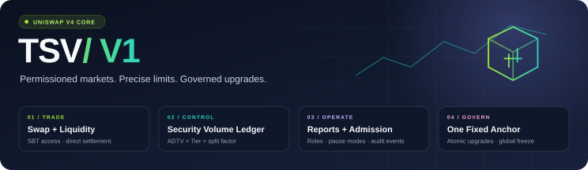
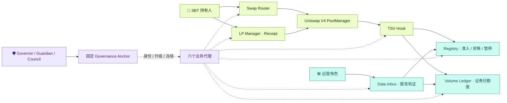

<div align="center">

Registry 与单池 Wrapped Swap 已采用 W／U／原币报价 Q 模型；[当前实现与验收](docs/PERMISSIONED_REGISTRY_V1.md)说明 ABI 和只读验证库链接。用户收付 U/Q，生产 Wrapped LP 待独立交付。



# TSV V1 · 证券交易合约

**交易有资格 · 成交有额度 · 升级有治理**


[📖 系统总览](docs/SYSTEMS_OVERVIEW.md) · [⚡ 快速启动](#quick-start) · [构建与验证](#tests) · [🗺️ 文档导航](#docs)

</div>

---

TSV 是基于 **Uniswap V4** 的证券交易合约系统。它把持证资格、证券级成交额度、运营报告和升级治理接入 Swap：池内使用原版 PermissionsAdapter W 与报价 Q，用户收付 U/Q，真实成交按 U 的法律股数记账，同一证券的所有 W/池共享日额度。

当前代码位于 [`src/v1/`](src/v1/)，目标链为 **X Layer / 196**。当前 Wrapped Swap 使用真实本地 PM 和原版 Factory/W 验证，尚未广播生产部署；生产发行方、SBT 与 Wrapped LP 条件见[当前交付边界](docs/PERMISSIONED_REGISTRY_V1.md)和[市场开通流程](docs/OPENING_A_STOCK_MARKET_V1.md)。

## ✨ 能做什么

| 系统 | 核心能力 | 关键规则 |
| :--- | :--- | :--- |
| 🔄 **交易** | 单 W/Q 池、U↔Q 双向 exact-input / exact-output | 真实用户 SBT；精确 wrap/unwrap；回调与策略快照绑定；失败回滚；external Adapter 拒绝 |
| 💧 **流动性** | 生产 Wrapped LP 待交付；旧 LP 源码保留 | 历史 Swap 测试使用真实 W/PM seed helper 准备流动性；测试已移除 |
| 📊 **额度** | 证券级共享日额度、自动日切、可选 quota、拆并股系数 | 上月日均 ADTV × Tier rate × 系数；拆并股只在未来计量日开始生效 |
| 🛠️ **运营** | 原子证券准入、报告提交、资产/池状态、范围与模式暂停 | 专职角色直接提交；报告去重与顺序校验；TRADE / LP / ALL 分别控制 |
| 🛡️ **治理** | 固定 Anchor、单笔或原子批量升级、全局升级冻结、身份恢复 | Governor 升级；Guardian 关闭全部升级入口；Council 提案 + 当前 Guardian 批准恢复 |

## 🧭 一张图认识系统



六个业务代理是 **Registry、VolumeLedger、DataInbox、Hook、SwapRouter、LPManager**。固定 Anchor 保存治理身份与升级开关；具体权限、交互和入口参数见[三系统总览](docs/SYSTEMS_OVERVIEW.md)。

<a id="quick-start"></a>

## ⚡ 快速启动

需要已安装 **Foundry** 和 Git。初始化私有 SBT 子模块需要对应 GitLab 仓库的访问权限。

```sh
# 初始化仓库固定的外部子模块
# 已初始化的工作区可直接进入下面的构建和检查
git submodule update --init --recursive

# 安装 foundry.toml 中锁定的 OpenZeppelin 依赖
forge soldeer install

# 检查格式和 diff
make check

# 构建合约
make build
```

编译配置：**Solidity 0.8.26 · Cancun · via-IR · optimizer 200 runs**，以 [`foundry.toml`](foundry.toml) 为准。首次完整 via-IR 编译耗时较长；后续会复用缓存。

## 📐 每日额度怎么算

```text
硬上限 = floor(上月日均成交量 × tierBps × 拆并股分子 / (10,000 × 拆并股分母))
有效上限 = 有 quota 覆盖 ? min(硬上限, quota) : 硬上限
剩余额度 = max(0, 有效上限 − 当日已用量)
```

例如 ADTV 为 **1,000 股**，Tier 为 **25 bps**，每日硬上限为 **2.5 股**。提前排期一拆二后，指定未来计量日开始时变为 **5 股**；无需激活交易，也不等待 Token 更新。新日独立累计，旧日用量保留。

- **精确比例：**一拆二为 `2/1`，五合一为 `1/5`；同月连续一拆二、再一拆三，上报累计系数 `6/1`。
- **排期规则：**由 `VOLUME_ORACLE_ROLE` 提交 `SplitFactorReport`，只能选择未来计量日开始；最新未生效项可更正或取消。
- **月度基准：**报告服务固定 ADTV 的来源月月末股数单位，新月数据已体现的事件不再重复乘入；quota 是目标日绝对覆盖值。
- **成交计股：**每笔仍由实时 Adapter 换算。额度排期不替代发行方单位核定或异常监控。

准确 ABI、舍入、版本与存储规则见[编码规格 §7](docs/CODING_SPEC_V1.md#7-角色报告计量日和额度)，公司行动步骤见[准入标准 §4](docs/TOKEN_ADMISSION_STANDARD_V1.md#4-公司行动与数据单位)。

<a id="tests"></a>

## 构建与验证

TSV 当前及归档测试已移除。文档中的历史测试结果仅代表对应版本，不代表当前代码的回归验证。

```sh
make build
make check
```

## 🗂️ 项目地图

```text
src/v1/
├── core/          Registry · DataInbox · VolumeLedger · V4 Hook
├── periphery/     Swap Router · LP Manager / Receipt
├── governance/    固定 Anchor · 共用治理与 UUPS 权限
├── adapters/      法律股数直接换算
├── deployment/    ERC-1967 Proxy · CREATE2 Hook Factory
├── libraries/     结算 · 日切 · 报告验证
├── types/         请求、配置与报告
└── interfaces/    合约边界

docs/                     规范、操作步骤、覆盖与验收记录
lib/dexrouter-interfaces/ 可提交的薄 ABI；无需完整 DEX 源码即可运行 fork
```

<a id="docs"></a>

## 🗺️ 文档导航

| 你想做的事 | 从这里开始 |
| :--- | :--- |
| 🧠 了解三个系统和角色 | [三系统总览](docs/SYSTEMS_OVERVIEW.md) · [架构决策](docs/CONTRACT_ARCHITECTURE.md) |
| 🧩 查看接口和算法 | [编码规格](docs/CODING_SPEC_V1.md) |
| 🏦 准入资产、核定法律股数 | [代币准入标准](docs/TOKEN_ADMISSION_STANDARD_V1.md) |
| 🚀 开通一只股票市场 | [Opening a Stock Market](docs/OPENING_A_STOCK_MARKET_V1.md) |
| 🔌 接入外部 DEX | [DEX Router / Adapter 接入](docs/EXTERNAL_DEX_ROUTER_ADAPTER_TSV_INTEGRATION.md) |
| 🧪 查看历史测试规格 | [测试规格](docs/TEST_SPEC_V1.md) |
| 📋 评估当前完整度 | [实现状态](docs/IMPLEMENTATION_STATUS_V1.md) · [统一缺口](docs/TEST_GAPS_V1.md) |
| 📦 部署或执行治理操作 | [部署清单](docs/DEPLOYMENT_CHECKLIST_V1.md) · [Manifest 模板](docs/DEPLOYMENT_MANIFEST_V1.example.json) |

完整索引见 [`docs/README.md`](docs/README.md)。历史评审与审计按日期归档在 [`docs/reviews/`](docs/reviews/)，当前规则以源码和权威规格为准。

---

<div align="center">

**从一笔 Swap，到一份日账，再到一次升级。**<br>
交易、运营、治理各有入口，共同守住资金、额度与权限。

</div>
