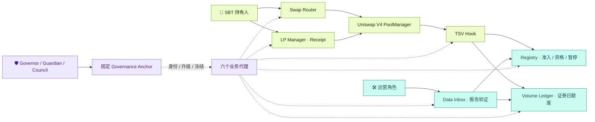

<div align="center">


# TSV V1 · 证券交易合约

**交易有资格 · 成交有额度 · 升级有治理**


[📖 系统总览](docs/SYSTEMS_OVERVIEW.md) · [⚡ 快速启动](#quick-start) · [🧪 测试](#tests) · [🗺️ 文档导航](#docs)

</div>

---

TSV 是基于 **Uniswap V4** 的证券交易合约系统。它把持证资格、证券级成交额度、运营报告和升级治理接入真实 Swap 与 LP 流程：用户收付池内 Currency，实际成交按法律股数记账，同一证券的所有池共享日额度。

当前代码位于 [`src/v1/`](src/v1/)，目标链为 **X Layer / 196**。本仓库已有本地与固定区块 fork 验证，尚未广播生产部署；发布条件见[实现状态](docs/IMPLEMENTATION_STATUS_V1.md)与[部署清单](docs/DEPLOYMENT_CHECKLIST_V1.md)。

## ✨ 能做什么

| 系统 | 核心能力 | 关键规则 |
| :--- | :--- | :--- |
| 🔄 **交易** | 股票/报价币池、双向 exact-input / exact-output、白名单 Adapter 接入 | 共用 SBT 资格门禁；按实际 V4 delta 直接结算与计股；失败整笔回滚 |
| 💧 **流动性** | 开仓、加仓、减仓、领费、关仓、授权强退 | Receipt 不可转让；仓位 owner 固定；退出资产交付原 owner；LP 不占成交额度 |
| 📊 **额度** | 证券级共享日额度、自动日切、可选 quota、拆并股系数 | 上月日均 ADTV × Tier rate × 系数；拆并股只在未来计量日开始生效 |
| 🛠️ **运营** | 原子证券准入、报告提交、资产/池状态、范围与模式暂停 | 专职角色直接提交；报告去重与顺序校验；TRADE / LP / ALL 分别控制 |
| 🛡️ **治理** | 固定 Anchor、单笔或原子批量升级、全局升级冻结、身份恢复 | Governor 升级；Guardian 关闭全部升级入口；Council 提案 + 当前 Guardian 批准恢复 |

## 🧭 一张图认识系统



六个业务代理是 **Registry、VolumeLedger、DataInbox、Hook、SwapRouter、LPManager**。固定 Anchor 保存治理身份与升级开关；具体权限、交互和入口参数见[三系统总览](docs/SYSTEMS_OVERVIEW.md)。

<a id="quick-start"></a>

## ⚡ 快速启动

需要已安装 **Foundry** 和 Git。初始化私有 SBT 子模块需要对应 GitLab 仓库的访问权限。

```sh
# 初始化仓库固定的外部子模块
# 已初始化的工作区可直接进入下面的检查和测试
git submodule update --init --recursive

# 安装 foundry.toml 中锁定的 OpenZeppelin 依赖
forge soldeer install

# 检查格式、测试目录规则和 diff
make check

# 全部不联网测试
make test
```

编译配置：**Solidity 0.8.26 · Cancun · via-IR · optimizer 200 runs**，以 [`foundry.toml`](foundry.toml) 为准。首次完整 via-IR 编译耗时较长；后续会复用缓存。

## 📐 每日额度怎么算

```text
硬上限 = floor(上月日均成交量 × tierBps × 拆并股分子 / (10,000 × 拆并股分母))
有效上限 = 有 quota 覆盖 ? min(硬上限, quota) : 硬上限
剩余额度 = max(0, 有效上限 − 当日已用量)
```

例如 ADTV 为 **1,000 股**，Tier 为 **25 bps**，每日硬上限为 **2.5 股**。提前排期一拆二后，指定未来计量日开始时变为 **5 股**；无需激活交易，也不等待 Token 更新。新日独立累计，旧日用量保留。

- **精确比例：**一拆二为 `2/1`，五合一为 `1/5`；同月连续一拆二、再一拆三，上报累计系数 `6/1`。
- **排期规则：**由 `VOLUME_ORACLE_ROLE` 提交 `SplitFactorReport`，只能选择未来计量日开始；最新未生效项可更正或取消。
- **月度基准：**报告服务固定 ADTV 的来源月月末股数单位，新月数据已体现的事件不再重复乘入；quota 是目标日绝对覆盖值。
- **成交计股：**每笔仍由实时 Adapter 换算。额度排期不替代发行方单位核定或异常监控。

准确 ABI、舍入、版本与存储规则见[编码规格 §7](docs/CODING_SPEC_V1.md#7-角色报告计量日和额度)，公司行动步骤见[准入标准 §4](docs/TOKEN_ADMISSION_STANDARD_V1.md#4-公司行动与数据单位)。

<a id="tests"></a>

## 🧪 测试与验证

2026-10-04，固定 seed `0x20261004` 的验证结果：

| 验证范围 | 通过数 | 失败 / 跳过 |
| :--- | ---: | :--- |
| 单元测试 | **237** | 0 / 0 |
| 真实本地 V4 集成 | **132** | 0 / 0 |
| X Layer 固定区块 fork | **11** | 0 / 0 |

本地共 **369 项 / 63 个套件**，另有 **11 项 fork**；独立插桩运行也通过全部 369 项。七项 invariant 覆盖治理、交易/LP 和运营模型，默认每项 64 轮 × 32 步；普通 fuzz 256 次。

| 想验证什么 | 命令 |
| :--- | :--- |
| 全部本地用例 | `make test` |
| 治理与恢复 | `make test-governance` |
| Swap / LP | `make test-trading` / `make test-liquidity` |
| 注册、报告和运营 | `make test-operations` |
| 独立状态模型 | `make test-invariants` |
| X Layer 固定区块 DEX 流程 | `make test-xlayer` |
| 插桩覆盖率 | `make coverage` |

复现拆并股专项与运营模型：

```sh
forge test --match-contract 'TSV(SplitFactor.*|StatefulOperations)Test' --fuzz-seed 0x20261004
```

X Layer fork 固定 **chainId 196 / block 72,271,000**，调用 DexRouter `0x7c5bee2a8091c3ef39072f64f18fac913060aeaf`，验证双向、拆单、多跳、退款、身份传递、失败回滚及 LP 生命周期。默认使用公开 archive RPC，可通过 `XLAYER_RPC_URL` 环境变量覆盖，运行方法见[fork 说明](test/integration/xlayer/README.md)。

Fork 中 DEX 与授权组件为真实链上实例，TSV/V4 新部署，股票/Wrapped/SBT 为行为 mock，DEX Adapter 为测试实现。真实资产、生产 SBT、多签、正式 Adapter、链下报告/索引服务和生产 gas 仍需各自验收。业务覆盖与剩余工作见[覆盖矩阵](docs/TEST_COVERAGE_V1.md)、[统一缺口清单](docs/TEST_GAPS_V1.md)。

## 🗂️ 项目地图

```text
src/v1/
├── core/          Registry · DataInbox · VolumeLedger · V4 Hook
├── periphery/     Swap Router · LP Manager / Receipt
├── governance/    固定 Anchor · 共用治理与 UUPS 权限
├── adapters/      法律股数直接换算
├── deployment/    ERC-1967 Proxy · CREATE2 Hook Factory
├── libraries/     结算 · 日切 · 报告验证
├── types/         请求、配置与报告
├── interfaces/    合约边界
└── legacy/        隔离的历史结算参考

test/
├── helpers/v1/            无可执行用例的 fixture · 独立状态模型
├── unit/v1/               按治理 / 交易 / 注册 / 报告分类
├── integration/local/    真实 V4 + 行为 mock 的交易、LP、运营与升级
└── integration/xlayer/   固定区块真实 DEX 完整流程

script/                   部署、只读验证、测试目录检查
docs/                     规范、操作步骤、覆盖与验收记录
lib/dexrouter-interfaces/ 可提交的薄 ABI；无需完整 DEX 源码即可运行 fork
```

<a id="docs"></a>

## 🗺️ 文档导航

| 你想做的事 | 从这里开始 |
| :--- | :--- |
| 🧠 了解三个系统和角色 | [三系统总览](docs/SYSTEMS_OVERVIEW.md) · [架构决策](docs/CONTRACT_ARCHITECTURE.md) |
| 🧩 查看接口和算法 | [编码规格](docs/CODING_SPEC_V1.md) |
| 🏦 准入资产、核定法律股数 | [代币准入标准](docs/TOKEN_ADMISSION_STANDARD_V1.md) |
| 🚀 开通一只股票市场 | [Opening a Stock Market](docs/OPENING_A_STOCK_MARKET_V1.md) |
| 🔌 接入外部 DEX | [DEX Router / Adapter 接入](docs/EXTERNAL_DEX_ROUTER_ADAPTER_TSV_INTEGRATION.md) |
| 🧪 编写和维护测试 | [测试说明](test/README.md) · [测试规格](docs/TEST_SPEC_V1.md) |
| 📋 评估当前完整度 | [实现状态](docs/IMPLEMENTATION_STATUS_V1.md) · [统一缺口](docs/TEST_GAPS_V1.md) |
| 📦 部署或执行治理操作 | [部署清单](docs/DEPLOYMENT_CHECKLIST_V1.md) · [Manifest 模板](docs/DEPLOYMENT_MANIFEST_V1.example.json) |

完整索引见 [`docs/README.md`](docs/README.md)。历史评审与审计按日期归档在 [`docs/reviews/`](docs/reviews/)，当前规则以源码和权威规格为准。

---

<div align="center">

**从一笔 Swap，到一份日账，再到一次升级。**<br>
交易、运营、治理各有入口，共同守住资金、额度与权限。

</div>
