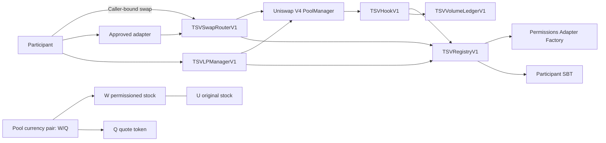

# TSV V1

TSV V1 is a Solidity protocol that gates Uniswap V4 stock pools by participant credentials, issuer permissions, pool lifecycle and per-security daily volume quotas. The implementation lives in [`src/v1/`](src/v1/). This README describes that code; design proposals and dated review reports are indexed separately in [`docs/README.md`](docs/README.md).

## Current asset and contract model

TSV uses three asset identities:

| Symbol | Meaning | On-chain role |
| --- | --- | --- |
| **W** | Issuer permissioned stock adapter created by the configured Permissions Adapter Factory | Stock currency held by a V4 pool |
| **U** | Original stock token wrapped by W | User-facing settlement and canonical legal-share conversion input |
| **Q** | Registered quote ERC-20 | Quote currency held by the pool and used for user settlement |

Every registered pool is a single **W/Q** V4 pool with exactly one registered stock side and one registered quote side. The Router accepts exact-input requests. On the stock side, the user pays or receives U while the PoolManager settles W through the issuer adapter; Q remains the quote settlement asset. The Registry ties every W for one U to a single security ID and legal-share adapter, so all pools for that security consume the same daily quota.



The code has five TSV business contracts: `TSVRegistryV1`, `TSVVolumeLedgerV1`, `TSVHookV1`, `TSVSwapRouterV1`, and `TSVLPManagerV1`. There is no DataInbox or Governance Anchor in the current source tree. Operators call Registry and Ledger role-gated setters directly; upgrades use UUPS authorization checked against roles held by the Registry.

## What the contracts enforce

- **Admission:** the Registry verifies W provenance and metadata against the configured Factory, binds W to U and a security, validates the legal-share adapter, and separately registers Q. A pool can only be registered through the LP Manager and must contain one W and one Q.
- **Participant access:** the Registry combines permissions from the participant's registered SBT identities. The Router requires `SWAP_ALLOWED`; ordinary position actions require `LIQUIDITY_ALLOWED` for both executor and position owner. W also applies its issuer-side `swappingEnabled` and allowlist checks.
- **Swap execution:** participants can call the Router's caller-bound exact-input entry point, or an approved adapter can call an adapter entry point. The caller-bound path uses the caller as participant, payer, and recipient; both paths retain SBT, issuer, pool, pause, and quota checks. The requested input must be fully spent and the minimum output must be met.
- **Volume limits:** `setQuota` writes absolute WAD values by security and fixed EST epoch day. A missing quota is zero, so a positive-volume swap needs a quota set for the current day. `setUsedWad` is an explicit correction and may lower usage, set it to zero, or set it above quota; later swaps enforce the resulting quota.
- **LP positions:** the LP Manager registers and initializes pools, processes supported position actions, and maintains an NFT count per pool. The two delta-funded mint/increase actions are rejected. `withdrawClaim` is disabled. Forced exits are full-position operations and can fail if token delivery is rejected or the PoolManager delta exceeds its `int128` range.
- **Pauses:** security pause mode is assigned as a final `NONE`, `TRADE`, `LP`, or `ALL` value. Pool lifecycle is `LIST`, `PAUSE`, or `DELIST`. A separate global emergency pause blocks execution paths; `isTradable` and `isLPAllowed` do not include that global flag.

See [`docs/SYSTEMS_OVERVIEW.md`](docs/SYSTEMS_OVERVIEW.md) for call flows and role boundaries and [`docs/CODING_SPEC_V1.md`](docs/CODING_SPEC_V1.md) for current public interfaces and state rules.

## Build and test

Requirements: Python 3.11+, Foundry (validated with 1.7.1), Git submodules, and network access for dependency installation. All submodules use public HTTPS repositories. SBT, issuer checkers and DEX adapters are external contracts; no private implementation checkout is required.

```sh
git submodule update --init --recursive
forge soldeer install
make build
make check
make test
make artifacts-check
```

The compiler configuration is Solidity 0.8.26, Cancun, via-IR, and optimizer runs 200, as set in [`foundry.toml`](foundry.toml). The default test profile runs unit tests and local PoolManager integrations; it excludes `test/integration/xlayer/`, which currently contains no executable fork tests.

Useful focused commands:

```sh
make test-unit
make test-local
make test-governance
make test-trading
make test-liquidity
make test-operations
make test-invariants
make coverage
```

The executable test architecture, fixture boundaries, and current test assumptions are in [`test/README.md`](test/README.md). Local tests use mocks for issuer, SBT, and some external dependencies; they do not establish production-token or deployment acceptance.

## Repository map

```text
src/v1/core/          Registry, Hook, and Volume Ledger
src/v1/periphery/     Swap Router and LP Manager
src/v1/governance/    Shared AccessControl and UUPS authorization base
src/v1/adapters/      ERC-8056 direct legal-share converter
src/v1/libraries/     Admission, settlement, and LP action logic
src/v1/deployment/    ERC-1967 proxy and CREATE2 Hook proxy factory
src/v1/types/         Pool, asset, pause, identity, and request types
test/unit/            Contract-level tests
test/integration/     Local integration and X Layer test configuration
docs/                 Current code guide and explicitly labeled historical designs
```

## Documentation

- [System overview](docs/SYSTEMS_OVERVIEW.md) — components, execution paths, access control, quotas, and pauses.
- [Contract architecture](docs/CONTRACT_ARCHITECTURE.md) — code boundaries, design choices, and external risk assumptions.
- [Coding specification](docs/CODING_SPEC_V1.md) — current interfaces and behavior derived from `src/v1/`.
- [Registry and W/U/Q admission](docs/PERMISSIONED_REGISTRY_V1.md) — asset and pool admission details.
- [Token admission standard](docs/TOKEN_ADMISSION_STANDARD_V1.md) — on-chain checks and off-chain review requirements.
- [Backend integration guide](docs/BACKEND_INTEGRATION_GUIDE_V1.md) — Router, LP Manager, and Ledger calls.
- [Deployment checklist](docs/DEPLOYMENT_CHECKLIST_V1.md) — required configuration and explicit deployment gaps.
- [Test guide](test/README.md) — suites, commands, fixtures, and coverage limits.
- [Full documentation index](docs/README.md) — current references versus design and audit archives.

## Deployment boundary

Public preproduction and production address inventories are maintained in [`deployment/`](deployment/README.md), with successful deployment evidence in [`docs/deployments/`](docs/deployments/tsv-mcp/README.md). These historical records do not mean that current main is the deployed implementation. `test/integration/xlayer/` has no executable fork suite. Production Factory, PoolManager, SBT, issuer tokens, roles, and transfers must be verified on the target deployment; local mocks are not evidence of those external systems.

## License

First-party TSV code is intended to use BUSL-1.1. The [LICENSE](LICENSE) Parameters are an explicitly unfinished draft pending the rights holder, additional grant, change date and conversion license. Complete them before publication. Third-party licenses remain unchanged; see [licensing status](LICENSING.md) and [third-party notices](THIRD_PARTY_NOTICES.md).

## External contracts

This repository does not distribute private SBT or DEX-adapter implementations. Integration scripts use the public ABI boundary and deployment-configured addresses. The incomplete standalone Securitize checker copy is not included; issuers may supply an existing checker implementing `IAllowlistChecker`. Deployment addresses must be independently verified, and this repository's tests do not audit those external implementations.
