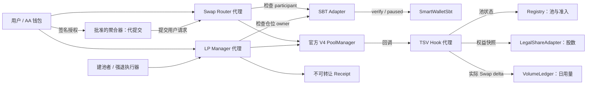
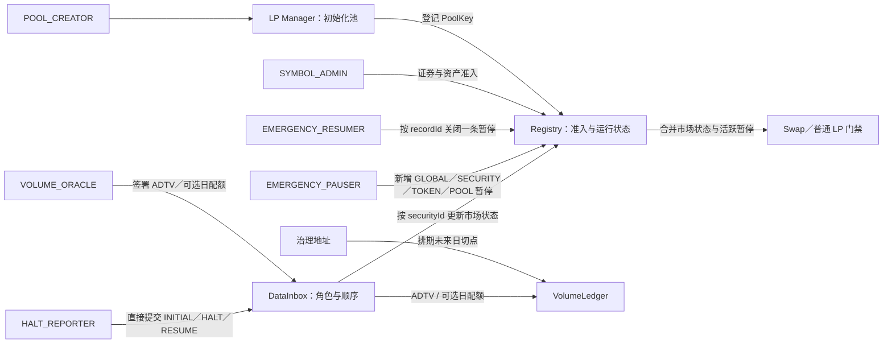
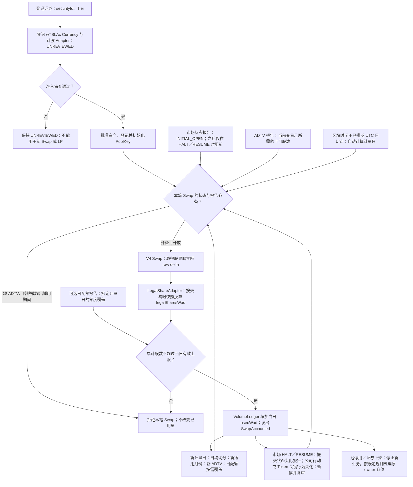
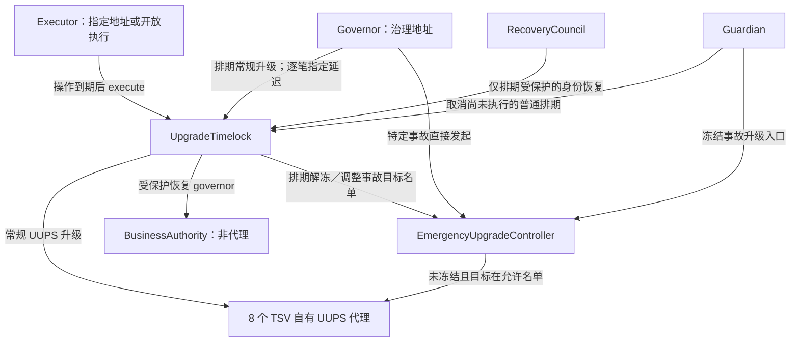

# TSV Uniswap V4 合约代码架构设计

状态：**目标架构；本地标准 ERC8056 直接动态计量路径已实现，生产 wTSLAx 仍需外部准入证据**；准入以[新版准入标准](./TOKEN_ADMISSION_STANDARD_V1.md)为准。V1 新 Swap/LP **只直接收付池内 Currency**；Tesla 池的唯一用户收付资产是 wTSLAx，TSLAx 不经 TSV 同笔包装/赎回。源码仍保留 `IssuerShareSettlementAdapter` 供旧单元测试和负向兼容对照，但 Registry 不接受该旧用户结算组合。本部署没有旧仓位或旧账本迁移问题。  
依据：[TSV 合约系统 PRD 0.2](https://okg-block.sg.larksuite.com/docx/NsW1dF4VjoLRIyxJCALlGRVNg9f)  
目标链：X Layer，chainId 196  
范围：链上合约、关键链下服务接口、部署与治理边界；本文解释设计依据，V1 具体 ABI、字段、签名和状态规则以[编码规格](./CODING_SPEC_V1.md)为准。当前实现位于 `src/v1/`。

## 0. 决策记录与阅读方式

| 编号 | 决策 | 状态 | 对架构的影响 |
| --- | --- | --- | --- |
| D-01 | 已创建池的 Hook 保持原地址并可升级逻辑 | 已确认，2026-09-29 问答 | 使用地址权限位固定的代理；常规升级经 Timelock，特定事故可走 D-12 的即时路径 |
| D-02 | 本部署的交易额度覆盖同一 Registry 下全部池 | 已确认，2026-09-29 问答 | 一个共享日成交账本在链上原子聚合，无跨链证明组件 |
| D-03 | 禁止股票 Currency / 股票 Currency 币对 | 用户最新修订，2026-09-30；取代早期双股票池决定 | Registry 在 `registerPendingPool` 拒绝 `securityId0 != 0 && securityId1 != 0`；无需双股票池运行期或旧仓位迁移路径 |
| D-04 | V1 股票输入侧按含费总支出、输出侧按净到账占用日额度 | 用户已选定技术/业务计量方案；法律口径待书面确认 | 直接按 V4 `afterSwap` 实际 delta 逐笔计量；准入池一次 Swap 最多一侧为股票；法务批准仍是上线门禁 |
| D-05 | Token 拒绝向原 LPOwner 转账时采用方案 A | 已确认，2026-09-29 问答 | V1 整笔回滚、链下告警、协调发行方解除限制后原路重试；无备用收款人 |
| D-06 | 本部署仅有一个 TSV 交易平台 | 已澄清，2026-09-29 | 不设置多个 venueId；全部池共用一份场所日配额 |
| D-07 | 24 小时允许交易 | 已确认，2026-09-29 问答；原 SIP 日切分方式由 D-34 取代 | 不以美股常规交易时段作为额外门禁 |
| D-09 | 不在 PoolConfig 中保存 venueId | 已据 D-06 修订 | PoolId 只表示 V4 池；一个平台内所有池统一累计 |
| D-10 | 旧方案：休市期间计入下一个 SIP 交易日 | **已由 D-34 取代** | 新规则下没有周末或例行休市归属；所有计量日独立累计，仍保留人工暂停 |
| D-11 | 建池初始价格由 POOL_CREATOR 自行提交 | 已按最新指示修改，2026-09-29 | 不设治理价格审批或链上容忍区间；合约校验 V4 价格范围并记录提交事实 |
| D-12 | 特定事故允许治理多签即时升级 | 已确认，2026-09-29 问答 | 治理多签经限定目标的事故升级控制器调用 UUPS 代理，留下事故与代码摘要；不等待 Timelock |
| D-13 | 常规升级的延迟在每次排期时指定，不设最小或最大时长 | 已按最新指示修订，2026-09-29 | `TSVUpgradeTimelock` 的 OZ 最小延迟固定为 0，禁用 `updateDelay`；每笔升级由 proposer 传入自己的 `delaySeconds`，允许 0 |
| D-14 | Timelock 延迟仅约束常规合约升级 | 已确认，2026-09-29 问答 | 使用专用 UpgradeTimelock；业务角色和参数由治理多签直接管理，升级授权配置仍属升级治理域 |
| D-15 | 设置独立 Guardian 即时冻结事故升级入口 | 已确认，2026-09-29 问答 | Guardian 可单方面冻结；解除冻结与 Guardian 轮换走 UpgradeTimelock，常规升级不因冻结自动失败 |
| D-16 | 授予 Guardian UpgradeTimelock 的 `CANCELLER_ROLE` | 已确认，2026-09-29 问答 | Guardian 可取消普通升级治理排期；自定义 Timelock 禁止取消受保护的权限恢复排期 |
| D-17 | 独立 RecoveryCouncil 负责受保护的治理权限恢复 | 已由用户授权设计决策，2026-09-29 | 自行指定恢复排期延迟后原子轮换治理多签/Guardian 及业务治理根地址；Guardian 不可取消此类恢复，RecoveryCouncil 不可提议普通升级 |
| D-18 | 业务管理员采用共享的非代理权限根 | 依据用户授权的设计决策，2026-09-29 | 业务合约动态读取 `TSVBusinessAuthority.governor()`；旧多签在受保护恢复执行后同时失去全部业务合约的管理员身份，日常业务操作仍可由多签直接即时提交 |
| D-19 | 主市场停牌状态仅在变化时上链 | 已确认，2026-09-29 问答 | 标的登记时建立初始状态，此后 HALT/RESUME 等变化才提交；不发送定时链上心跳，不设 HALT 状态年龄超时 |
| D-20 | 入池 Currency 必须 raw 余额稳定、转账双方 raw 差额精确；AutoFee Rebase 原币不得直接入池 | 原决策按新版准入标准精确定义，2026-09-30 | 普通 ERC-20、raw 稳定的 UI Multiplier 原币、经验证的发行方 Wrapped 均逐实例审查；股数比例是否动态另行判断，现有代码尚未支持全部组合 |
| D-21 | V1 LP 仓位开放时流动性必须为正 | 依据 V4 源码评审修订 | 部分减仓保留正流动性；全额减仓走 close/forceExit，同笔结算本金和费用并销毁 Receipt |
| D-22 | 拒绝 100% 费率与零输出 Swap | 依据 V4 源码评审修订 | V1 仅允许静态费率且小于 1,000,000 pips；Router 与 Hook 拒绝实际任一侧为零的成交 |
| D-23 | ADTV 与配额无变化时不定时重报 | 已确认，2026-09-29 问答；日配额跨日必报的旧规则由 D-33 取代 | 新适用月份仍提交 ADTV；配额只在指定 TSV 计量日需要覆盖硬上限时提交，日内更正提高版本；已接受数据不按年龄自动失效 |
| D-24 | TSLAx 以源码计算的显示数量计股：1 个完整显示 TSLAx 对应 1 股，权益随 multiplier 变化 | 用户已确认 V1 业务计量，2026-09-30；监管口径仍需发行方/法务书面批准 | 使用版本化 `LegalShareAdapter` 在成交时快照换算；缺少实际代理验证或书面依据时资产不得启用 |
| D-25 | 旧方案：TSLAx 原币同笔包装/赎回作为用户结算路径 | **已由 D-31 新决定取代** | V1 新 Swap/LP 不再经 TSV 收付 TSLAx；旧 Adapter 仅保留为源码和隔离回归对照，本部署没有旧仓位迁移路径 |
| D-26 | V1 不自建 Wrapped | 已确认，2026-09-30 问答 | `balanceOf()` 会自行变化的 Rebase 原币不直接入池；发行方稳定 Wrapped 可作为用户与池共同使用的 Currency，raw 稳定的 UI Multiplier 原币可另行审查 |
| D-27 | 旧 TSLAx 用户路径的显示数量无需严格相等 | **已由 D-31 取代** | 目标新交易只提交 wTSLAx raw 限额；前端股数显示为报价，Hook 仍按实际 V4 delta 计股。旧显示边界仅存在于历史源码对照 |
| D-28 | 结算准入与股数计量独立判断 | 按最新单一路径规则修订，2026-09-30 | raw 稳定且精确转账的 Currency 直接进入 V4；权益系数可由股数 Adapter 动态读取。TSLAx Rebase 原币不参加 TSV 结算 |
| D-30 | V1 每笔 Swap 只经过一个池，报告接受后不按时间自动过期 | 用户确认单池，2026-09-30；无心跳要求据 D-23 固化 | 固定单 PoolKey 的 Router 授权和执行上下文；报告以月份/计量日适用，`submitDeadline` 只限制迟到报告上链 |
| D-31 | V1 每侧只直接收付该侧 PoolKey Currency；Tesla 池只收付 wTSLAx | 用户最新修正，2026-09-30；本地直接动态路径已实现，生产 wTSLAx 待外部证据 | 一个 wTSLAx Currency、一个 Tesla `securityId`、一个动态计股 Adapter；不登记额外 TSLAx 路径、不签路径选择、不为新 LP 保存路径字段；TSLAx 原币包装/赎回由用户在 TSV 外办理 |
| D-32 | Hook 代理地址预留全部 V4 回调与返回 delta 权限 | 用户选择的部署前扩展策略；V1 非零 delta 未启用 | 低 14 位设为 `0x3FFF`；现版四类 delta 均返回零，donate 回滚。未来非零 delta 须同版重做最终结算、成交量口径和 Hook 自身清算，不能只替换 Hook 实现 |
| D-33 | 单个计量日的场所配额报告改为可选覆盖 | 用户确认，2026-09-30；已按 D-33 编码 | 适用 ADTV 与 Tier 算出硬上限；当日无配额覆盖时使用硬上限，有覆盖时取两者较小值；SET/CLEAR 不跨日继承 |
| D-34 | 每个 UTC 日期都有独立的 TSV 计量日；UTC 起点可配置，并可仅对未来计量日排期变更 | 用户修订，2026-09-30；已按 D-34 编码 | 由区块时间和起点配置确定 `tradeDayId`，不再提交 TradeDayReport／日历窗口；旧 D-10 和日历前置条件失效。一次起点变更必然产生长于或短于 24 小时的过渡日，具体切换约束见编码规格 §7 |
| D-35 | Timelock、BusinessAuthority、事故控制器保持非代理；治理根换址采用独立受限迁移 | 用户同意原则，2026-09-30；**目标方案，当前代码未实现** | 八个业务代理改为读取固定 GovernanceAnchor 的当前治理地址；迁移只更新治理地址组，不提供任意实现升级或任意调用。RecoveryCouncil 提议、Guardian 独立批准；双身份与新合约一致性校验后原子切换 |
| D-36 | Registry 不再单独登记静态计股比例；股票 Currency 绑定经审查的双向 LegalShareAdapter | 用户提出，2026-09-30；**ERC8056 本地路径已编码，通用发行方路径仍待实现/审查** | Adapter 按同一交易时快照实现 raw→法定股数及带边界语义的反向换算；Registry 绑定资产、证券、Adapter 地址/版本、代码与权益依据，不把某个比例字段当成完整公式。实际成交只按 V4 delta 正向计股；拆股可切换整版计股策略或同一 Adapter 的参数/rate epoch，并对齐额度报告口径。同一 securityId 的不同 Token 可以在不同时间读取新参数，交易事件记录各自 snapshot/rateId，运营负责日账分段；只有参数/法律映射无法验证时暂停 |

本文区分三类内容：**PRD 已定**、**本设计建议**、**待确认**。待确认项不得被部署脚本偷偷填成默认值；ABI 和代码验收以[编码规格](./CODING_SPEC_V1.md)与[测试规格](./TEST_SPEC_V1.md)为准。

### 0.1 venue 是什么

这里的 **venue（交易场所）** 是 PRD 中 `venueDailyQuota` 的配额归属单位，指本 TSV 交易平台，不是 Uniswap V4 原生字段，也不是一个池。已确认本部署只有一个 TSV 平台、多个 PoolKey，因此合约不需要 `venueId`：同一证券在全部池、全部映射 Token 上的成功成交累计为一份 `usedWad[securityId][tradeDayId]`。按 D-33 目标规则，它始终受 ADTV/Tier 硬上限约束；仅当该日另有有效配额覆盖时再受该覆盖值约束。此选择改变了原先每日必须下发场所配额的要求，生产启用前仍须确认业务/法务口径。

若集团未来另有独立 TSV 平台，本部署只能验证自己的额度和成交。跨平台配额总和由链下集团分配服务负责并留存可审计记录；要在链上原子约束多个平台，须另行设计共享账本及授权边界。

## 1. 不可变的系统边界

1. 池状态和资金最终结算在 X Layer 官方 `PoolManager`；TSV 不部署替代 PoolManager。官方部署页目前列出的地址为 `0x360e68faccca8ca495c1b759fd9eee466db9fb32`。部署脚本仍须核对 chainId、链上代码、目标 core 版本和官方清单。
2. 所有 TSV 池的 `PoolKey.hooks` 指向同一受控 Hook 代理。`PoolId` 是 `PoolKey` 的哈希，不存在独立的 V4 池合约地址。对外披露“池地址”时应明确给出 PoolManager 地址、PoolId 和 PoolKey，不能把 PoolId 伪称为合约地址。
3. TSV 仅能约束**使用 TSV Hook 的池**。同一 Token 的普通转账、其他 Hook 的池、其他协议的成交不受本系统控制；Token 发行方限制和集团外交易监控属于另外的控制面。
4. Swap 与所有用户 LP 操作使用同一个 `SmartWalletSbt` tokenId；参与地址可以是 EOA 或 ERC-1271 AA 钱包。AA 合约钱包取得该 ERC-1155 SBT 还须支持 `onERC1155Received`，否则发行方 `issue/claim` 会回滚。用户操作时同时检查 `verify(owner, tokenId)` 和 SBT `paused()`。
5. Swap 的 `participant = payer = recipient`。只有用户本人直接调用，或经过已批准 Adapter 且具有效签名时才可执行。Adapter 仍调用 TSV Router。
6. 任意有效 GLOBAL、SECURITY、TOKEN、POOL 暂停时，匹配池的 Swap 和全部用户 LP 操作拒绝。链上主市场 HALT 状态持续生效，直到收到有效 RESUME；适用 ADTV 缺失只阻止 Swap，未提交可选日配额不阻止 Swap。授权强退独立鉴权；池初始化仅走 `POOL_CREATOR`，不读取 SBT，也不因 TSV 暂停失败。
7. Hook 对 PoolManager 的回调只能接受官方 PoolManager。`sender` 必须是被批准且地址稳定的 TSV Router 或 LP Manager；用户地址不得仅靠任意 `hookData` 声明。
8. TSV 核心使用与本仓库 V4 Core 一致的 Solidity 0.8.26 编译单元；SmartWalletSbt 源码要求 ^0.8.29，Backed 源码要求精确 0.8.9。TSV 只通过本项目编译版本兼容的薄接口连接它们的已部署合约，不把三套实现源码直接导入同一个编译单元。

## 2. 系统架构：三个视角

### 2.1 交易与计量

Router 和 LP Manager 直接以获准的 raw 稳定 Currency 与用户和 PoolManager 结算；只有 **Swap** 的 Hook 回调写入成交量，LP 资金变化不计量。Tesla 实例的用户和池都使用 wTSLAx，见[TSLAx 实例](./TSLAX_INTEGRATION.md)。

### 2.2 运营和日常

`Registry` 是全部 TSV 池的唯一注册源；`VolumeLedger` 是同一 Registry 下全部池共享的成交账本，按 `securityId/tradeDayId` 原子聚合。LP Manager 在登记获准 PoolKey 后调用官方 PoolManager 初始化池。

| 日常运营身份 | 入口与行为 | 权限边界 |
| --- | --- | --- |
| `SYMBOL_ADMIN` | 登记／重上架／下架证券，登记或停用 Token、池，调整证券 Tier，并按准入流程更换 Adapter | 不设置 Tier 政策比例，不提交市场或成交量报告；受资产状态和已有仓位约束 |
| `POOL_CREATOR` | 经 LP Manager 登记获准 PoolKey 并调用官方 PoolManager 初始化池，提交初始价格及依据摘要 | 不能绕过 Token 准入、Hook 地址、费率和双股票池禁令；不是普通用户 Swap／LP 身份 |
| `HALT_REPORTER` | 直接调用 `DataInbox.submitMarketStatus` 提交市场状态报告。初次为 `INITIAL_OPEN` 或 `INITIAL_HALTED`，此后仅在状态变化时提交 `HALT`／`RESUME` | `msg.sender` 必须直接持有该角色；只控制该证券的市场状态，不能新增或清除紧急暂停。没有周末或日常收市报告 |
| `VOLUME_ORACLE` | 直接调用 `DataInbox.submitAdtv`、`submitAdtvBatch` 和 `submitQuota` 提交月度 ADTV 与指定 TSV 计量日的可选配额覆盖报告；更正须提高版本和序号 | `msg.sender` 必须直接持有该角色；不能改 `usedWad`、标的准入、市场状态或日切配置。日切由 Ledger 按 UTC 和治理排期自动计算，不需要日历报告 |
| `EMERGENCY_PAUSER` | 直接调用 `Registry.addEmergencyPause(scope,target,reasonCode,sourceHash)`；范围为 `GLOBAL`、`SECURITY`、池内 `TOKEN` 或 `POOL`，成功后生成独立 `recordId` 并立即生效 | 只能新增暂停，不能解除；同一目标可有多条活跃记录 |
| `EMERGENCY_RESUMER` | 直接调用 `Registry.clearEmergencyPause(recordId,reasonCode)`，关闭指定活跃记录并减少该范围的活跃计数 | 不能新增暂停、不能一笔清除其他记录，也不能将证券从 `HALTED` 改为 `OPEN` |
| `REVOKE_EXIT_EXECUTOR` | 对当前已失去共用 SBT 资格的原 owner，逐仓位调用 `LPManager.forceExit` | 不能强退仍有资格的 owner；不能更改资产接收人 |
| `FORCE_EXIT_ADMIN` | 对任意仍开放且有流动性的仓位，凭原因码和证据摘要调用 `LPManager.forceExit` | 只能全额退出并向仓位原 owner 交付，不能指定其他接收人或直接提取池资产 |

紧急暂停的 `target` 编码为：`GLOBAL` 使用零值，`SECURITY` 使用 `securityId`，`TOKEN` 使用池内 Currency 地址左填充为 `bytes32`，`POOL` 使用 `PoolId`。Tesla 池的 `TOKEN` 暂停目标是 wTSLAx，而非不经 TSV 收付的 TSLAx；需要停掉该证券全部池时使用 `SECURITY`。`Registry.isTradable` 同时检查市场状态和四级紧急暂停；命中任一项即拒绝相关池的 Swap 与普通用户 LP 操作。`RESUME` 不清除紧急暂停，关闭暂停记录也不改变 `HALTED` 市场状态。授权强退仍走独立路径。表中的运营与数据身份各按独立地址配置，业务 Governor 可授予或撤销角色；`VOLUME_ORACLE` 必须由持有该角色的地址直接提交报告。Guardian 冻结事故**升级**入口，不代替这些运营暂停。入口及状态规则见[暂停与停牌 §6](#6-暂停与停牌)。

#### 单只证券的准入与报告生命周期

以下以 Tesla 证券及 wTSLAx Currency 为例；新仓位只直接收付 wTSLAx。生产实例仍须通过发行方逐实例审查后才能批准。

目标规则下，ADTV 在同一适用月份内不变时无须定时重报；新适用月份仍须提交对应报告。日配额只在某个计量日需要低于硬上限的覆盖时提交，同日更正需新版本；未提交则当日使用硬上限。计量日从区块时间自动计算，不需要日历报告。缺适用 ADTV 阻止 Swap；缺日配额不阻止 Swap；这些数据缺失本身不阻止用户 LP。市场停牌、资产或池停用则阻止新 Swap 和用户 LP。LP 增减仓不计入 `usedWad`，既有仓位的授权强退遵守 §7.1–7.2 的独立规则。当前角色报告字段及目标变更见[编码规格 §7](./CODING_SPEC_V1.md#7-角色报告计量日和额度)。

### 2.3 治理与升级

下图表示当前已实现的治理调用路径；D-35 的治理根换址目标在本节下方单独说明。

**可升级范围。**下列 8 个 TSV 自有合约的实现均继承 `TSVGoverned`，通过固定地址的 `TSVERC1967Proxy` 运行；升级只替换代理指向的实现，不重新创建代理，也不改变已有 PoolKey 中的 Hook 地址。

| UUPS 代理 | 升级时重点保留或核对的状态 |
| --- | --- |
| `TSVHook` | 最终代理地址的 `0x3FFF` V4 权限位、全部回调 ABI、PoolManager/Registry/Ledger/Router/LP Manager 绑定、Swap 计量与强退回调 |
| `TSVRegistry` | 证券／Token／PoolKey 登记、市场状态、紧急暂停记录与活跃计数、角色授权 |
| `TSVVolumeLedger` | 历史和当日 `usedWad`、ADTV、可选配额及 UTC 日切检查点；公司行动涉及单位变化时仍须依未冻结的 D-36 规则处理 |
| `TSVDataInbox` | 已使用的 `reportId`、来源序号和来源时间戳；报告由 `msg.sender` 角色直接授权，不保存报告 EIP-712 域或签名版本 |
| `TSVSwapRouter` | 用户 nonce、签名域、聚合器允许名单、payer／recipient 绑定和结算规则 |
| `TSVLPManager` | 已有仓位、原 owner、PoolKey、流动性、原资产交付路径与强退可达性 |
| `TSVReceipt` | tokenId 与仓位一一对应、owner、不可转让语义及仅 LP Manager 可 mint／burn |
| `TSVSBTAdapter` | SBT 地址、共用 tokenId、资格和 SBT 暂停的读取规则 |

**两条升级路径覆盖同一类 UUPS 代理，但授权流程不同。**常规路径由 Governor 向 UpgradeTimelock 排期，逐笔指定 `delaySeconds`；到期后由有权限的 Executor 提交**完全相同的排期调用**，Timelock 再调用目标代理的 `upgradeToAndCall`。即使延迟为 0，排期和执行仍是两笔交易。Guardian 可以在普通操作执行前取消。事故路径由 Governor 直接调用未冻结的 EmergencyUpgradeController，控制器只对已列入允许名单的代理转发 `upgradeToAndCall`，并记录事故、旧／新实现与代码哈希；代理没有入名单时不能走此路径。两个路径最终都经过代理的 UUPS 升级授权，升级后沿用原地址和存储；都须审查实现代码、存储布局、接口兼容及本表的不变量。一次升级涉及多个相互调用的代理时，还须规定版本兼容矩阵、升级顺序与中间状态，不能假定多笔交易自动原子完成。

**不走这两条升级路径。**`TSVBusinessAuthority`、`TSVUpgradeTimelock`、`TSVEmergencyUpgradeController` 和 Hook CREATE2 工厂是非代理合约；`TSVERC1967Proxy` 的代理壳代码固定，只有其指向的业务实现可按上述路径升级。`LegalShareAdapter` 与发行方结算 Adapter 当前也是非代理实例，若需更换应走 Registry 的版本化 Adapter 替换与相关资产暂停／审查流程，而非对原地址 UUPS 升级；固定比例变化还受[公司行动缺口](./STATIC_RATIO_CORPORATE_ACTION_GAP.md)约束。官方 V4 PoolManager、发行方股票 Token／Wrapped 和发行方 SBT 不受 TSV 升级治理控制。Governor 的普通业务参数与角色操作不经过 UpgradeTimelock；Guardian 只冻结事故升级入口，RecoveryCouncil 只排期受保护的治理身份恢复。详细权限和事故条件见 §9。

**治理合约地址迁移尚未实现。**当前 `TSVBusinessAuthority` 与事故控制器的 `upgradeTimelock` 是不可变地址；八个业务代理的 `upgradeTimelock`／`emergencyUpgradeController` 在初始化后没有更换入口。RecoveryCouncil 只能恢复 Governor／Guardian，不能替换 Timelock、BusinessAuthority 或控制器。因此“为某业务代理换实现”和“为全系统换治理基础合约”不是同一流程；后者须另行设计跨合约迁移、权限切换与既有仓位保障，不能仅对旧 Timelock 排期一笔调用就宣称完成。

**D-35 治理根换址目标。**生产部署前增设固定地址、非代理的 `TSVGovernanceAnchor`；八个业务代理仅保存该 Anchor 地址，动态读取当前 `BusinessAuthority`、`UpgradeTimelock` 和事故控制器。Anchor 保存同一组当前治理合约地址、当前 Guardian、固定 RecoveryCouncil 和迁移 epoch。业务管理员检查和 `_authorizeUpgrade` 均以这组当前地址为准，不能保留旧地址旁路。替换治理合约只切换 Anchor 中的一组指针，不升级 Anchor 自身，也不修改八个代理的地址、PoolKey、成交账本、签名 nonce 或 LP 仓位。

RecoveryCouncil 向 Anchor 提议**精确的新三地址组**，绑定当前迁移 epoch、Guardian 轮换序号、提案唯一 ID 与证据摘要；当前 Guardian 对同一提案独立批准；两项授权齐备后，任何地址可执行一次原子切换。Guardian 可在执行前撤回自己的批准，Council 可撤销自己的提案。Governor、旧 Timelock 和旧事故控制器均无权单独切换 Anchor。执行前 Anchor 核对新合约均有代码、互异、与自身绑定关系一致：新 Timelock 已绑定新 BusinessAuthority／事故控制器；三者报告相同的新 Governor，Timelock／控制器报告当前 Guardian，Timelock 报告固定 RecoveryCouncil；BusinessAuthority／控制器的不可变 Timelock 均指向新 Timelock；新控制器处于冻结状态，且已预先批准全部八个业务代理为升级目标。新 Timelock 的 proposer、canceller、Council executor 和自管理权限须与清单一致。任一核对失败则整笔回滚，epoch 不变；成功后旧 Timelock／控制器立即失去八个代理的升级调用权，旧 BusinessAuthority 不再决定业务管理员。旧合约内的待执行操作不会自动转移；新地址组应在切换前部署、审查和配置完成。

Guardian 的常规受保护轮换仍由当前 Timelock 完成，但须在同一 `recoverAuthorities` 交易中同步 Anchor 的当前 Guardian 并递增轮换序号；Anchor 只接受当前 Timelock 在受保护恢复上下文中的该调用。否则旧 Guardian 会保留根换址批准权。迁移提案按迁移 epoch 和 Guardian 轮换序号失效。Anchor 本身不提供任意调用、任意实现升级或单地址热替换入口；Council 与 Guardian 联合选择新 Governor 和新治理合约具有最高治理权，代码哈希、配置和证据仍须独立审查。两者同时失联或 Anchor 自身故障时，本方案没有链上恢复入口。**当前 Solidity 仍直接保存三地址，D-35 还需实现 Anchor、代理读取改造和迁移状态机；在这些改造完成前，不得把根换址列为已支持功能。**

合约职责如下。D-02 不要求把所有状态塞进一个 Solidity 合约，只要求所有池指向同一组可信实例，且账本对同一 `securityId/tradeDayId` 原子聚合。

| 合约 | 持久状态 | 唯一写入者/核心职责 |
| --- | --- | --- |
| `TSVRegistry` | security、Tier、Token 准入、PoolKey、池状态、暂停记录、角色/地址配置 | 治理与授权运营；提供 `requirePoolForSwap/LP/Initialize` 等策略视图 |
| `TSVVolumeLedger` | 月度 ADTV、交易日、本平台配额、security/day 成交量 | 数据入口更新参数；仅 Hook 在 `afterSwap` 增加成交量 |
| `TSVDataInbox` | 数据源角色授权、reportId 去重、序号/时间戳 | 按 `msg.sender` 角色检查后调用 Registry/VolumeLedger；HALT 与 VOLUME 权限分离 |
| `TSVHook` | 极少量配置状态；固定 `PoolManager/Registry/Ledger/Router/LPManager` 地址 | `before*` 拦截与 `afterSwap` 实际成交记账 |
| `LegalShareAdapter` | 每资产固定或版本化的权益换算配置；动态实例读取发行方链上状态 | 把池内 Currency 数量转换为交易时法定股数；只读、不可由用户选择，公式更新先暂停相关池 |
| `TSVSwapRouter` | 签名 nonce、执行上下文 | 用户授权、exact-in/out、直接 Currency 转账、PoolManager `unlock`、结算与成交事件 |
| `TSVLPManager` | 独立仓位账本、owner 索引、强退上下文 | PoolManager `initialize/modifyLiquidity`、直接 Currency 交付、强退、费用、原子结算 |
| `TSVReceipt` | 不可转让 ERC-721 凭证 | 只允许 LP Manager mint/burn；`tokenId = positionId` |
| `TSVSBTAdapter` | 当前 SBT proxy 与共用 tokenId、配置版本 | 读取 `paused()` 和 `verify()`；读失败 fail-closed；治理多签统一迁移凭证配置 |
| `TSVBusinessAuthority` | 当前治理多签地址、固定 UpgradeTimelock 地址 | 非代理权限根；全部业务合约动态查询同一 governor；仅受保护恢复可轮换地址，不代执行日常业务调用 |
| `TSVUpgradeTimelock` | 已排期操作及各自执行时间、受保护恢复操作 ID、proposer/executor/canceller 角色 | 常规升级及升级授权配置逐笔指定延迟；无全局延迟下限或上限；Guardian 可取消普通排期，RecoveryCouncil 的权限恢复排期不可由 Guardian 取消 |
| `TSVEmergencyUpgradeController` | 治理多签、Guardian、代理允许名单、冻结状态、已用升级行动 ID | 多签仅可在未冻结时事故升级；Guardian 仅可冻结；解冻与角色轮换仅由 UpgradeTimelock 执行 |
| `TSVERC1967Proxy` | ERC-1967 实现槽及 TSV 业务状态 | 代理地址稳定；固定 `tsvImplementation()` 查询实现，业务调用委托给 UUPS 实现 |

股票 Token 由发行方提供，不属于 TSV 核心系统的必选发行组件。第三方股票 Token 必须经单独兼容审查；raw 余额稳定且精确转账的资产可直接接入，raw 余额会自行变化的资产仅可经合格发行方 Wrapped 接入。权益显示变化与 raw 余额变化须分别判断。

## 3. PoolKey、标的与 Token 数据模型

### 3.1 标的身份

`securityId` 是不可变的底层证券主键，不直接依赖可变 ticker 文本；`symbolHash`、主挂牌交易所代码、显示 ticker 和外部标的映射以事件及链下元数据呈现。每个 Token 地址最多映射一个 `securityId`，多个 Token 可以映射同一个 `securityId`。同一标的的所有池、所有 Token 共享计数和配额。

拟议 `SecurityConfig`：`securityId`、`symbolHash`、`tierId`、`listingStatus`、`activePoolCount`、`registrationVersion`。Tier 1/2 名额计数按已上线底层证券计算，注册或 Tier 迁移先检查目标上限，再原子修改计数。只有该标的全部池停用后才允许 `delistSecurity` 释放名额；重新启用时重新占用名额。Tier 更改不清除当日成交量。

当前 `TokenConfig` 以 `poolCurrency` 地址为主键，却同时保存 `userToken`、`settlementMode`、`settlementAdapter` 与静态股数比例；这些是**旧实现字段**。目标 V1 每侧只直接收付该侧 Currency，因此无需按 `(poolCurrency,userToken)` 登记多条结算路径：若保留 `userToken` 字段，必须等于 `poolCurrency`；若保留 `settlementMode`，只能是 `DIRECT_ERC20`；`settlementAdapter` 必须为零。Registry 对股票 Currency 保存 `securityId`、静态/动态计股模式、已批准 `LegalShareAdapter`、版本、代码和权益依据；D-36 目标不再保存第二份静态比例。完整准入规则见[代币准入标准](./TOKEN_ADMISSION_STANDARD_V1.md)。

| 资产实例 | 目标用户与池内 Currency | 股数 Adapter | 当前代码差异 |
| --- | --- | --- | --- |
| Tesla xStock | 均为发行方 wTSLAx | 动态读取发行方获批权益公式 | 生产目标为 wTSLAx 直结；TSLAx 不作为 TSV 用户结算 Token，也不调用包装/赎回 Adapter。本地 ERC8056 fixture 用于同类动态计量路径 |
| 本地标准股票测试代币 `ERC8056TestToken`（测试符号 `STDx`） | 均为 `STDx` | `ERC8056LegalShareAdapter` 读取 `uiMultiplier()`，按当前快照将 raw delta 换算为法律股数；Registry 不保存静态比例 | 当前本地集成已覆盖双向 Swap、LP 加减仓和 multiplier 变化；该 Token 仅是测试夹具，不代表发行方法律公式 |
| 普通非股票配对币 | 同一个经批准的 ERC-20 地址 | 无，`securityId == 0` | 当前直接模式已有 |

发行方 Token 的 `decimals`、符号或代码哈希字段不能单独证明每币的法定股数、转账精确性或代理实现安全。Token 或其代理实现、制裁和暂停规则变化时由链下监控发现，再暂停相关新交易并复审；V1 不在链上检查发行方代理实现地址或 codehash。已有池的 Currency/证券身份不得原地改写。本部署没有旧 TSLAx 仓位迁移问题。

拟议 `PoolConfig` 保存完整 PoolKey 哈希、两侧 Token 的可选 `securityId`、状态、初始化标记和版本，不保存 venueId。建池先核对 `currency0 < currency1`、非零地址、两侧代码存在、Token 兼容、Hook 代理地址相等、重复池检查。V1 只开放静态 LP fee，要求 `0 <= fee < 1_000_000` pips、`1 <= tickSpacing <= 32767`；拒绝动态费率哨兵值和 100% LP fee。普通配对资产仍须准入。**两侧 `securityId` 不能同时非零**；Registry 在待初始化池登记时拒绝所有双股票币对。此为建池约束，不设计历史双股票池的运行期处理。

V4 `PoolId = keccak256(abi.encode(PoolKey))`，PoolKey 只由两侧 Currency、fee、tickSpacing 和 Hook 组成。一个平台内可以有多个不同 PoolKey；同一 PoolKey 只能初始化一次。所有池的成交按底层 securityId 进入共享账本。

建池初始 `sqrtPriceX96` 由 `POOL_CREATOR` 自行提交。调用序列：`TSVLPManager.initializePool` 检查 `msg.sender` 持有 `POOL_CREATOR` 且价格处于 V4 允许范围 → `Registry.registerPendingPool` → `PoolManager.initialize` → Hook `beforeInitialize/afterInitialize` 验证 `sender == LPManager` 和精确 PoolKey → Registry 标记初始化成功。Registry 只允许 LP Manager 注册待初始化池，阻止其他地址提前占位。任一步回滚则整笔注册回滚。暂停状态、SBT 状态均不参与初始化检查。

Registry 不保存治理价格区间，也不对价格来源或偏离幅度做链上判断。`POOL_CREATOR` 对提交价格及 `currency1/currency0` 方向负责；提交参数建议附带可审计的价格依据哈希，但它只用于追溯，不构成链上价格校验。`PoolInitialized` 事件记录 PoolId、实际 `sqrtPriceX96`、操作者和依据哈希。池已初始化后不得再次初始化或修改初始价格。由于初始报价直接影响第一笔交易的执行价格，POOL_CREATOR 的操作流程需在上线配置中明确。

### 3.2 发行方 Token 兼容边界

`lib/TestToken/backed-token-contract` 是独立的发行方协议，不由 TSV 治理升级。V1 对实际 V4 `Currency` 的准入按下表处理；地址、实现、制裁名单和参数均以拟上市的**实际部署实例**为准，不仅依据源码文件名判断。

raw 余额稳定且转账精确的股票 Token 满足 `userToken == poolCurrency` 时，可由 Router/LP Manager 直接结算；它的权益系数仍可动态变化，由独立的股数 Adapter 计量。**Tesla 池只直接收付发行方 wTSLAx**；TSLAx 原币的 `balanceOf()` 会自行变化，既不能直接入池，也不作为 TSV 用户 Token。用户如需包装或赎回，在 TSV 之外使用发行方流程。完整门槛见[代币准入标准](./TOKEN_ADMISSION_STANDARD_V1.md)。

| 发行方 Token 类型 | V1 作为池内 Currency | 技术依据与条件 |
| --- | --- | --- |
| 固定余额的 `BackedTokenImplementation` 或等效标准 ERC-20 | 条件允许 | `balanceOf` 稳定、转账数量精确；仍须核验暂停、制裁名单、代理实现和每 Token 对应的法定股数 |
| raw 稳定的 UI Multiplier 股票原币 | 条件允许 | `balanceOf()` 不随展示系数自行变化，转账双方 raw 差额精确；本地 `ERC8056TestToken + ERC8056LegalShareAdapter` 已验证技术路径，真实发行方仍须审查动态法定股数公式及公司行动流程 |
| `BackedAutoFeeTokenImplementation` 原币 | 禁止 | `balanceOf` 受 multiplier/自动费率影响；`transfer(amount)` 向下取整为内部 shares，可能成功却未足额改变余额；PoolManager 持仓余额会漂移 |
| 经验证的 `WrappedBackedTokenImplementation` | 条件允许 | 包装 Token 的 ERC-20 余额单位稳定；须核验其底层 AutoFee 地址、制裁限制，以及交易时包装份额到法定股数的**可验证动态映射**；用户与池都直接收付 Wrapped |
| 其他 fee-on-transfer、rebasing、冻结余额或到账数量不确定的 Token | 禁止 | V4 `sync/settle/take` 和 TSV 精确交付检查要求转入、转出数量可靠 |

每个已登记股票 Currency 必须绑定经审查的 `LegalShareAdapter`。固定比例由 `StaticLegalShareAdapter` 的不可变参数计算 `ceil(rawAmount * numerator / denominator)`；`TokenConfig.sharesPerWholeTokenWad` 和 `ratioEvidenceHash` 仅为兼容保留字段，Registry 不将它们作为第二份比例来源。D-36 目标由 Adapter 同时提供正向计股与有边界定义的反向 raw 估算。Wrapped 的法定股数可随底层 multiplier 变化，Adapter 必须从发行方认可、交易时可在链上复算的状态和有版本的公式计算，不能把当前 `convertToAssets` 估算或用户传入数字自动视作法律权益。不同 Currency 即使映射同一 `securityId` 也分别绑定 Adapter，再汇入同一日账本。Wrapper 的 ERC-20 单位、底层 AutoFee 显示余额与法定股数是三个不同概念；发行方须定义两者的关系、最小股单位及舍入。如果权益只有按账户余额舍入的定义，单凭 Swap 份额数量无法得出唯一的逐笔股数，或者无法给出可验证的反向边界，该资产不得按此接口准入。Adapter 公式/版本变化时先暂停相关池、登记新版本和生效依据，再恢复；公司行动只改变 multiplier 时可保留 Adapter 地址，Adapter 直接读取发行方当前参数和 nonce，不需要人工写入新比例，但必须按其可验证的生效边界归入参数/rate epoch，不能依赖未锁定的实时参数跨日混用；链上可确定的普通 multiplier 变化按交易时快照计量，历史累计量不重算。通用规则见[代币准入标准](./TOKEN_ADMISSION_STANDARD_V1.md)，Tesla 实例见[TSLAx/wTSLAx 接入规格](./TSLAX_INTEGRATION.md)。

Wrapped Token 的转账可能实时读取底层制裁名单。准入时须逐项验证用户、Router/LP Manager、PoolManager 和 LP owner 之间的 wTSLAx 直接入金/出金，记录发行方代理实现、管理员、制裁及暂停规则；每次转账须核对发送方和接收方 raw 差额。发行方若拒绝向 owner 转出 wTSLAx，§7.2 的方案 A 仍会整体回滚；准入检查不能保证未来永久可退出。发行方代理升级由链下监控发现，链上不做实现地址或 codehash 检查；监控告警后由运营暂停并重新审查。TSLAx 原币的包装/赎回能力属于 TSV 外流程，不构成目标合约的收付边界。

## 4. 身份、签名和入口控制

### 4.1 SBT

`TSVSBTAdapter.isEligible(owner)` 必须执行 `!paused() && verify(owner, configuredTokenId)`，捕获 SBT 外部读异常后拒绝。`hasCredential(owner)` 只读取当前凭证，不把 SBT 暂停解释为撤销。LP 自动强退复核“该 owner 曾有仓位且当前凭证缺失”；单纯 SBT `paused()` 不触发退出。SBT 重新签发早于强退执行时，自动强退任务应复核并取消；管理员独立强退仍由独立权限控制。

AA 钱包作为 SBT 持有人还必须能够接收 ERC-1155 单件铸造：发行方 `issue/claim` 会调用钱包的 `onERC1155Received`，且返回值须为标准 selector。部署前用实际钱包实现与发行方 SBT 代理确认领证可达性；仅支持 ERC-1271 签名不能证明可以领证。不能领证的钱包不得进入当前资格路径，需先由发行方提供受支持的领证方式。

SBT 地址、tokenId 在上线清单中固定。变更 SBT 地址或 tokenId 等同资格体系迁移；由治理多签通过共享 `TSVSBTAdapter` 的单一配置入口直接执行，须完成迁移检查并记录新旧配置与依据哈希。Router 与 LP Manager 始终读取同一 Adapter，避免分笔修改时读到不同凭证。事故即时升级亦须保留相同的迁移不变量。SBT 的 `verify()` 本身不会因 `paused()` 返回 false，因此必须显式检查暂停。

### 4.2 Swap 授权

| 入口 | TSV 对调用者的要求 | TSV 对 `participant` 的身份与签名要求 |
| --- | --- | --- |
| EOA 或 AA 钱包直接调用 | `msg.sender == participant`，`authorizedCaller == 0` | 实时检查该地址 SBT 有效且未暂停；TSV 签名参数必须为空。AA 钱包内部的 UserOperation/所有者授权由钱包自身验证 |
| 白名单聚合器代提交 | `msg.sender == authorizedCaller`，且该地址在 Router 白名单 | 同样实时检查 **participant** 的 SBT；验证 participant 对完整 EIP-712 请求的签名：EOA 用 ECDSA，AA 钱包用 ERC-1271 |

EIP-712 域固定 `name = TSVSwapRouter`、`version = 2`、当前 `chainId` 和 Router **代理地址**。签名绑定 `participant/payer/recipient/authorizedCaller`、完整 PoolKey 推得的 `poolId`、方向、exact-in/out、数量和价格边界、两侧资产份额/显示数量界限、nonce 和 deadline；nonce 按 participant 记录，成功或主动取消后不能重用。ERC-1271 钱包可在执行时按自己的规则验证或拒绝签名，TSV 不假定某个 EOA 是其固定 owner。无论哪种入口，V1 强制 `participant == payer == recipient`。

**Swap 授权与 Token 支付授权分开。**EIP-712 签名允许 Router 按请求执行，不会自动产生 ERC-20 allowance；参与者仍需预先授权 Router 支付池内 Currency。AA 钱包可自行批处理授权与交易，但 TSV V1 不提供通用 permit 入口。

`authorizedCaller` 仅是代提交入口，不是用户资产接收人；聚合器自身持证不能代替未持证 participant 通过 SBT 校验。完整 `SwapAuthorization` 字段顺序以[编码规格 §5](./CODING_SPEC_V1.md)为准。若聚合器以自己的持证地址作为 participant 买入资产，再在 TSV 之外转给第三人，TSV 只识别该聚合器为本笔交易者；最终受益人的限制需依赖发行方 Token 转账规则和平台外的合规控制。

Router 在 `unlock` 前建立经过自身验证的操作上下文；Hook 仅信任 Router 地址，并校验 `hookData` 中的操作标识与 Router 上下文相符。V1 一次 unlock 只执行一个 PoolId 的一次 `swap`；多跳/批量不属于 V1。禁止把外部调用者提供的 `participant` 原样当作已验证身份。

## 5. Swap 执行与结算

V1 外部入口 `swapExactInput(request, participantSignature)` 和 `swapExactOutput(request, participantSignature)` 使用单池 `SwapRequest`，用 `exactInput` 明确金额方向。目标所有资产都以池内 Currency 的 raw 数量交易；Tesla 池的数量单位是 **wTSLAx ERC-20 raw**。前端可按发行方权益公式显示预估股数；目标保留现有签名结构，但旧 `AssetBounds` 全为零，不绑定 TSLAx 底层显示余额边界，并将 Router EIP-712 域版本升为 `"2"`。exact-in 为负，exact-out 为正。必须检查整数范围、非零金额、`sqrtPriceLimitX96`、deadline 和完整 PoolKey；实际输入与输出都须严格大于零。ABI 与升级签名规则见[编码规格 §5](./CODING_SPEC_V1.md)。

1. Router 校验 SBT、participant/payer/recipient、签名/nonce、Pool 配置、暂停和数据健康。
2. Router 调用 `PoolManager.unlock`，仅接受 PoolManager 进入 `unlockCallback`，回调数据与已建立上下文哈希一致。
3. 回调内调用 `PoolManager.swap`。`beforeSwap` 验证 `sender == Router`、池仍有效、所有适用暂停与数据状态，并取得已登记 LegalShareAdapter 的交易时快照；`afterSwap` 读取实际 `BalanceDelta`，先拒绝任一腿零数量，再对每个股票 Currency 按同一快照计算法定股数并调用共享 VolumeLedger。任何超额立即 revert，PoolManager swap 与此前同交易内的配额增量一起回滚。
4. Router 根据 PoolManager 返回的实际 delta 再次要求 `actualIn > 0 && actualOut > 0`；exact-in 检查 `actualOut >= minOut`、`actualIn <= specifiedIn`，允许满足下限的部分成交；exact-out 检查 `actualOut == specifiedOut`、`actualIn <= maxIn`。价格边界导致 exact-out 部分成交时必须拒绝。
5. 对实际负 delta，从 payer 直接拉取该侧 Currency，调用 `sync/settle` 向 PoolManager 精确清偿；对实际正 delta，调用 `take` 将同一 Currency 直接交给 recipient。wTSLAx 与普通 ERC-20 均走这一流程，Router 不调用发行方包装/赎回 Adapter。当前代码核对发送方恰扣、PoolManager 余额变化、接收方恰增及 `settle()` 清偿值；故障转账差额会使整笔交易回滚，见[准入标准 §2](./TOKEN_ADMISSION_STANDARD_V1.md)。
6. 发出本次单池实际成交事件：`operationId`、participant、PoolId、方向、两侧实际原始单位数量、tradeDayId、成交块时间。链下再与 PoolManager `Swap` 日志关联价格；交易哈希和 logIndex 由索引器取得。

当前 V4 core 的 `afterSwap` 参数 `delta` 是 Hook 自身返回值影响 PoolManager 最终 caller delta **之前**的实际 Swap delta。V1 虽已在代理地址预留返回 delta 权限，但四类返回值均为零，因此当前可用该值统计股数。未来若任一返回值非零，Router 最终收付、Hook 自身欠款和 Ledger 的 SEC 股数口径都可能改变，须整体升级和复核，不能只替换 Hook 实现；也不得让 Hook 自调用 PoolManager 绕过回调。`take/settle` 不触发 swap hook，不能记成证券成交。

所有准入 ERC-20 Currency（包括 wTSLAx）都按同一 raw 结算规则：转账前后核对发送方和接收方 `balanceOf` 差额，`settle()` 返回值与欠款相等，`take()` 后用户实收与账面输出相等；差额不一致即回滚。V1 不允许原生币 `Currency.wrap(address(0))`，也不允许以 ERC-6909 claim 代替实际交付。Router、LP Manager 不暴露任意 calldata 转发、任意 `unlock` 脚本或可由用户指定的 `take` 收款人；外部 Token 调用期间保持非重入和精确操作上下文。

### 5.1 股数和额度

对已登记股票 Currency，Hook 在 `beforeSwap` 读取 Registry 绑定的 Adapter 和交易时权益快照，在 `afterSwap` 将 `abs(stockDeltaRaw)` 交给同版本 Adapter，得到 `legalSharesWad` 与可审计的舍入信息。静态模式仍为 `ceil(rawAmount * sharesPerWholeTokenWad / 10^decimals)`；动态模式按发行方已确认的链上公式和当前 multiplier 计算。`decimals <= 18` 只是池内 Currency 的 V1 兼容边界，不等于一 Token 一股。成交及 Router 最终结算前须复核快照版本/数值没有在本交易中变化；若不一致整笔回滚。Adapter 不可由用户或 Router 临时选择。`dailyHardCapWad = floor(previousMonthAdtvWad * tierBps / 10_000)`。按 D-33 目标规则，`effectiveCapWad = min(dailyHardCapWad, 当日有效配额覆盖值)`；没有覆盖值时 `effectiveCapWad = dailyHardCapWad`。对 security/day，`newUsed = oldUsed + legalSharesWad`，要求 `newUsed <= effectiveCapWad`。由于建池禁止两侧均为股票，一个准入池每笔 Swap 至多产生一条股票计量；同一证券跨池、跨 Currency 仍汇入一份 `used`。Tier 变更或配额调低不减少既有 `used`，只限制后续交易。

**V1 已选定含费输入腿口径，法律口径仍待书面确认。**`afterSwap` 的 `BalanceDelta` 是 PoolManager caller 的实际余额变化；股票作为输入币时，其绝对值包含 LP fee 和协议费对应的总支出，作为输出币时是用户净收到量。池内最多一侧为股票，因此每笔按该股票腿的实际方向计量。`afterSwap` 单个 `BalanceDelta` 不提供可直接核验的净输入股数；若法务要求扣除手续费后才计算输入侧股数，须重新评审 V4 手续费拆分、Hook 数据与跨池汇总算法，在该口径获批前不得发布生产配置。

**前端股数展示与报价。**合约入口只接受 V4 Currency 的 raw 金额。前端读取 Registry 当前绑定的 Adapter、版本和快照，用 D-36 的正／反向只读方法在本地或 `eth_call` 中换算并展示账户权益和 raw 报价，再构造现有 raw `SwapRequest`、滑点界限与 deadline。V1 不新增股数输入合约入口或股数专用签名；Hook 仍仅对成功 Swap 的实际 V4 delta 正向计股并写入 VolumeLedger。前端查询“当前持有多少股”时还须核对发行方的**账户持仓权益**定义；逐笔成交换算 `toLegalShares(rawAmount)` 不必等于账户总余额的法律权益，尤其在 `balanceOfUI` 按账户舍入时。前端报价可过期，合约仅保证已签 raw 边界，不能把展示的股数称作链上保证的精确成交量。

所有同一 Registry 下的池引用同一 VolumeLedger。`usedWad[securityId][tradeDayId]` 跨 PoolKey、Token 地址和方向共享；本平台可按 `(securityId,tradeDayId)` 提交一份可选的 `venueDailyQuotaWad` 覆盖，**不另设 venue 子账**。提交时要求配额不高于当前硬上限；未提交不等于零额度。Router、Adapter、用户和 hookData 均不能自报 venue 身份。不得通过重新注册 PoolId、切换 Token 地址、反向成交或拆分 unlock 重置 `used`。

目标规则中，`tradeDayId` 是**计量周期开始时的 UTC 日期**，格式 `YYYYMMDD`。每个 UTC 日期都有一个独立的 TSV 计量日，周末与通常的休市日没有特殊归属。某日期 D 的开始时刻是 `D 00:00 UTC + dayStartOffsetSeconds(D)`；结束时刻是下一日期的开始时刻，区间左闭右开。例如设置为 `04:00 UTC`：`2026-10-01 04:00 UTC` 至 `2026-10-02 04:00 UTC` 的成交全部记为 `20261001`，其中 `2026-10-02 03:59:59 UTC` 也属于 `20261001`。没有日历报告、下一窗口或心跳交易。`VolumeLedger` 从 `block.timestamp` 与已生效的日切配置计算当前 ID；若缺适用 ADTV 则受影响证券 Swap 拒绝，未提交该日 quota 时使用硬上限。若需从第一笔交易起使用较低配额，应在该日开始前提交可选覆盖报告。LP 修改不增加 `used`。

这里重新定义的是 **TSV 成交量归属和日额度重置周期**。`AdtvReport` 中月度 ADTV 的来源统计方法仍需按批准的数据定义计算，不能仅凭日切算法推断；`MarketReport` 的 HALT 仍处理个别异常停牌，不代表周末或普通闭市。新规则与原 PRD 的 SIP 日口径不同，生产采用前须完成业务和法务口径签署。

治理地址可为尚未开始的日期 D 排期一个新 `dayStartOffsetSeconds`，仅从 D 的开始时刻生效；排期时 D 的**前一个计量日也必须尚未开始**，以保证没有已成交的周期被缩短或延长。初始起点可设为 UTC 日内任意秒，运行中每次变更幅度限于四小时。日期 D-1 是唯一过渡日，长度 `86400 + newOffsetSeconds - oldOffsetSeconds`，因此介于 20–28 小时；其后周期恢复严格 24 小时。例如从 04:00 改到 05:00 且 D 为 10 月 3 日，则 10 月 2 日的周期从 10 月 2 日 04:00 持续到 10 月 3 日 05:00，共 25 小时。变更按治理排期事件留痕，不需到点再发激活交易；治理只能在过渡日开始前取消待生效变更。历史计量日边界、`tradeDayId`、`usedWad` 和已成交日志不可改写。配额仍以日期 ID 为键，过渡日的较长或较短时长不按比例改变硬上限；运营方须在排期时复核该日和相邻日已签署的可选配额。

每个 `(securityId, tradeDayId)` 最多保存本平台一份当前有效的配额覆盖，值由 `QuotaReport` 指定，可在同日用递增版本更正。未设置时从 ADTV/Tier 动态计算硬上限；显式设置要求 `0 < quotaWad <=` 提交时的硬上限。恢复默认硬上限使用 `CLEAR` 动作，保留版本与审计记录；`quotaWad = 0` 不能表示暂停，需走独立紧急暂停。配额报告在当日中途提交只约束提交成功后的新 Swap，并与该 TSV 计量日已经累计的 `usedWad` 比较，不追溯撤销成交；如果新限额低于已用量，后续 Swap 拒绝。新计量日不会继承昨天的覆盖。若链下还需为其他关联平台分配额度，其配额总和检查由集团数据服务负责，本部署无法单独在链上证明。

ADTV 更正或 Tier 变更若降低当前硬上限至小于已提交的配额覆盖值，目标规则自动取两者较小值，不能因旧覆盖值较高而突破新硬上限；若硬上限升高，既有覆盖值仍继续限制，直至新的 SET 或 CLEAR 报告。ADTV 原始股数与来源月份单独存储，Tier 比例在计算有效日上限时读取当前批准的政策版本。若公司行动改变法定股数单位，不能仅对不同单位的值取最小值，必须先暂停并完成[准入标准 §4](./TOKEN_ADMISSION_STANDARD_V1.md#4-公司行动与数据单位)的单位对齐。所有 `recordSwap` 检查完成后再写入该证券的日用量；任一上限失败则整笔交易回滚。

## 6. 暂停与停牌

设计上维护两类互不覆盖的记录：主市场 `MarketHalt[securityId]`；运营紧急暂停 `EmergencyPause[recordId]`。每个标的从 `UNINITIALIZED` 开始，开放交易前由 HALT_REPORTER 提交一次签名的 `INITIAL_OPEN` 或 `INITIAL_HALTED`；之后只有状态变化才提交 HALT 或 RESUME，按同一 securityId 严格递增序号和来源时间处理。HALT 一直有效，直到收到有效 RESUME；不得因时间经过自动恢复，也不要求定时心跳交易。HALT_REPORTER 不具有紧急暂停的恢复权限。

紧急暂停由 `EMERGENCY_PAUSER` 只能**新增**记录，记录 scope、目标、原因码、来源哈希、操作者和时间。单独的 `EMERGENCY_RESUMER` 只能**关闭指定 recordId**，不能一次清掉目标上的所有暂停。每个 scope/目标维护活跃计数，策略读取为 O(1)；重复暂停互不覆盖。GLOBAL、securityId、Token0、Token1、PoolId 任何一个命中即拒绝 Swap 和用户 LP 操作。链上主市场 HALT 命中时阻止 Swap 和用户 LP；适用 ADTV 缺失只影响 Swap，可选 quota 缺失不影响 Swap。市场状态服务失联时，合约无法仅凭旧状态发现新的停牌；链下监控应告警，授权 `EMERGENCY_PAUSER` 可提交独立暂停记录。

`beforeInitialize` 只检查创建权限和准入，不调用运行期暂停策略。`beforeAddLiquidity`、`beforeRemoveLiquidity`（V4 `liquidityDelta == 0` 也走 remove 回调）检查运行期策略，强退上下文除外。`beforeSwap` 检查运行期策略。Hook 代理地址低 14 位固定为 `0x3FFF`：全部回调和返回 delta 权限位在建池前预留，因为既有 PoolKey 无法改 Hook 地址。**预留位不改变 V1 行为**：未使用的 afterAdd/afterRemove 回调只返回正确 selector 与零 delta，`beforeSwap/afterSwap` 返回零 delta；`beforeDonate/afterDonate` 均回滚，禁止捐赠。额外回调增加 LP 的外部调用与 gas；非零 delta 受 D-32 的整体升级门禁约束。部署时用本地 `Hooks.sol` 常量重新计算并核对位型。

Token 下架或 Pool 停用应阻止新交易和用户 LP 操作，同时保留已登记池的强退可达性。`isKnownPool` 与 `isTradablePool` 必须分开，避免下架使历史仓位无法取回。强退仍依赖底层 Token 的可转账性；Token 发行方冻结结算是合约无法单方面修复的外部故障。

## 7. LP 仓位与 Receipt

`TSVLPManager` 是 PoolManager 仓位调用主体。每个 TSV positionId 对应唯一 `(PoolId, tickLower, tickUpper, salt)`；`salt = hash(chainId, LPManager proxy, positionId)`，杜绝不同用户相同 tick 范围不可逆混合。仓位账本保留不可变 `owner`、PoolKey、salt 和创建版本，流动性为可变值。建立 `owner => activePositionIds` 可枚举索引，供撤销监控枚举；删除采用 swap-and-pop 并发事件，查询接口分页，避免链上全量循环。

`TSVReceipt` 是不可转让 ERC-721：一个仓位一个 tokenId；`transferFrom/safeTransferFrom/approve/setApprovalForAll` 均 revert，只有 LP Manager 可 mint/burn。用户操作必须同时要求 `msg.sender == ledger.owner` 和 `ownerOf(positionId) == ledger.owner`。Receipt 只是权益证明，PoolManager 的真实 owner 是 LP Manager；不可把 Receipt 当作官方 V4 PositionManager NFT。

拟议操作：

| 操作 | 校验 | PoolManager 动作 | 状态结果 |
| --- | --- | --- | --- |
| `openPosition` | owner SBT、池/Token、tick、deadline、双币最大支付、最小流动性 | 正 `liquidityDelta` | 结算成功后记账并 mint Receipt |
| `increaseLiquidity` | owner、Receipt、SBT、运行期策略、最大支付 | 正 delta，原 salt | 增加仓位流动性 |
| `decreaseLiquidity` | owner、Receipt、SBT、运行期策略、双币最小到账；减仓量小于当前流动性 | 负 delta，修改后流动性仍严格为正 | 领取本次本金和已累计费用，保持 OPEN |
| `collectFees` | owner、Receipt、SBT、运行期策略、最小到账；当前流动性严格为正 | 零 delta | 领取实际费用，不改本金和流动性 |
| `closePosition` | owner、Receipt、SBT、运行期策略、双币最小到账；当前流动性严格为正 | 一次负 delta 移除全部流动性，返回本金及费用 | 同一 unlock 交付所有应收资产后关闭并 burn Receipt |
| `forceExit` | 授权系统路径、原因码、已知 PoolKey、两侧 raw `minPoolOut`；当前流动性严格为正 | 一次负 delta 移除全部流动性，返回本金及费用 | 每侧实收均达到运营给定下限后，才向账本 owner 结算并关闭、burn |

每个 LP 入口校验 `deadline`、PoolKey、tick 对齐与范围和实际两侧 delta。普通 LP 操作由用户设置 raw 最大付款/最小收款；强退由运营调用方按执行时策略设置每侧 raw `minPoolOut`，未达到任一边界则整笔回滚、保留仓位。目标新仓位只直接使用每侧 PoolKey Currency：开仓/加仓从 owner 拉取实际负 delta，减仓、领费、关闭和强退从 PoolManager `take` 实际正 delta 给**原 owner**。Tesla 仓位的交付物是 wTSLAx，不在同笔调用 TSLAx 包装/赎回。两侧转账均须核对发送方与接收方 raw 差额；Receipt 与仓位更新在同一交易内，任一失败整体回滚。正常 OPEN 仓位始终有正流动性；重复关闭或强退必须失败，不得二次领取。本部署没有旧 TSLAx 交付仓位，所有上线仓位均按 wTSLAx 直结规则创建。

实现 `openPosition` 时可在调用 `unlock` 之前暂写 `Position` 供回调校验，但必须在同一外部交易内完成 PoolManager 修改、Token 结算和 Receipt mint；任一环节失败时 EVM 回滚会撤销暂写。V4 在 `liquidityDelta == 0 && liquidity == 0` 时抛出 `CannotUpdateEmptyPosition`；因此 `decreaseLiquidity` 只允许部分减仓，`closePosition/forceExit` 在最后一次负 delta `modifyLiquidity` 返回的 `callerDelta` 中一次性结算本金和已累计费用，不再追加零 delta 领取。`feesAccrued` 可用于事件/分项核对，实际结算以包含本金和费用的 `callerDelta` 为准。零 delta `collectFees` 只用于正流动性 OPEN 仓位，并进入 `beforeRemoveLiquidity` 回调；强退全额负 delta 同样须在 Hook 的精确强退上下文中授权。若历史迁移发现零流动性 Receipt，须作为单独的遗留状态治理，不能用 V1 正常入口调用 V4 零 delta。

前端可用同一 Adapter 把用户填写的股数预算反算成股票 Currency raw，再结合当前 V4 池价、tick 范围与另一侧资金上限估算 `liquidity`，提交现有 `openPosition/increaseLiquidity` 和 `LPBounds`；减仓、关仓则展示预计到账股数并提交现有流动性和 raw 到账界限。PoolManager 价格或发行方系数在报价后变化时，交易可能因已提交的 raw 边界失败或在界面显示出不同股数；LP Manager 不保证用户填写的股数目标。LP 仍不调用 VolumeLedger 的 Swap 记账，也不占用 ADTV／日配额。

### 7.1 强退权限与失败

区分 `REVOKE_EXIT_EXECUTOR` 与 `FORCE_EXIT_ADMIN`：自动执行器仅在仓位 owner 当前无共用 SBT 且原仓位存在时强退；合规多签可凭原因码强退任意仍开放且正流动性的仓位。调用方必须提交两侧 raw `minPoolOut`，具体金额由运营按执行时的估值和风险政策设定，并通过隐私交易提交降低公开 mempool 抢跑风险。两者都不能提供任意 recipient，内部固定 `position.owner`。在 LP Manager `unlock` 前设置精确 `(positionId, PoolId, salt, mode)` 强退上下文，Hook 只在 PoolManager 发来的对应全额 remove 回调中认可；操作结束清理。普通用户不能设置该上下文。任何暂停、SBT 暂停、SBT 撤销及池停用下仍允许此路径；但资产转账失败会整体回滚。

撤销监控：订阅 SBT `TransferSingle/TransferBatch` 及撤销事件 → 等待约定确认数 → 复核当前 SBT 状态 → 分页读取 activePositionIds → 由运营按当时策略计算两侧 raw `minPoolOut`，经隐私交易逐仓位提交 `forceExit` → 按链上完成事件去重。若任一侧未达到下限，整笔回滚，按最新状态重新评估限额后再试；不得为追求完成而静默改为零下限。任务主键 `(owner, positionId, revokeTx)`；失败告警、分类、重试和人工处置。单纯 SBT 暂停不生成任务。Token 拒绝向 owner 转账时，链上仓位保持原状，不能标记完成；V1 不提供备用接收地址，也不允许管理员改收款人。

### 7.2 V1 回滚处置和未来备选

强退在同一交易中执行一次 `PoolManager.modifyLiquidity(-全部流动性)`，从 `callerDelta` 同时取得本金和累计费用。目标新仓位的所有正 delta 均以该侧 Currency 直接 `take` 给 `position.owner`；Tesla 池交付 wTSLAx，不执行发行方赎回。只有两侧发送方扣减与原 owner 收款增量均精确、且 PoolManager 欠款全部清偿，才关闭仓位并销毁 Receipt。若任一 Token 拒转或双方 raw 差额不符，PoolManager 减仓、另一侧交付、TSV 仓位、Receipt 与事件都随整笔交易回滚；旧仓位保持可重试。失败交易不能留下持久的 `ForceExitFailed` 事件，链下执行器按失败 receipt 告警。

当前代码的新仓位直接向原 owner 交付池内 Currency；Tesla 池交付 wTSLAx，不调用 TSLAx 赎回。本部署没有相应旧仓位，因此不保留兼容退出逻辑。TSLAx 底层 `sharesOf`、发行方托管和总供应差额检查不属于目标新仓位的结算要求。

**V1 采用方案 A。** 执行器按单个 positionId 提交强退；一笔失败不阻止同一 owner 的其他仓位逐笔处理。收到失败 receipt 后记录 positionId、原 owner、Token、交易哈希、失败类别和首次/末次尝试时间，并立即告警。执行器先复核仓位仍开放及 Token 状态；对临时网络/nonce 问题按限次退避重试，对确定的 Token 转账拒绝停止盲目重试、升级给发行方和合规运营，必要时发起相应 Token/Pool 范围暂停。只有发行方按合规流程恢复对原 owner 的转账后，才向同一原 owner 重试。完成标准是成功交易及实际到账，不是任务提交或失败告警。Token 长期拒转时不能保证强退完成时限，应作为资产准入和发行方应急协作的上线条件。

| 方案 | 链上处理 | 适用情况 | 限制与 V1 关系 |
| --- | --- | --- | --- |
| A. 原 owner 交付失败后重试（V1） | 保持现有仓位与 Receipt；暂停受影响交易，通知发行方按合规流程解除对 owner、PoolManager 或 Wrapped Vault 的相关限制，再原路强退与赎回 | 临时白名单、转账暂停或操作错误，且发行方可以合法解除 | 符合当前原 owner 收款决策；在解除前 LP 仍存在，不能宣称退出完成 |
| B. 固定 RecoveryVault 接收实物 Token | 另设受控 `forceExitToRecoveryVault`：全量移除 LP，`take` 到预先登记的 Vault；Vault 按原 owner/positionId/token/amount 记不可转让受益权，日后原 owner 可领取 | 仅原 owner 被限制，而 PoolManager → Vault 可转账 | 改变“直接退回 LPOwner”的 PRD 行为，增加托管、偿付和法律问题；须法务/合规批准、单独审计。Vault 被拒转时仍回滚 |
| C. PoolManager ERC-6909 claim 暂存 | 移除 LP 后，在 unlock 内把正向 currency delta 转成由受控合约持有的 PoolManager claim；以后再兑换为 Token | Token 暂时无法转给任何外部接收人，但池中储备仍存在 | 不等于用户收到 Token；claim 可能长期无法兑换且有保管风险。PRD 明确 V1 不把 claim credit 用作长期用户余额，本方案仅作另案评审 |
| D. 预登记备用用户地址 | 仓位建立时固定受益人控制的备用地址；触发时按明确权限与签名转给该地址 | Token 仅封锁原钱包，备用地址可收且受益权一致 | 需要修改原 PRD 的固定 LPOwner 收款规则、用户授权与合规政策；不得由管理员临时任意填写 |

B/C/D 仅供未来独立版本评审，**不进入 V1 ABI、部署或升级计划**。若未来采用，必须是单独、显式授权的交易模式，不能让一般管理员随意把 `forceExit` 的 recipient 改成任意地址。失败的直接强退交易不会在链上留下可信的“曾失败”标记；备用模式需凭角色、原因码、原仓位 owner 和链下审批记录执行。无论选择哪种备用模式，只要发行方禁止从 PoolManager 转出池内 Currency，或禁止从 Wrapped Vault 向原 owner 交付底层资产，TSV 合约就无法保证交付；ERC-6909 claim 也可能无法最终兑换。

## 8. 数据报告与链下接口

目标 `TSVDataInbox` 对 HALT、ADTV、可选 VENUE_QUOTA 使用分开的角色入口；现有代码中的 TRADE_DAY 类型、窗口提交及更正入口须移除。报告由当前 `msg.sender` 直接提交，按角色检查；没有 EIP-712 typehash、signer 字段或报告签名。`reportId` 永不重用；按标的及报告类型检查严格递增序号，避免晚到报告覆盖新状态。时间异常、提交截止已过、零数据或角色无权均回滚。HALT/RESUME 只在状态变化时提交；其 `submitDeadline` 不决定已记录状态何时失效。

**有效性由业务适用期间决定，不设置定时刷新年龄阈值。**`submitDeadline` 只阻止迟到的报告被接受上链；一旦接受，ADTV 仅在 `sourceMonth` 为当前 TSV 计量日 ID 所在月份的上月时适用，配额覆盖仅在其 `tradeDayId` 为当前计量日时适用，不在同期间自动过期。新适用月份必须有新 ADTV；日切由区块时间与治理配置自动发生，配额按需覆盖。`sourceTimestamp` 用于来源顺序与审计，不触发 `sourceTimestamp + maxAgeSeconds` 形式的定时失效。主市场 HALT 状态也不按报告年龄自动过期。当前代码已不依赖日历窗口或每日必填配额；Ledger 按 D-34 自动推导计量日。

| 数据 | 需配置的期间含义 | 缺失或期间不匹配时的链上行为 |
| --- | --- | --- |
| 上月 ADTV | `sourceMonth` 等于当前所需上月；新月份须有新报告；已接受报告在该期间不按年龄失效 | 缺少适用月份报告时受影响证券的 Swap 拒绝；不会清除已累计成交量 |
| TSV 计量日归属 | 区块时间按已排期的 UTC 日切配置自动映射至日期 ID | 无逐日报告缺失情形；配置初始化和边界算法必须经部署核对 |
| 本平台可选日配额 | 报告的 `tradeDayId` 是当前归属日；仅该日有效，不继承到下一日 | 缺少当日报告时使用 ADTV/Tier 硬上限；显式 SET/CLEAR 按报告版本更正 |

ADTV 的新适用月份需要对应报告；日配额没有新的覆盖要求时不必按日提交。日切不提交报告，同一期间无变化不因时间流逝重复上链。报告更正须提高版本和序号。若发行方或数据源在同一期间发布变化而新报告未上链，合约无法自行得知；运营监控须告警并由授权 `EMERGENCY_PAUSER` 暂停相关交易。若新的市场停牌消息未成功上链，合约同样按上一次状态运行，并依赖独立紧急暂停处置。

合约事件只发布链上事实，不存 KYC/PII。索引器以 `(chainId, txHash, logIndex)` 唯一标识成交；等待链确认、处理 reorg、幂等重放和修正版本。透明度服务在成交后 10 分钟内发布最近 30 天免费机器可读数据：PoolManager 地址、PoolId/PoolKey、两侧 symbol、原始成交量、USD 价格和 notional、UTC 成交时间、方向、估值来源/时间/版本。日成交股数来自链上 ledger；日终池规模从 PoolManager 状态按固定快照规则计算。美元换算不进入 Swap 执行链路。

## 9. 治理、代理与升级

Hook **代理地址**的低 14 位必须与回调权限位一致。TSV 自有代理建议使用轻量 `TSVERC1967Proxy`（继承 OpenZeppelin `ERC1967Proxy`，只增加不可由实现覆盖的 `tsvImplementation()` 只读函数）；在 CREATE2 工厂中挖掘其最终创建代码与初始化参数对应的 salt，并在部署后验证地址、implementation codehash、权限位及所有接口。`Hooks.validateHookPermissions` 的检查对象必须是最终 Hook **代理**地址，可在代理上下文的 `initialize` 中或部署核验脚本中执行；实现合约构造函数不得用其自身 `address(this)` 代替代理地址做该校验。Hook 实现使用 UUPS 模式，禁止 implementation 直接初始化；`initialize` 只在代理上下文执行，存入 PoolManager 等地址。§2.3 所列八个业务代理均归 TSV 升级治理域；升级必须保持已有代理地址和它们在其他合约中的引用稳定。发行方 SBT 代理不由 TSV 治理升级。`tsvImplementation()` 的 selector 在所有 TSV 实现中保留，不能声明同名冲突函数。

**升级治理域。**部署 `TSVUpgradeTimelock`（继承仓库固定版本的 OpenZeppelin `TimelockController`），只赋予它 TSV 代理的常规 UUPS 升级权、事故升级控制器的授权配置和解冻权。其构造参数 `minDelay` 固定为 0，覆写 `updateDelay` 为恒定回滚，防止日后引入全局下限。治理多签以 `PROPOSER_ROLE` 在每笔常规升级的 `schedule` 调用中单独提交 `delaySeconds`；合约不额外规定最小值或最大值，0 表示排期后可立即执行，正数则须等到该笔操作的 ready 时间。执行仍需持有 `EXECUTOR_ROLE`，且排期与执行是两笔交易；普通升级的 payload、salt、排期时间、`delaySeconds` 与最早执行时间由原生事件留痕。无合约层面的审阅窗口承诺：选择 0 时，Guardian 即使持取消权，也可能来不及在执行前取消；选择极大值则可能长期无法执行。

**业务治理域。**治理多签是共享 `TSVBusinessAuthority.governor()` 返回的唯一业务根管理员，可直接向各业务合约提交标的与 Token 准入、Tier/政策参数、业务角色、SBT 配置、暂停和恢复权限等操作；这些操作不通过 UpgradeTimelock，也不受升级排期的 `delaySeconds` 约束。`TSVBusinessAuthority` 是非代理合约，初始化时固定 UpgradeTimelock 地址，仅保存当前 governor，不提供任意调用转发或业务参数修改入口。具体业务操作仍须经过各函数自己的范围、版本、有效期、原子性和事件校验。UpgradeTimelock 不直接持有业务合约的管理员或参数修改角色，治理多签也不能通过业务管理员身份改写代理的 `_authorizeUpgrade`。业务参数即时变更可能立即影响交易，运维流程应在提交前核对影响范围并持续留痕。

权限实现上，`_authorizeUpgrade(newImplementation)` 直接比较两个固定升级调用者地址，不查询业务 `AccessControl` 角色；`setTier`、`setTokenStatus`、`setSbtConfig` 等业务入口检查各自业务角色或 `TSVBusinessAuthority.governor()`。各业务代理共用拟议基类 `TSVGovernedAccessControl`：覆写 `hasRole(DEFAULT_ADMIN_ROLE, account)`，只在 `account == authority.governor()` 时返回 true；禁止通过 `grantRole/revokeRole/renounceRole` 或内部 `_grantRole/_revokeRole` 修改 `DEFAULT_ADMIN_ROLE`；其他业务角色继续由当前 governor 通过正常 `grantRole/revokeRole` 即时管理。初始化时写入同一个 Authority 地址且没有更换入口；任何新业务代理上线前必须使用相同权限根。`TSVBusinessAuthority.recoverGovernor(expectedOldGovernor, newGovernor, evidenceHash)` 只接受 UpgradeTimelock 在受保护恢复上下文中的调用，普通 Timelock 排期不能直接调用。部署脚本逐项核对所有业务代理的 Authority 地址、动态管理员结果、升级授权和 Timelock 自身角色，没有旁路管理员或交叉授予。

`TSVUpgradeTimelock` 在部署后通过一次自身排期调用 `bindBusinessAuthority(authority)`，只允许绑定一次，并核对 Authority 指向自身、初始 governor 与事故控制器一致；未绑定时不得排期受保护恢复或开放生产业务。若只轮换 Guardian，`recoverAuthorities` 不调用 `recoverGovernor`；若轮换 governor，先读取并核对 Authority 与事故控制器当前 governor 相同，再以旧/新地址执行 Authority 切换。`TSVBusinessAuthority` 不可升级、没有普通 governor setter，也不接受普通 Timelock 排期直接改 governor。业务代理不得留有另一条可修改 Authority 地址或虚拟 `DEFAULT_ADMIN_ROLE` 语义的业务入口；未来对这部分逻辑的升级仍受 §9 的常规/事故升级治理约束。

**事故即时路径。**经治理认定为活跃攻击、用户资产有迫切风险或 TSV 合约故障阻断必要强退等特定事故时，治理多签可直接调用非代理的 `TSVEmergencyUpgradeController.executeEmergencyUpgrade(proxy, newImplementation, initData, incidentId, upgradeActionId, reasonCode, evidenceHash)`，无需等待 UpgradeTimelock，但必须满足控制器 `emergencyUpgradeFrozen == false`。控制器只接受登记的治理多签，且只接受事先经 UpgradeTimelock 登记的 TSV 自有 UUPS 代理；官方 PoolManager 和发行方 SBT 不在名单中。控制器检查目标与实现代码存在、事故字段非空、`upgradeActionId` 未使用，并在成功交易中记录旧/新实现、代码哈希、初始化数据哈希、事故编号和调用者。一个 `incidentId` 可以对应多个代理或后续修复，每次执行使用唯一 `upgradeActionId`。`initData` 默认应为空；必要的存储迁移须在多签签名内容中完整绑定 calldata 并独立审查，其哈希写入事件。事故真实性、证据充分性和新代码安全性无法由链上合约证明，属于治理地址控制方的责任。此路径赋予治理多签即时替换允许名单内逻辑的实质权限，必须在权限清单和公开披露中明确。

**Guardian 冻结。**事故升级控制器在部署后默认 `emergencyUpgradeFrozen = true`。独立 Guardian 在该控制器中只能调用 `freezeEmergencyUpgrades(incidentId, reasonHash, freezeSalt)` 把状态从未冻结改为冻结；合约校验 `freezeSalt != 0`，Guardian 运维须为本次事故生成事前不可预测的值。控制器递增 `freezeEpoch`，计算唯一 `freezeId = keccak256(abi.encode(block.chainid, address(this), freezeEpoch, guardian, incidentId, freezeSalt))`，事件记录 Guardian、事故编号、`freezeId`、原因摘要和时间。Guardian 无权解冻、升级代理、改目标名单或改业务参数。`executeEmergencyUpgrade` 在冻结时直接回滚，未使用的行动 ID 保持未使用。冻结只影响**事故即时升级入口**：UpgradeTimelock 已排期的常规升级仍可执行，用户交易和强退也不因该冻结标志自动改变。若 Guardian 冻结交易先上链，后续事故升级会失败；已执行的升级不会被追溯撤销。

只有 UpgradeTimelock 可调用 `unfreezeEmergencyUpgrades(expectedFreezeId, recoveryEvidenceHash)`，且 `expectedFreezeId` 必须等于当前冻结编号；解冻排期也由 proposer 单笔指定延迟，可以为 0。此绑定防止治理多签预先排期一笔通用解冻交易，等待 Guardian 将来冻结后立即执行。治理多签失陷时应先由 Guardian 冻结并取消可疑普通排期，再由 RecoveryCouncil 排期受保护的权限轮换；新治理多签恢复后再按普通路径排期解冻。旧多签在冻结期间不能执行事故即时升级。解冻须记录证据摘要和对应冻结编号，不能由业务 `DEFAULT_ADMIN_ROLE`、Guardian 或事故治理多签直接调用。合约只校验 Guardian 与治理地址及其角色，不检查地址背后的签署方式。由于普通升级和解冻均可选 0 延迟，Guardian 的取消权无法保证抢在恶意操作执行前生效；冻结标志只阻止事故即时升级入口，不构成对失陷治理多签的绝对链上防护。

**Guardian 取消权。**Guardian 持有 `TSVUpgradeTimelock.CANCELLER_ROLE`，可调用 `cancel(operationId)` 取消任何处于 Waiting 或 Ready、但尚未执行的**普通**升级治理操作，包括常规升级、控制器解冻和目标名单调整；已执行的操作无法取消。`TSVUpgradeTimelock` 覆写 OpenZeppelin 的 `cancel`：若 `protectedRecovery[operationId] == true`，Guardian 的取消交易回滚；其余操作仍调用父合约 `cancel` 并发出原生 `Cancelled` 事件。被取消的 payload 可由 proposer 重新排期，但须重新等待新排期指定的延迟；Ready 操作的取消与执行仍存在链上先后顺序竞争。OpenZeppelin 当前实现会在构造时同时授予 proposer `CANCELLER_ROLE`，部署时须撤销治理多签的该角色，保持 Guardian 为普通操作的唯一 canceller。

**受保护的权限恢复。**另设独立 `RecoveryCouncil` 多签，控制权与治理多签及 Guardian 分离。它获得 UpgradeTimelock 的 `PROPOSER_ROLE`，但自定义 `schedule` 覆写在 `msg.sender == RecoveryCouncil` 时只接受 `target == address(this)`、`value == 0`、无 predecessor、精确编码的 `recoverAuthorities(newGovernor, newGuardian, evidenceHash)` 调用；要求地址/证据有效、至少一个地址变化且由 RecoveryCouncil 为该笔操作指定 `delaySeconds`（可为 0），随后调用父合约 `schedule` 并将精确操作 ID 标记为 `protectedRecovery`。自定义 `scheduleBatch` 对 RecoveryCouncil 一律拒绝。它不能排期普通升级，也不能把任意调用塞进受保护批次。治理多签的 `schedule/scheduleBatch` 不得排期该恢复 selector；Timelock 的 `grantRole/revokeRole/renounceRole` 对 `DEFAULT_ADMIN_ROLE/PROPOSER_ROLE/CANCELLER_ROLE` 恒拒绝，通过受保护恢复内部方法轮换这些固定角色，防止普通排期自调用绕过恢复路径。

受保护操作到期后由普通 executor 调用 `execute`；`TSVUpgradeTimelock` 仅在执行该精确操作 ID 时短暂设置 `recoveryContext`。`recoverAuthorities` 必须同时满足 `msg.sender == address(this)` 与 `recoveryContext == true`，在同一交易中更新事故控制器的 governor/Guardian 地址和 `TSVBusinessAuthority.governor()`，并同步授予新、撤销旧的 `PROPOSER_ROLE`/`CANCELLER_ROLE`；未变化的一侧保持原状。`TSVBusinessAuthority.recoverGovernor` 和事故控制器的 `setGovernor/setGuardian` 都只接受 UpgradeTimelock 的恢复上下文，防止普通排期绕过原子轮换。若其中任何调用失败，整笔恢复交易回滚，旧权限不出现半轮换状态。全部业务合约动态读取同一个 Authority，因此无需逐个代理修改管理员存储。恢复操作**不自动解冻**事故升级入口；新治理多签仍需另行排期解冻，延迟可逐笔指定为 0。Guardian 无法取消恢复自己的受保护操作，但可继续取消其他普通操作。

RecoveryCouncil 具备按单笔指定延迟更换治理多签和 Guardian 的高权限；合约只保存其独立地址并限制可排期的调用，不读取钱包内部成员或签名门槛。建议固定该地址，不给普通治理提供随意更换此根权限地址的入口。它不能通过受保护入口升级实现、修改业务参数、替普通升级指定延迟或直接解冻；恢复后新治理多签才可按正常业务权限修改参数。运维持续监控 `CallScheduled/Cancelled/CallExecuted`、`BusinessGovernorRecovered` 与恢复事件，核对目标、calldata 哈希、角色变化和事故依据。**剩余风险：**从排期到恢复执行前，失陷旧多签仍能执行即时业务操作或授予其他业务角色；若 Council 选 0 延迟，这段时间可以很短，但仍存在链上交易排序竞争。Guardian 的升级冻结和取消权不冻结业务操作。发现此类事故时应使用独立紧急暂停角色先阻断交易，再盘点并清理旧多签授予的运营角色和恶意配置；恢复本身只轮换根管理员，不自动恢复被改坏的业务数据，也不能追回已执行交易。若 RecoveryCouncil 本身失陷，链上仍无法保证治理安全；这一信任边界须在治理文件中明确。

当前 TSV UUPS 实现的 `_authorizeUpgrade` 只接受初始化时保存的 UpgradeTimelock 或事故控制器；D-35 目标改为只接受固定 Anchor 返回的当前两地址。事故控制器的可升级目标名单仅能经当前 UpgradeTimelock 的普通排期修改；治理多签和 Guardian 的常规轮换只通过受保护的 `recoverAuthorities` 原子执行，治理合约地址组的迁移则走 §2.3 的独立双身份流程。业务合约管理员可直接轮换业务角色，但不能借业务 `DEFAULT_ADMIN_ROLE` 或即时授予的 `UPGRADE_ADMIN` 角色开放第三条代理升级路径。控制器仅转发对允许名单中代理的升级调用，不提供任意目标调用。为了可靠记录旧实现，控制器通过代理自身固定的 `tsvImplementation()` 读取 ERC-1967 实现槽，升级前记录旧地址和 `extcodehash`，升级后再次读取并要求等于提交的新地址。该函数写在代理而非可变实现中，以保证修复实现故障时仍可读取。当前代码尚无治理合约地址组迁移入口，不能把 D-35 目标描述为现有能力。

两条路径都要维护相同的不变量：升级不改变 PoolKey.hooks、Hook 地址权限位、已有池的强退通道、额度、暂停、Router 签名 nonce、Receipt owner 和 LP 仓位。升级前后的实现须使用固定存储命名空间或经验证的追加式布局，保留 `proxiableUUID`/代理槽兼容；禁用实现合约的直接初始化和直接升级。Hook 的新实现须保持原回调权限清单及安全语义，禁止新增 PoolManager 自调用绕过计量。上述是代码验收和治理约束：拥有升级权限者能够替换代理逻辑，控制器无法证明新逻辑一定遵守业务不变量。常规升级须先完成独立审计、存储布局检查、接口兼容和 fork 演练，并发布实现地址、codehash、版本、变更摘要及排期事件。事故路径在可用时间内完成这些检查，并补做完整审计与公开事故报告；链上事故标记不能代替代码审查。多个代理逐个升级可能出现版本组合，升级计划须列兼容矩阵与顺序。若需要原子升级多个代理，应由控制器提供限定目标的批量入口，并要求整批成功或整体回滚。

事故时若暂停功能可用，先即时暂停受影响 Swap/用户 LP，再升级；若故障恰在暂停路径，事故执行记录应说明无法先暂停的原因。升级不会自动恢复交易，恢复仍由独立 `EMERGENCY_RESUMER` 清除对应暂停记录，且此前须核对核心不变量、数据源新鲜度和强退可达性。事故修复候选实现仍须保留方案 A 的原 LPOwner 收款约束。

角色矩阵：

| 角色 | 允许动作 | 明确不允许 |
| --- | --- | --- |
| 治理多签/动态业务 `DEFAULT_ADMIN_ROLE` | 通过 BusinessAuthority 的 governor 身份直接配置业务角色、标的和政策参数；提议常规升级；在特定事故中调用事故升级控制器 | 不直接调用代理升级函数，不拥有升级控制器目标名单的即时修改权 |
| `TSVUpgradeTimelock` | 执行排期后的常规代理升级、受保护权限恢复、控制器解冻 | 不持有 TSV 业务角色，不管理业务参数；Guardian 不能取消受保护恢复 |
| 独立 `UPGRADE_GUARDIAN` / Timelock `CANCELLER_ROLE` | 即时冻结事故升级入口；取消普通的待执行 UpgradeTimelock 操作 | 不解冻、不提议或执行升级、不取消受保护恢复、不改业务角色或参数 |
| 独立 `RecoveryCouncil` | 仅排期受保护的治理多签/Guardian/业务权限根恢复 | 不排期普通升级、不解冻、不改业务参数；恢复按 Council 单笔指定的延迟执行，可能为 0 |
| `TSVBusinessAuthority` | 全部业务代理的唯一动态管理员地址源；恢复时原子切换 governor | 不转发任意调用，不持有代理升级权，不自行修改业务参数 |
| `TSVEmergencyUpgradeController` | 未冻结时仅对已登记代理执行即时 UUPS 升级并记录事故 | 不改 Timelock 延迟，不执行任意治理调用 |

`POOL_CREATOR` 与 `SYMBOL_ADMIN` 是否同地址、治理地址、Guardian 地址、RecoveryCouncil 地址、事故升级代理允许名单和其他运营角色地址都是部署配置，不在代码中写死。事故范围和批准证据格式由治理事故手册固定版本并公布。

全部运营与数据身份的日常职责、入口和边界集中在[运营和日常 §2.2](#22-运营和日常)；本节只描述治理地址如何授予这些权限，不把它们当作代理升级身份。

**治理地址配置。**每个身份在 TSV 合约里都是一个独立地址；合约只按 `msg.sender` 和角色映射授权，不关心地址背后的多签成员、门槛或钱包内部轮换。部署配置只需给出地址到权限的映射：

| 身份地址 | TSV 合约所需配置 |
| --- | --- |
| Governor | BusinessAuthority governor、UpgradeTimelock 普通 proposer、事故升级控制器调用者 |
| Guardian | 事故升级冻结调用者、UpgradeTimelock 普通操作 canceller |
| RecoveryCouncil | 受保护权限恢复 proposer |
| Executor | UpgradeTimelock executor 地址或开放执行标志 |
| 运营与数据身份 | `POOL_CREATOR`、`SYMBOL_ADMIN`、`EMERGENCY_PAUSER`、`EMERGENCY_RESUMER`、`FORCE_EXIT_ADMIN`、`HALT_REPORTER`、`VOLUME_ORACLE` 等角色对应地址 |

部署核对地址非零、必要身份地址互异、实际角色持有人与配置一致。角色地址自行承担交易签名和 gas 支付，不进入 TSV 合约的报告 ABI。

## 10. 关键不变量和上线验收

1. 每个 TSV PoolKey 只有指定 Hook 代理，PoolManager 回调 `sender` 只接受受控 Router/LP Manager；direct swap、modify、initialize、donate 均被拒绝。
2. 任意路径的用户 Swap 和 LP 操作实时检查共用 SBT 及 SBT paused；只授权强退绕过用户门禁。
3. 暂停叠加不互相覆盖；恢复一条记录后，其他记录仍生效。已停用池保持强退可达。
4. `sum(position.liquidity by position key)` 与 LP Manager 在 PoolManager 的仓位账本一致；一个 Receipt 只对应一个不可转让仓位。
5. `volumeUsed[securityId][tradeDayId]` 等于该 Registry 下所有成功 TSV Swap 的股票腿实际池内 Currency delta 按交易时批准的 Adapter 快照换算并按批准舍入规则累计的法定股数；股票输入腿包含手续费，股票输出腿取净到账。一个准入池最多一侧为股票；失败交易不改变值。该值不超过 ADTV/Tier 硬上限；当日有配额覆盖时也不超过有效覆盖值。
6. 任何结算、Receipt mint/burn、强退、额度更新在同一 EVM 交易中原子完成；unlock 结束所有 currency delta 清零。
7. ADTV 缺失或适用月份不符时拒绝受影响 Swap；计量日由区块时间自动推导，日配额缺失时按硬上限执行。报告提交截止只在报告接受时检查，同期间数据不变不要求定时重报。链上 HALT 状态仅随有效状态变更报告改变。数据服务故障对外告警而不改变链上已发生事实。
8. 升级后原 Hook 地址、PoolId、仓位 owner、暂停记录、当日累计量和授权 nonce 保持有效。
9. 常规升级仅由 UpgradeTimelock 执行；即时升级仅由登记的事故控制器执行，且控制器只接受治理多签和允许名单内的代理。动态业务 `DEFAULT_ADMIN_ROLE` 不授予代理升级权；两条升级路径均不得自动解除暂停。
10. Guardian 冻结后事故升级入口拒绝执行，只有 UpgradeTimelock 可解冻；冻结不自动影响已排期的常规升级、Swap 或强退。Guardian 可取消普通待执行操作；受保护的权限恢复只有 RecoveryCouncil 可排期，且不能由 Guardian 取消或混入普通升级。
11. 全部业务代理的 `DEFAULT_ADMIN_ROLE` 只由共享 BusinessAuthority 的当前 governor 动态决定；常规业务操作即时生效，受保护恢复执行后旧 governor 同笔失去所有业务根管理员身份。业务角色授予和参数变更仍须单独复核。

上线必做验证的可执行用例与通过标准见[V1 测试规格](./TEST_SPEC_V1.md)。重点覆盖两个证券分别与非股票资产建池及双股票建池拒绝、输入含费与输出净到账计量、同证券跨池聚合、静态和动态股数换算、wTSLAx 唯一直结、LP owner 强退、发行方拒转的整体回滚、SBT/AA 身份、代理升级和 Hook 权限位。纯 `take/settle` 路径不应被误记为成交；外部安全审计仍须覆盖资产、授权、会计、代理升级和 Token 兼容性。

## 11. 当前仓库的实施状态

V1 合约按职责位于 `src/v1/` 的 `core/`、`periphery/`、`adapters/`、`governance/`、`deployment/`、`types/` 和 `interfaces/`；测试位于 `test/unit/v1/` 与 `test/integration/local/`，共享夹具位于 `test/helpers/v1/`。旧原型代码和专属测试已清理。Registry、VolumeLedger、DataInbox、Hook、Router、LP Manager、Receipt、资产 Adapter 和治理合约的当前完成范围与尚未通过的外部协议、fork、性质测试门禁见[实现状态](./IMPLEMENTATION_STATUS_V1.md)。具体 ABI 与状态规则以[编码规格](./CODING_SPEC_V1.md)为准。

## 12. 生产上线前待填写与确认

1. 不设置 ADTV、配额或 HALT 状态的定时上链心跳；报告的 `submitDeadline` 只限制上链时间，已接受数据按适用月份或 TSV 计量日生效。无需日历报告；数据源须确定新期间 ADTV 及按需配额覆盖的提交安排。缺 ADTV 时链上自动拒绝受影响 Swap，缺配额时使用硬上限。
2. §9 表中的 Governor、Guardian、RecoveryCouncil、Executor 和运营角色需要填写各自的地址；事故升级目标代理允许名单及事故手册批准条件也需确定。钱包内部签署配置不属于 TSV 合约架构。
3. 用户已选择 §5.1 的技术/业务计量方案：股票输入腿按**含手续费毛支出**、股票输出腿按**净到账**逐笔累计日硬上限，并沿用 PRD 的纯借贷设计。法务仍须书面确认该口径符合成交量定义，尤其是 LP/协议费的处理；用户的架构选择不等于法务批准。若法务要求净输入股数，须重做可验证的手续费拆分设计。
4. 每个拟上线股票 Currency 的 `LegalShareAdapter` 模式、地址/代码哈希、版本、发行方确认的法定股数定义、最小股单位、舍入规则和可复算依据须填写并审查；静态比例作为 Adapter 构造参数和审查清单项填写，**不作为目标 Registry 的独立字段**；动态模式填写实际系数来源与权益公式，发行方 Wrapped 另记录底层权益来源与外部赎回限制。`balanceOf()` 会自行变化的原币在发行方未提供合格稳定 Wrapped 时不准入；raw 稳定的 UI Multiplier 原币可按新版准入标准的直接动态路径审查。实际 Token 的制裁名单、暂停、代理实现与管理员仍须在部署时核验。

这些待填值采用部署清单输入，不写死进源码。目标资产清单对每个 Currency 登记 `poolCurrency/securityId/volumeMode/poolDecimals/legalShareAdapter/版本/策略与权益依据/审查哈希`；用户直接收付相同的 Currency，不登记独立结算路径、底层 TSLAx userToken 或结算 Adapter。静态比例只填入 Adapter 参数及审查清单，wTSLAx 另记录发行方底层权益公式、托管与外部赎回限制。当前 ABI 仍保留旧 `assetClass` 与比例字段，但 Registry 要求 `userToken == poolCurrency` 并拒绝非零重复比例；新配置不使用 TSLAx 用户 Token。本部署没有需要迁移的旧 LP 仓位。清单记录实际 Token 代理实现与运行代码哈希、制裁/暂停与管理员地址、准入版本及启用时间。缺发行方权益依据或真实实例审查时保持 `UNREVIEWED`。治理清单只填写 §9 独立身份地址和允许名单，不读取背后多签内部配置。法务结论以版本化依据记录，不能把技术选择描述为已获合规批准。

提交法务/业务签署的计量样例须覆盖：股票作为输入币的含费总支出、作为输出币的净到账；wTSLAx 直接交易按池内实际股票腿记账；动态 multiplier 改变前后同量 Wrapped 对应的不同权益；每笔按批准舍入规则换算后按 `securityId` 跨池、跨 Token 汇总；LP 注入/退出与单独领取费用不计为 Swap 成交；交易回滚不留成交量。签署结果应明确同意这套算法及其适用资产范围，或给出需改动的具体一项。发行方/授权数据源另对每个上架 Token 的权益公式和 Wrapped 份额托管、赎回出具可追溯依据。这样法律判断和资产事实以明确输入影响部署，不由合约开发者推测。

常规升级延迟已确定为每笔排期单独指定、无最小或最大限制；不存在待填写的全局 Timelock 延迟。管理员恢复路径已在 §9 闭合。以上待填项不阻止架构评审，但没有填值或取得结论前不能签署生产部署配置。

## 13. 代码、接口与状态归属

### 13.1 存储主键与状态机

证券以 `securityId`、池以 `PoolId`、成交量与配额以 `(securityId, tradeDayId)`、仓位以 `positionId`、Router 授权以 `(participant, nonce)` 为主键。证券、Token、池、市场状态、暂停记录、仓位和事故升级权限的精确状态迁移，以[编码规格 §2、§6–§9](./CODING_SPEC_V1.md)为当前代码依据；直接结算的目标准入以[代币准入标准](./TOKEN_ADMISSION_STANDARD_V1.md)为准。已用成交量只随成功 Swap 增加，报告更正不清零；仓位 owner、PoolKey 及旧仓位原应收资产不能因配置升级而被重写。

### 13.2 接口与事件

源码职责目录见仓库根 [README](../README.md)，完整类型、Router EIP-712 字段、对外 ABI、事件和错误见[编码规格](./CODING_SPEC_V1.md)。Ledger 必须从 Registry 核对池和资产配置，不信任用户传入的证券 ID、decimals 或股数比率；DataInbox 不得直接修改已用成交量。新增路径接口必须先满足[代币准入标准](./TOKEN_ADMISSION_STANDARD_V1.md)，并更新[测试规格](./TEST_SPEC_V1.md)的验收用例。

### 13.3 三协议构建边界

TSV/V4 Core 使用 Solidity `0.8.26`，SmartWalletSbt 使用 `^0.8.29`，Backed 参考实现使用 `0.8.9`；三个外部实现分别构建，通过薄接口及固定版本产物集成。不得把它们直接导入同一编译单元。实际代理的 ABI、运行代码哈希、实现版本和权限仍须独立核验，详见[测试规格 §4](./TEST_SPEC_V1.md)。

## 14. 部署和发布顺序

1. 固定 v4-core 版本，核对 X Layer chainId、官方 PoolManager 地址和运行代码哈希；锁定 TSV 的 Solidity `0.8.26`、优化参数和依赖 commit。SBT `^0.8.29` 与 Backed `0.8.9` 使用各自独立构建产物；审查跨项目薄接口、实际 ABI、代理实现与 OZ 版本，不把外部实现加入同一编译单元。
2. 部署治理多签、独立 Guardian、独立 RecoveryCouncil 和自定义 `TSVUpgradeTimelock`，将 OZ `minDelay` 固定为 0 并禁用 `updateDelay`。治理多签为普通 proposer，RecoveryCouncil 的 `schedule` 仅能排期固定权限恢复调用，Guardian 持 `CANCELLER_ROLE`，executor 单独配置。OpenZeppelin 构造时会同时给初始 proposer `CANCELLER_ROLE`；部署管理员须撤销治理多签的该角色，另给 RecoveryCouncil `PROPOSER_ROLE` 但不授予 canceller，并核对自定义入口阻止它排期普通升级。部署事故升级控制器与非代理 `TSVBusinessAuthority`，均绑定同一个初始治理多签和固定 UpgradeTimelock；事故控制器初始化为冻结状态。紧急暂停、紧急恢复、数据报告与强退密钥分别准备配置。
3. 部署 Registry、VolumeLedger、DataInbox、SBTAdapter、Router、LPManager、Receipt 的实现和 `TSVERC1967Proxy`；实现合约禁用直接初始化，代理拒绝空初始化数据。每个代理都应在同一交易中使用初始化 calldata 创建，禁止先部署空代理再单独初始化；逐个核对代理实现、升级授权和初始化参数。
4. 对最终 Hook 代理的创建代码及初始化参数挖掘 CREATE2 salt；在代理上下文初始化或部署脚本中调用等价于 `Hooks.validateHookPermissions` 的校验，核对**代理地址**低 14 位为 `0x3FFF`，并核对四类 delta 实际返回零、donate 回滚、afterAdd/afterRemove 回调不改变结算。部署后核对 implementation、初始化状态和 PoolManager 地址。实现构造函数只禁用直接初始化，不以实现地址校验 Hook 位。先完成 Hook 与 Registry/Ledger/Router/LPManager 的相互绑定，再授予 Hook 唯一成交写入权限。
5. 经 UpgradeTimelock 排期一次性绑定 BusinessAuthority、设置事故控制器的代理允许名单和首轮解冻，按各笔排期指定的 `delaySeconds` 执行；核对每个代理的 `tsvImplementation()`、控制器地址、Guardian 和升级权限。核对普通提案可被 Guardian 取消、受保护恢复不能被取消、RecoveryCouncil 无法排期普通升级后，撤销临时外部 UpgradeTimelock 管理员。全部业务代理配置同一个 BusinessAuthority，并验证 `hasRole(DEFAULT_ADMIN_ROLE, governor) == true`、其他地址为 false，且直接授予/撤销此根角色会回滚；再配置紧急暂停、紧急恢复、数据报告与强退角色，核对 UpgradeTimelock 不持有这些业务角色。
6. 注册证券、Tier、Token、普通配对资产和 PoolKey 参数；为每个股票 Currency 登记计股 Adapter、版本、发行方权益依据及最小股单位，拒绝 AutoFee 原币、非精确转账资产和 100%/动态费率池。wTSLAx 实例须核对 raw 稳定、双侧精确转账、底层权益公式、托管、读取 gas 上限、原 owner 收取 wTSLAx 的可达性及发行方代理权限；不要求目标 TSV 同笔包装或赎回。AA 钱包用实际发行方 SBT 核对 ERC-1155 接收能力。上传签名数据源、公示版本化准入与配置摘要；未齐备前保持 Swap fail-closed。
7. 以 POOL_CREATOR 经 LPManager 初始化首批池；读取 PoolManager `Initialize` 事件和 Registry 池状态进行交叉核验。Ledger 初始化时设置 UTC 日切点，并核对当前及下一日的时间边界；随后提交适用上月 ADTV 及各已上线标的的一次初始市场状态，按需提交个别计量日的配额覆盖，再开放 Swap。日切不需要交易；此后只有市场状态变化、进入新适用月份或需要配额覆盖时才提交对应数据。
8. 发布地址、ABI、角色、tokenId、报告期限、逐笔升级延迟与最早执行时间、Guardian/RecoveryCouncil 地址、`PROPOSER_ROLE`/`CANCELLER_ROLE` 持有人、冻结状态、事故升级允许名单、运行代码哈希及恢复/暂停预案；索引和公开披露服务同步启动。

PRD 第 2/9 节要求 Timelock 延迟升级，第 10 节表格写“多签即时升级”。经问答明确，本文将两者分别用于**常规升级排期**和**特定事故即时升级**；常规排期的单笔延迟可以是 0，因此 PRD 所称“延迟”不再保证存在实际等待时间。Timelock 不约束业务角色或参数修改。PRD 发布最终版时应写明这一变化、适用条件与治理责任。Token 强退可达性、发行方故障协作、法务成交口径、D-34 计量日定义与新月份报告运营安排未闭环前，部署脚本应拒绝生产发布。

## 参考

- [TSV 合约系统 PRD 0.2](https://okg-block.sg.larksuite.com/docx/NsW1dF4VjoLRIyxJCALlGRVNg9f)
- [Uniswap V4 X Layer 官方部署](https://developers.uniswap.org/docs/protocols/v4/deployments)
- [Uniswap V4 PoolManager 架构](https://developers.uniswap.org/docs/protocols/v4/concepts/poolmanager)
- [Uniswap V4 ERC-6909 claim 机制](https://docs.uniswap.org/contracts/v4/concepts/erc6909)
- [ERC-20 对失败返回值的要求](https://eips.ethereum.org/EIPS/eip-20)
- [OpenZeppelin TimelockController 5.5.0（仓库依赖）](../dependencies/@openzeppelin-contracts-5.5.0/governance/TimelockController.sol)
- [OpenZeppelin UUPSUpgradeable 5.5.0（仓库依赖）](../dependencies/@openzeppelin-contracts-5.5.0/proxy/utils/UUPSUpgradeable.sol)
- 仓库固定版本 `lib/v4-core/src/PoolManager.sol`、`lib/v4-core/src/libraries/Hooks.sol`、`lib/soul-bound-token-1155/src/SmartWalletSbt.sol`
