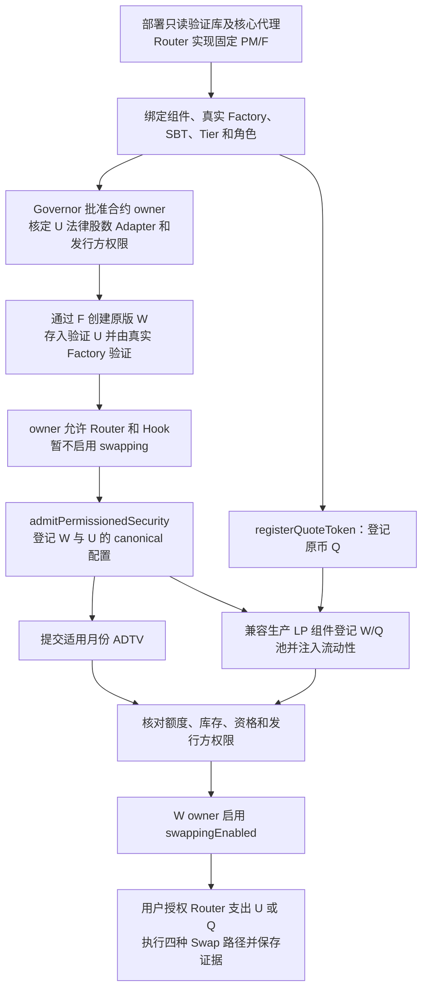

# W/U/Q 股票市场开通与运营（2026-10-07）

当前流程使用项目 underlying U、原版 PermissionsAdapter W 和原币报价 Q。用户授权 Router、收付 U/Q；PoolKey 和 PM 使用 W/Q。Registry 与单池 Wrapped Swap 已实现；生产 Wrapped LP 尚待交付，开通流程中的生产建池/注资步骤须由兼容组件完成。源码与验收范围见 [Registry 与 Wrapped Swap](./PERMISSIONED_REGISTRY_V1.md)。

## 开通顺序

证券准入、PM 初始化和可实际成交是不同阶段。`OPEN` / `isTradable` 不证明 ADTV、剩余额度、价格区间内流动性、用户 SBT 或发行方转账条件已齐备。ADTV 与建池注资可在准入后分别准备；完成两者及所有权限核验后再启用 swapping。

## 一次性环境配置

复用已完成的环境时读取并核验，不重复调用一次性绑定。

| 执行者 / 入口 | 必须核对的结果 |
| --- | --- |
| 部署者：部署 `PermissionedValidationLib` | Registry 链接已记录地址；内部 settlement/runtime helper 不单独部署。 |
| 部署者：原版 `PermissionsAdapterFactory(PM)`、Registry R、Router 实现 `(PM,F)` | F 与 Router 使用同一个 PM；Router 的 `PERMISSIONS_ADAPTER_FACTORY()` 返回 F，R 的 `permissionsAdapterFactory()` 返回真实 F。 |
| Governor：`R.bindComponents(Hook, LPManager, DataInbox, F, SBT)` | 一次绑定 Hook/LPManager/DataInbox/F/SBT，PM 从 F 获取；随后用 VerifyDeploymentV1 核验组件引用。 |
| Governor：`Ledger.bindWriters(Hook, DataInbox)`、`Anchor.bindProxies(address[6])` | 写入者及六代理顺序为 R、Ledger、Inbox、Hook、Router、LPManager。 |
| Governor：`R.setSbtConfig(tokenId, permissions)`、`R.setTierPolicy(tierId, tierBps, maxListed)` | SBT 正常、用户可验证；Tier 非零、有名额，比例为 `1..10000` bps。 |
| Governor：目标代理 `grantRole` | Registry 的 SYMBOL_ADMIN、Inbox 的 VOLUME_ORACLE/HALT_REPORTER，以及暂停/恢复人员均使用真实执行账号。生产建池角色由兼容 LP 组件提供。 |

部署脚本保留六代理框架；当前生产 LP 未完成 Wrapped 改造，不能仅运行脚本就宣布市场可交易。`VerifyDeploymentV1` 校验组件身份、不可变 PM/F 与库链接，资产/issuer/流动性条件需另行记录。所有地址、实现参数、依赖版本、ABI/layout 和交易证据填入 [manifest](./DEPLOYMENT_MANIFEST_V1.example.json)。

## 每只证券的准备与准入

1. **核定 U 与计股口径。** U 是项目中的股票 underlying，可能是发行方自身的 shares/wrapped token；它不等于 TSV 的 W。Adapter 的 `poolCurrency()` 必须为 U，支持 `IDirectLegalShareAdapter`。U/W 精度一致且不超过 18，raw 余额与转账必须符合精确结算。先取得 issuer 对 Router 支出用户 U、W 托管 U、W 向用户释放 U、协议费接收方收取 U 的允许条件。
2. **批准 owner。** Governor 调用 `R.setPermissionedOwnerApproval(owner, true)`；owner 必须是合约账号，随后配置 W 的允许 wrapper、Hook 和 swapping。
3. **创建、验证 W。** 任何账号均可调用 `F.createPermissionsAdapter(IERC20(U), owner, issuerChecker)`，保存真实 F 的 Created 事件及 W 地址。持有者先 `U.approve(W, verificationAmount)`，再 `W.depositForVerification(verificationAmount)`；之后调用 `F.verifyPermissionsAdapter(W)` 并核对 F 的两个查询均返回 U。验证保证金为 surplus，不能作为 Swap 少付的抵扣。
4. **配置 W。** W owner 调用 `updateAllowedWrapper(Router,true)`、`updateAllowedHook(Hook,true)`；checker 为发行方自己开发、部署的 `IAllowlistChecker` 合约。此时 swapping 可保持 false，准入不要求已开启交易。Registry 不再维护 U 级 `exitAdmin`。
5. **原子准入证券与 W。** SYMBOL_ADMIN 调用 `R.admitPermissionedSecurity(tierId, PermissionedAdmission(W, securityId, owner, legalShareAdapter))`。securityId 非零且未上市；首次 W 要求 supply、PM W 余额及累计 W 协议费为零。R 派生并保存 U/decimals/canonical Adapter，默认上市且市场 OPEN。
6. **登记报价 Q。** SYMBOL_ADMIN 调用 `R.registerQuoteToken(Q)`；Q 是原币 ERC-20，不能使用 U、W 或系统地址。报价精度独立，例如 U/W 18 decimals、Q 6 decimals。已登记 Q 可复用。

同一 U 添加第二个 W 时调用 `registerPermissionedCurrency(admission)`，沿用相同 securityId、精度和 canonical Adapter。每个 W 独立管理 owner 和 TOKEN 暂停；全部池共用证券日额度。

## 报告、生产 LP 与启用门禁

VOLUME_ORACLE 向 DataInbox 提交适用上月的 `AdtvReport`，量纲为法律股数 WAD；quota 为可选当日绝对覆盖。新证券默认 OPEN，不需要额外首次开市报告。交易所停复市由 HALT_REPORTER 提交 `MarketReport`，没有自动交易所日历。

生产兼容 LP 组件必须按 Registry 的 W/Q PoolKey、排序、Hook 地址及真实 LP context 在同一交易完成 registerPool 与 PM initialize，随后注资并覆盖首笔交易价格。该组件、仓位/退出/费用流程与权限须独立交付验收。`test/helpers/v1/WrappedSwapMocks.sol` 中的 seed helper 仅为本地验收提供资金，不属于运营 ABI，也不能授予其测试 wrapper 权限给生产实例。

启用前检查以下条件，均保存读值与证据：

| 门禁 | 验收读值或证据 |
| --- | --- |
| 身份与准入 | F 对 W created/verified 均为 U；W 的 PM/U/checker、owner 与 R 记录一致；W/Q 已准入，证券上市，PoolKey 完整匹配且 PM 已初始化；相关操作未暂停。 |
| W 权限 | owner 已获 Governor 批准；Router wrapper 和 Hook 均允许。 |
| 发行方权限 | 用户 U→W 及 W→用户 U、Router operator、W custody、协议费接收方均可达；Q 支出与接收无税费或额外扣费。 |
| 库存 | 初始准入时核验 PM W = W supply、Router/用户 W = 0、W U collateral ≥ supply，并记录验证保证金。Swap 运行时不做库存快照；PM/Router 的既有 U 不作为 W/Q 结算资金。 |
| 资格与额度 | SBT 未暂停，真实用户持证；ADTV/报告适用，当前日额度足够，交易门禁正常。SDK 分别查询 `R.isAllowed(SWAP_ALLOWED,user)` 和 `W.isAllowed(user,SWAP_ALLOWED)`；普通 LP 两层查询均使用 LIQUIDITY_ALLOWED。 |
| 流动性与费用 | 有真实覆盖区间流动性、可用报价和滑点参数；静态 LP fee 与协议费配置合理，W 协议费提取按原版 W 自动释放 U 到获准接收方。 |

条件齐备后由 W owner 调用 `W.updateSwappingEnabled(true)`。把 production LP 与发行方证据补齐后才能设置 manifest 的 readiness；当前仓库模板保持 false。

## 用户交易与首笔验收

用户通过白名单 Adapter 发起交易。若使用 `swapExactInputFromAdapterDirect`，输入股票时执行 `U.approve(Router, amount)`，输入报价时执行 `Q.approve(Router, amount)`；授权 W 不能替代对 Router 的 U 授权。PoolKey 使用 W/Q，方向按地址排序确定；Router 返回真实 `actualIn, actualOut`。Router 不再提供用户直调或 exact-output 入口。

| 路径 | amountSpecified / limitAmount | 用户余额效果 |
| --- | --- | --- |
| U→Q exact-in | 指定 U raw 输入 / Q raw 最小输出 | 输入全额成交，输出直接交给指定收款方。 |
| Q→U exact-in | 指定 Q raw 输入 / U raw 最小输出 | 输入全额成交，输出直接交给指定收款方。 |

两条方向路径均使用白名单 Adapter exact-in 入口与有效 deadline。检查返回的实际输入与输出、PM `Swap`、Ledger `SwapAccounted` 的 W/U 两个地址、真实余额双侧变化、U canonical 法律股数与 Ledger.used 增量、PM 两腿零欠款，以及库存和 E 保持不变。Router 不另发成交事件或引用 Ledger。失败须余额、价格、流动性、额度与策略写入全部回滚，随后修正条件能够重试。

DEX Adapter 需获 Governor 白名单授权；Router 检查 Adapter 验证的真实用户身份和发行方权限，Adapter 负责 U/Q 收付。单池入口不支持 native 或 U 直接池。

## 持续运营

- 资产停用使用 TOKEN 暂停，单池停用使用 POOL 暂停；模式为 TRADE、LP 或 ALL。暂停/恢复分别由 EMERGENCY_PAUSER/RESUMER 执行，清除 TOKEN 暂停会复核已登记资产配置。证券下架无需逐池操作，重新上市后未被暂停覆盖的历史池自动恢复。
- owner 轮换先通过 TOKEN、SECURITY 或 GLOBAL 范围暂停该 W 的交易和 LP，由新 owner 实际接受 ownership 并获 Governor 批准，再调用 `updatePermissionedExpectedOwner`，最后恢复暂停。
- Registry 不再维护 `setExitAdmin/exitAdminOf`；用户输出受发行方限制时整笔交易回滚。
- `SYMBOL_ADMIN_ROLE` 可随时调用 `replaceUnderlyingLegalShareAdapter(U,newAdapter)`；同 U 的全部 W 随后立即使用新 Adapter，历史 used 不清零。若新旧 Adapter 换算尺度不同，当日用量会按各自结果累计，并可能改变当日限额判断。拆并股的 ADTV 调整由目标日 `splitFactor` 单独处理，quota 仍按目标日单位独立上报。
- 按月提交 ADTV，必要时更新 quota、排期拆并股系数；持续监控 issuer 拒转、SBT、W 权限/库存、适用额度、生产 LP 流动性及 PM 费用。资产停用使用现有暂停入口，历史额度和准入记录不清零。
