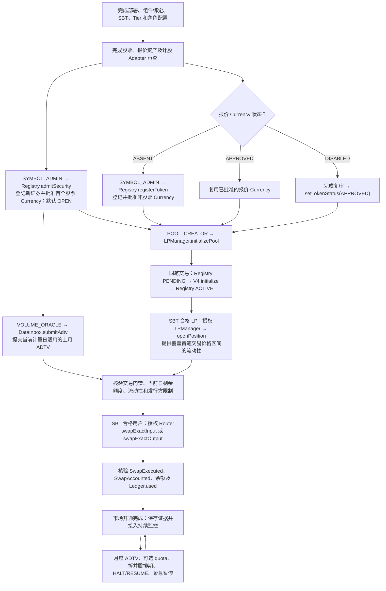
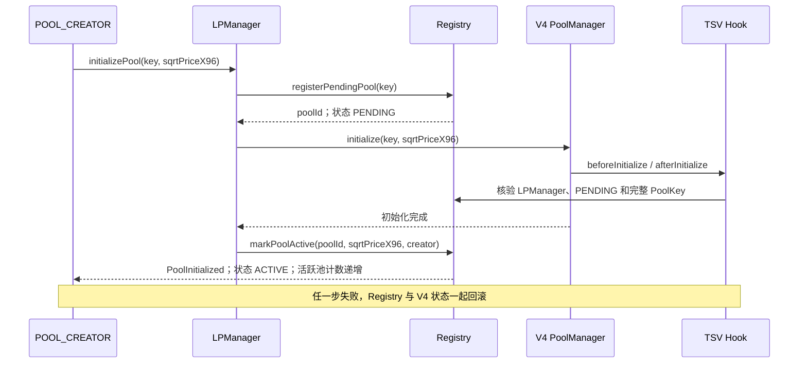
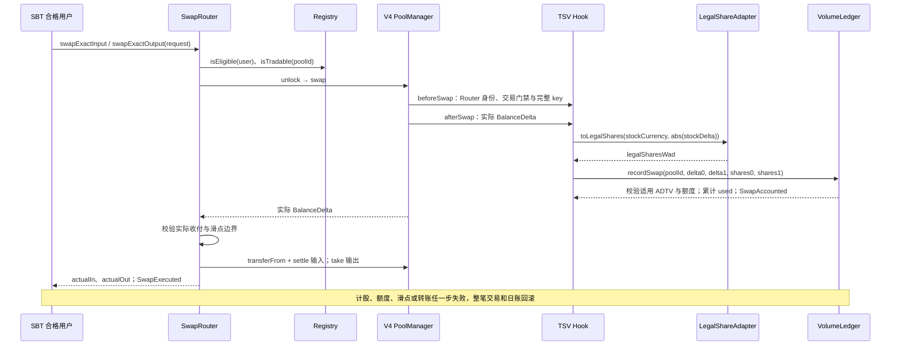

# Opening a Stock Market (TSV V1)

当前 ABI 已移除业务 hash 参数和配置字段，部署脚本及 manifest 也不接收 CODEHASH 输入。业务 ID、reasonCode、salt 与内部哈希计算保留。此变更改变函数/事件 ABI 和存储布局，须全新部署；不得直接升级使用旧字段布局的实例。链下审查材料按证券、资产、报告 ID 和交易记录归档。

本文按当前 `src/v1/` 实现说明如何开通一只新股票的交易市场，覆盖准备、证券与 Currency 准入、ADTV、建池、LP 入池、首笔成交和后续运营。适用范围是已完成全新部署的 TSV V1 实例；合约部署步骤见[部署清单](./DEPLOYMENT_CHECKLIST_V1.md)。

基础配置完成、报价 Currency 已获批时，新证券的核心运营调用是 **`admitSecurity`、`submitAdtv`、`initializePool` 三次**。之后还需 LP 提供有效流动性、用户完成 ERC-20 授权并成功交易，才能完成开通验收。新证券准入后默认 `OPEN`，无需提交首次开市报告；ADTV 和建池可按任意顺序执行，LP 可以先于 ADTV 入池。

## 1. 开通全流程



图中的 ADTV 和建池分支都依赖证券已准入，但彼此没有先后要求。`initializePool` 成功后池已为 `ACTIVE`；`PENDING` 仅是该交易内部状态，没有人工确认入口。

| 阶段 | 完成标志 | 下一阶段还需要什么 |
| --- | --- | --- |
| 证券准入完成 | `listed=true`，股票 Token 为 `APPROVED`，市场默认 `OPEN` | 报价资产、池、ADTV 和 LP |
| 池创建完成 | Registry 池为 `ACTIVE`，V4 初始价格已写入 | 有效价格区间内的 LP、适用 ADTV、资格与授权 |
| 市场可成交 | 交易门禁通过，当前日有额度，池有可用流动性，用户及转账条件满足 | 首笔实际成交验收 |
| 开通验收完成 | 成功成交的事件、余额和法律股数账本一致 | 月度报告与持续运营 |

`marketStatus=OPEN` 表示该证券没有市场报告暂停；`isTradable=true` 表示 Registry 的交易门禁通过。两者都不检查 ADTV、剩余额度、用户 SBT、ERC-20 授权或池内流动性。当前实现也不根据交易所日历自动开闭市，市场事件需运营角色提交报告。

## 2. 开通前准备与权限

### 2.1 复用已完成的基础配置

以下配置由当前 Governor 执行。已经完成时读取并核对结果即可，每只新股票无需重复部署六个代理。

| 入口 | 配置目的与验收 |
| --- | --- |
| `Registry.bindComponents(address hook, address lpManager, address dataInbox)` | 一次性绑定三个组件；地址与发布 manifest 一致。 |
| `VolumeLedger.bindWriters(address hook, address dataInbox)` | 一次性绑定计量与报告写入者。 |
| `GovernanceAnchor.bindProxies(address[6] addresses)` | 一次性绑定六代理，顺序为 Registry、VolumeLedger、DataInbox、Hook、SwapRouter、LPManager；同时核对 Anchor 与组件交叉引用。 |
| `Registry.setSbtConfig(address sbt, uint256 tokenId)` | 配置 participant SBT；地址有代码，`paused()` 与 `verify(address,uint256)` 可调用。用拟参与的 LP 与交易地址验证 `isEligible`。 |
| `Registry.setTierPolicy(uint8 tierId, uint16 tierBps, uint32 maxListed)` | `tierId != 0`、`tierBps` 为 `1..10000`；开通前要求 `listedCount < maxListed`。例如 `25 bps` 表示 ADTV 的 `0.25%`。 |
| 各目标合约的 `grantRole(bytes32 role, address account)` | 在实际调用的代理上授予业务角色；Governor 身份本身不自动具备报告或准入角色。 |

| 参与者 | 角色授予位置 | 开通或运营入口 |
| --- | --- | --- |
| 资产运营 | Registry：`SYMBOL_ADMIN_ROLE` | `admitSecurity`、`registerToken`、Token/Pool/证券状态管理 |
| 建池运营 | LPManager：`POOL_CREATOR_ROLE` | `initializePool` |
| 成交量报告服务 | DataInbox：`VOLUME_ORACLE_ROLE` | `submitAdtv`、`submitAdtvBatch`、`submitQuota`、`submitSplitFactor` |
| 市场事件报告服务 | DataInbox：`HALT_REPORTER_ROLE` | `submitMarketStatus` |
| 紧急暂停与恢复人员 | Registry：`EMERGENCY_PAUSER_ROLE` / `EMERGENCY_RESUMER_ROLE` | `addEmergencyPause` / `clearEmergencyPause` |
| LP 与交易用户 | 无需业务角色，须通过 SBT 资格检查 | `openPosition`、`swapExactInput`、`swapExactOutput` |

`hasRole(role, account)` 在相应代理上查询。普通 LP 与 Swap 使用 `isEligible(user)`，要求 SBT 未暂停且 `verify(user, tokenId)` 返回真；仅 `hasCredential(user)=true` 不代表当前可参与。

### 2.2 准备市场参数与准入证据

| 参数 | 运营准备内容 |
| --- | --- |
| `securityId` | 新证券的非零唯一内部 ID；同一证券的多 Currency、多池共用 `securityId`。 |
| `tierId` | 已配置且有上市名额的 Tier；其 `tierBps` 决定每日硬上限比例。 |
| 股票与报价 Currency | 实际进入 V4 的 ERC-20 地址、decimals、实现审查及限制证据。 |
| `legalShareAdapter` | 股票 raw 数量转为 `legalSharesWad` 的已审实现，绑定股票 Currency；首次准入版本为 `1`。 |
| ADTV | 上月日均成交量，统一为法律股数 WAD，`1e18 = 1 股`；固定来源月月末股数单位。 |
| `PoolKey` 与初始价格 | 排序后的 Currency、fee、tickSpacing、TSV Hook 地址、初始 `sqrtPriceX96` 和定价依据。 |
| LP 与首笔交易参数 | 拟参与地址、余额、授权、tick 区间、liquidity、滑点边界与 deadline。 |

Currency 审查必须覆盖 raw 余额稳定、双侧精确转账、发行方暂停/制裁限制和原 owner 退出可达性。用户收付的 Token 就是池内 Currency；TSV 的 Swap/LP 不在同笔交易内替用户包装或赎回股票。资产政策见[代币准入标准](./TOKEN_ADMISSION_STANDARD_V1.md)。

当前源码有两种直接计股实现，具体选型需与发行方批准的法律股数定义一致：

| Adapter | 绑定与转换方式 |
| --- | --- |
| [`BackedAutoFeeLegalShareAdapter`](../src/v1/adapters/BackedAutoFeeLegalShareAdapter.sol) | 构造参数为 `(underlying, wrapped, version)`；核验 Wrapped 的 `asset()` 及两侧 18 decimals。池内 Currency 是 Wrapped；调用来源 Token 的 `getUnderlyingAmountByShares(rawAmount)`，返回值作为法律股数 WAD。 |
| [`ERC8056DirectLegalShareAdapter`](../src/v1/adapters/ERC8056DirectLegalShareAdapter.sol) | 构造参数为 `(currency, version)`；读取 Currency 当次生效的 `uiMultiplier()` 和 `decimals()`，计算 `floor(rawAmount × multiplier / 10^decimals)`。将结果作为法律股数 WAD 的依据须独立审查。 |

Adapter 的接口存在或本地测试通过，都不能替代真实资产的准入证据。接口和流程若与其他文档存在差异，以当前源码为准。

## 3. 函数说明：准入证券与报价资产

### 3.1 `Registry.admitSecurity`：新证券与首个股票 Currency 原子准入

```solidity
function admitSecurity(
    bytes32 securityId,
    uint8 tierId,
    TokenConfig calldata config
) external;
```

调用者须在 Registry 具备 `SYMBOL_ADMIN_ROLE`。`securityId` 必须非零；证券 ID 和 `poolCurrency` 均未登记；`config.securityId` 必须等于本次证券 ID。Tier 必须有名额。

`TokenConfig` 按[当前类型定义](../src/v1/types/TSVTypes.sol)构造：

| 字段 | 股票 Currency | 报价 Currency |
| --- | --- | --- |
| `poolCurrency` | 实际股票 ERC-20，非零且有代码 | 实际报价 ERC-20，非零且有代码 |
| `poolDecimals` | 与 `decimals()` 一致，最大 `18` | 同左 |
| `securityId` | 本次准入的非零证券 ID | `bytes32(0)` |
| `legalShareAdapter` | 有代码，实现 `IDirectLegalShareAdapter`，`poolCurrency()` 与本 Currency 一致 | `address(0)` |
| `legalAdapterVersion` | 首次登记为 `1`，与 Adapter 的 `adapterVersion()` 一致 | `0` |
| `status` | `TokenStatus.APPROVED` | `TokenStatus.APPROVED` |

成功时占用一个 Tier 名额，证券 `listed=true`、`version=1`、`activePoolCount=0`；股票 Token 从 `ABSENT` 变为 `APPROVED`。新证券的 `marketPauseMode=NONE`、`marketSequence=0`，`marketStatus(securityId)=OPEN`。该调用不创建池、不提交 ADTV，也不注入流动性。

**验收：**核对 `SecurityListed`、`TokenRegistered`、`TokenStatusChanged`，读取 `getSecurity`、`getToken`、`tierPolicy` 和市场状态。任一校验失败，证券记录、Token 与 Tier 名额一起回滚。

### 3.2 `Registry.registerToken`：报价资产或同证券新增 Currency

```solidity
function registerToken(TokenConfig calldata config) external;
```

同样要求 Registry 的 `SYMBOL_ADMIN_ROLE`，配置校验与上表一致，登记成功即为 `APPROVED`。新报价资产设置 `securityId=0`；已有上市证券新增股票 Currency 时，设置已有 `securityId` 并配置绑定该 Currency 的初始版本 `1` Adapter，不重复占用证券 Tier 名额。

**验收：**读取 `getToken(currency)`，核对 `TokenRegistered` 和 `ABSENT → APPROVED` 的 `TokenStatusChanged`。已为 `APPROVED` 的报价币直接复用；已登记但为 `DISABLED` 时，复审后使用 `setTokenStatus(address currency, TokenStatus status)`，不重复登记。

## 4. 函数说明：提交 ADTV 与核验额度

### 4.1 `DataInbox.submitAdtv`：写入适用月份的日均成交量

```solidity
function submitAdtv(AdtvReport calldata report) external;
```

调用者须在 DataInbox 具备 `VOLUME_ORACLE_ROLE`，证券须已上市。先用 `VolumeLedger.currentTradeDay()` 获取 `(exists, tradeDayId)`，再取该计量日所在月份的上一个自然月作为首笔交易所需的 `sourceMonth`。例如计量日为 `20261005` 时需要 `202609`；不要直接用本地时区日期推导月份。

| `AdtvReport` 字段 | 输入规则 |
| --- | --- |
| `securityId` | 已上市的证券 ID。 |
| `sourceMonth` | 合法 `YYYYMM`。合约允许保存其他合法月份；当前交易只读取当前计量日对应的上月报告。 |
| `adtvWad` | 大于 `0` 的上月日均法律股数 WAD，例如 `1000e18` 表示 `1000 股/日`。 |
| `sourceTimestamp` | 不晚于当前区块时间，且不小于该证券 ADTV 报告流的前一来源时间。 |
| `submitDeadline` | 不早于实际提交区块时间。 |
| `version` | 本证券、本来源月的已接受版本加 `1`；首次为 `1`。 |
| `sequence` | 严格大于 `DataInbox.lastSequence(1, securityId)`，可跳号；换月不归零。 |
| `reportId` | 非零，且未被当前 DataInbox 的任何报告类别或证券使用。 |

DataInbox 验证权限、时效、顺序与去重，再调用 Ledger 的 `acceptAdtv` 保存数据。成功后产生 `AdtvAccepted`；读取 `adtvOf(securityId, sourceMonth)` 核对值、版本与 reportId。下游失败时，DataInbox 已写入的 reportId、sequence 和来源时间也会回滚。

月度多证券更新可使用 `submitAdtvBatch(AdtvReport[] calldata reports)`：数组大小为 `1..100`，同一个来源月，`securityId` 按数值严格递增且不重复；任一项失败整批回滚。单只新股票使用单笔入口即可。

### 4.2 额度读取与计算

```text
hardCapWad = floor(adtvWad × tierBps × numerator / (10000 × denominator))
effectiveCapWad = quota.active ? min(hardCapWad, quota.quotaWad) : hardCapWad
remainingWad = max(0, effectiveCapWad − usedWad)
```

未排期公司行动时，系数为 `1/1`。ADTV 为 `1000 股`、Tier 为 `25 bps` 时，每日硬上限为 `2.5 股`；未来计量日生效的 `2/1` 拆股系数将该日硬上限调整为 `5 股`。

读取 `remaining(securityId, tradeDayId)` 返回 `(valid, value)`：`valid=false` 表示所需 ADTV 缺失或计算出的硬上限为零；`valid=true, value=0` 表示当前有效额度已无剩余。**额度按证券与计量日共享，买入、卖出以及同证券其他池的成功交易都会累计，LP 操作不消耗成交额度。**

`submitQuota(QuotaReport calldata report)` 是可选入口，同样要求 `VOLUME_ORACLE_ROLE`：`action=1` 设置目标日绝对额度，要求 `0 < quotaWad <= hardCapWad`；`action=2` 清除已有覆盖且 `quotaWad=0`。不提交时使用硬上限。Quota 不能替代 ADTV，不能提高硬上限。

## 5. 函数说明：创建股票/报价币池

```solidity
function initializePool(
    PoolKey calldata key,
    uint160 sqrtPriceX96
) external;
```

入口位于 LPManager，调用者须在 **LPManager** 具备 `POOL_CREATOR_ROLE`。它在同一交易内完成 Registry 登记、V4 初始化与 Registry 激活。

| 参数 | 输入规则 |
| --- | --- |
| `key.currency0` / `key.currency1` | 两侧 Currency 都已 `APPROVED`；地址非零，按 `currency0 < currency1` 排序；一个池最多一侧股票。本流程选一侧股票、一侧非股票报价币。 |
| `key.fee` | 静态费率，`< 1000000`，按 V4 百万分比单位；例如 `3000` 表示 `0.3%`。 |
| `key.tickSpacing` | `1..32767`。 |
| `key.hooks` | 已绑定的 TSV Hook 代理地址。 |
| `sqrtPriceX96` | V4 Q64.96 初始平方根价格，使用 raw Currency 单位；范围和重复初始化由 PoolManager 校验。 |

初始价格满足 `sqrtPriceX96 ≈ sqrt(rawCurrency1 / rawCurrency0) × 2^96`。如果使用“一枚 currency0 对应多少枚 currency1”的展示价格 `P`，先换算 `rawRatio = P × 10^decimals1 / 10^decimals0`。若业务报价是每枚股票 Currency 对应的报价币数量，股票排在 currency0 时直接用该报价作为 `P`，排在 currency1 时先取倒数。报价按法律股数给出时，还需按已审 Adapter 的当前转换关系换算成每枚股票 Currency 的价格。最终使用整数精度工具生成价格，保存来源与舍入依据。



`poolId` 由完整 `PoolKey` 计算，即 V4 的 `PoolIdLibrary.toId()`。`registerPendingPool`、`markPoolActive` 仅允许已绑定 LPManager 调用；运营人员直接调用 `initializePool`。

**验收：**核对 `PoolInitialized`、`PoolStatusChanged` 的 `ABSENT → PENDING → ACTIVE`，读取 `getPool(poolId)`，确认完整 key、股票侧 securityId、`status=ACTIVE`、`version=2`，并核对 V4 初始价格和活跃池计数。建池不要求 ADTV 或 LP 用户 SBT，也不会自动注入流动性；成交与普通 LP 是否开放仍由各自门禁决定。

## 6. 函数说明：LP 入池与首笔交易

### 6.1 `LPManager.openPosition`：提供有效流动性

```solidity
function openPosition(
    PoolKey calldata key,
    int24 tickLower,
    int24 tickUpper,
    uint128 liquidity,
    LPBounds calldata bounds
) external returns (uint256 positionId);
```

LP 先对实际股票和报价 ERC-20 调用 `approve`，spender 为 **LPManager 代理**。开仓要求 `isEligible(msg.sender)=true`、`isLPAllowed(poolId)=true`，且 deadline 未过期；不要求 ADTV。

`tickLower < tickUpper`，两者在 V4 TickMath 范围内并对齐 `key.tickSpacing`；`liquidity > 0` 且不超过 `int128` 正数上限。Liquidity 是 V4 流动性量，不直接等于 Token 数量。首笔成交所用区间需要有实际可用流动性。

| `LPBounds` 字段 | 含义 |
| --- | --- |
| `maxPoolIn0` / `maxPoolIn1` | 本次允许从 owner 支付的两侧最大 raw 数量。 |
| `minPoolOut0` / `minPoolOut1` | 本次要求向 owner 交付的两侧最小 raw 数量。 |
| `deadline` | 本次操作允许执行的最晚区块时间。 |

LPManager 经 PoolManager 的 `unlock`、`modifyLiquidity` 和 Hook 上下文校验后，按实际 delta 直接结算两侧 Currency；成功后返回 `positionId`，铸造绑定调用者的不可转让 Receipt。

**验收：**核对 `PositionOpened`、`getPosition(positionId)`、`ownerOf(positionId)` 及两侧实际余额差。LP 加减仓、领费、关仓使用 `increaseLiquidity`、`decreaseLiquidity`、`collectFees`、`closePosition`，普通操作都要求 owner 仍合格且 LP 门禁通过。

### 6.2 `Router.swapExactInput` / `swapExactOutput`：首笔成交

```solidity
function swapExactInput(SwapRequest calldata request)
    external returns (uint256 actualIn, uint256 actualOut);

function swapExactOutput(SwapRequest calldata request)
    external returns (uint256 actualIn, uint256 actualOut);
```

用户对输入 Currency 的 ERC-20 授权，spender 为 **SwapRouter 代理**。直接入口的 participant、付款人和收款人均为 `msg.sender`；要求 SBT 合格、Registry 交易门禁通过、deadline 有效。

| `SwapRequest` 字段 | `swapExactInput` | `swapExactOutput` |
| --- | --- | --- |
| `key` | 已登记股票/报价币池的完整 PoolKey | 同左 |
| `zeroForOne` | `true` 为 currency0 → currency1，`false` 为反向；买卖方向依股票所在侧判断 | 同左 |
| `amountSpecified` | 输入 raw 数量上限，正数且不超过 `int128` 正数上限 | 要求精确收到的输出 raw 数量，范围同左 |
| `limitAmount` | 最小输出 raw 数量，须大于 `0` | 最大输入 raw 数量，须大于 `0` |
| `deadline` | 最晚执行时间 | 同左 |

Exact-input 路径允许实际输入少于请求值，成功时 `actualIn <= amountSpecified` 且 `actualOut >= limitAmount`；exact-output 要求 `actualOut == amountSpecified` 且 `actualIn <= limitAmount`。两种入口都返回实际 raw 收付数量，Router 按方向设置全区间 V4 价格边界。



股票侧 delta 为负时按实际输入计股，含 V4 记入输入的费用；股票侧 delta 为正时按实际输出计股。两种方向都增加证券日用量，不进行买卖净额抵消。Token 拒转、余额差不精确、Adapter 失败或额度超限均使整笔交易回滚。

外部 DEX 路径另需 Governor 调用 `Router.setAdapterAllowed(address adapter, bool allowed)`，由可信 Adapter 使用 `swapExactInputFromAdapter(SwapRequest request, address participant)`。该路径由 Adapter 结算，并校验原始 participant 的 SBT；身份传递与退款规则见[外部 DEX 接入说明](./EXTERNAL_DEX_ROUTER_ADAPTER_TSV_INTEGRATION.md)。

## 7. 开通验收与查询函数

在同一计量日保存首笔交易前后快照，并保留交易哈希、区块、receipt、事件和参数证据。

| 合约与查询 | 验收目的 |
| --- | --- |
| `Registry.getSecurity(bytes32 securityId)` | 确认证券上市、Tier 和活跃池计数。 |
| `Registry.getToken(address currency)` | 确认两侧 `APPROVED`、股票 securityId、Adapter 及版本。 |
| `Registry.getPool(bytes32 poolId)` | 确认 `ACTIVE`、完整 key 与正确证券侧。 |
| `Registry.marketStatus(bytes32 securityId)` / `marketPauseMode(bytes32 securityId)` | 确认市场报告层状态与暂停模式；LP 专属暂停时市场可为 HALTED 但交易仍可通过。 |
| `Registry.isEligible(address user)` | 分别检查 LP 和交易用户的有效 SBT 资格。 |
| `Registry.isTradable(bytes32 poolId)` / `isLPAllowed(bytes32 poolId)` | 分别检查交易和普通 LP 的准入、状态与暂停门禁。 |
| `VolumeLedger.currentTradeDay()` | 确认当前 `tradeDayId`；需要边界时间时读取 `dayStartUTC(uint32 dayId)`。 |
| `VolumeLedger.adtvOf(bytes32 securityId, uint32 sourceMonth)` | 确认当前计量日适用上月报告的值、版本和 reportId。 |
| `VolumeLedger.remaining(bytes32 securityId, uint32 tradeDayId)` | 首笔交易前确认 `valid=true`，且剩余额度足以覆盖预计实际法律股数。 |
| `VolumeLedger.used(bytes32 securityId, uint32 tradeDayId)` | 首笔交易后确认用量增量等于该笔 `SwapAccounted.legalSharesWad`；并发交易按事件分别核对。 |
| `LPManager.getPosition(uint256 positionId)` / `ownerOf(uint256 positionId)` | 确认仓位 active、owner、流动性、tick 范围和 Receipt。 |

首笔交易应同时满足：`SwapExecuted` 的 poolId、participant、方向与实际 delta 正确；`SwapAccounted` 的证券、Currency、rawAmount、legalSharesWad、Adapter 版本和计量日正确；用户与 PoolManager 的实际余额差吻合。若期间发生日切，按事件中的 `tradeDayId` 核对账本。

失败验收至少覆盖 SBT 不合格、缺适用 ADTV、额度不足和 Token 拒转，确认业务余额、仓位、Receipt 与 Ledger 用量未被部分写入。生产实例、发行方证据与基础设施验收范围见[部署清单](./DEPLOYMENT_CHECKLIST_V1.md#7-发布后最小验收)。

## 8. 开通后的运营函数

### 8.1 市场事件与紧急暂停

| 入口 | 权限与行为 |
| --- | --- |
| `DataInbox.submitMarketStatus(MarketReport calldata report)` | `HALT_REPORTER_ROLE`；`action=HALT` 添加 TRADE、LP 或 ALL 暂停，`action=RESUME` 清除所选模式。首次报告可以直接 HALT；模式为 NONE 或状态没有实际变化时拒绝。 |
| `Registry.addEmergencyPause(PauseScope scope, bytes32 target, PauseMode mode, bytes32 reasonCode)` | `EMERGENCY_PAUSER_ROLE`；返回 recordId。范围为 GLOBAL、SECURITY、TOKEN 或 POOL；模式为 TRADE、LP 或 ALL。GLOBAL target 为零；证券和池使用相应 ID，Token 使用 `bytes32(uint256(uint160(currency)))`。原因码非零。 |
| `Registry.clearEmergencyPause(uint256 recordId, bytes32 reasonCode)` | `EMERGENCY_RESUMER_ROLE`；逐条关闭 active 紧急暂停记录，原因非零。仍有其他匹配记录时继续阻断。 |

`MarketReport` 包含 `securityId`、`action`、`mode`、`reasonCode`、`sourceTimestamp`、`submitDeadline`、`sequence`、`reportId`。原因码和报告 ID 非零；报告通用顺序、去重和时间规则与 ADTV 一致，市场流使用 `kind=0`。

市场暂停按模式叠加，例如先 HALT TRADE 再 HALT LP 变为 ALL；RESUME TRADE 后仍阻断 LP。市场 RESUME 与紧急暂停解除互相独立。TRADE 暂停阻断 Swap，LP 暂停阻断所有普通 LP 操作，包括普通减仓和退出。

### 8.2 月度数据与公司行动

按月补齐新计量月适用的上月 ADTV，新来源月版本从 `1` 开始，ADTV 流 sequence 继续递增。报告流按 `(kind, securityId)` 维护 sequence 与来源时间，`kind=0/1/2/3` 分别为市场、ADTV、quota、拆并股；reportId 在整个 DataInbox 中唯一。

```solidity
function submitSplitFactor(SplitFactorReport calldata report) external;
```

入口位于 DataInbox，要求 `VOLUME_ORACLE_ROLE`。报告设置 `securityId`、`sourceMonth`、`effectiveTradeDayId`、`action`、`numerator`、`denominator` 及来源时间、deadline、version、sequence、reportId。

- `action=1` 排期或更正：分子与分母均为正；`effectiveTradeDayId` 必须晚于当前计量日，且其上月等于 `sourceMonth`。未来日开始时自动使用系数，无需激活交易。
- 系数是相对该 ADTV 来源月股数单位的绝对累计比例；一拆二用 `2/1`，同月随后再一拆三用 `6/1`，五合一用 `1/5`。
- 同证券、同来源月 version 每次加 `1`，包括取消；sequence 使用 `kind=3` 独立报告流。仅最新且尚未生效的 checkpoint 可在同一生效日更正或取消。
- `action=2` 取消最新待生效项，分子与分母必须为零；已生效项不可改写。`splitFactorOf(securityId, tradeDayId)` 查询目标日有效比例，默认 `1/1`。
- Ledger 系数只调整额度；每笔成交仍用实时 Adapter 换算。发行方单位变更与额度单位无法一致衔接时，先暂停相关操作，核对后恢复；quota 继续作为目标日绝对法律股数值复核。

新来源月的 ADTV 已包含历史事件时，不重复沿用旧月系数。完整字段和算法见[编码规格 §7](./CODING_SPEC_V1.md#7-角色报告计量日和额度)，发行方单位变更步骤见[准入标准 §4.1](./TOKEN_ADMISSION_STANDARD_V1.md#41-排期与发行方变更的运营步骤)。

### 8.3 资产、池与退出管理

| 入口 | 权限与使用条件 |
| --- | --- |
| `setTokenStatus(address currency, TokenStatus status)` | Registry 的 `SYMBOL_ADMIN_ROLE`；在 `APPROVED` / `DISABLED` 间切换。Token 停用阻断普通 Swap 与 LP；重新批准股票要求证券仍上市且 Currency 地址仍有代码。 |
| `disablePool(bytes32 poolId)` / `enablePool(bytes32 poolId)` | Registry 的 `SYMBOL_ADMIN_ROLE`；停用/启用池并同步活跃池计数。启用时要求两侧资产、证券及 TRADE/LP 门禁均有效。 |
| `delistSecurity(bytes32 securityId)` / `relistSecurity(bytes32 securityId)` | Registry 的 `SYMBOL_ADMIN_ROLE`；退市前需活跃池计数为零，重新上市需原 Tier 有名额。重新上市保留原市场暂停和报告序号，池与 Token 状态另行处理。 |
| `replaceLegalShareAdapter(address currency, address newAdapter)` | Registry 的 `SYMBOL_ADMIN_ROLE`；新 Adapter 绑定相同 Currency，版本为当前版本加 `1`。要求该 Currency 无活跃池，或 GLOBAL/TOKEN 紧急暂停已覆盖 TRADE 和 LP；证券市场 HALT 本身不能替代此条件。 |
| `LPManager.forceExit(uint256 positionId, uint256 minPoolOut0, uint256 minPoolOut1, bytes32 reasonCode)` | `FORCE_EXIT_ADMIN_ROLE`，或在 owner 已失去 SBT credential 时由 `REVOKE_EXIT_EXECUTOR_ROLE` 调用。专用强退路径允许已知池退出，资产仍交付原 owner，受 Token 实际可转账性及最小收款边界约束。 |

## 9. 常见阻断与排查

| 现象 | 核对内容 |
| --- | --- |
| 准入 `InvalidConfig` | 重复证券/Currency、Tier 名额、decimals 与代码存在性、TokenConfig.status、Adapter 接口/绑定/版本。 |
| 报告 `UnauthorizedReporter` / `InvalidReport` / `Expired` | DataInbox 上的角色、reportId 是否已使用、对应 kind 的 sequence 和来源时间、期限；Ledger 的版本与业务字段。 |
| 建池失败 | Currency 排序、两侧批准状态、Hook、fee、tickSpacing、重复 key、初始价格范围、LPManager 上的建池角色；失败后 Registry 不应遗留 PENDING。 |
| `OPEN` 但不能交易 | `isTradable`、Pool/Token 状态、紧急暂停、证券上市状态、用户 SBT，再检查 ADTV、额度、流动性与授权。 |
| `MissingReport` | 当前计量日所需上月 ADTV 是否存在，或调整后硬上限是否因舍入变为零。 |
| `QuotaExceeded` | 当日共享用量、可选 quota、适用拆并股系数与实际股票 delta；其他池交易也会消耗该证券额度。 |
| LP 被拒绝 | SBT、`isLPAllowed`、deadline、tick 对齐、liquidity、bounds、余额与对 LPManager 的授权；无需补 ADTV 来解锁 LP。 |
| `SlippageExceeded` / `SettlementMismatch` / Token 拒转 | 可用区间流动性、实际 delta、收付边界、余额、spender 授权与发行方限制；确认整笔业务状态已回滚后处理原因。 |

## 10. 源码与验证依据

流程直接对应 [Registry](../src/v1/core/TSVRegistryV1.sol)、[DataInbox](../src/v1/core/TSVDataInboxV1.sol)、[VolumeLedger](../src/v1/core/TSVVolumeLedgerV1.sol)、[LPManager](../src/v1/periphery/TSVLPManagerV1.sol)、[SwapRouter](../src/v1/periphery/TSVSwapRouterV1.sol)、[Hook](../src/v1/core/TSVHookV1.sol)、[GovernanceAnchor](../src/v1/governance/TSVGovernanceAnchor.sol)及[报告类型](../src/v1/types/TSVReports.sol)。

已有测试中的关键流程证据：

- [ProtocolFixture](../test/helpers/v1/ProtocolFixture.sol)：准入、报价资产登记、建池、授权、先 LP 后报告的完整准备顺序。
- [Admission](../test/integration/local/registry/Admission.t.sol) 与 [PoolCreationBoundaries](../test/integration/local/operations/PoolCreationBoundaries.t.sol)：无需首次开市报告，建池失败不遗留 PENDING 或池计数。
- [Accounting](../test/integration/local/trading/Accounting.t.sol)：实际股票输入费用口径，以及同证券多池共享额度。
- [AdtvBatch](../test/unit/v1/reports/AdtvBatch.t.sol)：批量限制、排序、去重与原子回滚。
- [SplitFactor](../test/unit/v1/reports/SplitFactor.t.sol) 与 [SplitFactorFlows](../test/integration/local/operations/SplitFactorFlows.t.sol)：未来日自动生效、绝对累计比例、跨月基准及实际交易/LP 行为。

角色与系统全貌见[系统总览](./SYSTEMS_OVERVIEW.md)，准入政策见[代币准入标准](./TOKEN_ADMISSION_STANDARD_V1.md)，发布与验收见[部署清单](./DEPLOYMENT_CHECKLIST_V1.md)。
