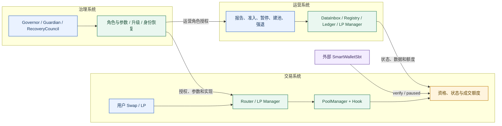
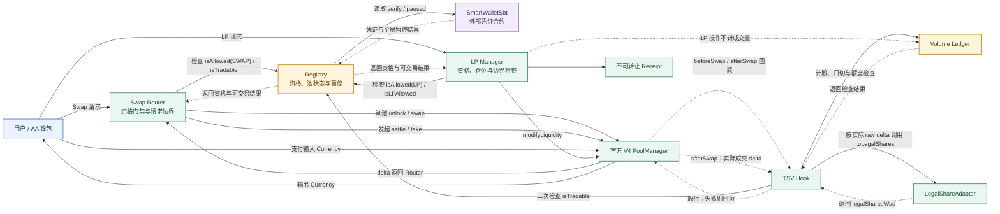
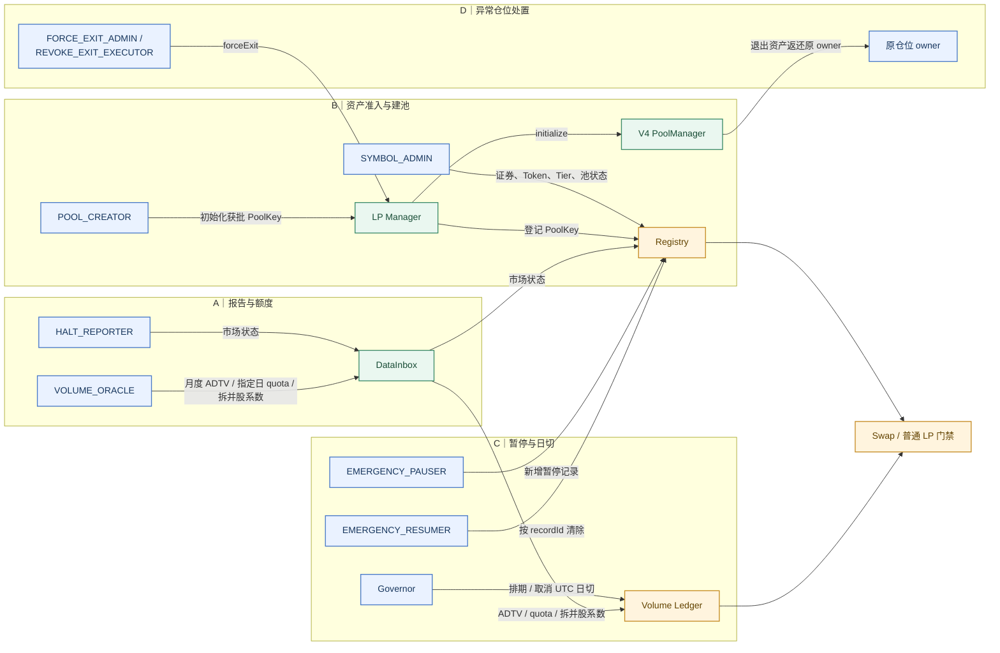
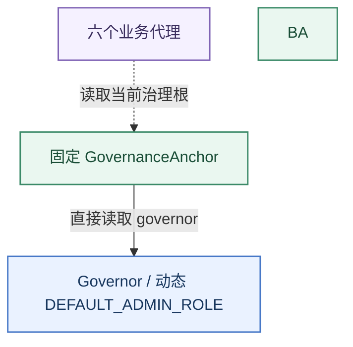
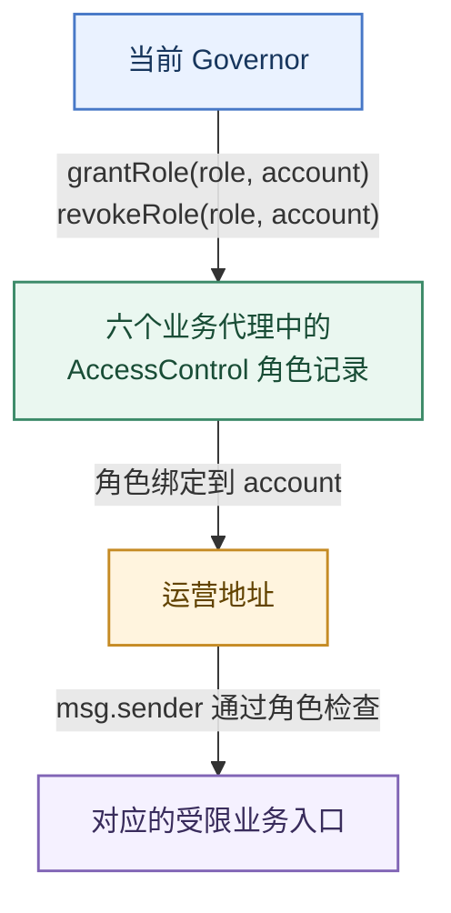
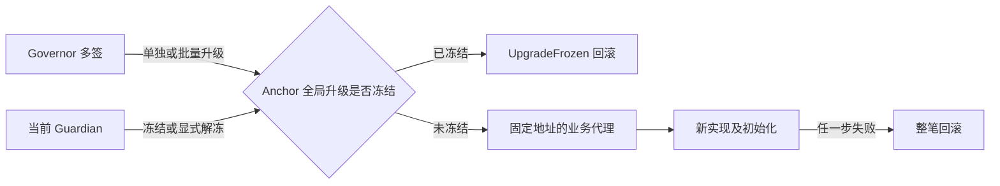
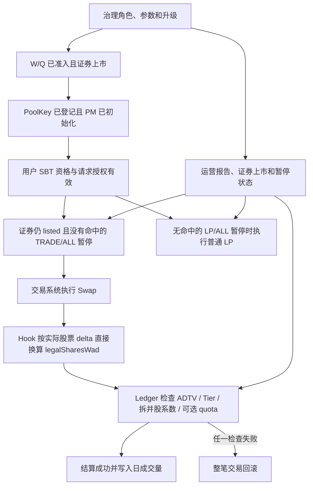

# TSV V1 三个系统：交易、运营与治理

> **2026-10-07 Wrapped Swap 更新：** Registry 与单池 Wrapped Swap 已实现，用户收付 U/Q，池内结算 W/Q。当前 ABI、库链接与验收边界见 [Registry 与 Wrapped Swap](./PERMISSIONED_REGISTRY_V1.md)，当前运营步骤见 [W/U/Q 开通流程](./OPENING_A_STOCK_MARKET_V1.md)。下文旧 DIRECT、TokenConfig/getToken、DEX 与 LP 成功路径属于历史版本；生产 Wrapped LP 及真实资产/目标链验收仍待交付，历史测试数量不代表当前覆盖。

本文从业务角度说明当前仓库中的 TSV V1 如何组成交易、运营和治理三个系统，以及它们如何共同约束交易。描述以 `src/v1/` 当前源码为准；目标链部署、实际 wTSLAx/SBT 准入证据等未完成项见[实现与缺口清单](./IMPLEMENTATION_STATUS_V1.md)。完整 ABI 和算法以[编码规格](./CODING_SPEC_V1.md)为准。

## 一、整体关系

三个系统围绕同一组核心合约协作：交易系统执行用户 Swap 和 LP 操作；运营系统提交市场、成交量和准入状态，并处理暂停、建池和强退；治理系统管理运营权限、关键业务参数及合约升级。



图中 `Registry`、`DataInbox`、`VolumeLedger`、`Hook`、`SwapRouter` 和 `LPManager` 是六个业务代理。`GovernanceAnchor` 是唯一、不可升级的治理合约；直接保存 Governor、Guardian、Council 和统一升级开关，六代理只保存该固定 Anchor 地址。

`SmartWalletSbt` 是 Registry 使用的外部凭证合约，不属于 TSV 六个业务代理；Registry 保存 SBT 地址和 tokenId，并读取凭证有效性及全局暂停状态。

## 二、交易系统



### 2.1 Swap：授权、执行、计量、结算

1. **提交请求。**用户可通过 [TSVSwapRouterV1](../src/v1/periphery/TSVSwapRouterV1.sol) 直接提交单池 exact-in 或 exact-out 请求。外部 DexRouter 可通过其现有 Adapter 接口路由到 TSV Adapter，再调用 TSV Router 的 Adapter 专用 exact-in 入口。用户直连时调用者是 participant、payer 和 recipient；Adapter 路径由 Router 检查白名单 Adapter 与其提供的 participant，Adapter 作为结算方并接收输出。
2. **通过资格与交易门禁。**Router 负责发起 Swap 门禁调用，并根据返回结果拒绝或继续交易：直连路径检查 `msg.sender`，Adapter 路径检查白名单 Adapter 并校验其提供的 participant；两条路径都会查询 Registry 的 `isAllowed(SWAP_ALLOWED,participant)` 和 `isTradable`。Registry 负责计算资格与可交易状态，并封装对外部 [SmartWalletSbt](../lib/soul-bound-token-1155/src/SmartWalletSbt.sol) 的读取，包括 `verify(owner, tokenId)` 和 `paused()`；池/Token 状态、市场 HALT 和命中的紧急暂停也由 Registry 检查。LP Manager 对普通 LP 用户查询 isAllowed(LIQUIDITY_ALLOWED,owner) 和 isLPAllowed；Hook 的 LP 回调复核 isLPAllowed。交易和 LP 分别检查命中的暂停模式。
3. **在 V4 中执行。**Router 通过官方 [PoolManager](../lib/v4-core/src/PoolManager.sol) 发起 Swap。PoolManager 调用 [TSVHookV1](../src/v1/core/TSVHookV1.sol)；Hook 检查回调来自 Router、池可交易且 PoolKey 与 Registry 配置一致。Router 非重入锁限制单笔 Swap，不使用 Swap `operationId`，也不保存 Swap 活跃上下文。
4. **按实际成交量计量。**`afterSwap` 收到实际 delta 后，对股票腿调用 Registry 绑定的 LegalShareAdapter `toLegalShares(currency,rawAmount)`，再把结果和真实 delta 一起交给 [TSVVolumeLedgerV1](../src/v1/core/TSVVolumeLedgerV1.sol)。Ledger 校验股票身份、Adapter 配置及非零 shares，按 `(securityId, tradeDayId)` 更新全平台共享用量并检查当日有效上限；它不重复调用 Adapter。
5. **原子结算。**用户直连路径由 Router 以池内 ERC-20 Currency 和用户结算；Adapter 路径由 Router 从 Adapter 拉取输入并将输出交给 Adapter，再由 Adapter 转发到外部 DexRouter 指定的 hop 收款地址。交易门禁、计股、额度检查或精确余额校验任一失败，整笔交易回滚，成交和账本不会只成功一半。

TSV Router 每次调用只执行一个池并结算 `PoolKey` 中的 Currency；用户可直连，外部 DexRouter 也可通过白名单 Adapter 把 TSV 作为一跳。Tesla 目标池直接使用 wTSLAx，TSLAx 不在 TSV 同笔交易中包装或赎回。股票腿和普通报价币腿的计量方式不同：报价币不占证券额度；一个合格池最多有一侧是股票。

### 2.2 Swap 交互合约入口与参数

下表只列用户实际提交的 Swap 交易入口。Registry 查询、PoolManager 解锁与回调、Hook/Adapter/Ledger 调用属于协议内部执行流程，已在前面的流程图和 Swap 步骤中说明，这里不重复列作交易入口。

| 调用方 → 合约 | 函数入口 | 参数与作用 |
| --- | --- | --- |
| 用户 → [TSVSwapRouterV1](../src/v1/periphery/TSVSwapRouterV1.sol) | `swapExactInput(SwapRequest request) returns (uint256 actualIn, uint256 actualOut)` | 精确输入模式；调用者本人作为 participant、payer 和 recipient，模式由入口确定。 |
| 用户 → Router | `swapExactOutput(SwapRequest request) returns (uint256 actualIn, uint256 actualOut)` | 精确输出模式；调用者本人作为 participant、payer 和 recipient，模式由入口确定。 |
| 外部白名单 Adapter → Router | `swapExactInputFromAdapter(SwapRequest request,address participant)` | 仅 exact-in；Adapter 作为结算方和收款方，`participant` 用于 SBT 校验；价格边界由 Router 按方向设置。 |

**直连 Swap 由 participant 直接提交。**直连路径的 participant、payer 和 recipient 均由 `msg.sender` 确定。Adapter 路径仅允许 Governor 授权的 Adapter 调用，Adapter 必须从外部 DexRouter 附加的 caller marker 解析原始调用者，并将该地址传给 Router；`ORIGIN_PAYER` 是退款地址，不用作 SBT 身份。Adapter 需批准 Router 从其余额中拉取本次输入 Token。

外部 DexRouter 仓库当前已有 `IAdapter.sellBase/sellQuote` 分发调用，无需为此功能新增用户直连入口；内部 Adapter 调用 helper 需附加实际 hop 输入量，路由构造需提供 TSV Adapter 所需 `moreInfo`，并保留两个尾部身份/退款字段。详细分工见[外部接入说明](./EXTERNAL_DEX_ROUTER_ADAPTER_TSV_INTEGRATION.md)。

#### `SwapRequest` 结构与字段

`SwapRequest` 定义在 [TSVTypes.sol](../src/v1/types/TSVTypes.sol)。下面列出完整字段，并展开嵌套结构 `PoolKey`：

```solidity
struct PoolKey {
    Currency currency0;
    Currency currency1;
    uint24 fee;
    int24 tickSpacing;
    IHooks hooks;
}

struct SwapRequest {
    PoolKey key;
    bool zeroForOne;
    uint128 amountSpecified;
    uint128 limitAmount;
    uint64 deadline;
    uint256 expectedMultiplier;
}
```

| `SwapRequest` 字段 | 类型 | 含义与当前约束 |
| --- | --- | --- |
| `key` | `PoolKey` | V4 池的完整身份键。Router 从它计算 `poolId` 并检查 Registry 的 `isTradable(poolId)`；Hook 在 `beforeSwap` 核对精确 PoolKey。具体字段见下表。 |
| `zeroForOne` | `bool` | `true` 表示从 `currency0` 换到 `currency1`；`false` 表示从 `currency1` 换到 `currency0`。 |
| `amountSpecified` | `uint128` | 使用池内 Currency 的 raw 最小单位，不是股数。精确输入时表示目标/上限输入量；精确输出时表示必须完整得到的输出量。必须大于零且不超过 `int128.max`。 |
| `limitAmount` | `uint128` | 交易滑点界限，单位同样是池内 Currency 的 raw 最小单位。精确输入时为最小输出量；精确输出时为最大输入量；必须大于零。 |
| `deadline` | `uint64` | Unix 秒时间戳。执行时若 `block.timestamp > deadline`，请求过期并回滚。 |
| `expectedMultiplier` | `uint256` | 报价时读取的股票侧 Adapter multiplier。Hook 按 Registry 识别唯一股票侧并在 Swap 前后比较；报价币的 multiplier 不参与比较。固定比例 Adapter 传其配置比例。 |

调用方不传 V4 价格停止边界。Router 根据 `zeroForOne` 设置全范围 `sqrtPriceLimitX96`；交易滑点仍由 `limitAmount` 约束。`expectedMultiplier` 必须保留报价时的值，不能在提交交易时替换成刚查询的当前值。

#### 嵌套结构参数

`PoolKey` 来自 V4 Core 的 [PoolKey.sol](../lib/v4-core/src/types/PoolKey.sol)：

| `PoolKey` 字段 | 类型 | 含义与当前约束 |
| --- | --- | --- |
| `currency0` | `Currency` | 池中排序较小的 Currency 地址。TSV 注册池要求非零且小于 `currency1`；当前资产准入使用 ERC-20 Currency。 |
| `currency1` | `Currency` | 池中排序较大的 Currency 地址，必须与 Registry 中登记值一致。 |
| `fee` | `uint24` | V4 池手续费参数；必须与已登记池一致。TSV 当前注册逻辑要求小于 `1_000_000`。 |
| `tickSpacing` | `int24` | 池允许的 tick 间隔；必须与登记值一致。TSV 注册范围为 `1..32767`。 |
| `hooks` | `IHooks` | 该池的 Hook 合约地址；TSV 要求它等于配置的 `TSVHookV1`。 |

### 2.3 普通 LP 交互入口与参数

普通 LP 操作由 [TSVLPManagerV1](../src/v1/periphery/TSVLPManagerV1.sol) 作为唯一 V4 仓位持有人执行。操作会先检查用户资格、截止时间和池状态，再更新 V4 仓位；开仓时铸造不可转让 Receipt，LP 操作不计入成交量账本。

| LP 用户入口 | 参数 | 含义 |
| --- | --- | --- |
| `openPosition(PoolKey key, int24 tickLower, int24 tickUpper, uint128 liquidity, LPBounds bounds) returns (uint256 positionId)` | 池键、价格区间下/上 tick、增加的 liquidity、两侧结算边界和 deadline | 开新仓位并铸造 Receipt；tick 必须按池的 `tickSpacing` 对齐，并返回新仓位 ID。 |
| `increaseLiquidity(uint256 positionId, uint128 liquidity, LPBounds bounds)` | 仓位 ID、增加的 liquidity、结算边界 | 仓位 owner 增加流动性。 |
| `decreaseLiquidity(uint256 positionId, uint128 liquidity, LPBounds bounds)` | 仓位 ID、减少的 liquidity、结算边界 | 仓位 owner 部分撤出；不能一次减到零，全部退出使用 close。 |
| `collectFees(uint256 positionId, LPBounds bounds)` | 仓位 ID、结算边界 | 领取该仓位已产生的费用；无费用时回滚。 |
| `closePosition(uint256 positionId, LPBounds bounds)` | 仓位 ID、结算边界 | 撤出全部流动性、结算资产并销毁 Receipt。 |

`LPBounds` 定义在 [TSVTypes.sol](../src/v1/types/TSVTypes.sol)，是 LP 入口共用的结算边界：

| `LPBounds` 字段 | 含义 |
| --- | --- |
| `maxPoolIn0` / `maxPoolIn1` | currency0/1 从 owner 扣取的 raw 数量上限。 |
| `minPoolOut0` / `minPoolOut1` | currency0/1 返还给 owner 的 raw 数量下限。 |
| `deadline` | Unix 秒时间戳；过期的普通 LP 请求会回滚。 |

LP 需要向 LP Manager 授权输入 Token；LP Manager 从仓位 owner 拉取投入资产，并将取回资产直接发回原 owner。

### 2.4 计量日和成交额度

Ledger 使用 `block.timestamp` 和配置的 UTC 日切起点自动计算 `tradeDayId`。每个 UTC 日期都形成一个计量日；它不是美股交易日历，也不要求日历报告或边界时的激活交易。起点可由 Governor 为未来日期排期调整，具体限制见[编码规格 §7](./CODING_SPEC_V1.md#7-角色报告计量日和额度)。

证券当日硬上限由适用 ADTV、证券 Tier 和独立拆并股系数计算（整条公式一次向下取整）；有效日配额有覆盖时，取硬上限和覆盖值中较小者，没有覆盖时使用硬上限。适用 ADTV 缺失会阻止该证券 Swap；可选 quota 缺失本身不会阻止交易。每个证券在同一 TSV 平台的所有池共用一份日用量。LP 加减仓不增加 `usedWad`。

### 2.5 LP Receipt

Receipt 是 LP 仓位凭证，不可转让；普通 LP 操作检查用户 SBT 资格、deadline、资产/池状态和运行期门禁，但不写成交量账本。

### 2.6 交易系统直接查询与 Receipt ABI

以下是用户或前端可直接查询的接口。带“协议上下文”的方法只供 Hook/其他 TSV 合约在活跃调用期间读取，不作为用户操作入口。

| 合约 | 直接查询入口 | 含义 |
| --- | --- | --- |
| SwapRouter | `poolManager()`、`registry()` | 查询 Router 绑定的组件地址。 |
| LPManager | `getPosition(uint256 positionId) returns (Position memory)` | 读取仓位 owner、PoolKey、ticks、salt、流动性和 active 状态。 |
| LPManager | `ownerOf(uint256 tokenId)`、`balanceOf(address owner)`、`tokenURI(uint256 tokenId)`、`name()`、`symbol()`、`getApproved(uint256 tokenId)`、`isApprovedForAll(address owner, address operator)`、`supportsInterface(bytes4 interfaceId)` | ERC-721 Receipt 标准查询；`tokenURI` 对有效 Receipt 返回空字符串；Receipt 不可转让，approve 查询通常为零/false。 |
| LPManager | `poolManager()`、`registry()`、`nextPositionId()` | 查询绑定的 PoolManager、Registry 和下一个仓位编号。 |
| LPManager（协议上下文） | `activeLPContext()` | 仅在 LP Manager 的活跃 PoolManager 操作上下文中返回 Hook 所需字段，供 Hook 核对，不是普通用户读取入口。 |

Receipt 的 `approve(address,uint256)`、`setApprovalForAll(address,bool)`、`transferFrom(address,address,uint256)`、`safeTransferFrom(address,address,uint256)` 和 `safeTransferFrom(address,address,uint256,bytes)` 均可在 ABI 层调用，但会回滚 `NonTransferable()`；它们不是可成功执行的业务操作。

## 三、运营系统

运营系统维护交易所需的市场数据、额度、资产与池状态，并处理运行风险。运营地址按角色授权，各角色直接调用对应合约，不共享一个“运营管理员”入口。



运营入口按“报告和额度、证券与 Token 准入、暂停、日切、池管理、强制退出”展开。下面列的是角色直接调用的业务入口；Governor 对运营角色的授予/撤销，以及治理根和升级入口属于治理系统。所有报告由带对应角色的地址直接提交，没有 relayer 或用户签名参数。

#### 运营角色直接写入口总表

这里先列出运营角色和 Governor 实际提交的入口函数；下方小节再说明每个参数的含义和校验。这样函数签名与参数说明始终成对出现。

| 调用方/角色 | 合约 | 直接入口函数 | 参数说明 |
| --- | --- | --- | --- |
| `HALT_REPORTER_ROLE` | DataInbox | `submitMarketStatus(MarketReport calldata report)` | `report` 字段见 §3.1「停牌/恢复」。 |
| `VOLUME_ORACLE_ROLE` | DataInbox | `submitAdtv(AdtvReport calldata report)` | `report` 字段见 §3.1「月度成交量」。 |
| `VOLUME_ORACLE_ROLE` | DataInbox | `submitAdtvBatch(AdtvReport[] calldata reports)` | 同月、按 `securityId` 严格递增的 ADTV 报告数组；见 §3.1「月度成交量」。 |
| `VOLUME_ORACLE_ROLE` | DataInbox | `submitQuota(QuotaReport calldata report)` | `report` 字段见 §3.1「指定日额度」。 |
| `VOLUME_ORACLE_ROLE` | DataInbox | `submitSplitFactor(SplitFactorReport calldata report)` | 在未来计量日开始生效的拆/并股系数排期、更正或取消，见 §3.1「拆并股系数」。 |
| `SYMBOL_ADMIN_ROLE` | Registry | `admitPermissionedSecurity(uint8 tierId, PermissionedAdmission calldata admission)` | Tier、新证券及首个 W 的准入参数；见 §3.2。 |
| `SYMBOL_ADMIN_ROLE` | Registry | `relistSecurity(bytes32 securityId)` | 已下架证券 ID。 |
| `SYMBOL_ADMIN_ROLE` | Registry | `setSecurityTier(bytes32 securityId, uint8 tierId)` | 证券 ID、新 Tier。 |
| `SYMBOL_ADMIN_ROLE` | Registry | `delistSecurity(bytes32 securityId)` | 证券 ID。 |
| `SYMBOL_ADMIN_ROLE` | Registry | `registerPermissionedCurrency(PermissionedAdmission calldata admission)` | 已上市证券新增 W；见 §3.2。 |
| `SYMBOL_ADMIN_ROLE` | Registry | `registerQuoteToken(address quote)` | 普通报价币 Q。 |
| `SYMBOL_ADMIN_ROLE` | Registry | `updatePermissionedExpectedOwner(address w, address newOwner)` | 已暂停 W、新 owner；见 §3.2。 |
| `SYMBOL_ADMIN_ROLE` | Registry | `replaceUnderlyingLegalShareAdapter(address u, address newAdapter)` | U、新规范股数 Adapter；见 §3.2。 |
| `EMERGENCY_PAUSER_ROLE` | Registry | `addEmergencyPause(PauseScope scope, bytes32 target, PauseMode mode, bytes32 reasonCode) returns (uint256 recordId)` | 暂停范围、范围目标、TRADE/LP/ALL 模式、原因码；返回新暂停记录 ID。 |
| `EMERGENCY_RESUMER_ROLE` | Registry | `clearEmergencyPause(uint256 recordId, bytes32 reasonCode)` | 暂停记录 ID、清除原因码。 |
| Governor | VolumeLedger | `scheduleDayStart(uint32 newOffsetSeconds, uint32 effectiveDayId)` | 新 UTC 偏移秒数、生效日。 |
| Governor | VolumeLedger | `cancelPendingDayStart()` | 无参数。 |
| `POOL_CREATOR_ROLE` | LPManager | `initializePool(PoolKey calldata key, uint160 sqrtPriceX96)` | V4 池键、初始平方根价格。 |
| `FORCE_EXIT_ADMIN_ROLE` 或 `REVOKE_EXIT_EXECUTOR_ROLE` | LPManager | `forceExit(uint256 positionId, uint256 minPoolOut0, uint256 minPoolOut1, bytes32 reasonCode)` | 仓位 ID、两侧最低返还量、原因码。 |

以上是运营直接写入口全集。`Registry.registerPool`、`Registry.applyMarketStatus`、`VolumeLedger.acceptAdtv/acceptQuota/recordSwap` 是由 LPManager、DataInbox 或 Hook 调用的合约间入口，不属于此清单。

### 3.1 报告和额度入口

#### 通用审计字段

四类报告都携带来源时间、提交截止、递增序号和唯一报告 ID：

| 参数 | 类型 | 含义和校验 |
| --- | --- | --- |
| `sourceTimestamp` | `uint64` | 数据源生成时间（Unix 秒）。不得晚于当前链上时间；同类、同证券的来源时间不得倒退。DataInbox 保存每类报告的最新值用于后续校验，不参与 ADTV 或额度公式。 |
| `submitDeadline` | `uint64` | 最晚可上链时间（Unix 秒）；当前时间超过它时拒绝。只在提交时校验，不存入状态或 `AdtvAccepted` 事件，也不会让已接受的 ADTV 自动过期。 |
| `sequence` | `uint64` | 同报告类别、同证券的来源序号，必须严格大于上次接受值；DataInbox 保存最新值用于防乱序，不参与 ADTV 或额度公式。四个类别分别维护序号：市场状态、ADTV、Quota、SplitFactor；换月不重置序号。 |
| `reportId` | `bytes32` | 全局唯一的非零报告 ID；DataInbox 保存已用标记防重复，VolumeLedger 保存该证券/月 ADTV 的最新 `reportId` 并在 `AdtvAccepted` 事件中发出；不参与额度计算。 |

这些校验在 `TSVDataInboxV1` 入口统一执行；成功后才调用 Registry 或 VolumeLedger 写入业务状态。`sourceTimestamp` 的单调性按报告类别和证券分别维护，`reportId` 则跨类别全局去重。

#### 停牌/恢复：`MarketReport`

入口为 `submitMarketStatus(MarketReport calldata report)`，仅 `HALT_REPORTER_ROLE` 可调用。状态写入 Registry；报告 ID、序号与数据来源元数据由 DataInbox 校验。

```solidity
struct MarketReport {
    bytes32 securityId;
    MarketAction action;
    PauseMode mode;
    bytes32 reasonCode;
    uint64 sourceTimestamp;
    uint64 submitDeadline;
    uint64 sequence;
    bytes32 reportId;
}
```

| 参数 | 类型 | 含义和当前约束 |
| --- | --- | --- |
| `securityId` | `bytes32` | 已登记且当前 listed 的证券 ID；不是 ticker 字符串。 |
| `action` | `MarketAction` | `HALT=0` 或 `RESUME=1`。准入后默认开放，首份报告可以直接 HALT；HALT 叠加模式，RESUME 清除指定模式，无模式变化的报告回滚。 |
| `mode` | `PauseMode` | `TRADE=1`、`LP=2`、`ALL=3`；禁止 NONE；只影响指定模式，另一类操作开放。 |
| `reasonCode` | `bytes32` | 非零原因码；建议在运营字典中维护稳定编码。仅在提交时校验，不写入 Registry 状态或 `MarketStatusChanged` 事件；可从提交交易 calldata 读取。 |
| 其余字段 | — | 按上面的通用审计字段填写。 |

`HALT` 一直有效到对应模式的有效 `RESUME` 被接受，不会按报告年龄自动恢复。市场在任一模式暂停时保持 HALTED，全部恢复后变为 OPEN；首次准入后默认 NONE/OPEN，无需首次开市报告；重新上市保留原暂停模式及报告序号。例如先 HALT TRADE，再 HALT LP 得到 ALL；RESUME TRADE 后仅剩 LP 暂停。MarketStatusChanged 包含 oldPauseMode/newPauseMode，HALTED 内的模式变化也会发事件。该入口不能增删或解除紧急暂停记录。

#### 月度成交量：`AdtvReport`

单笔入口为 `submitAdtv(AdtvReport calldata report)`；批量入口为 `submitAdtvBatch(AdtvReport[] calldata reports)`。二者仅 `VOLUME_ORACLE_ROLE` 可调用，Ledger 保存 ADTV。

```solidity
struct AdtvReport {
    bytes32 securityId;
    uint32 sourceMonth;
    uint256 adtvWad;
    uint64 sourceTimestamp;
    uint64 submitDeadline;
    uint64 sequence;
    bytes32 reportId;
}
```

| 参数 | 类型 | 含义和当前约束 |
| --- | --- | --- |
| `securityId` | `bytes32` | 已登记且 listed 的证券 ID。 |
| `sourceMonth` | `uint32` | ADTV 来源自然月，格式 `YYYYMM`，如 `202610`；年份范围为 1970–9999，月份为 01–12。 |
| `adtvWad` | `uint256` | 月均日成交量，按 18 位 WAD 表示；必须大于零。具体统计口径由已批准的数据源/业务定义给出。 |
| 其余字段 | — | 按通用审计字段填写；`sequence` 按 ADTV 报告类别和证券递增。 |

批量提交长度须为 `1..100`；所有条目必须属于同一个 `sourceMonth`，并按 `securityId` 严格递增且不重复。批次全有或全无：任一条无效，整笔交易回滚。新适用月份必须有对应 ADTV；同一来源月的更正使用递增 `sequence`，跨月不重置序号，也不会重置已用成交量。Ledger 只保存金额，报告来源保留在 AdtvAccepted 事件中，reportId 仍由 Inbox 全局去重。

#### 指定日额度：`QuotaReport`

入口为 `submitQuota(QuotaReport calldata report)`，仅 `VOLUME_ORACLE_ROLE` 可调用，Ledger 保存或清除当日可选额度覆盖。

```solidity
struct QuotaReport {
    bytes32 securityId;
    uint32 tradeDayId;
    uint8 action;
    uint256 quotaWad;
    uint64 sourceTimestamp;
    uint64 submitDeadline;
    uint64 sequence;
    bytes32 reportId;
}
```

| 参数 | 类型 | 含义和当前约束 |
| --- | --- | --- |
| `securityId` | `bytes32` | 已登记且 listed 的证券 ID。 |
| `tradeDayId` | `uint32` | 额度生效的 TSV 计量日，格式 `YYYYMMDD`；按 UTC 起点归属，不是美股交易日历日期的自动映射。 |
| `action` | `uint8` | `1 = SET`，`2 = CLEAR`；其他值拒绝。 |
| `quotaWad` | `uint256` | `SET` 时须 `0 < quotaWad <=` 当日硬上限。硬上限为 `tradeDayId` 前一自然月 ADTV × 证券当前 `tierBps / 10,000` × 当日拆并股系数，一次向下取整，且必须已有该月 ADTV；`CLEAR` 时必须为零。零值不能用来停牌。 |
| 其余字段 | — | 按通用审计字段填写；`sequence` 按 Quota 报告类别和证券递增。 |

新 quota 只约束提交成功后的 Swap，并与当日已用量比较；若额度调到已用量以下，后续 Swap 会被拒绝。额度不跨日继承，且覆盖值为目标日单位下的绝对数，不随系数自动相乘。需要恢复 ADTV/Tier/系数默认硬上限时提交 `CLEAR`；清除要求已有非零覆盖。Ledger 只保存金额，零表示无覆盖，报告来源保留在 QuotaAccepted 事件中。更新顺序由 Inbox 的 `(kind,securityId)` sequence 管理，报告不含 version。

#### 拆并股系数

`submitSplitFactor(SplitFactorReport)` 保留原来的上月日均 ADTV 输入与 Tier 配置，只增加独立系数。每日硬上限为 `floor(adtvWad × tierBps × numerator / (10000 × denominator))`。例如 ADTV=1000、Tier=25bps，原限额2.5；未来日一拆二后为5。无需修改 ADTV，也无需在生效时另发交易。

| 字段 | 含义 |
| --- | --- |
| `securityId`、`sourceMonth` | 已上市证券和目标计量日前一自然月 `YYYYMM` |
| `effectiveTradeDayId` | 严格晚于当前计量日的 `YYYYMMDD`；只在该日 `dayStartUTC` 生效，不支持日内时间 |
| `action` | `SET=1`：排期或更正最新待生效项；`CANCEL=2`：取消最新待生效项 |
| `numerator`、`denominator` | `uint128` 正比例，表示相对来源月单位的绝对累计系数；SET 原样保存精确分子/分母，CANCEL 两值均为零 |
| `sourceTimestamp`、`submitDeadline`、`sequence`、`reportId` | 沿用报告校验；序号按 kind=3/证券递增；来源时间/截止时间不决定生效 |

同月连续一拆二、再一拆三，系数依次为2和6。报告服务固定 ADTV 为来源月结束时的股数单位；新月 ADTV 已体现的事件不再乘入，默认新月系数为1。生效后不可修改/取消历史；变更较早待生效项时先依次取消其后待生效项。Future 查询用于排期预检查；当前有效系数通过 `currentTradeDay` 返回的日 ID 查询。

新日用量独立累计，旧日用量不换算。可选 quota 是目标日绝对上限，排期时按需更正或 CLEAR。Token 更新时间不能提前/延后额度切换；逐笔成交仍由现有实时 Adapter 换算。发行方单位异常或多个 Token 不一致时按准入流程核对并暂停。准确 ABI 与存储规则见[编码规格 §7 D-37](./CODING_SPEC_V1.md#7-角色报告计量日和额度)。


### 3.2 证券、W/Q 与股数 Adapter 准入

证券和资产由 `SYMBOL_ADMIN_ROLE` 在链下审查完成后准入。新证券及首个 W 使用 `admitPermissionedSecurity` 原子登记；已有上市证券新增 W 使用 `registerPermissionedCurrency`，普通报价币 Q 使用 `registerQuoteToken`。资产没有独立状态枚举：W 的非零 underlying 和 Q 的 registered 标志表示已准入，证券的 listed 标志决定其所有池是否允许普通操作。

| 入口 | 参数 | 主要效果和约束 |
| --- | --- | --- |
| `admitPermissionedSecurity(uint8 tierId, PermissionedAdmission calldata admission)` | Tier、securityId、W、expectedOwner、U 的 LegalShareAdapter | 原子上市证券并准入首个 W；失败回滚证券、W/U 和 Tier 名额。证券 ID 必须非零且未登记，Tier 必须有名额。 |
| `registerPermissionedCurrency(PermissionedAdmission calldata admission)` | 已上市证券及新增 W 的准入参数 | 校验原版 Factory/W、U 绑定、精度、owner、wrapper/Hook 权限和首次库存；同一 U 共享规范股数 Adapter。 |
| `registerQuoteToken(address quote)` | 普通报价币 Q | 校验身份和精度，登记 rawDecimals 和 registered；零位精度合法，已登记 Q 不可重复登记。 |
| `relistSecurity(bytes32 securityId)` | 已下架证券 ID | 恢复原证券并占用原 Tier 名额；独立暂停及报告序号保留，未暂停的历史池恢复普通操作。 |
| `setSecurityTier(bytes32 securityId, uint8 tierId)` | 已上市证券 ID、新 Tier | 扣减旧 Tier 名额并占用新 Tier 名额。 |
| `delistSecurity(bytes32 securityId)` | 已上市证券 ID | 直接阻止该证券全部池的交易和普通 LP，释放 Tier 名额；不删除历史池或仓位。 |
| `updatePermissionedExpectedOwner(address w, address newOwner)` | W、新 owner | 该 W 的交易及 LP 均须暂停；TOKEN、SECURITY、GLOBAL 和市场暂停可组合覆盖两类操作。新 owner 须通过发行方绑定和 Governor 批准检查。 |
| `replaceUnderlyingLegalShareAdapter(address u, address newAdapter)` | U、新规范股数 Adapter | 整个证券的交易及 LP 均须暂停；仅 GLOBAL、SECURITY 或市场暂停可覆盖。新 Adapter 须实现对应接口并绑定同一 U。 |

`getCurrency(W)` 返回 underlying 和 expectedOwner；`getUnderlying(U)` 返回 securityId、legalShareAdapter 和 rawDecimals；`getQuoteToken(Q)` 返回 rawDecimals 和 registered。用户 Swap 收付 U/Q，PoolKey 使用 W/Q。证券及资产身份永久保留，运营停止和恢复统一使用下一节的暂停入口。

### 3.3 紧急暂停与恢复

暂停模式同时用于紧急暂停与市场报告；这次接口按首次部署更新，不保留旧 ABI 或迁移旧记录。

| mode | 交易 | 普通 LP |
| --- | --- | --- |
| TRADE（1） | 暂停 | 允许 |
| LP（2） | 允许 | 暂停 |
| ALL（3） | 暂停 | 暂停 |

“允许”还须通过资产、池、证券及 SBT 准入。NONE（0）仅表示无市场暂停，不能作为请求模式。紧急暂停开启事件包含 mode；恢复按 recordId 关闭整条记录，若需部分恢复，分别创建 TRADE 和 LP 两条记录。

| 入口 | 角色 | 参数含义与约束 |
| --- | --- | --- |
| `addEmergencyPause(PauseScope scope, bytes32 target, PauseMode mode, bytes32 reasonCode) returns (uint256 recordId)` | `EMERGENCY_PAUSER_ROLE` | 新建独立暂停记录并返回递增的 `recordId`。`scope` 为 `GLOBAL`、`SECURITY`、`TOKEN` 或 `POOL`；GLOBAL 的 `target` 必须为零，其余 scope 的 target 必须非零。`mode` 必须为 TRADE/LP/ALL；`reasonCode` 必须非零。 |
| `clearEmergencyPause(uint256 recordId, bytes32 reasonCode)` | `EMERGENCY_RESUMER_ROLE` | 按记录 ID 清除一条暂停；记录必须存在且仍 active，清除原因码非零。不同记录独立计数，清除一条不会清除其他暂停。清除 TOKEN 记录时复核已准入 W 的绑定、精度、owner/wrapper/Hook 权限和股数 Adapter，或 Q 的身份与精度；不重做首次库存检查。 |

`target` 的编码按范围解释：GLOBAL 使用 `bytes32(0)`；SECURITY 使用 `securityId`；TOKEN 使用地址左侧补零转为 `bytes32(uint256(uint160(token)))`；POOL 使用 `PoolId.unwrap(key.toId())`。命中的 TRADE 或 ALL 记录阻止交易，LP 或 ALL 记录阻止开仓、加仓、减仓、收费、关闭等全部普通 LP 操作。记录按 scope/target/mode 分别计数，并与市场暂停叠加；清除一条记录仅解除该记录，不影响其他记录或市场 HALT。授权 forceExit 继续可用。

### 3.4 UTC 计量日切点

日切由 Governor 直接维护 VolumeLedger。起点是 UTC 午夜后的秒数，自动应用，不需要到点发送激活交易。

| 入口 | 参数 | 含义与约束 |
| --- | --- | --- |
| `scheduleDayStart(uint32 newOffsetSeconds, uint32 effectiveDayId)` | 新 UTC 偏移秒数、起效日期 `YYYYMMDD` | 偏移须小于 `86,400` 秒；相对当前日切每次最多变化 `14,400` 秒（4 小时）；起效日期必须晚于已有检查点，并且其前一日的过渡周期尚未开始。不能重写已开始或历史周期。 |
| `cancelPendingDayStart()` | 无参数 | 只能取消尚未开始过渡日的待生效排期；无待处理项目或过渡日已开始时拒绝。 |

每次偏移变化使起效日前一计量日成为 20–28 小时的过渡日；新偏移只从 `effectiveDayId` 开始生效。历史 dayId、边界和已用额度不回写。更完整的日期例子见[编码规格 §7](./CODING_SPEC_V1.md#7-角色报告计量日和额度)。

### 3.5 池初始化与暂停

`POOL_CREATOR_ROLE` 调用 `TSVLPManagerV1.initializePool(PoolKey key, uint160 sqrtPriceX96)`。Registry 要求恰好一侧为已上市证券的 W，另一侧为已登记 Q；Currency 地址有序且非零，Hook 为 TSV Hook，静态 fee 小于 1,000,000，tickSpacing 为 1..32767。价格范围及重复初始化由真实 PoolManager 校验，初始定价依据保存在链下。

同一交易依次执行 `Registry.registerPool(key)` 和 `PoolManager.initialize(key, sqrtPriceX96)`。Hook 检查调用者是绑定的 LPManager，且 PoolKey 与登记记录完全一致；初始化失败连同注册一起回滚。Registry 不保存池生命周期状态或池计数，初始化结果使用 PM 的 Initialize 事件。

停用池使用 `addEmergencyPause(POOL, poolId, mode, reasonCode)`，恢复使用 `clearEmergencyPause(recordId, reasonCode)`；资产和证券的其他暂停继续生效。`isKnownPool` 通过保存的非零 currency0 判断历史池身份，证券下架或暂停不删除记录，授权强退仍可识别原池。

### 3.6 强制退出仓位

```solidity
function forceExit(
    uint256 positionId,
    uint256 minPoolOut0,
    uint256 minPoolOut1,
    bytes32 reasonCode
) external;
```

该入口由 `FORCE_EXIT_ADMIN_ROLE` 或 `REVOKE_EXIT_EXECUTOR_ROLE` 调用：

| 参数 | 含义与约束 |
| --- | --- |
| `positionId` | 要全额退出的 LP 仓位 ID；仓位必须存在、活跃且流动性大于零。 |
| `minPoolOut0` / `minPoolOut1` | `currency0/1` 返还仓位 owner 的最小 raw 数量；任一侧未达到即整笔回滚。 |
| `reasonCode` | 非零处置原因编码。 |

两种角色都必须提供非零 `reasonCode`。`FORCE_EXIT_ADMIN_ROLE` 可按管理员授权执行；`REVOKE_EXIT_EXECUTOR_ROLE` 只有在仓位原 owner 已失去全部已登记 SBT 身份时才能执行；关闭某个 tokenId 的操作权限不构成身份撤销，单独的 SBT 全局 paused 不等同撤证。资产固定返还仓位原 owner，调用者不能指定收款地址。强退不要求池仍可交易，也不受一般市场暂停门禁阻挡；若 Token 拒绝转账或最低返还量不满足，仓位、Receipt 和资产变化全部回滚。

### 3.7 运营入口与治理入口的边界

运营地址不会自行授予角色。Governor 通过各业务代理的 `grantRole(bytes32 role, address account)` / `revokeRole(bytes32 role, address account)` 配置运营角色；权限配置属于治理。`setTierPolicy(uint8 tierId, uint16 tierBps, uint32 maxListed)` 和 `setSbtConfig(uint256 tokenId, PermissionFlag permissions)` 同样仅 Governor 可调用，故分别属于风险参数和资格体系治理，不授予 `SYMBOL_ADMIN` 执行权。日切虽然由 Governor 调用，但在本系统业务分类中作为运营计量周期配置列于 §3.4。

资产先经链下审查，再由 `SYMBOL_ADMIN` 一次调用 `admitSecurity` 完成证券和首个 Currency 准入，市场默认开放。随后 `VOLUME_ORACLE` 提交 ADTV、`POOL_CREATOR` 初始化获批的 PoolKey，两者可按任意顺序完成。LP 可在 ADTV 提交前提供流动性，首笔股票 Swap 必须有适用 ADTV 和流动性。普通 Pool 创建权限不意味着可以跳过 Registry 的资产准入或运行期交易门禁。

### 3.8 运营状态直接查询入口

以下查询无需运营角色，可由前端、运营人员或监控直接读取。参数沿用对应写入口中的证券、Token、Pool、报告类别和计量日标识。

| 合约 | 直接查询入口 | 返回/用途 |
| --- | --- | --- |
| Registry | `getSecurity(bytes32 securityId)`、`getToken(address currency)`、`getPool(bytes32 poolId)`、`tierPolicy(uint8 tierId)` | 读取证券、Token、池和 Tier 配置结构。 |
| Registry | `marketStatus(bytes32 securityId)`、`marketPauseMode(bytes32 securityId)`、`isKnownPool(bytes32 poolId)`、`isTradable(bytes32 poolId)`、`isLPAllowed(bytes32 poolId)`、`hasCredential(address owner)` | 市场状态从暂停模式推导为 OPEN/HALTED，未知证券的 marketStatus 查询回滚；池是否登记/允许交易/允许普通 LP，SBT 是否持有；操作资格通过 `isAllowed(permission,account)` 独立查询，并考虑 SBT 全局暂停。isTradable 不检查 ADTV、额度或流动性。 |
| Registry | `marketSequence(bytes32 securityId)`、`emergencyPauses(uint256 recordId)`、`activePauseCount(uint8 scope, bytes32 target, uint8 mode)` | 读取市场报告序号、暂停记录及指定范围/目标/精确模式的活动暂停数量；证券活跃池计数通过 `getSecurity` 返回，不再单独维护币种级计数。ALL 记录计入 mode=3，不重复计入 mode=1/2。 |
| Registry | `hook()`、`lpManager()`、`dataInbox()`、`nextPauseId()`、`participantSbt()`、`sbtTokenIds()`、`sbtIdentityConfig(tokenId)` | 读取绑定地址、下一暂停记录编号和当前 SBT 配置。 |
| VolumeLedger | `splitFactorOf(bytes32,uint32)`、`splitFactorCheckpointCount(bytes32,uint32)`、`splitFactorCheckpoint(bytes32,uint32,uint256)` | 指定日分子/分母（默认1/1），来源月内保留的检查点；未来查询用于预检查，取消项通过事件审计。 |
| DataInbox | `reportIdUsed(bytes32 reportId)`、`lastSequence(uint8 kind, bytes32 key)`、`lastSourceTimestamp(uint8 kind, bytes32 key)`、`MAX_ADTV_BATCH_SIZE()` | 核对报告去重、各类别最新序号/来源时间和批量 ADTV 上限；`kind` 为 `0=Market`、`1=ADTV`、`2=Quota`、`3=SplitFactor`，`key` 为对应 `securityId`。 |
| DataInbox | `registry()`、`ledger()` | 读取绑定的 Registry 和 VolumeLedger。 |
| VolumeLedger | `currentTradeDay()`、`dayStartUTC(uint32 dayId)`、`dayStartCheckpointCount()`、`dayStartCheckpoint(uint256 index)`、`initialDayStartOffsetSeconds()` | 查询当前计量日（uint32）、指定计量日起点及日切配置历史。 |
| VolumeLedger | `used(bytes32 securityId, uint32 tradeDayId)`、`adtvOf(bytes32 securityId, uint32 sourceMonth)`、`quotaOf(bytes32 securityId, uint32 tradeDayId)`、`remaining(bytes32 securityId, uint32 tradeDayId)` | 查询指定证券和周期的已用量、ADTV、Quota 覆盖和剩余额度；`adtvOf`、`quotaOf` 返回 uint256 金额，`remaining` 返回 `(valid, value)`。 |
| VolumeLedger | `registry()`、`hook()`、`dataInbox()`、`QUOTA_SET()`、`QUOTA_CLEAR()` | 读取绑定地址和 Quota action 常量。 |

## 四、治理系统

治理系统有两个不同范围：**业务权限与参数管理**，以及**合约实现升级与治理身份恢复**。日常业务角色、普通业务参数和实现升级均由当前 Governor 直接管理。运营角色配置归治理权限管理，不归日常运营动作。

### 4.1 治理身份与运营角色管理

#### 治理身份如何配置和变更

Governor、Guardian、RecoveryCouncil 的初始地址来自部署配置。它们是治理身份；运营地址则通过业务角色授权获得具体的运营入口。

| 治理身份 | 链上权限 | 管理方式 |
| --- | --- | --- |
| Governor | 六代理动态默认管理员；直接/批量 UUPS 升级；冻结期间所有升级均拒绝 | 初始部署配置；身份变更须由 Council 提案、当前 Guardian 批准后恢复。 |
| Guardian | 冻结/解冻全部升级；批准或撤回身份恢复 | 仅经受保护身份恢复轮换，冻结状态保留，新 Guardian 接管开关。 |
| RecoveryCouncil | 提议/取消身份恢复 | Anchor 构造参数固定，当前 Guardian 独立批准后方可执行。 |

代理的默认管理员不是逐个写入代理的静态角色，而是沿固定 Anchor 动态读取：



身份恢复由 Council 调用 `anchor.proposeRecovery`，当前 Guardian 调用 `approveRecovery` 后，任意地址调用 `executeRecovery` 原子切换身份。Guardian 可撤回批准，Council 可取消；提案绑定当前两个 epoch，每次成功恢复使旧批准失效。Governor 与 Guardian 根身份不通过普通角色接口修改。

#### 运营角色如何授予和使用



| 业务角色 | 合约入口和权限范围 |
| --- | --- |
| `SYMBOL_ADMIN_ROLE` | Registry 的证券登记/下架、Token 登记/状态、股数 Adapter 替换、池启停。 |
| `POOL_CREATOR_ROLE` | LPManager 的 `initializePool`。 |
| `HALT_REPORTER_ROLE` | DataInbox 的 `submitMarketStatus`。 |
| `VOLUME_ORACLE_ROLE` | DataInbox 的 `submitAdtv`、`submitAdtvBatch`、`submitQuota`、`submitSplitFactor`。 |
| `EMERGENCY_PAUSER_ROLE` / `EMERGENCY_RESUMER_ROLE` | Registry 的 `addEmergencyPause` / `clearEmergencyPause`。 |
| `FORCE_EXIT_ADMIN_ROLE` | LPManager 的 `forceExit` 管理员强退入口。 |
| `REVOKE_EXIT_EXECUTOR_ROLE` | 仅在仓位原 owner 已失去 SBT 凭证时，可调用 LPManager `forceExit`。 |

这些业务角色由 Governor 按地址逐项授予或撤销，合约只校验 `msg.sender`，不管理运营地址背后的多签成员或门槛。业务代理的 `DEFAULT_ADMIN_ROLE` 由固定 [GovernanceAnchor](../src/v1/governance/TSVGovernanceAnchor.sol) 动态读取Anchor 中的 Governor，不能通过 `grantRole/revokeRole` 转让。`setTierPolicy`、`setSbtConfig` 等治理参数也是 Governor 专属入口；日切入口虽然同样要求 Governor，但按业务分类仍列在运营系统 §3.4。

#### Governor 直接配置入口与角色管理函数

| 调用者 | 合约入口 | 参数说明与约束 |
| --- | --- | --- |
| Governor | 六个业务代理的 `grantRole(bytes32 role, address account)` | `role` 是该代理定义的业务角色 ID；`account` 是获授权地址。Governor 通过动态 `DEFAULT_ADMIN_ROLE` 授权。不能授予 `DEFAULT_ADMIN_ROLE`。 |
| Governor | 六个业务代理的 `revokeRole(bytes32 role, address account)` | 撤销指定地址的业务角色；不能撤销动态 `DEFAULT_ADMIN_ROLE`。 |
| 角色持有人 | 六个业务代理的 `renounceRole(bytes32 role, address callerConfirmation)` | 持有人主动放弃自己的业务角色；`callerConfirmation` 必须等于 `msg.sender`；不能放弃动态 `DEFAULT_ADMIN_ROLE`。 |
| Governor | Registry 的 `setTierPolicy(uint8 tierId, uint16 tierBps, uint32 maxListed)` | `tierId` 必须非零；`tierBps` 范围 `1..10000`；`maxListed` 不得低于当前已上市数量。 |
| Governor | Registry 的 `setSbtConfig(uint256 tokenId, PermissionFlag permissions)` | 单个身份 tokenId 及 swap/LP 权限；可再次更新同一 ID 权限。使用组件绑定时固定的 SBT，配置时校验该 ID 的 `verify()` 读取。 |
| Governor（首次绑定） | Registry 的 `bindComponents(address hook, address lpManager, address dataInbox, address factory, address sbt)` | 五个组件地址都须有代码；SBT ABI 和 F 的 PM 有效后一次绑定，发一个包含全部地址的 ComponentsBound 事件。 |
| Governor（首次绑定） | VolumeLedger 的 `bindWriters(address hook, address dataInbox)` | Hook 与 DataInbox 地址都须有代码，且只能绑定一次。 |
| Governor（首次绑定） | GovernanceAnchor 的 `bindProxies(address[6] addresses)` | 按固定顺序绑定 Registry、VolumeLedger、DataInbox、Hook、SwapRouter、LPManager；地址必须是互不相同且组件交叉绑定一致的已部署代理；只能绑定一次。 |

上述 `grantRole/revokeRole/renounceRole` 是继承的 AccessControl 入口，但 TSV 覆写了默认管理员行为；治理身份轮换不通过这些入口，而走受保护恢复流程。

### 4.2 一笔完成实现升级

Governor 多签直接调用业务代理的 `upgradeToAndCall(newImplementation, initData)`。切换实现和初始化在同笔交易中完成；初始化失败全部回滚。TimeLock、排期、等待和专用 Executor 已移除。



需要同时升级多个代理时，Governor 调用 `anchor.upgradeBatch(targets, implementations, initData)`。数组等长、长度 1–6、目标为已绑定六代理且不得重复；按数组顺序升级，任一步失败整批回滚。批量初始化的调用者为 Anchor，升级初始化函数须支持该身份和活跃的 `upgradeContextActive()` 上下文。

| 调用者 | 入口 | 约束 |
| --- | --- | --- |
| 当前 Governor | 代理 `upgradeToAndCall(address,bytes)` | 全局未冻结时单代理立即升级，可附初始化；Guardian、Council 和业务角色不能直接升级。 |
| 当前 Governor | Anchor `upgradeBatch(address[],address[],bytes[])` | 全局未冻结时已绑定代理的原子批量升级；Anchor 仅在此调用上下文内获得升级权。 |
| 当前 Guardian | Anchor `freezeUpgrades()` | 同时关闭单代理和批量升级，Governor 无法绕过。 |
| 当前 Guardian | Anchor `unfreezeUpgrades(bytes32 expectedFreezeId)` | 匹配当前冻结 ID；Governor/Council 无权解冻。 |

开关保存在固定 Anchor，六代理共同检查。冻结不影响交易、LP、强退、业务参数或身份恢复；更换身份不会自动解冻。新 Guardian 可解冻旧 Guardian 留下的当前冻结。所有升级仍须验证存储布局、实现代码与跨代理接口版本。

### 4.3 身份恢复

| 调用者 | Anchor 入口 | 约束 |
| --- | --- | --- |
| Council | `proposeRecovery(address newGovernor,address newGuardian,bytes32 salt)` | 非零、独立身份；至少变化一个；绑定当前 epoch 与 guardianEpoch。 |
| Guardian | `approveRecovery(bytes32 id)` / `revokeRecoveryApproval(bytes32 id)` | 批准当前提案或撤回批准。 |
| Council | `cancelRecovery(bytes32 id)` | 取消 active 提案。 |
| 任意地址 | `executeRecovery(bytes32 id)` | 当前提案已批准；在 Anchor 内直接更新 Governor/Guardian；全局冻结保留。 |

每次身份恢复递增 epoch，Guardian 轮换还递增 guardianEpoch，使旧批准失效。Anchor 不提供更换治理组件或迁移治理根的入口。六代理的 Anchor 地址与业务状态保留；旧 Governor（若地址变化）即时失权。详细发布步骤见[部署清单 §9](./DEPLOYMENT_CHECKLIST_V1.md#9-治理身份恢复和升级)。

## 五、三系统之间的门禁关系

一次用户操作会经过的共同检查可以概括为：



治理定义谁可以改变状态和实现；运营提交具体业务数据和风险动作；交易系统在每笔调用中读取这些状态并强制执行。链上不会因外部事件自动获知市场停牌、发行方代理升级或法律单位变化，相关监控和及时暂停仍依赖运营流程。

## 六、仓库代码地图与当前边界

| 仓库位置 | 在三系统中的职责 |
| --- | --- |
| [`src/v1/periphery/`](../src/v1/periphery/) | 用户交易入口：Swap Router 与 LP Manager。 |
| [`src/v1/core/`](../src/v1/core/) | 运行时核心：Registry、Hook、Volume Ledger、Data Inbox。 |
| [`src/v1/governance/`](../src/v1/governance/) | 直接保存身份和统一升级开关的 GovernanceAnchor 与代理授权。 |
| [`src/v1/adapters/`](../src/v1/adapters/) 和 [`src/v1/libraries/`](../src/v1/libraries/) | 资产计股适配、直接结算、数学、日期和报告校验。 |
| [`script/`](../script/) | 治理与六代理分阶段部署、部署状态验证。 |
| [`test/`](../test/) | 单元和本地集成回归；测试夹具不代表生产发行方实例。 |
| [`lib/`](../lib/) | V4 Core、SBT 和发行方/测试 Token 等依赖或夹具。 |

当前源码包含本地标准 ERC-8056 直接结算和动态计股路径、自动 UTC 日切、可选日配额、交易和 LP 流程、暂停/强退及治理身份恢复。真实 wTSLAx 与 SBT 的逐实例证据、目标链部署、生产监控和发布验收仍是外部工作；状态以[实现与缺口清单](./IMPLEMENTATION_STATUS_V1.md)为准。

## 七、公开查询、继承 ABI 与部署入口

前面的表列出业务角色、用户和治理角色直接发起的状态变更。下面补列可从链上直接读取的状态接口、继承 ABI 和一次性部署入口。`public` 状态变量会由 Solidity 自动生成同名 getter。

### 7.1 治理状态查询

| 合约 | 查询入口 | 返回信息 |
| --- | --- | --- |
| GovernanceAnchor | `governor()`、`guardian()`、`recoveryCouncil()`、`epoch()`、`guardianEpoch()`、`proxiesBound()`、`proxies(uint256 index)`、`recoveries(bytes32 id)`、`upgradeContextActive()`、`upgradesFrozen()`、`freezeEpoch()`、`freezeId()` | 当前治理根和统一升级冻结状态、治理 epoch、六个代理地址和提案状态。 |
| UUPS 代理 | `tsvImplementation()`、`governanceAnchor()` | 查询当前实现和治理 Anchor 地址；实现读取接口用于部署/升级核对。 |

### 7.2 所有受治理代理共用的角色 ABI

Registry、VolumeLedger、DataInbox、Hook、SwapRouter、LPManager 均继承 `TSVGoverned` / AccessControl。以下 selector 可直接调用；角色常量也有无参数 getter：

| 函数 | 参数及行为 |
| --- | --- |
| `hasRole(bytes32 role, address account)` | 查询地址是否有角色；`DEFAULT_ADMIN_ROLE` 动态映射到当前 Governor。 |
| `getRoleAdmin(bytes32 role)` | 查询指定角色的管理员角色。 |
| `grantRole(bytes32 role, address account)` | Governor 授予业务角色；不得授予 `DEFAULT_ADMIN_ROLE`。 |
| `revokeRole(bytes32 role, address account)` | Governor 撤销业务角色；不得撤销 `DEFAULT_ADMIN_ROLE`。 |
| `renounceRole(bytes32 role, address callerConfirmation)` | 角色持有人自行放弃非默认管理员角色，确认地址必须等于 `msg.sender`。 |
| `supportsInterface(bytes4 interfaceId)` | 查询 AccessControl 接口支持情况。 |

六个代理还自动暴露 `governanceAnchor()` getter，治理身份查询通过固定 Anchor 的 `governor()`、`guardian()` 和 `recoveryCouncil()`。Hook 另暴露 `poolManager()`、`registry()`、`ledger()`、`router()`、`lpManager()` 和 `REQUIRED_HOOK_FLAGS()`；对应的 Registry、DataInbox、VolumeLedger、Router、LPManager 绑定地址 getter 已分别列于 §2.6、§3.8。

`DEFAULT_ADMIN_ROLE()` 以及 `SYMBOL_ADMIN_ROLE()`、`POOL_CREATOR_ROLE()`、`HALT_REPORTER_ROLE()`、`VOLUME_ORACLE_ROLE()`、`EMERGENCY_PAUSER_ROLE()`、`EMERGENCY_RESUMER_ROLE()`、`FORCE_EXIT_ADMIN_ROLE()`、`REVOKE_EXIT_EXECUTOR_ROLE()` 均为无参数角色 ID getter。默认管理员不能通过 `grantRole`、`revokeRole` 或 `renounceRole` 变更。


### 7.3 一次性代理初始化

这些 `initialize` 是代理部署初始化 calldata，不是日常用户或运营入口。每个代理只能成功初始化一次；参数必须与部署的治理根和组件地址对应。

| 代理 | 初始化入口 |
| --- | --- |
| Registry | `initialize(address anchor)` |
| VolumeLedger | `initialize(address anchor, address registry, uint32 dayStartOffsetSeconds)` |
| DataInbox | `initialize(address anchor, address registry, address ledger)` |
| Hook | `initialize(address anchor, address poolManager, address registry, address ledger, address router, address lpManager)` |
| SwapRouter | `initialize(address anchor, address poolManager, address registry)` |
| LPManager | `initialize(address anchor, address poolManager, address registry)` |

### 7.4 ABI 范围说明

本文件列的是三系统中由用户、运营角色、治理角色发起的业务操作、可用查询和部署初始化。以下源码入口明确属于合约间调用，不作为人类角色的直接操作列入：PoolManager 调用 Hook 的 `IHooks` 回调；PoolManager 调用 Router/LPManager 的 `unlockCallback(bytes)`；Hook 在 `afterSwap` 调用 LegalShareAdapter 的 `toLegalShares(...)` 并调用 VolumeLedger 的 `recordSwap(...)`；DataInbox 调用 Registry 的 `applyMarketStatus(...)` 和 VolumeLedger 的 `acceptAdtv(...)` / `acceptQuota(...)` / `acceptSplitFactor(...)`；LPManager 调用 Registry 的 `registerPool(...)`。Adapter 的直接换算接口和外部 SBT 的 `paused()` / `verify(...)` 同样是 TSV 合约读取的依赖接口。Governor 的升级与 Guardian 的统一开关入口见 §4.2。

LP Receipt 继承的转移/授权 selector 虽在 ABI 中存在，但会回滚，见 §2.6。部署工厂 `TSVHookProxyFactory.predict(address implementation, bytes initData, bytes32 salt)` / `deploy(address implementation, bytes initData, bytes32 salt)` 属于部署工具，不属于交易、运营或治理业务入口。

## 延伸阅读

- [架构决策与设计理由](./CONTRACT_ARCHITECTURE.md)
- [当前 ABI 与编码规则](./CODING_SPEC_V1.md)
- [代币准入标准](./TOKEN_ADMISSION_STANDARD_V1.md)
- [测试与验收规格](./TEST_SPEC_V1.md)
- [部署、发布与治理身份恢复清单](./DEPLOYMENT_CHECKLIST_V1.md)
- [实现与缺口清单](./IMPLEMENTATION_STATUS_V1.md)
