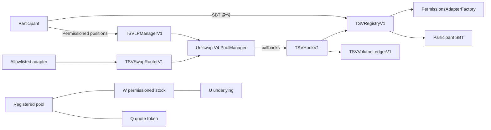

# TSV V1 系统与调用路径

本文按当前 `src/v1/` 描述合约职责和调用边界。测试可执行路径见 [`test/README.md`](../test/README.md)；公开数据结构见 [`CODING_SPEC_V1.md`](./CODING_SPEC_V1.md)。

## 1. 合约组成

| 合约 | 源码 | 职责 |
| --- | --- | --- |
| `TSVRegistryV1` | `src/v1/core/TSVRegistryV1.sol` | W/U/Q 与证券准入、池登记、SBT 权限映射、tier 容量、证券暂停、池 lifecycle、全局紧急暂停及 AccessControl 根 |
| `TSVVolumeLedgerV1` | `src/v1/core/TSVVolumeLedgerV1.sol` | 以固定 EST epoch day 和 legal-share WAD 保存直接日额度、已用量并校验成交额度 |
| `TSVHookV1` | `src/v1/core/TSVHookV1.sol` | 接收 PoolManager 回调、验证 Router/LP Manager 调用、执行池/暂停门禁、检查 multiplier 快照并记账 |
| `TSVSwapRouterV1` | `src/v1/periphery/TSVSwapRouterV1.sol` | 单池 exact-input Swap、Adapter 白名单、W/U 与 Q 结算、请求期限与滑点边界 |
| `TSVLPManagerV1` | `src/v1/periphery/TSVLPManagerV1.sol` | 建池、Permissioned Position NFT、流动性 action、普通 LP 门禁及两条全仓强退入口 |
| `ERC8056DirectLegalShareAdapter` | `src/v1/adapters/ERC8056DirectLegalShareAdapter.sol` | 读取绑定 U 的 `uiMultiplier()` 并将 raw 数量换算为 legal-share WAD |

部署辅助合约包括 `TSVERC1967Proxy` 和 `TSVHookProxyFactoryV1`。当前源码没有 DataInbox、Governance Anchor、报告类型或外置报告验证合约。Registry 和 Ledger 直接接受受角色限制的写入。

Router 提供 caller-bound 直接交易入口和 Adapter 交易入口。直接调用时 `msg.sender` 同时是 participant、payer 和收款方；Adapter 入口仍要求 allowlist，并由 Adapter 提供 participant 身份。Registry 和 W 分别检查 participant 的权限。LP 用户通过 action 接口直接调用 LP Manager。

## 2. W/U/Q 与池身份

- **W** 是由 Factory 创建的 Permissions Adapter，也是 V4 池中的股票币种。它对应一个 **U**，并受发行方 swap/LP 权限检查约束。
- **U** 是原始 underlying Token。Registry 将 W 映射到 U，并为每个 U 保存 `securityId`、decimals 和 legal-share adapter。同一个 U 的多个 W 共用这条登记及 Ledger quota。
- **Q** 是单独登记的 quote ERC-20。已登记的 V4 池必须恰好包含一个 W 和一个 Q，使用已配置的 Hook，并由已配置的 LP Manager 发起登记。
- Registry 校验 Factory 来源、W/U metadata、issuer checker 接口、资产身份隔离、quote 身份，以及 legal-share adapter 的 ERC-165 接口和 `poolCurrency()` 绑定。它不验证经济安全性、转账行为、发行方承诺或法律解释。
- 禁止 U 或 Q 参与新池登记只阻止未来建池，本身不会改变既有池的 lifecycle 或操作门禁。下架 security 前，其所有池都必须先进入 `DELIST`，并且不能仍有计数中的位置 NFT。

`PermissionedValidationLib` 链接到 Registry implementation，通过 delegatecall 执行准入检查。状态、角色和事件仍属于 `TSVRegistryV1`。

## 3. 池准入与生命周期

`TSVLPManagerV1.initializePool(key, sqrtPriceX96)` 检查 `POOL_CREATOR_ROLE`，调用 Registry 登记池，再在 PoolManager 中初始化同一个 key。两个步骤在同一笔交易内完成；若初始化失败，池登记也会回滚。

Pool lifecycle is stored in `PoolRecord`:

| 状态 | Swap | 普通 LP |
| --- | --- | --- |
| `LIST` | 继续检查其余门禁 | 继续检查其余门禁 |
| `PAUSE` | 禁止 | 继续检查其余门禁 |
| `DELIST` | 禁止 | 禁止 |

进入 `DELIST` 要求池的 `tickCount` 为零。该计数跟踪经 LP Manager mint/burn 的 position NFT；它不是价格 tick 数，也不衡量活跃流动性。零流动性的 NFT 在 burn 前仍计数。`delistSecurity` 要求该证券的 `listedPoolCount` 为零，因此运营方须先下架其所有池。

## 4. Swap 流程与成交量记账

1. 用户可直接调用 `swapExactInput(request)`，Router 将调用者绑定为 participant、payer 和收款方；或者已登记的 Adapter 调用 `swapExactInputFromContractDirect(request, payer, participant, recipient)` / `swapExactInputFromContract(request, participant)`。Direct Adapter 的 U 输入使用 W 中预存的 U；Q 输入使用调用 Adapter 作为 payer；输出交给 participant。普通 Adapter 入口以调用 Adapter 作为 payer，输出返回 Adapter。
2. Router 对 Adapter 路径检查 allowlist；所有路径都检查 participant 的 SBT 权限、deadline、输入范围、池登记、lifecycle 和最小输出。请求只支持单池 exact-input，且必须结算全部请求输入。
3. 直接用户和普通 Adapter 路径的 U 输入由 Router 转入 W，再由 W 包装为 PoolManager 的 W；Direct Adapter 路径使用调用前存入 W 的 U。Q 输入在 `PoolManager.sync` 后由 Router 直接从 payer 转给 PoolManager 并结算，不经过 Router 余额。W 输出会解封为 U，Q 输出仍为 Q。
4. Hook 仅接受已配置 Router 和 PoolManager 的 swap 回调。Swap 前后均检查 `isTradable`、global pause，以及请求中的 32-byte `expectedMultiplier` 是否与 canonical U adapter 当前值相符。
5. `afterSwap` 将 PoolManager 返回的 W 侧 delta 绝对值转换成 legal-share WAD，并调用 `recordSwap`。Ledger 根据已登记池找到其 security，检查更新后的当日 `usedWad` 是否超过该 security 的 quota。检查失败会回滚整笔 swap。

链上不计算 quota 公式：没有由 ADTV/tier 推导的上限、quota override、报告序号或预定拆并股因子。运营方通过 `setQuota` 直接写入额度。mapping 默认值为零；当前日配置 quota 前，正成交量的 swap 会回滚。

当前日计算式为 `(block.timestamp - 5 hours) / 1 days`，日界固定在 UTC-5，不随夏令时调整。`setQuota` 不改变已用量；`setUsedWad` 覆盖已用量，可将其设为零或高于 quota，后续 swap 会按更新后的状态重新执行额度检查。

## 5. LP 操作与退出

LP Manager 复用 permissioned V4 position manager，并在 action dispatch 中加入 TSV 检查：

- 建池受 `POOL_CREATOR_ROLE` 限制。
- 普通 position action 和 settlement action 均要求 action executor 具有 `LIQUIDITY_ALLOWED`；position action 还会检查 NFT owner。显式 recipient 在解析 sentinel 地址后检查。
- `MINT_POSITION_FROM_DELTAS` 和 `INCREASE_LIQUIDITY_FROM_DELTAS` 会被拒绝。标准 `MINT_POSITION` 和 `INCREASE_LIQUIDITY` 使用显式 liquidity 数量。
- `withdrawClaim` 被禁用。成功 mint/burn 后更新池 position 计数；若 Registry 更新失败，整个 action 一并回滚。
- `unwindPosition` 允许任一 Factory 验证过的 permissioned currency adapter 的 owner 请求全仓退出。`unwindPositionByTsv` 使用 `FORCE_EXIT_ADMIN_ROLE`。两条路径都将资产交付给 LP owner，并创建仅供本次退出 action 使用的受限 callback。
- 两个 unwind 入口都在一次操作中退出全部仓位。若 quote Token 拒绝转账，或原始本金/费用超出 PoolManager `int128` delta 范围，退出可能回滚。代码没有授权的部分退出入口，也没有 quote-token claim fallback。

global emergency pause 会阻止普通 action 和 unwind 入口。security 级 LP pause 会阻止普通 LP 操作；Hook 允许正在进行且已授权的 unwind 通过该 security 级检查。

## 6. 暂停与权限模型

`SecurityPauseMode` 每次写入最终值（`NONE`、`TRADE`、`LP`、`ALL`），不是通过 bitwise 命令累积；这些值被当作操作 bitmask 使用。`PoolLifecycle` 与 security pause 相互独立。Registry 的 `emergencyPauseEnable` 是第三个全局标志。

`isTradable(poolId)` 和 `isLPAllowed(poolId)` 返回已登记池、lifecycle 和 security 操作权限检查的结果，不包含 global emergency flag；全局状态由 `isPaused()` 单独返回。实际执行合约会检查适用的两类条件。

Registry 为每个 SBT identity token ID 保存权限 bitmask。对 participant，Registry 会按位 OR 其当前持有的所有已配置身份权限。若 SBT 报告自身 paused，则有效权限为 `NONE`。TSV 检查 `SWAP_ALLOWED` 和 `LIQUIDITY_ALLOWED`；W 的 issuer checker 与 `swappingEnabled` 是独立的一层权限控制。

## 7. 角色与升级

`TSVGoverned` 在初始化时向 admin 授予 `DEFAULT_ADMIN_ROLE` 和 `UPGRADE_ADMIN_ROLE`。Default Admin 控制角色分配。Router、LP Manager、Hook 和 Volume Ledger 会从 Registry 查询角色，用于执行各自受限操作。

| 角色 | 当前源码中的用途 |
| --- | --- |
| `DEFAULT_ADMIN_ROLE` | 管理角色、配置 SBT 身份和 tier policy、设置 Router Adapter allowlist |
| `SYMBOL_ADMIN_ROLE` | 登记股票/quote、配置证券 tier/listing 和池 lifecycle |
| `HALT_REPORTER_ROLE` | 设置 security pause mode |
| `VOLUME_ORACLE_ROLE` | 设置 quota 和覆盖已用成交量 |
| `EMERGENCY_PAUSER_ROLE` / `EMERGENCY_RESUMER_ROLE` | 启用/解除 global pause |
| `POOL_CREATOR_ROLE` | 通过 LP Manager 初始化已登记 V4 池 |
| `FORCE_EXIT_ADMIN_ROLE` | 调用 `unwindPositionByTsv` |
| `UPGRADE_ADMIN_ROLE` | 授权 UUPS 升级；Hook 在 global pause 时也会拒绝升级 |

共享基类仍定义 `REVOKE_EXIT_EXECUTOR_ROLE` 和 `WITHDRAW_CLAIM_ROLE` 常量，但当前 TSV 合约没有消费者；`withdrawClaim` 会回滚。分配角色前应先核对当前源码中的实际调用点，不能仅凭常量名称赋予运营含义。

## 8. 当前实现边界

当前源码不包含 DataInbox/报告合约、ADTV 派生额度、拆并股排期、治理 Anchor、TSV Router 多跳/exact-output 接口、公司行动处理或可执行的 X Layer fork 套件。历史设计和审计材料可能描述较早版本；文档分类见 [`docs/README.md`](./README.md)。
