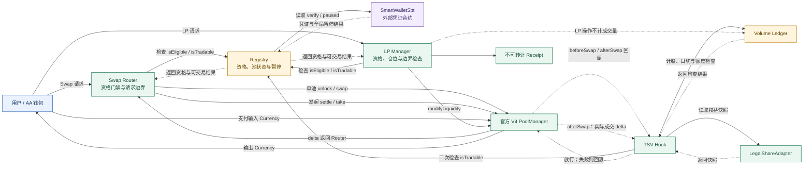
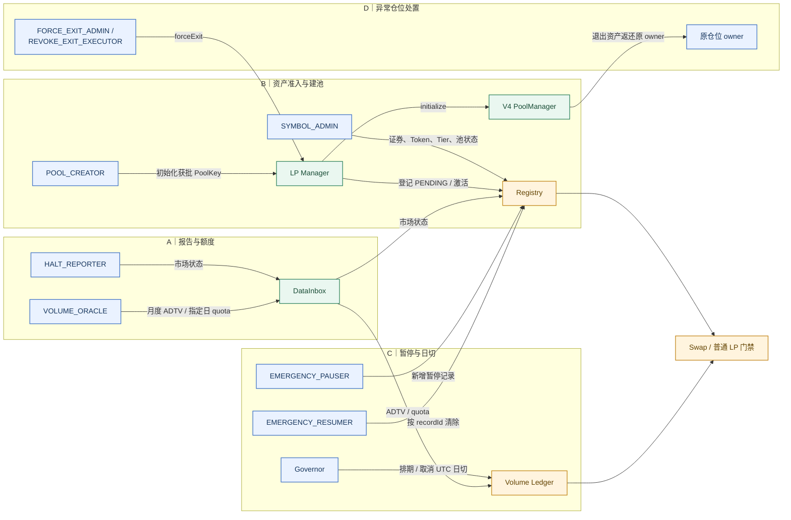
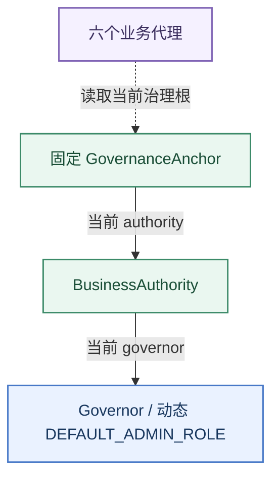
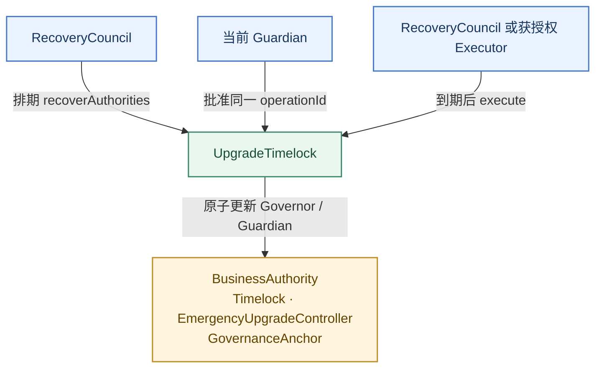
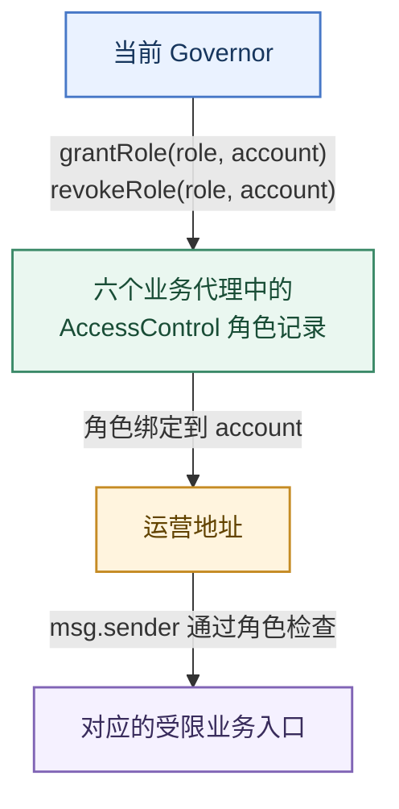
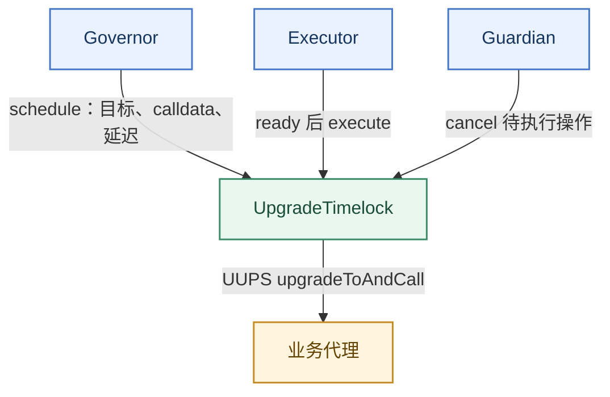
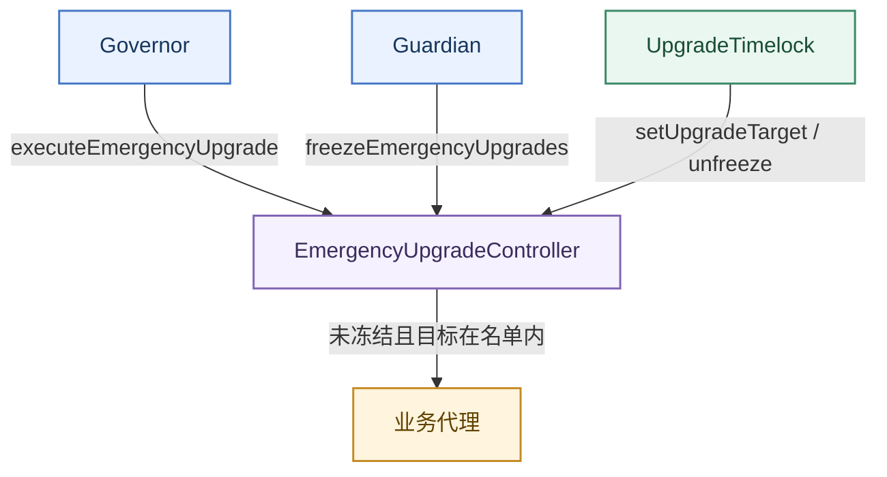
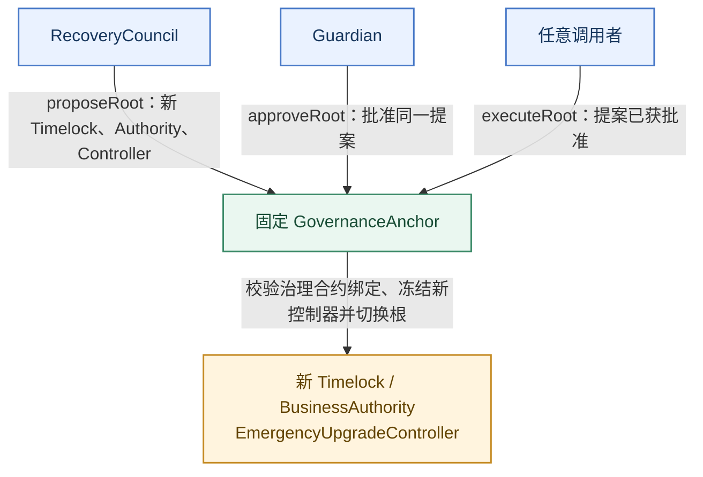
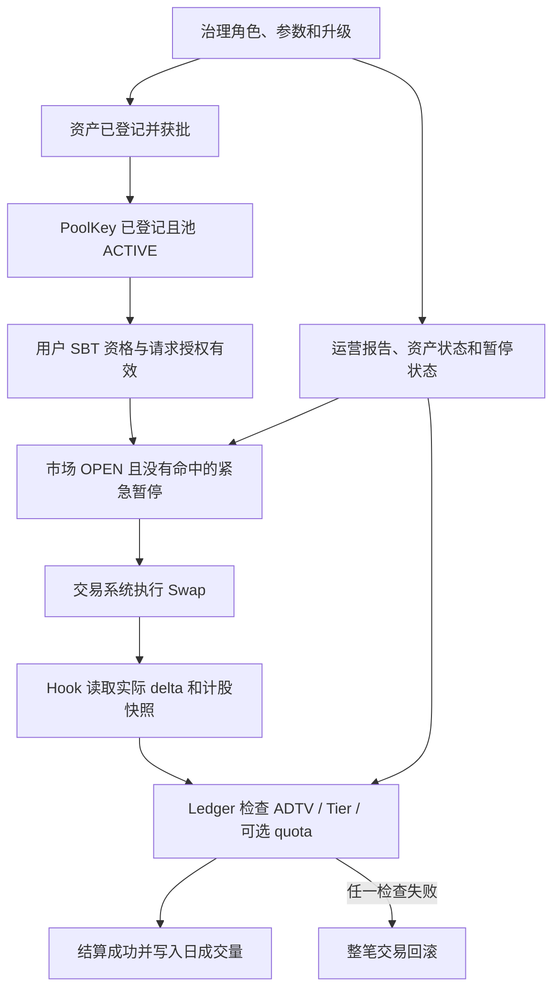

# TSV V1 三个系统：交易、运营与治理

本文从业务角度说明当前仓库中的 TSV V1 如何组成交易、运营和治理三个系统，以及它们如何共同约束交易。描述以 `src/v1/` 当前源码为准；目标链部署、实际 wTSLAx/SBT 准入证据等未完成项见[实现与缺口清单](./IMPLEMENTATION_STATUS_V1.md)。完整 ABI 和算法以[编码规格](./CODING_SPEC_V1.md)为准。

## 一、整体关系

三个系统围绕同一组核心合约协作：交易系统执行用户 Swap 和 LP 操作；运营系统提交市场、成交量和准入状态，并处理暂停、建池和强退；治理系统管理运营权限、关键业务参数及合约升级。


图中 `Registry`、`DataInbox`、`VolumeLedger`、`Hook`、`SwapRouter` 和 `LPManager` 是六个业务代理。治理三合约和 `GovernanceAnchor` 是非代理治理合约；Anchor 为六个代理提供当前治理根地址。

`SmartWalletSbt` 是 Registry 使用的外部凭证合约，不属于 TSV 六个业务代理；Registry 保存 SBT 地址和 tokenId，并读取凭证有效性及全局暂停状态。

## 二、交易系统



### 2.1 Swap：授权、执行、计量、结算

1. **提交请求。**用户通过 [TSVSwapRouterV1](../src/v1/periphery/TSVSwapRouterV1.sol) 直接提交单池 exact-in 或 exact-out 请求。Router 要求 `msg.sender == participant == payer == recipient`，并绑定 PoolKey、金额边界和 deadline。
2. **通过资格与交易门禁。**Router 负责发起 Swap 门禁调用，并根据返回结果拒绝或继续交易：它调用 Registry 的 `isEligible` 和 `isTradable`。Registry 负责计算资格与可交易状态，并封装对外部 [SmartWalletSbt](../lib/soul-bound-token-1155/src/SmartWalletSbt.sol) 的读取，包括 `verify(owner, tokenId)` 和 `paused()`；池/Token 状态、市场 HALT 和命中的紧急暂停也由 Registry 检查。LP Manager 对普通 LP 用户也会经 Registry 查询资格和池状态。
3. **在 V4 中执行。**Router 通过官方 [PoolManager](../lib/v4-core/src/PoolManager.sol) 发起 Swap。PoolManager 调用 [TSVHookV1](../src/v1/core/TSVHookV1.sol)；Hook 校验唯一活跃上下文、池和运行状态。Router 非重入锁保证同一时刻只有一笔 Swap，不使用 Swap `operationId`。
4. **按实际成交量计量。**`afterSwap` 收到实际 delta 后读取股票腿的 LegalShareAdapter 快照，并将实际 raw 数量与该快照交给 [TSVVolumeLedgerV1](../src/v1/core/TSVVolumeLedgerV1.sol)。Ledger 记账时校验快照、换算为 `legalSharesWad`，按 `(securityId, tradeDayId)` 更新全平台共享用量并检查当日有效上限。Router 在 unlock 回调结束后清理自身活跃上下文。
5. **原子结算。**Router 直接以池内 ERC-20 Currency 和用户结算。交易门禁、计股、额度检查或精确余额校验任一失败，整笔交易回滚，成交和账本不会只成功一半。

当前 V1 是单池直接结算路径；用户直接支付和接收 `PoolKey` 中的池内 Currency。Tesla 目标池直接使用 wTSLAx，TSLAx 不在 TSV 同笔交易中包装或赎回。股票腿和普通报价币腿的计量方式不同：报价币不占证券额度；一个合格池最多有一侧是股票。

### 2.2 Swap 交互合约入口与参数

下表只列用户实际提交的 Swap 交易入口。Registry 查询、PoolManager 解锁与回调、Hook/Adapter/Ledger 调用属于协议内部执行流程，已在前面的流程图和 Swap 步骤中说明，这里不重复列作交易入口。

| 调用方 → 合约 | 函数入口 | 参数与作用 |
| --- | --- | --- |
| 用户 → [TSVSwapRouterV1](../src/v1/periphery/TSVSwapRouterV1.sol) | `swapExactInput(SwapRequest request) returns (uint256 actualIn, uint256 actualOut)` | 精确输入模式；要求 `request.exactInput == true` 且 `msg.sender == request.participant`。 |
| 用户 → Router | `swapExactOutput(SwapRequest request) returns (uint256 actualIn, uint256 actualOut)` | 精确输出模式；要求 `request.exactInput == false` 且 `msg.sender == request.participant`。 |

**每笔 Swap 都由 participant 直接提交。**Router 要求 `msg.sender == participant == payer == recipient`，并实时检查 participant 的 SBT 资格；Router 不接受代提交者或 participant 签名。合约钱包可由自身发起调用，其 UserOperation/所有者授权由钱包自身验证。用户仍须预先授权 Router 花费输入 Token。

#### `SwapRequest` 结构与字段

`SwapRequest` 定义在 [TSVTypes.sol](../src/v1/types/TSVTypes.sol)。下面列出完整字段，并展开嵌套结构 `PoolKey`：

```solidity
struct PoolKey {
    Currency currency0;
    Currency currency1;
    uint24 fee;
    int24 tickSpacing;
    IHooks hooks;
}

struct SwapRequest {
    PoolKey key;
    address participant;
    address payer;
    address recipient;
    bool zeroForOne;
    bool exactInput;
    uint128 amountSpecified;
    uint128 limitAmount;
    uint160 sqrtPriceLimitX96;
    uint64 deadline;
}
```

| `SwapRequest` 字段 | 类型 | 含义与当前约束 |
| --- | --- | --- |
| `key` | `PoolKey` | V4 池的完整身份键。Router 根据它计算 `poolId`，并要求它与 Registry 登记的完整 PoolKey 相同；具体字段见下表。 |
| `participant` | `address` | 本笔交易的主体，必须非零且通过 Registry 的 SBT 资格检查。V1 还要求 `participant == payer == recipient`。 |
| `payer` | `address` | Router 从该地址拉取实际输入 Currency；V1 要求等于 `participant`，并须预先授权 Router 花费 Token。 |
| `recipient` | `address` | Router 将实际输出 Currency 发送到该地址；V1 要求等于 `participant`。 |
| `zeroForOne` | `bool` | `true` 表示从 `currency0` 换到 `currency1`；`false` 表示从 `currency1` 换到 `currency0`。 |
| `exactInput` | `bool` | `true` 选择 `swapExactInput`，`false` 选择 `swapExactOutput`；必须与实际调用的入口一致。 |
| `amountSpecified` | `uint128` | 使用池内 Currency 的 raw 最小单位，不是股数。精确输入时表示目标/上限输入量；精确输出时表示必须完整得到的输出量。必须大于零且不超过 `int128.max`。 |
| `limitAmount` | `uint128` | 交易滑点界限，单位同样是池内 Currency 的 raw 最小单位。精确输入时为最小输出量；精确输出时为最大输入量；必须大于零。 |
| `sqrtPriceLimitX96` | `uint160` | V4 的价格停止边界，表示 Q64.96 格式的平方根价格。PoolManager 按交易方向校验该边界；到达边界可能令精确输入部分成交，但精确输出若未达到目标会回滚。 |
| `deadline` | `uint64` | Unix 秒时间戳。执行时若 `block.timestamp > deadline`，请求过期并回滚。 |

#### 嵌套结构参数

`PoolKey` 来自 V4 Core 的 [PoolKey.sol](../lib/v4-core/src/types/PoolKey.sol)：

| `PoolKey` 字段 | 类型 | 含义与当前约束 |
| --- | --- | --- |
| `currency0` | `Currency` | 池中排序较小的 Currency 地址。TSV 注册池要求非零且小于 `currency1`；当前资产准入使用 ERC-20 Currency。 |
| `currency1` | `Currency` | 池中排序较大的 Currency 地址，必须与 Registry 中登记值一致。 |
| `fee` | `uint24` | V4 池手续费参数；必须与已登记池一致。TSV 当前注册逻辑要求小于 `1_000_000`。 |
| `tickSpacing` | `int24` | 池允许的 tick 间隔；必须与登记值一致。TSV 注册范围为 `1..32767`。 |
| `hooks` | `IHooks` | 该池的 Hook 合约地址；TSV 要求它等于配置的 `TSVHookV1`。 |

### 2.3 普通 LP 交互入口与参数

普通 LP 操作由 [TSVLPManagerV1](../src/v1/periphery/TSVLPManagerV1.sol) 作为唯一 V4 仓位持有人执行。操作会先检查用户资格、截止时间和池状态，再更新 V4 仓位；开仓时铸造不可转让 Receipt，LP 操作不计入成交量账本。

| LP 用户入口 | 参数 | 含义 |
| --- | --- | --- |
| `openPosition(PoolKey key, int24 tickLower, int24 tickUpper, uint128 liquidity, LPBounds bounds) returns (uint256 positionId)` | 池键、价格区间下/上 tick、增加的 liquidity、两侧结算边界和 deadline | 开新仓位并铸造 Receipt；tick 必须按池的 `tickSpacing` 对齐，并返回新仓位 ID。 |
| `increaseLiquidity(uint256 positionId, uint128 liquidity, LPBounds bounds)` | 仓位 ID、增加的 liquidity、结算边界 | 仓位 owner 增加流动性。 |
| `decreaseLiquidity(uint256 positionId, uint128 liquidity, LPBounds bounds)` | 仓位 ID、减少的 liquidity、结算边界 | 仓位 owner 部分撤出；不能一次减到零，全部退出使用 close。 |
| `collectFees(uint256 positionId, LPBounds bounds)` | 仓位 ID、结算边界 | 领取该仓位已产生的费用；无费用时回滚。 |
| `closePosition(uint256 positionId, LPBounds bounds)` | 仓位 ID、结算边界 | 撤出全部流动性、结算资产并销毁 Receipt。 |

`LPBounds` 定义在 [TSVTypes.sol](../src/v1/types/TSVTypes.sol)，是 LP 入口共用的结算边界：

| `LPBounds` 字段 | 含义 |
| --- | --- |
| `maxPoolIn0` / `maxPoolIn1` | currency0/1 从 owner 扣取的 raw 数量上限。 |
| `minPoolOut0` / `minPoolOut1` | currency0/1 返还给 owner 的 raw 数量下限。 |
| `deadline` | Unix 秒时间戳；过期的普通 LP 请求会回滚。 |

LP 需要向 LP Manager 授权输入 Token；LP Manager 从仓位 owner 拉取投入资产，并将取回资产直接发回原 owner。

### 2.4 计量日和成交额度

Ledger 使用 `block.timestamp` 和配置的 UTC 日切起点自动计算 `tradeDayId`。每个 UTC 日期都形成一个计量日；它不是美股交易日历，也不要求日历报告或边界时的激活交易。起点可由 Governor 为未来日期排期调整，具体限制见[编码规格 §7](./CODING_SPEC_V1.md#7-角色报告计量日和额度)。

证券当日硬上限由适用 ADTV 和证券 Tier 计算；有效日配额有覆盖时，取硬上限和覆盖值中较小者，没有覆盖时使用硬上限。适用 ADTV 缺失会阻止该证券 Swap；可选 quota 缺失本身不会阻止交易。每个证券在同一 TSV 平台的所有池共用一份日用量。LP 加减仓不增加 `usedWad`。

### 2.5 LP Receipt

Receipt 是 LP 仓位凭证，不可转让；普通 LP 操作检查用户 SBT 资格、deadline、资产/池状态和运行期门禁，但不写成交量账本。

### 2.6 交易系统直接查询与 Receipt ABI

以下是用户或前端可直接查询的接口。带“协议上下文”的方法只供 Hook/其他 TSV 合约在活跃调用期间读取，不作为用户操作入口。

| 合约 | 直接查询入口 | 含义 |
| --- | --- | --- |
| SwapRouter | `poolManager()`、`registry()`、`ledger()`、`hook()` | 查询 Router 绑定的组件地址。 |
| LPManager | `getPosition(uint256 positionId) returns (Position memory)` | 读取仓位 owner、PoolKey、ticks、salt、流动性和 active 状态。 |
| LPManager | `ownerOf(uint256 tokenId)`、`balanceOf(address owner)`、`tokenURI(uint256 tokenId)`、`name()`、`symbol()`、`getApproved(uint256 tokenId)`、`isApprovedForAll(address owner, address operator)`、`supportsInterface(bytes4 interfaceId)` | ERC-721 Receipt 标准查询；`tokenURI` 对有效 Receipt 返回空字符串；Receipt 不可转让，approve 查询通常为零/false。 |
| LPManager | `poolManager()`、`registry()`、`nextPositionId()`、`nextOperationNonce()` | 查询绑定的 PoolManager、Registry、下一个仓位编号和下一个 LP 操作序号。 |
| LPManager（协议上下文） | `activeLPContext(bytes32 operationId)` | 仅在 LP Manager 的活跃 PoolManager 操作上下文中供 Hook 核对，不是普通用户读取入口。 |
| SwapRouter（协议上下文） | `activeSwapContext() returns (bool isActive, bytes32 poolId, address participant)` | 仅在 Router 的单笔活跃 Swap 上下文中供 Hook 核对，不是普通用户操作入口。 |

Receipt 的 `approve(address,uint256)`、`setApprovalForAll(address,bool)`、`transferFrom(address,address,uint256)`、`safeTransferFrom(address,address,uint256)` 和 `safeTransferFrom(address,address,uint256,bytes)` 均可在 ABI 层调用，但会回滚 `NonTransferable()`；它们不是可成功执行的业务操作。

## 三、运营系统

运营系统维护交易所需的市场数据、额度、资产与池状态，并处理运行风险。运营地址按角色授权，各角色直接调用对应合约，不共享一个“运营管理员”入口。



运营入口按“报告和额度、证券与 Token 准入、暂停、日切、池管理、强制退出”展开。下面列的是角色直接调用的业务入口；Governor 对运营角色的授予/撤销，以及治理根和升级入口属于治理系统。所有报告由带对应角色的地址直接提交，没有 relayer 或用户签名参数。

#### 运营角色直接写入口总表

这里先列出运营角色和 Governor 实际提交的入口函数；下方小节再说明每个参数的含义和校验。这样函数签名与参数说明始终成对出现。

| 调用方/角色 | 合约 | 直接入口函数 | 参数说明 |
| --- | --- | --- | --- |
| `HALT_REPORTER_ROLE` | DataInbox | `submitMarketStatus(MarketReport calldata report)` | `report` 字段见 §3.1「停牌/恢复」。 |
| `VOLUME_ORACLE_ROLE` | DataInbox | `submitAdtv(AdtvReport calldata report)` | `report` 字段见 §3.1「月度成交量」。 |
| `VOLUME_ORACLE_ROLE` | DataInbox | `submitAdtvBatch(AdtvReport[] calldata reports)` | 同月、按 `securityId` 严格递增的 ADTV 报告数组；见 §3.1「月度成交量」。 |
| `VOLUME_ORACLE_ROLE` | DataInbox | `submitQuota(QuotaReport calldata report)` | `report` 字段见 §3.1「指定日额度」。 |
| `SYMBOL_ADMIN_ROLE` | Registry | `listSecurity(bytes32 securityId, bytes32 symbolHash, uint8 tierId, bytes32 evidenceHash)` | 新证券 ID、符号摘要、Tier、依据摘要。 |
| `SYMBOL_ADMIN_ROLE` | Registry | `relistSecurity(bytes32 securityId, bytes32 evidenceHash)` | 已下架证券 ID、恢复依据摘要。 |
| `SYMBOL_ADMIN_ROLE` | Registry | `setSecurityTier(bytes32 securityId, uint8 tierId, bytes32 evidenceHash)` | 证券 ID、新 Tier、依据摘要。 |
| `SYMBOL_ADMIN_ROLE` | Registry | `delistSecurity(bytes32 securityId, bytes32 evidenceHash)` | 证券 ID、下架依据摘要。 |
| `SYMBOL_ADMIN_ROLE` | Registry | `registerToken(TokenConfig calldata config, bytes32 evidenceHash)` | 完整 `TokenConfig` 和登记依据摘要；字段见 §3.2。 |
| `SYMBOL_ADMIN_ROLE` | Registry | `setTokenStatus(address currency, TokenStatus status, bytes32 evidenceHash)` | 池内 Currency、目标状态、状态变更依据摘要。 |
| `SYMBOL_ADMIN_ROLE` | Registry | `replaceLegalShareAdapter(address currency, address newAdapter, bytes32 evidenceHash)` | 股票 Currency、新 Adapter、政策/法律依据摘要。 |
| `EMERGENCY_PAUSER_ROLE` | Registry | `addEmergencyPause(PauseScope scope, bytes32 target, bytes32 reasonCode, bytes32 sourceHash) returns (uint256 recordId)` | 暂停范围、范围目标、原因码、来源摘要；返回新暂停记录 ID。 |
| `EMERGENCY_RESUMER_ROLE` | Registry | `clearEmergencyPause(uint256 recordId, bytes32 reasonCode)` | 暂停记录 ID、清除原因码。 |
| Governor | VolumeLedger | `scheduleDayStart(uint32 newOffsetSeconds, uint32 effectiveDayId, bytes32 reasonHash)` | 新 UTC 偏移秒数、生效日、理由摘要。 |
| Governor | VolumeLedger | `cancelPendingDayStart(bytes32 reasonHash)` | 非零取消理由摘要。 |
| `POOL_CREATOR_ROLE` | LPManager | `initializePool(PoolKey calldata key, uint160 sqrtPriceX96, bytes32 priceBasisHash)` | V4 池键、初始平方根价格、定价依据摘要。 |
| `SYMBOL_ADMIN_ROLE` | Registry | `disablePool(bytes32 poolId, bytes32 evidenceHash)` | 池 ID、停用依据摘要。 |
| `SYMBOL_ADMIN_ROLE` | Registry | `enablePool(bytes32 poolId, bytes32 evidenceHash)` | 池 ID、恢复依据摘要。 |
| `FORCE_EXIT_ADMIN_ROLE` 或 `REVOKE_EXIT_EXECUTOR_ROLE` | LPManager | `forceExit(uint256 positionId, uint256 minPoolOut0, uint256 minPoolOut1, bytes32 reasonCode, bytes32 evidenceHash)` | 仓位 ID、两侧最低返还量、原因码、证据摘要。 |

以上是运营直接写入口全集。`Registry.registerPendingPool/markPoolActive`、`Registry.applyMarketStatus`、`VolumeLedger.acceptAdtv/acceptQuota/recordSwap` 是由 LPManager、DataInbox 或 Hook 调用的合约间入口，不属于此清单。

### 3.1 报告和额度入口

#### 通用审计字段

三个报告都携带来源时间、提交截止、递增序号、唯一报告 ID 和来源哈希：

| 参数 | 类型 | 含义和校验 |
| --- | --- | --- |
| `sourceTimestamp` | `uint64` | 数据源生成时间（Unix 秒）。不得晚于当前链上时间；同类、同证券的来源时间不得倒退。DataInbox 保存每类报告的最新值用于后续校验，不参与 ADTV 或额度公式。 |
| `submitDeadline` | `uint64` | 最晚可上链时间（Unix 秒）；当前时间超过它时拒绝。只在提交时校验，不存入状态或 `AdtvAccepted` 事件，也不会让已接受的 ADTV 自动过期。 |
| `sequence` | `uint64` | 同报告类别、同证券的来源序号，必须严格大于上次接受值；DataInbox 保存最新值用于防乱序，不参与 ADTV 或额度公式。三个类别分别维护序号：市场状态、ADTV、Quota。 |
| `reportId` | `bytes32` | 全局唯一的非零报告 ID；DataInbox 保存已用标记防重复，VolumeLedger 保存该证券/月 ADTV 的最新 `reportId` 并在 `AdtvAccepted` 事件中发出；不参与额度计算。 |
| `sourceHash` | `bytes32` | 必须非零；当前实现只做非零校验，不写入合约状态或 `AdtvAccepted` 事件。可从提交交易 calldata 读取，供链下索引器关联来源材料。 |

这些校验在 `TSVDataInboxV1` 入口统一执行；成功后才调用 Registry 或 VolumeLedger 写入业务状态。`sourceTimestamp` 的单调性按报告类别和证券分别维护，`reportId` 则跨类别全局去重。

#### 停牌/恢复：`MarketReport`

入口为 `submitMarketStatus(MarketReport calldata report)`，仅 `HALT_REPORTER_ROLE` 可调用。状态写入 Registry；报告 ID、序号与数据来源元数据由 DataInbox 校验。

```solidity
struct MarketReport {
    bytes32 securityId;
    MarketAction action;
    bytes32 reasonCode;
    bytes32 exchangeHash;
    uint64 sourceTimestamp;
    uint64 submitDeadline;
    uint64 sequence;
    bytes32 reportId;
    bytes32 sourceHash;
}
```

| 参数 | 类型 | 含义和当前约束 |
| --- | --- | --- |
| `securityId` | `bytes32` | 已登记且当前 listed 的证券 ID；不是 ticker 字符串。 |
| `action` | `MarketAction` | `INITIAL_OPEN`、`INITIAL_HALTED`、`HALT` 或 `RESUME`。首次只能初始化为开放或停牌；之后只允许 `OPEN → HALTED` 和 `HALTED → OPEN`，重复状态报告回滚。 |
| `reasonCode` | `bytes32` | 非零原因码；建议在运营字典中维护稳定编码。仅在提交时校验，不写入 Registry 状态或 `MarketStatusChanged` 事件；可从提交交易 calldata 读取。 |
| `exchangeHash` | `bytes32` | 非零交易所/市场来源标识摘要。仅在提交时校验，不写入 Registry 状态或 `MarketStatusChanged` 事件；可从提交交易 calldata 读取。 |
| 其余字段 | — | 按上面的通用审计字段填写。 |

`HALT` 一直有效到有效 `RESUME` 被接受；不会按报告年龄自动恢复。该入口用于个别证券的市场状态，不代表周末或正常闭市，也不能增删紧急暂停记录。

#### 月度成交量：`AdtvReport`

单笔入口为 `submitAdtv(AdtvReport calldata report)`；批量入口为 `submitAdtvBatch(AdtvReport[] calldata reports)`。二者仅 `VOLUME_ORACLE_ROLE` 可调用，Ledger 保存 ADTV。

```solidity
struct AdtvReport {
    bytes32 securityId;
    uint32 sourceMonth;
    uint256 adtvWad;
    uint64 sourceTimestamp;
    uint64 submitDeadline;
    uint64 version;
    uint64 sequence;
    bytes32 reportId;
    bytes32 sourceHash;
}
```

| 参数 | 类型 | 含义和当前约束 |
| --- | --- | --- |
| `securityId` | `bytes32` | 已登记且 listed 的证券 ID。 |
| `sourceMonth` | `uint32` | ADTV 来源自然月，格式 `YYYYMM`，如 `202610`；年份范围为 1970–9999，月份为 01–12。 |
| `adtvWad` | `uint256` | 月均日成交量，按 18 位 WAD 表示；必须大于零。具体统计口径由已批准的数据源/业务定义给出。 |
| `version` | `uint64` | 针对 `(securityId, sourceMonth)` 的版本，必须严格等于已存版本加一。 |
| 其余字段 | — | 按通用审计字段填写；`sequence` 按 ADTV 报告类别和证券递增。 |

批量提交长度须为 `1..100`；所有条目必须属于同一个 `sourceMonth`，并按 `securityId` 严格递增且不重复。批次全有或全无：任一条无效，整笔交易回滚。新适用月份必须有对应 ADTV；同一来源月的更正使用递增 `version`，不会重置已用成交量。

#### 指定日额度：`QuotaReport`

入口为 `submitQuota(QuotaReport calldata report)`，仅 `VOLUME_ORACLE_ROLE` 可调用，Ledger 保存或清除当日可选额度覆盖。

```solidity
struct QuotaReport {
    bytes32 securityId;
    uint32 tradeDayId;
    uint8 action;
    uint256 quotaWad;
    uint64 sourceTimestamp;
    uint64 submitDeadline;
    uint64 version;
    uint64 sequence;
    bytes32 reportId;
    bytes32 sourceHash;
}
```

| 参数 | 类型 | 含义和当前约束 |
| --- | --- | --- |
| `securityId` | `bytes32` | 已登记且 listed 的证券 ID。 |
| `tradeDayId` | `uint32` | 额度生效的 TSV 计量日，格式 `YYYYMMDD`；按 UTC 起点归属，不是美股交易日历日期的自动映射。 |
| `action` | `uint8` | `1 = SET`，`2 = CLEAR`；其他值拒绝。 |
| `quotaWad` | `uint256` | `SET` 时须 `0 < quotaWad <=` 当日硬上限。硬上限为 `tradeDayId` 前一自然月 ADTV × 证券当前 `tierBps / 10,000`，向下取整，且必须已有该月 ADTV；`CLEAR` 时必须为零。零值不能用来停牌。 |
| `version` | `uint64` | 针对 `(securityId, tradeDayId)` 的版本，必须严格等于已存版本加一；清除后仍保留版本和报告 ID。 |
| 其余字段 | — | 按通用审计字段填写；`sequence` 按 Quota 报告类别和证券递增。 |

新 quota 只约束提交成功后的 Swap，并与当日已用量比较；若额度调到已用量以下，后续 Swap 会被拒绝。额度不跨日继承。需要恢复 ADTV/Tier 默认硬上限时提交 `CLEAR`。

### 3.2 证券、Token 与股数 Adapter 准入

证券和资产元数据由 `SYMBOL_ADMIN_ROLE` 直接写入 Registry。它不自动批准新 Token：证券和 Token 初始登记后仍是待审查状态，只有 Token 进入 `APPROVED` 后才能建池。

| 入口 | 参数 | 主要效果和约束 |
| --- | --- | --- |
| `listSecurity(bytes32 securityId, bytes32 symbolHash, uint8 tierId, bytes32 evidenceHash)` | 内部证券 ID、ticker/符号摘要、Tier 编号、依据摘要 | 新增证券；`securityId`、`symbolHash`、`evidenceHash` 均非零；`securityId` 和 `symbolHash` 分别不能已登记；Tier 必须已配置且尚有名额。 |
| `relistSecurity(bytes32 securityId, bytes32 evidenceHash)` | 已下架证券 ID、恢复依据摘要 | 恢复原证券并增加版本；证券必须存在且当前未 listed，原 Tier 仍须有名额。 |
| `setSecurityTier(bytes32 securityId, uint8 tierId, bytes32 evidenceHash)` | 证券 ID、新 Tier、依据摘要 | 修改已上市证券的 Tier；扣减旧 Tier 名额、占用新 Tier 名额并增加证券版本。 |
| `delistSecurity(bytes32 securityId, bytes32 evidenceHash)` | 证券 ID、下架依据摘要 | 下架证券并释放 Tier 名额；必须已 listed 且 `activePoolCount == 0`。 |
| `registerToken(TokenConfig calldata config, bytes32 evidenceHash)` | 下方完整 TokenConfig、登记依据摘要 | 登记池内 Currency 和审核信息；初始 `status` 必须为 `UNREVIEWED`。地址、代码哈希、decimals 和直接结算规则均按下表校验。 |
| `setTokenStatus(address currency, TokenStatus status, bytes32 evidenceHash)` | TokenConfig 主键 Currency、目标状态、状态变更依据摘要 | 只允许 `UNREVIEWED → APPROVED`、`APPROVED → DISABLED`、`DISABLED → APPROVED`；不能设置回 `UNREVIEWED`，也不能重复设置当前状态。批准时须已有非零 `reviewHash`；股票还须有非零 `legalSharePolicyHash`、证券仍 listed，且 Token 运行时代码哈希匹配登记值。 |
| `replaceLegalShareAdapter(address currency, address newAdapter, bytes32 evidenceHash)` | 股票 Currency、新 Adapter、公式/法律依据摘要 | 只对已登记股票 Token；新 Adapter 版本须等于旧版本加一、绑定相同 Currency，快照分子/分母非零且当前有效。`evidenceHash` 同时作为更新后的 `legalSharePolicyHash` 保存。若该 Currency 仍有活跃池，必须命中 GLOBAL 或该 TOKEN 范围的紧急暂停；SECURITY 或 POOL 范围暂停不满足此条件。 |

`TokenConfig` 的 ABI 字段顺序如下：

```solidity
struct TokenConfig {
    address poolCurrency;
    uint8 poolDecimals;
    bytes32 securityId;
    address legalShareAdapter;
    uint32 legalAdapterVersion;
    TokenStatus status;
    bytes32 poolRuntimeCodeHash;
    bytes32 legalAdapterCodeHash;
    bytes32 poolImplementationHash;
    bytes32 reviewHash;
    bytes32 restrictionsHash;
    bytes32 legalSharePolicyHash;
}
```

| 字段 | 含义与当前规则 |
| --- | --- |
| `poolCurrency` | 作为 V4 Currency 使用的 ERC-20 地址，也是 Registry TokenConfig 的主键；必须非零且有代码。 |
| `poolDecimals` | 池内 Currency 的 `decimals()`；登记时与链上值核对且不得超过 18。 |
| `securityId` | 股票资产的证券 ID；`0` 表示普通配对币，非零表示股票且必须指向已上市证券。 |
| `legalShareAdapter` | 股票的法律股数换算 Adapter；普通配对币必须为零，股票必须提供有效合约并绑定同一 Currency。 |
| `legalAdapterVersion` | 股数 Adapter 版本；普通币为 `0`，新登记股票当前为 `1`。 |
| `status` | `UNREVIEWED`、`APPROVED` 或 `DISABLED`；新登记必须为 `UNREVIEWED`。 |
| `poolRuntimeCodeHash` | 登记时与链上代码哈希核对；Token 批准时再次核对，交易期间不持续检查。 |
| `legalAdapterCodeHash` | 股票登记时与 Adapter 代码哈希核对；更换 Adapter 时更新。Swap/LP 运行时按 Adapter 版本和快照检查，不读取此字段重新校验代码哈希。 |
| `poolImplementationHash` | 当前合约只保存并通过 `getToken` 返回；不做链上校验、不参与准入或交易门禁。需要核验代理实现时须由链下流程读取并比对。 |
| `reviewHash` | 批准 Token 时只检查非零；不解析或验证其摘要对应的审查材料。 |
| `restrictionsHash` | 当前合约只保存并通过 `getToken` 返回；不校验非零，也不参与任何交易门禁。 |
| `legalSharePolicyHash` | 股票登记/批准时要求非零；更换股数 Adapter 时会以新 `evidenceHash` 更新。当前不参与股数换算公式或 Swap 额度公式。 |

`TokenConfig` 只描述实际池内 Currency 和股数计量配置；用户结算 Token 与池内 Currency 不再分别登记，V1 也没有结算 Adapter 替换入口。`poolImplementationHash` 和 `restrictionsHash` 是当前链上逻辑未消费的被动字段。ABI 首次部署后，后续代理升级必须遵守已部署的存储布局。SBT 地址/tokenId、角色授权和 Tier 风险参数由 Governor 控制，见治理系统；运营角色不能自行更换这些治理根配置。

### 3.3 紧急暂停与恢复

| 入口 | 角色 | 参数含义与约束 |
| --- | --- | --- |
| `addEmergencyPause(PauseScope scope, bytes32 target, bytes32 reasonCode, bytes32 sourceHash) returns (uint256 recordId)` | `EMERGENCY_PAUSER_ROLE` | 新建独立暂停记录并返回递增的 `recordId`。`scope` 为 `GLOBAL`、`SECURITY`、`TOKEN` 或 `POOL`；GLOBAL 的 `target` 必须为零，其余 scope 的 target 必须非零。`reasonCode` 和 `sourceHash` 必须非零。 |
| `clearEmergencyPause(uint256 recordId, bytes32 reasonCode)` | `EMERGENCY_RESUMER_ROLE` | 按记录 ID 清除一条暂停；记录必须存在且仍 active，清除原因码非零。不同记录独立计数，清除一条不会清除其他暂停。 |

`target` 的编码按范围解释：GLOBAL 使用 `bytes32(0)`；SECURITY 使用 `securityId`；TOKEN 使用地址左侧补零转为 `bytes32(uint256(uint160(token)))`；POOL 使用 `PoolId.unwrap(key.toId())`。命中的暂停会阻止对应范围内新 Swap 和普通 LP 操作。它与市场 `HALT` 状态独立；强制退出另走专用授权路径。

### 3.4 UTC 计量日切点

日切由 Governor 直接维护 VolumeLedger。起点是 UTC 午夜后的秒数，自动应用，不需要到点发送激活交易。

| 入口 | 参数 | 含义与约束 |
| --- | --- | --- |
| `scheduleDayStart(uint32 newOffsetSeconds, uint32 effectiveDayId, bytes32 reasonHash)` | 新 UTC 偏移秒数、起效日期 `YYYYMMDD`、非零理由摘要 | 偏移须小于 `86,400` 秒；相对当前日切每次最多变化 `14,400` 秒（4 小时）；起效日期必须晚于已有检查点，并且其前一日的过渡周期尚未开始。不能重写已开始或历史周期。 |
| `cancelPendingDayStart(bytes32 reasonHash)` | 非零取消理由摘要 | 只能取消尚未开始过渡日的待生效排期；无待处理项目、理由为零或过渡日已开始时拒绝。 |

每次偏移变化使起效日前一计量日成为 20–28 小时的过渡日；新偏移只从 `effectiveDayId` 开始生效。历史 dayId、边界和已用额度不回写。更完整的日期例子见[编码规格 §7](./CODING_SPEC_V1.md#7-角色报告计量日和额度)。

### 3.5 池初始化与状态管理

| 入口 | 角色 | 参数含义与约束 |
| --- | --- | --- |
| `initializePool(PoolKey calldata key, uint160 sqrtPriceX96, bytes32 priceBasisHash)` | `POOL_CREATOR_ROLE`，调用 `TSVLPManagerV1` | 创建 V4 池并在同一交易中登记 PENDING→ACTIVE。`key` 由 `currency0/currency1/fee/tickSpacing/hooks` 组成，字段含义见交易系统 §2.2；两侧 Token 都须 APPROVED，Currency 地址须排序且不能为零，Hook 必须为 TSV Hook，fee `< 1,000,000`，tickSpacing 为 `1..32767`，最多一侧可为股票。`sqrtPriceX96` 是 V4 初始 Q64.96 平方根价格；范围及池是否已初始化由 PoolManager 校验。`priceBasisHash` 必须非零，用于留存定价依据摘要。 |
| `disablePool(bytes32 poolId, bytes32 evidenceHash)` | `SYMBOL_ADMIN_ROLE`，Registry | 仅 ACTIVE 池可停用；`evidenceHash` 非零。池状态变为 DISABLED，禁止新 Swap 和普通 LP 操作，但不自动清退存量仓位；历史池身份仍保留供强退使用。 |
| `enablePool(bytes32 poolId, bytes32 evidenceHash)` | `SYMBOL_ADMIN_ROLE`，Registry | 仅 DISABLED 池可恢复；`evidenceHash` 非零。两侧 Token 必须仍为 APPROVED，所含证券必须仍 listed；恢复时还会调用 `isTradable(poolId)`，因此全局/池/Token/证券暂停均须解除，股票市场状态必须为 OPEN。 |

`initializePool` 的原子流程是 LP Manager 调用 Registry 登记 PENDING、调用 PoolManager `initialize`，成功后再由 Manager 通知 Registry 标为 ACTIVE 并更新 active-pool 计数。失败时三步全部回滚。运营不直接调用 Registry 的 `registerPendingPool`/`markPoolActive`；这两个入口仅允许已绑定的 LP Manager 调用。

### 3.6 强制退出仓位

```solidity
function forceExit(
    uint256 positionId,
    uint256 minPoolOut0,
    uint256 minPoolOut1,
    bytes32 reasonCode,
    bytes32 evidenceHash
) external;
```

该入口由 `FORCE_EXIT_ADMIN_ROLE` 或 `REVOKE_EXIT_EXECUTOR_ROLE` 调用：

| 参数 | 含义与约束 |
| --- | --- |
| `positionId` | 要全额退出的 LP 仓位 ID；仓位必须存在、活跃且流动性大于零。 |
| `minPoolOut0` / `minPoolOut1` | `currency0/1` 返还仓位 owner 的最小 raw 数量；任一侧未达到即整笔回滚。 |
| `reasonCode` | 非零处置原因编码。 |
| `evidenceHash` | 非零事件/处置材料摘要。 |

两种角色都必须提供非零 `reasonCode` 和 `evidenceHash`。`FORCE_EXIT_ADMIN_ROLE` 可按管理员授权执行；`REVOKE_EXIT_EXECUTOR_ROLE` 只有在仓位原 owner 已失去 SBT 凭证时才能执行，单独的 SBT 全局 paused 不等同撤证。资产固定返还仓位原 owner，调用者不能指定收款地址。强退不要求池仍可交易，也不受一般市场暂停门禁阻挡；若 Token 拒绝转账或最低返还量不满足，仓位、Receipt 和资产变化全部回滚。

### 3.7 运营入口与治理入口的边界

运营地址不会自行授予角色。Governor 通过各业务代理的 `grantRole(bytes32 role, address account)` / `revokeRole(bytes32 role, address account)` 配置运营角色；权限配置属于治理。`setTierPolicy(uint8 tierId, uint16 tierBps, uint32 maxListed, bytes32 evidenceHash)` 和 `setSbtConfig(address sbt, uint256 tokenId, bytes32 evidenceHash)` 同样仅 Governor 可调用，故分别属于风险参数和资格体系治理，不授予 `SYMBOL_ADMIN` 执行权。日切虽然由 Governor 调用，但在本系统业务分类中作为运营计量周期配置列于 §3.4。

资产准入和建池是先后两步：先登记证券及 Token，并完成资产审查、批准；再由 `POOL_CREATOR` 初始化获批的 PoolKey。普通 Pool 创建权限不意味着可以跳过 Registry 的资产准入或运行期交易门禁。

### 3.8 运营状态直接查询入口

以下查询无需运营角色，可由前端、运营人员或监控直接读取。参数沿用对应写入口中的证券、Token、Pool、报告类别和计量日标识。

| 合约 | 直接查询入口 | 返回/用途 |
| --- | --- | --- |
| Registry | `getSecurity(bytes32 securityId)`、`getToken(address currency)`、`getPool(bytes32 poolId)`、`tierPolicy(uint8 tierId)` | 读取证券、Token、池和 Tier 配置结构。 |
| Registry | `marketStatus(bytes32 securityId)`、`isKnownPool(bytes32 poolId)`、`isTradable(bytes32 poolId)`、`hasCredential(address owner)`、`isEligible(address owner)` | 查询市场状态、池是否登记/可交易、SBT 是否持有/当前是否合格。`isEligible` 同时考虑 SBT 全局暂停。 |
| Registry | `activePoolCountByCurrency(address currency)`、`marketSequence(bytes32 securityId)`、`emergencyPauses(uint256 recordId)`、`activePauseCount(uint8 scope, bytes32 target)` | 读取活跃池计数、市场报告序号、暂停记录及指定范围的活动暂停数量。 |
| Registry | `hook()`、`lpManager()`、`dataInbox()`、`nextPauseId()`、`participantSbt()`、`sbtTokenId()` | 读取绑定地址、下一暂停记录编号和当前 SBT 配置。 |
| DataInbox | `reportIdUsed(bytes32 reportId)`、`lastSequence(uint8 kind, bytes32 key)`、`lastSourceTimestamp(uint8 kind, bytes32 key)`、`MAX_ADTV_BATCH_SIZE()` | 核对报告去重、各类别最新序号/来源时间和批量 ADTV 上限；`kind` 为 `0=Market`、`1=ADTV`、`2=Quota`，`key` 为对应 `securityId`。 |
| DataInbox | `registry()`、`ledger()` | 读取绑定的 Registry 和 VolumeLedger。 |
| VolumeLedger | `currentTradeDay()`、`dayStartUTC(uint32 dayId)`、`dayStartCheckpointCount()`、`dayStartCheckpoint(uint256 index)`、`initialDayStartOffsetSeconds()` | 查询当前计量日、指定计量日起点及日切配置历史。 |
| VolumeLedger | `used(bytes32 securityId, uint32 tradeDayId)`、`adtvOf(bytes32 securityId, uint32 sourceMonth)`、`quotaOf(bytes32 securityId, uint32 tradeDayId)`、`remaining(bytes32 securityId, uint32 tradeDayId)` | 查询指定证券和周期的已用量、ADTV、Quota 覆盖和剩余额度；`remaining` 返回 `(valid, value)`。 |
| VolumeLedger | `registry()`、`hook()`、`dataInbox()`、`QUOTA_SET()`、`QUOTA_CLEAR()` | 读取绑定地址和 Quota action 常量。 |

## 四、治理系统

治理系统有两个不同范围：**业务权限与参数管理**，以及**合约实现升级/治理根迁移**。日常业务角色和普通业务参数由 Governor 直接管理；它们不经过 UpgradeTimelock。运营角色配置归治理权限管理，不归日常运营动作。

### 4.1 治理身份与运营角色管理

#### 治理身份如何配置和变更

Governor、Guardian、RecoveryCouncil 和 Executor 的初始地址来自部署配置。它们是治理身份；运营地址则通过业务角色授权获得具体的运营入口。

| 治理身份 | 链上权限 | 管理方式 |
| --- | --- | --- |
| Governor | BusinessAuthority 的当前 Governor；六代理动态 `DEFAULT_ADMIN_ROLE`；Timelock 普通提案者；事故升级调用者 | 初始部署配置；变更须由 RecoveryCouncil 排期 `recoverAuthorities`，当前 Guardian 批准同一 operationId，再由有执行权的地址执行。 |
| Guardian | 取消普通 Timelock 操作；冻结事故升级；批准受保护身份恢复和治理根迁移 | 初始部署配置；与 Governor 一样只通过受保护 `recoverAuthorities` 轮换，更新会同步到 Anchor、Timelock 和事故控制器。 |
| RecoveryCouncil | 仅能排期受保护身份恢复；也能提出治理根迁移；自身始终有受保护恢复的执行权 | 当前设计中由固定 Anchor 和 Timelock 构造参数锁定，没有普通轮换入口；治理根迁移仍要求同一个 RecoveryCouncil。 |
| Executor | 执行已到期的 Timelock 操作；RecoveryCouncil 另有受保护恢复的执行权 | Executor 地址或开放执行设置在 Timelock 部署时配置；Timelock 的角色接口禁止增删执行者。需调整执行者时，通过根迁移部署并启用新的 Timelock。 |

代理的默认管理员不是逐个写入代理的静态角色，而是沿固定 Anchor 动态读取：



受保护身份恢复流程如下；Governor、Guardian 的根身份不是通过普通 `grantRole/revokeRole` 修改的：



#### 运营角色如何授予和使用



| 业务角色 | 合约入口和权限范围 |
| --- | --- |
| `SYMBOL_ADMIN_ROLE` | Registry 的证券登记/下架、Token 登记/状态、股数 Adapter 替换、池启停。 |
| `POOL_CREATOR_ROLE` | LPManager 的 `initializePool`。 |
| `HALT_REPORTER_ROLE` | DataInbox 的 `submitMarketStatus`。 |
| `VOLUME_ORACLE_ROLE` | DataInbox 的 `submitAdtv`、`submitAdtvBatch`、`submitQuota`。 |
| `EMERGENCY_PAUSER_ROLE` / `EMERGENCY_RESUMER_ROLE` | Registry 的 `addEmergencyPause` / `clearEmergencyPause`。 |
| `FORCE_EXIT_ADMIN_ROLE` | LPManager 的 `forceExit` 管理员强退入口。 |
| `REVOKE_EXIT_EXECUTOR_ROLE` | 仅在仓位原 owner 已失去 SBT 凭证时，可调用 LPManager `forceExit`。 |

这些业务角色由 Governor 按地址逐项授予或撤销，合约只校验 `msg.sender`，不管理运营地址背后的多签成员或门槛。业务代理的 `DEFAULT_ADMIN_ROLE` 由固定 [GovernanceAnchor](../src/v1/governance/TSVGovernanceAnchor.sol) 动态读取当前 BusinessAuthority 中的 Governor，不能通过 `grantRole/revokeRole` 转让。`setTierPolicy`、`setSbtConfig` 等治理参数也是 Governor 专属入口；日切入口虽然同样要求 Governor，但按业务分类仍列在运营系统 §3.4。

#### Governor 直接配置入口与角色管理函数

| 调用者 | 合约入口 | 参数说明与约束 |
| --- | --- | --- |
| Governor | 六个业务代理的 `grantRole(bytes32 role, address account)` | `role` 是该代理定义的业务角色 ID；`account` 是获授权地址。Governor 通过动态 `DEFAULT_ADMIN_ROLE` 授权。不能授予 `DEFAULT_ADMIN_ROLE`。 |
| Governor | 六个业务代理的 `revokeRole(bytes32 role, address account)` | 撤销指定地址的业务角色；不能撤销动态 `DEFAULT_ADMIN_ROLE`。 |
| 角色持有人 | 六个业务代理的 `renounceRole(bytes32 role, address callerConfirmation)` | 持有人主动放弃自己的业务角色；`callerConfirmation` 必须等于 `msg.sender`；不能放弃动态 `DEFAULT_ADMIN_ROLE`。 |
| Governor | Registry 的 `setTierPolicy(uint8 tierId, uint16 tierBps, uint32 maxListed, bytes32 evidenceHash)` | `tierId` 必须非零；`tierBps` 范围 `1..10000`；`maxListed` 不得低于当前已上市数量；`evidenceHash` 非零。 |
| Governor | Registry 的 `setSbtConfig(address sbt, uint256 tokenId, bytes32 evidenceHash)` | SBT 合约地址、资格 Token ID、变更依据摘要。地址须有代码、摘要非零；配置时探测 `paused()` 与 `verify()` 是否可调用。 |
| Governor（首次绑定） | Registry 的 `bindComponents(address hook, address lpManager, address dataInbox)` | 三个组件地址都须有代码，且只能绑定一次。 |
| Governor（首次绑定） | VolumeLedger 的 `bindWriters(address hook, address dataInbox)` | Hook 与 DataInbox 地址都须有代码，且只能绑定一次。 |
| Governor（首次绑定） | GovernanceAnchor 的 `bindProxies(address[6] addresses)` | 按固定顺序绑定 Registry、VolumeLedger、DataInbox、Hook、SwapRouter、LPManager；地址必须是互不相同且组件交叉绑定一致的已部署代理；只能绑定一次。 |

上述 `grantRole/revokeRole/renounceRole` 是继承的 AccessControl 入口，但 TSV 覆写了默认管理员行为；治理身份轮换不通过这些入口，而走受保护恢复流程。

### 4.2 两种实现升级路径

六个业务代理（Registry、VolumeLedger、DataInbox、Hook、SwapRouter、LPManager）使用固定代理地址和 UUPS 实现，代理地址保持不变。常规升级和事故升级分开绘制：





#### Timelock 直接入口与参数

| 调用者 | 入口函数 | 参数说明与约束 |
| --- | --- | --- |
| Governor；RecoveryCouncil 仅用于受保护身份恢复 | `schedule(address target, uint256 value, bytes data, bytes32 predecessor, bytes32 salt, uint256 delay)` | 目标合约、随调用发送的原生币数量、目标 calldata、前置操作 ID、唯一 salt、该操作的延迟秒数。普通提案只能由 Governor 排期；RecoveryCouncil 只能排期受保护的身份恢复操作。 |
| Governor | `scheduleBatch(address[] targets, uint256[] values, bytes[] payloads, bytes32 predecessor, bytes32 salt, uint256 delay)` | 多目标、金额和 calldata 数组必须等长；前置操作 ID、唯一 salt、延迟。此入口不接受受保护恢复 selector。 |
| `EXECUTOR_ROLE`（部署配置的 Executor；RecoveryCouncil 另有执行权） | `execute(address target, uint256 value, bytes payload, bytes32 predecessor, bytes32 salt)` | 必须与排期时的目标、金额、calldata、前置 ID 和 salt 完全相同；操作须到期可执行。受保护恢复还须 Guardian 已批准且恢复上下文未激活。 |
| `EXECUTOR_ROLE`（RecoveryCouncil 另有执行权） | `executeBatch(address[] targets, uint256[] values, bytes[] payloads, bytes32 predecessor, bytes32 salt)` | 执行与排期完全一致的一批操作；数组必须匹配且操作须到期。受保护恢复不能通过批量入口执行。 |
| Guardian | `cancel(bytes32 id)` | 取消普通待执行操作的 Timelock operation ID；受保护恢复操作不能由该入口取消。 |
| Guardian | `approveRecovery(bytes32 operationId)` | 批准已排期且仍 pending 的受保护恢复操作 ID。 |
| Guardian | `revokeRecoveryApproval(bytes32 operationId)` | 撤销此前对该恢复操作的批准；操作 ID 必须已有 Guardian 批准。 |

受保护恢复最终由 Timelock 执行自身目标 `recoverAuthorities(address newGovernor, address newGuardian, bytes32 evidenceHash)`。这不是 Governor 或 Guardian 直接调用的入口：必须由 RecoveryCouncil 排期、当前 Guardian 批准，再由有执行权的调用者通过 `execute` 执行；新地址必须非零、彼此不同且不得与 RecoveryCouncil 冲突，也不能交叉等于旧 Guardian/Governor；至少一个身份必须变化，证据摘要必须非零。

#### 事故升级直接入口与 Timelock 目标调用

| 发起者/实际调用者 | 入口函数 | 参数说明与约束 |
| --- | --- | --- |
| Governor 直接调用控制器 | `executeEmergencyUpgrade(address proxy, address newImplementation, bytes initData, bytes32 incidentId, bytes32 upgradeActionId, bytes32 reasonCode, bytes32 evidenceHash)` | 代理、目标实现、可选初始化 calldata、事故 ID、全局唯一升级动作 ID、原因码、证据摘要。控制器须未冻结，代理须在 Timelock 管理的允许名单中，目标实现须有代码；所有摘要/ID 非零，动作 ID 不可重放。 |
| Guardian 直接调用控制器 | `freezeEmergencyUpgrades(bytes32 incidentId, bytes32 reasonHash, bytes32 freezeSalt)` | 事故 ID、冻结原因摘要、唯一 salt；均须非零，控制器尚未冻结。 |
| 由 Governor 排期、Timelock 执行 | `setUpgradeTarget(address proxy, bool allowed)` | 将当前或候选迁移 Anchor 已绑定的六个业务代理之一加入或移出事故升级允许名单；目标必须出现在 Anchor 的固定代理列表中，任意其他代理回滚。迁移候选的 `nominatedAnchor` 还须证明自己仍绑定在旧 Timelock 上；实际 `msg.sender` 必须是候选 Timelock。 |
| 由 Governor 排期、Timelock 执行 | `unfreezeEmergencyUpgrades(bytes32 expectedFreezeId, bytes32 evidenceHash)` | 当前冻结 ID 和非零解冻证据摘要；当前必须处于冻结状态，实际 `msg.sender` 必须是 Timelock。 |
| 由 Governor 排期、Timelock 执行 | 代理 UUPS `upgradeToAndCall(address newImplementation, bytes data)` | 目标代理升级到有代码的新实现，并可附带初始化 calldata；代理升级授权只接受 GovernanceAnchor 中登记的 Timelock 或 EmergencyUpgradeController。 |

- **常规升级：**Governor 经 UpgradeTimelock 按每笔操作指定延迟排期；达到执行时间后，由有权限的 Executor 执行。当前 Timelock 最小延迟为 0，因此 0 延迟操作仍需先排期、再执行两笔交易。Guardian 可以取消普通待执行操作。
- **事故升级：**Governor 可通过 EmergencyUpgradeController 对已预先批准的代理升级；控制器须处于未冻结状态。Timelock 只能将 Anchor 固定六代理列表中的成员加入名单，执行时控制器也会复核成员关系；候选根读取 `nominatedAnchor` 时会验证该 Anchor 仍绑定在旧 Timelock 上。Guardian 可冻结该入口，解冻和修改升级目标名单由 Timelock 控制。此路径只处理六个已绑定业务代理，不是任意调用入口。

两种路径都受代理 UUPS 授权约束。升级仍须核对实现代码、存储布局、接口兼容性及跨代理版本顺序；多代理升级不会自动成为一个原子操作。

### 4.3 身份恢复与治理根迁移

| 调用者 | 入口函数 | 参数说明与约束 |
| --- | --- | --- |
| RecoveryCouncil | `proposeRoot(address newTimelock, address newAuthority, address newController, bytes32 salt, bytes32 evidenceHash) returns (bytes32 id)` | 新 Timelock、BusinessAuthority、EmergencyUpgradeController 地址，以及非零唯一 salt 和证据摘要。新治理合约必须互不相同、绑定一致；新事故控制器须处于冻结状态；代理必须已绑定。返回由当前 epoch、地址、salt 和摘要计算出的提案 ID。 |
| Guardian | `approveRoot(bytes32 id)` | 批准当前治理 epoch 下仍 active 的提案 ID。 |
| Guardian | `revokeRootApproval(bytes32 id)` | 撤回该 Guardian 已批准的提案 ID。 |
| RecoveryCouncil | `cancelRoot(bytes32 id)` | 取消 active 提案；执行后不可再批准或执行。 |
| 任意地址 | `executeRoot(bytes32 id)` | 执行 active 且已批准的当前 epoch 提案。Anchor 再次校验新合约绑定和冻结状态后切换根。 |



治理根地址迁移不等于升级一个业务代理。RecoveryCouncil 提议新的 Governor、Timelock 和事故控制器；当前 Guardian 对同一提案独立批准。任意地址都可执行已批准提案；Anchor 校验新治理合约之间的绑定关系、控制器冻结状态和代理关系后原子切换治理根，使旧根失去六个业务代理的管理/升级权限。详细步骤见[全新部署清单 §9](./DEPLOYMENT_CHECKLIST_V1.md#9-治理根迁移)。当前源码已编码此路径，但目标链部署和真实治理身份仍需发布验收。

## 五、三系统之间的门禁关系

一次用户操作会经过的共同检查可以概括为：



治理定义谁可以改变状态和实现；运营提交具体业务数据和风险动作；交易系统在每笔调用中读取这些状态并强制执行。链上不会因外部事件自动获知市场停牌、发行方代理升级或法律单位变化，相关监控和及时暂停仍依赖运营流程。

## 六、仓库代码地图与当前边界

| 仓库位置 | 在三系统中的职责 |
| --- | --- |
| [`src/v1/periphery/`](../src/v1/periphery/) | 用户交易入口：Swap Router 与 LP Manager。 |
| [`src/v1/core/`](../src/v1/core/) | 运行时核心：Registry、Hook、Volume Ledger、Data Inbox。 |
| [`src/v1/governance/`](../src/v1/governance/) | 业务权限根、Timelock、事故升级控制器、GovernanceAnchor 与代理。 |
| [`src/v1/adapters/`](../src/v1/adapters/) 和 [`src/v1/libraries/`](../src/v1/libraries/) | 资产计股适配、直接结算、数学、日期和报告校验。 |
| [`script/`](../script/) | 治理与六代理分阶段部署、部署状态验证。 |
| [`test/`](../test/) | 单元和本地集成回归；测试夹具不代表生产发行方实例。 |
| [`lib/`](../lib/) | V4 Core、SBT 和发行方/测试 Token 等依赖或夹具。 |

当前源码包含本地标准 ERC-8056 直接结算和动态计股路径、自动 UTC 日切、可选日配额、交易和 LP 流程、暂停/强退及治理根迁移。真实 wTSLAx 与 SBT 的逐实例证据、目标链部署、生产监控和发布验收仍是外部工作；状态以[实现与缺口清单](./IMPLEMENTATION_STATUS_V1.md)为准。

## 七、公开查询、继承 ABI 与部署入口

前面的表列出业务角色、用户和治理角色直接发起的状态变更。下面补列可从链上直接读取的状态接口、继承 ABI 和一次性部署入口。`public` 状态变量会由 Solidity 自动生成同名 getter。

### 7.1 治理状态查询

| 合约 | 查询入口 | 返回信息 |
| --- | --- | --- |
| BusinessAuthority | `governor()`、`upgradeTimelock()` | 当前 Governor 和固定 UpgradeTimelock。 |
| GovernanceAnchor | `timelock()`、`authority()`、`controller()`、`guardian()`、`recoveryCouncil()`、`epoch()`、`guardianEpoch()`、`proxiesBound()`、`proxies(uint256 index)`、`proposals(bytes32 id)` | 当前治理根、治理 epoch、六个代理地址和提案状态。 |
| EmergencyUpgradeController | `governor()`、`guardian()`、`upgradeTimelock()`、`frozen()`、`freezeEpoch()`、`freezeId()`、`upgradeTargetAllowed(address proxy)`、`usedUpgradeActionId(bytes32 actionId)` | 当前事故升级权限、冻结状态和动作去重状态。 |
| UpgradeTimelock | `governor()`、`guardian()`、`recoveryCouncil()`、`businessAuthority()`、`emergencyController()`、`governanceAnchor()`、`nominatedAnchor()`、`protectedRecovery(bytes32 id)`、`guardianApprovedRecovery(bytes32 id)`、`recoveryApprovalGuardian(bytes32 id)`、`recoveryContextActive()` | Timelock 身份、绑定关系和受保护恢复状态。 |
| UpgradeTimelock（继承） | `getMinDelay()`、`hashOperation(address,uint256,bytes,bytes32,bytes32)`、`hashOperationBatch(address[],uint256[],bytes[],bytes32,bytes32)`、`getTimestamp(bytes32 id)`、`getOperationState(bytes32 id)`、`isOperation(bytes32 id)`、`isOperationPending(bytes32 id)`、`isOperationReady(bytes32 id)`、`isOperationDone(bytes32 id)` | 查询延迟、计算操作 ID 和检查 Timelock 操作状态。 |
| UUPS 代理 | `tsvImplementation()`、`governanceAnchor()` | 查询当前实现和治理 Anchor 地址；实现读取接口用于部署/升级核对。 |

### 7.2 所有受治理代理共用的角色 ABI

Registry、VolumeLedger、DataInbox、Hook、SwapRouter、LPManager 均继承 `TSVGoverned` / AccessControl。以下 selector 可直接调用；角色常量也有无参数 getter：

| 函数 | 参数及行为 |
| --- | --- |
| `hasRole(bytes32 role, address account)` | 查询地址是否有角色；`DEFAULT_ADMIN_ROLE` 动态映射到当前 Governor。 |
| `getRoleAdmin(bytes32 role)` | 查询指定角色的管理员角色。 |
| `grantRole(bytes32 role, address account)` | Governor 授予业务角色；不得授予 `DEFAULT_ADMIN_ROLE`。 |
| `revokeRole(bytes32 role, address account)` | Governor 撤销业务角色；不得撤销 `DEFAULT_ADMIN_ROLE`。 |
| `renounceRole(bytes32 role, address callerConfirmation)` | 角色持有人自行放弃非默认管理员角色，确认地址必须等于 `msg.sender`。 |
| `supportsInterface(bytes4 interfaceId)` | 查询 AccessControl 接口支持情况。 |

六个代理还自动暴露 `governanceAnchor()`、`businessAuthority()`、`upgradeTimelock()`、`emergencyUpgradeController()` 组件 getter。Hook 另暴露 `poolManager()`、`registry()`、`ledger()`、`router()`、`lpManager()` 和 `REQUIRED_HOOK_FLAGS()`；对应的 Registry、DataInbox、VolumeLedger、Router、LPManager 绑定地址 getter 已分别列于 §2.6、§3.8。

`DEFAULT_ADMIN_ROLE()` 以及 `SYMBOL_ADMIN_ROLE()`、`POOL_CREATOR_ROLE()`、`HALT_REPORTER_ROLE()`、`VOLUME_ORACLE_ROLE()`、`EMERGENCY_PAUSER_ROLE()`、`EMERGENCY_RESUMER_ROLE()`、`FORCE_EXIT_ADMIN_ROLE()`、`REVOKE_EXIT_EXECUTOR_ROLE()` 均为无参数角色 ID getter。默认管理员不能通过 `grantRole`、`revokeRole` 或 `renounceRole` 变更。

UpgradeTimelock 还暴露 `PROPOSER_ROLE()`、`EXECUTOR_ROLE()`、`CANCELLER_ROLE()` 角色 ID getter，以及继承的 `hasRole(bytes32 role, address account)`、`getRoleAdmin(bytes32 role)`、`supportsInterface(bytes4 interfaceId)`、`grantRole(bytes32 role, address account)`、`revokeRole(bytes32 role, address account)`、`renounceRole(bytes32 role, address callerConfirmation)`。角色修改会拒绝变更 `DEFAULT_ADMIN_ROLE`、proposer、canceller 和 executor；默认管理员只绑定 Timelock 自身，因此可执行的角色变更必须经 Timelock 自调用提案。

TimelockController 继承的 `updateDelay(uint256 newDelay)` selector 也存在，但 TSV 覆写为始终回滚 `InvalidRecovery()`；不能通过它更改延迟。

### 7.3 一次性代理初始化

这些 `initialize` 是代理部署初始化 calldata，不是日常用户或运营入口。每个代理只能成功初始化一次；参数必须与部署的治理根和组件地址对应。

| 代理 | 初始化入口 |
| --- | --- |
| Registry | `initialize(address authority, address timelock, address controller)` |
| VolumeLedger | `initialize(address authority, address timelock, address controller, address registry, uint32 dayStartOffsetSeconds)` |
| DataInbox | `initialize(address authority, address timelock, address controller, address registry, address ledger)` |
| Hook | `initialize(address authority, address timelock, address controller, address poolManager, address registry, address ledger, address router, address lpManager)` |
| SwapRouter | `initialize(address authority, address timelock, address controller, address poolManager, address registry, address ledger, address hook)` |
| LPManager | `initialize(address authority, address timelock, address controller, address poolManager, address registry)` |

### 7.4 ABI 范围说明

本文件列的是三系统中由用户、运营角色、治理角色发起的业务操作、可用查询和部署初始化。以下源码入口明确属于合约间调用，不作为人类角色的直接操作列入：PoolManager 调用 Hook 的 `IHooks` 回调；PoolManager 调用 Router/LPManager 的 `unlockCallback(bytes)`；Hook 调用 VolumeLedger 的 `recordSwap(...)`；DataInbox 调用 Registry 的 `applyMarketStatus(...)` 和 VolumeLedger 的 `acceptAdtv(...)` / `acceptQuota(...)`；LPManager 调用 Registry 的 `registerPendingPool(...)` / `markPoolActive(...)`；以及 Timelock/Anchor 在恢复和初次绑定期间调用的 `bindBusinessAuthority(...)`、`bindEmergencyController(...)`、`bindGovernanceAnchor(...)`、`activateGovernanceAnchor(...)`、`nominateGovernanceAnchor(...)`、`syncGuardian(...)`、`recoverGovernor(...)`、`setGovernor(...)`、`setGuardian(...)`。Adapter 的快照/换算接口和外部 SBT 的 `paused()` / `verify(...)` 同样是 TSV 合约读取的依赖接口。Timelock 执行时的人类治理目标函数已在 §4.2 单独标为 Timelock 目标调用。

LP Receipt 继承的转移/授权 selector 虽在 ABI 中存在，但会回滚，见 §2.6。部署工厂 `TSVHookProxyFactory.predict(address implementation, bytes initData, bytes32 salt)` / `deploy(address implementation, bytes initData, bytes32 salt)` 属于部署工具，不属于交易、运营或治理业务入口。

## 延伸阅读

- [架构决策与设计理由](./CONTRACT_ARCHITECTURE.md)
- [当前 ABI 与编码规则](./CODING_SPEC_V1.md)
- [代币准入标准](./TOKEN_ADMISSION_STANDARD_V1.md)
- [测试与验收规格](./TEST_SPEC_V1.md)
- [部署、发布与治理根迁移清单](./DEPLOYMENT_CHECKLIST_V1.md)
- [实现与缺口清单](./IMPLEMENTATION_STATUS_V1.md)
