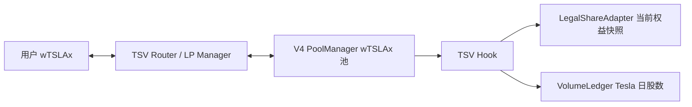

# TSLAx / wTSLAx 接入 TSV 的实例规格

状态：**目标为 wTSLAx 唯一直结；本地 ERC8056 夹具已验证同类直接动态路径，真实 wTSLAx 仍待外部准入**，2026-10-01。TSLAx 是 xStock 产品系列中的 Tesla 实例；本文件只说明该实例的发行方行为，不把其 shares 接口推广到所有 xStock。用户在 TSV 中 Swap/LP 时只支付或接收发行方 `wTSLAx`。TSLAx 原币不作为池内 Currency，也不作为 Router/LP Manager 的用户结算 Token；用户如需把 TSLAx 换成 wTSLAx，使用 TSV 之外的发行方流程。

## 1. 资产与源码边界

| 资产 | TSV 角色 | 必须审查的性质 |
| --- | --- | --- |
| TSLAx | 底层权益与计股公式的来源，不参与目标 TSV 收付 | `sharesOf(account)`、`getCurrentMultiplier()`、显示余额公式、发行方代理实现/权限和法定股数依据 |
| wTSLAx | 股票池 Currency，也是用户唯一直接收付 Token | raw `balanceOf()` 稳定、每次转账双方差额精确、发行方份额托管和必要时的外部赎回能力 |

TSV 不部署自建 Wrapped，不在目标 Swap/LP 交易中调用 `TSLAx.transferSharesFrom`、`wTSLAx.mint` 或 `wTSLAx.redeem`。V4 只持有 wTSLAx；池另一侧必须是已批准、`securityId == 0` 的非股票 Currency。全部 Tesla 池按同一 `securityId` 汇总日成交股数，不因用户在 TSV 之外自行包装或赎回而多记一次成交。

本地参考源码位于 `lib/TestToken/backed-token-contract`，发行方实际代理可能有不同 ABI、实现与权限。部署前逐项核对 wTSLAx 的 `asset()/balanceOf()/totalSupply()/transfer/transferFrom`、底层 `getCurrentMultiplier()/sharesOf()`、代理实现/管理员、暂停/制裁/托管规则。参考源码不能替代真实代理证据；在发行方权益与法务成交口径获批前，该资产保持 `UNREVIEWED`。

## 2. Registry 与法定股数

目标 Registry 以 wTSLAx 地址登记 `poolCurrency = userToken = wTSLAx`、`settlementMode = DIRECT_ERC20`、零 `settlementAdapter`，并绑定 Tesla `securityId`、`ONCHAIN_DYNAMIC` 计股模式、已审 `LegalShareAdapter`、版本和权益依据。当前 Registry 已拒绝旧 `ISSUER_SHARE_WRAPPED` 组合；真实 wTSLAx 是否能批准取决于代理 raw 稳定、双侧精确转账及发行方/法务公式证据。目标不创建第二条用户路径。

本地参考实现给出 `displayRaw = floor(wrappedShares × currentMultiplier / 1e18)`。已选技术方案把 **1 个完整显示 TSLAx 计为 1 股**，因此对一笔实际 wTSLAx raw delta 可按当前 multiplier 计算 `legalSharesWad`。源码只证明显示单位公式，**不证明监管法律股数**；发行方和法务仍须书面确认逐笔权益、舍入及含费输入/净到账口径。`wTSLAx.convertToAssets()` 只是 ERC-4626 估算，不能单独作为法定股数依据。Adapter 从发行方当前链上状态读取快照，不依赖心跳；若 getter gas 不可承受、返回零/错误或策略版本变化，交易应回滚并暂停复审。

## 3. 目标用户交易与 LP 路径

Swap 输入腿按实际 V4 负 delta 从用户直接拉取 wTSLAx，向 PoolManager 精确 `sync/settle`；输出腿按实际正 delta 直接 `take` wTSLAx 给用户。两次 ERC-20 移动都须核对发送方扣减和接收方增加；raw 滑点、价格限制与 deadline 仍由现有单池请求约束。Hook 只按成功 Swap 的实际 wTSLAx delta 计股：Tesla 输入含费总支出，Tesla 输出净收到；失败则额度、nonce 与结算整体回滚。前端若显示用户 TSLAx 股数，应查询发行方批准的**账户权益**函数；逐笔成交 Adapter 的舍入结果未必等于账户总余额的显示差。

LP 开仓/加仓由原 owner 直接提供 wTSLAx；减仓、领费、关闭和强退也只把实际 V4 应付的 wTSLAx 交付**原 owner**。LP 操作不写 Swap 成交量。若发行方 wTSLAx 转账拒绝或实际双方差额不精确，方案 A 要求整笔回滚，保留旧仓位和 Receipt。用户自行在 TSV 之外把退出所得 wTSLAx 赎回为 TSLAx，属于发行方流程，不纳入 TSV 同笔强退保证。

## 4. 当前源码与目标实现的差异

当前 `IssuerShareSettlementAdapter` 仍在源码中作为旧协议单元测试对照；Registry 的集成准入测试拒绝其 TSLAx→wTSLAx 用户路径。目标新交易只直接收付 wTSLAx，不能在 Router/LP 中调用包装/赎回或底层 shares 转移。

本部署没有旧 LP 仓位，也没有需要承接的旧 SIP 日账，因此不实现历史仓位或历史账本兼容分支。旧 Adapter 仅作为源码对照，目标新 Swap/LP 不调用它。

## 5. 上线前阻断证据

1. 实际 wTSLAx 代理 raw 余额/精确转账、发行方托管 shares、制裁/暂停和实现升级行为通过审查；PoolManager 与原 LP owner 在实际限制矩阵下可收付。
2. 发行方和法务批准每 wTSLAx raw 的逐笔法定股数公式、账户持仓定义、舍入、公司行动单位和输入含费/输出净到账口径。
3. `getCurrentMultiplier()` 在目标链最坏正常状态下可读且 gas 有余量；异常状态的交易暂停和已有 wTSLAx 仓位退出路径有预案。
4. 真实 V4 集成、单独构建的 Backed 与 SBT 源码、固定区块 X Layer 实例及原地址升级回归按[测试规格](./TEST_SPEC_V1.md)留证。当前行为 mock 的通过结果不能替代实际代理验证。

通用资产判据见[代币准入标准](./TOKEN_ADMISSION_STANDARD_V1.md)，当前代码与目标差异见[实现与缺口清单](./IMPLEMENTATION_STATUS_V1.md)。
