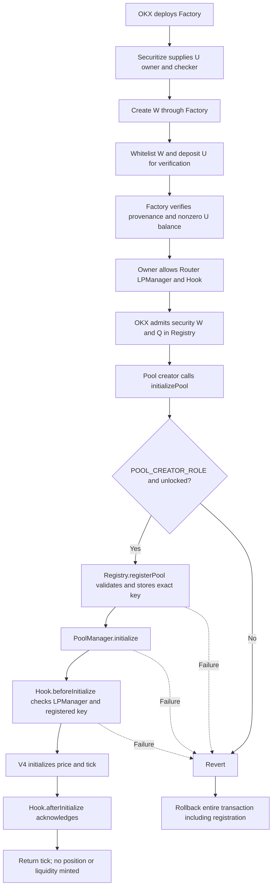
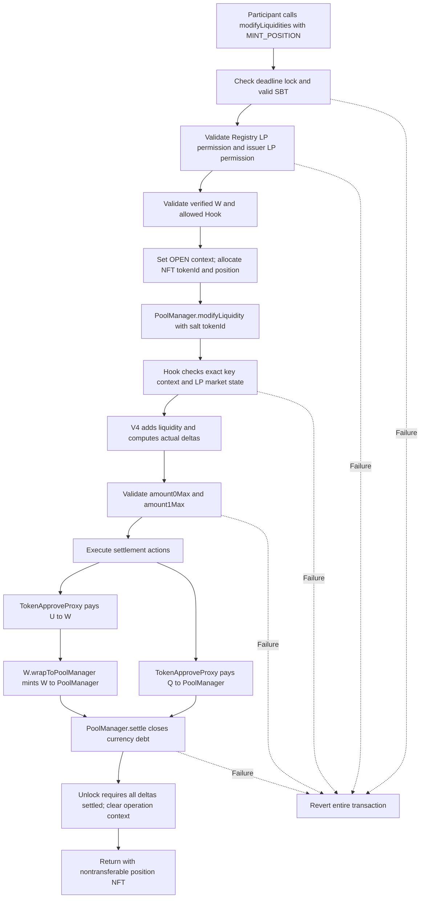
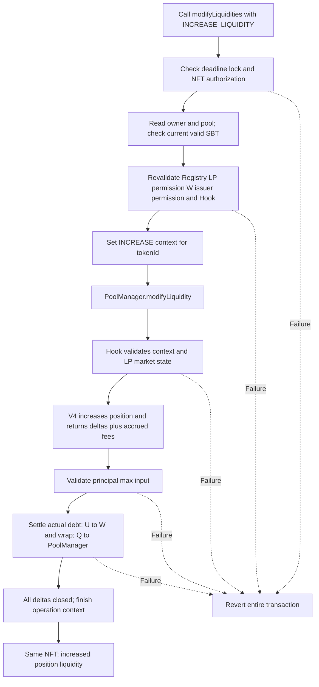
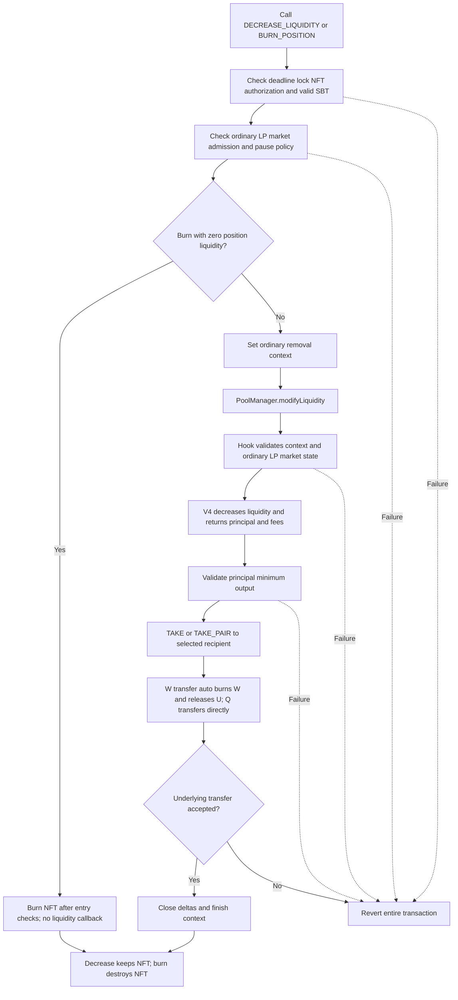
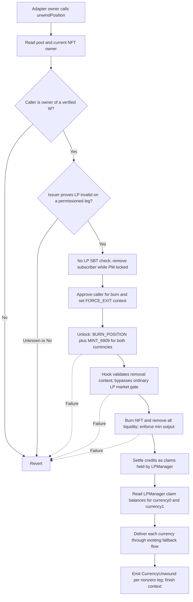
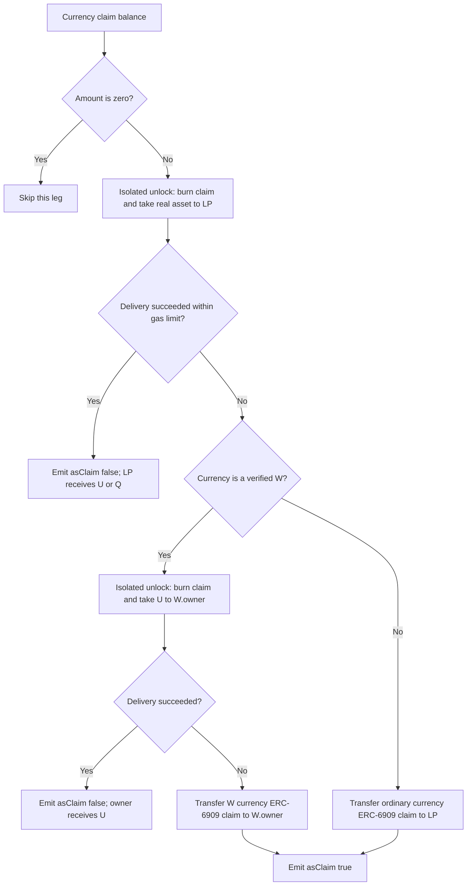
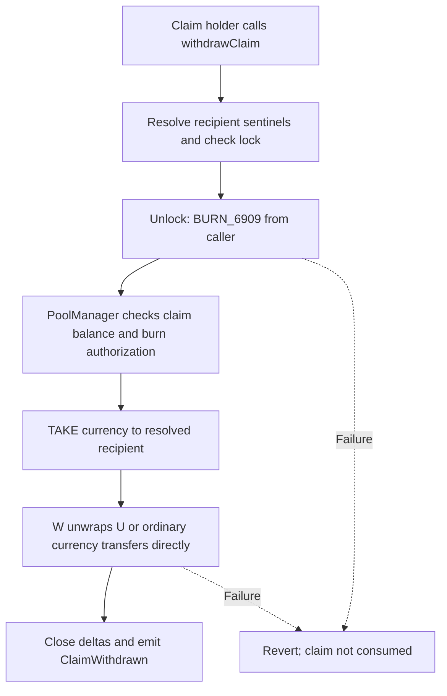

# TSV 合约设计：Permissioned Pools 与 LP 流程

日期：2026-10-09。本文先完成总体架构、Uniswap 源码复用与修改、Securitize 管理边界及 LP 业务设计；Swap 和管理业务的逐入口流程后续补充。

本文以当前工作区 `src/v1` 为实现依据，包含尚未提交的 LP 初始化与 TokenApproveProxy 改动。“目标设计”表示已确认需求，“当前实现”表示源码已具备的行为，“待讨论”表示尚未确定的接口语义。本文不代表生产部署或完整 LP 联调验收。

## 1. 总体设计


TSV 基本遵循 Uniswap v4 Permissioned Pools：由 PermissionsAdapter 托管底层受限证券代币，向 PoolManager 铸造虚拟币；复用 PermissionedPositionManager 的仓位、流动性计算及结算流程。TSV 增加参与者 SBT 验证、市场准入及暂停控制，并通过 Hook、Ledger 和 Inbox 完成证券成交量、法律股数与额度管理。OKX DexRouter 通过专用 Adapter 接入 TSV Router。

上图已按当前设计更新：**发行方 checker 与 TSV Registry 分开部署、分开查询**。PermissionsAdapter 查询 Securitize 提供的、继承 `BaseAllowlistChecker` 的具体 checker，获取发行方权限；Router 与 LPManager 独立查询 OKX Registry 的 SBT 权限，Hook 查询 Registry 的池状态。OKX Registry 管理 SBT、证券及市场配置，不继承发行方 checker，也不代替发行方查询。Factory 由 OKX 部署；其 verify 是部署来源及底层余额验证，不是每笔业务的资格验证。图中沿用原图的灰色执行链、绿色源码复用组件及蓝色 TSV 验证/记账组件。

### 1.1 三层资产

| 符号 | 含义 | 持有与用途 |
| --- | --- | --- |
| U | 底层受限证券代币，例如 CET | 存入 W；每次 U 转移由证券代币自己的合规逻辑执行检查 |
| W | `PermissionsAdapter(U)`，池中证券侧 currency | PoolManager 持有 W；流出时 W 自动 burn 并释放 U |
| Q | 普通报价币 | 直接由 PoolManager 持有并结算 |
| Claim | PoolManager ERC-6909 余额 | 表示对某个 currency 的提取权；与 W ERC-20 及仓位 NFT 分开 |
| Position NFT | LP 仓位凭证 | 不可转让；仓位通过 tokenId 对应 tick 区间及 salt |

池使用 W/Q 而不是 U/Q；W 地址、Hook、fee 或 tickSpacing 变化会改变 PoolKey/poolId，对应不同流动性池。`initializePool` 只初始化价格和池状态，不注入资金、不铸造 LP NFT。

### 1.2 权限分层

1. Securitize checker：查询钱包针对 U 的发行方权限，返回 `SWAP_ALLOWED`、`LIQUIDITY_ALLOWED` 等权限位。
2. TSV Registry：检查钱包是否持有已登记的 SBT，以及其 TSV 操作权限。
3. TSV Hook：校验 LP 操作来源、精确 PoolKey、操作上下文及市场状态。
4. 底层 U：在真实转账时独立执行白名单及其他发行方合规限制。

通过 checker 不保证下一次 U 转账成功；转账金额、资产暂停或转账双方状态仍可能导致 U 拒绝转移。失败按相应入口的回滚或 unwind 兜底规则处理。

## 2. 遵循 Uniswap 的部分与具体修改

参照代码为本仓库 `lib/v4-periphery/src/hooks/permissionedPools/`，TSV 本地兼容代码位于 `src/v1/vendor/permissionedPools/`。这里的“复用”指复用其源码和算法，不表示本地 vendor 文件与上游逐字一致。

| 组件/流程 | 复用的行为 | TSV 修改或扩展 |
| --- | --- | --- |
| PermissionsAdapter | U 托管、W 铸造、allowedWrappers/allowedHooks、issuer checker、PoolManager 流出时 unwrap | 当前 vendor 拒绝 W 转回 PoolManager 的自转账；增加元数据读取兼容处理；禁止 renounceOwnership，保留发行方 owner |
| PermissionsAdapterFactory | permissionless create/verify；记录 W→U；verify 要求工厂创建且 W 有非零 U 余额 | OKX 部署并绑定到同一个 PoolManager；TSV Registry 另行准入，Factory verified 不等于 TSV 可用 |
| BaseAllowlistChecker | IAllowlistChecker 接口及 ERC-165 支持 | Securitize 实现发行方资格；TSV SBT 独立检查，不写入发行方 checker |
| PermissionedPositionManager | NFT、tick/salt、增减流动性、滑点、结算、NFT 不可转让、owner 强退与交付兜底 | TSVLPManager 继承；加入 TSV 权限；初始化前原子注册池；用户付款接 TokenApproveProxy；补充 Hook 上下文 |
| 普通移除/销毁 | 复用 Uniswap decrease/burn 和资产释放算法 | **增加有效 SBT 门禁**；堵住上游撤销持有人资格后仍可自行移除的入口 |
| unwindPosition | Adapter owner 授权、销毁仓位、LP 优先交付、owner 实物兜底、claim 兜底 | 保留资金交付逻辑；增加发行方 LP 失效证明，具体查询语义待讨论；无需被退出 LP 持有 SBT |
| TSV Registry/Hook | 使用 V4 PoolKey、callback 与权限标志 | 增加证券准入、SBT、市场暂停、LP 上下文和入口约束；Hook 拒绝 donate |
| TSV Hook/Ledger/Inbox | V4 swap 返回真实 BalanceDelta | 根据实际证券腿成交量换算法律股数并记账、更新额度及市场报告；LP 加减不直接计为 swap 成交量 |
| TSV Router / OKX 接入 | PermissionedV4Router 的权限及 wrap/unwrap 模式 | 增加真实参与者识别、OKX 聚合器接入和精确结算；详细 Swap 入口另章补充 |

当前 `_decrease` 和带参数的 `_burn` 没有可直接覆盖的 `virtual` 扩展点，当前工作区已将 SBT 持有检查放在 TSV 的 action dispatcher，并将父类 dispatcher 改为 virtual 以允许扩展；不能只增加前端检查。该位置也覆盖无 Hook 回调的零仓位 burn。

## 3. Securitize 与 OKX 的管理边界

“管理”表示配置/治理责任；部署方与合约调用权限另行列明。BaseAllowlistChecker 本身是抽象类，实际部署的是 Securitize 的具体 checker。

| 组件 | 管理方 | 部署/配置责任与要求 |
| --- | --- | --- |
| 底层 U / 证券白名单体系 | Securitize / 发行方 | 管理 U 的转账合规；使 W 能接收和释放 U；配置可接收 unwind 实物的 Adapter owner |
| [PermissionsAdapter](../src/v1/vendor/permissionedPools/PermissionsAdapter.sol) | **Securitize 持有 owner 权限** | owner 管理 checker、allowedWrappers、allowedHooks、swappingEnabled；通过 OKX Factory 创建 W；initialOwner 指向发行方治理地址 |
| [BaseAllowlistChecker](../src/v1/vendor/permissionedPools/BaseAllowListChecker.sol) 的具体实现 | **Securitize** | 开发、部署并配置发行方查询；支持 IAllowlistChecker/ERC-165；不以 TSV SBT 替代证券合规 |
| [PermissionsAdapterFactory](../src/v1/vendor/permissionedPools/PermissionsAdapterFactory.sol) | OKX 负责部署与选用 | POOL_MANAGER 必须与 TSV 一致；create 和 verify 无 owner 限制，任何地址均可调用；Securitize 完成资产白名单及验证入金配合 |
| TSVRegistryV1 | OKX | 管理证券、W/U/Q、SBT 权限、发行方 owner 准入、exitAdmin、市场和组件绑定 |
| TSVLPManagerV1 | OKX | 管理池创建角色及升级；处理 LP 入口、SBT、issuer 权限、结算及 unwind；强退授权来自 W.owner 而非普通 OKX 管理角色 |
| TSVHookV1 | OKX | 管理实际 Router/LPManager 绑定；执行池和 LP 上下文校验、市场控制 |
| TokenApproveProxy / TokenApprove | OKX 相关授权基础设施管理员 | 授权实际 LPManager 代理调用 claimTokens；用户授权 TokenApprove 扣款 |
| TSVVolumeLedgerV1 / TSVDataInboxV1 | OKX | 成交记账、额度及报告处理；不托管 LP 的 U |
| PoolManager | 选用的 Uniswap v4 基础设施 | 持有 W/Q、维护池和 ERC-6909；发行方不通过 Factory 获得 PoolManager 的整体管理权 |

Registry 中的 `exitAdminOf(U)` 与 W.owner 当前要求是不同地址。本文按已确认需求，**unwind 使用 W.owner 作为实物及受限资产 claim 的兜底接收方，不改为 exitAdmin**。

### 3.1 对 Securitize checker 的查询要求

现有接口为 `checkAllowlist(address account, address tokenAddress) -> PermissionFlag`。Adapter 调用时第二参数传 U，不能传 W 或 PoolManager。一个 checker 服务多个资产时必须按 U 区分权限。

| 查询场景 | 实际调用/输入 | 应表达的含义 | 状态 |
| --- | --- | --- | --- |
| W 创建及 TSV 准入 | checker 的 supportsInterface；Registry 检查 checker 有代码及接口可读 | 实现正确接口，允许 Adapter 查询 U 的钱包权限 | 当前已实现结构检查，不证明每个钱包已获批 |
| 新增/增加 LP 的 validate | `W.isAllowed(owner, LIQUIDITY_ALLOWED)` → `checkAllowlist(owner, U)` | 仓位持有人针对 U 具备发行方 LP 权限；返回权限集合中的 LP 位 | 当前已实现 |
| 股票侧 LP 支付 | `W.isAllowed(msgSender(), LIQUIDITY_ALLOWED)` | 实际操作用户具备 LP 权限；不能只验证目标 NFT owner | 当前已实现；U 转账还需实际 payer 满足底层合规 |
| swap validate | `W.isAllowed(participant, SWAP_ALLOWED)` | 真实参与者针对 U 具备交易权限 | 本文仅定义边界，Swap 流程后续补充 |
| 普通移除/领取 | TSV 单独查询有效 SBT；U 在释放时查询转账合规 | 普通用户必须持有有效、未撤销的 SBT；U 能合法释放给实际接收方 | 当前 dispatcher 已检查 owner 的 hasCredential；完整有效性边界仍需明确；不自行新增 issuer LP 位检查 |
| unwind 资格查询 | 偏好 `W.isAllowed(lp, NONE)` 表达 LP 已失效 | 明确区分“可强退”“不可强退”“查询不可用” | **待讨论；当前 ABI 的按位语义不能证明失效** |
| unwind 实物释放 | 底层 U 的转账合规检查 | 分别允许或拒绝 LP、W.owner 接收 U，供既有兜底逻辑处理 | 保持现有资金交付逻辑 |

查询必须读取当前链上状态；资格读取失败不能被当作“LP 已失效”。普通业务遇到读取异常应回滚；强退资格未知也不能据此强退。

### 3.2 `NONE` 查询的待讨论问题

当前 Adapter 实现：

```solidity
return (allowListChecker.checkAllowlist(account, address(PERMISSIONED_TOKEN)) & permission) == permission;
```

`NONE = 0x0000`。无论 checker 返回什么正常权限值，`(flags & NONE) == NONE` 都为 true。因此 checker 对有效钱包返回 LP 权限、对无效钱包返回 NONE，也无法使 `isAllowed(lp, NONE)` 区分两者。

当前 TSV `_getLpStatus` 使用此调用；对于已验证 W，只要 checker 正常返回，就会得到 true，使管理员授权后的资格检查无法筛选失效 LP。这是待完成的设计，不可写成已经实现的失效证明。

**已确认偏好**：使用 `isAllowed(lp, NONE)` 作为 LP 无效证明。**尚未确认**：是否为 NONE 增加专门语义、无效的业务定义、以及应如何改动 Adapter/接口。仅修改 BaseAllowlistChecker 的返回位无法实现这一偏好。现有 `IStatusQuoter.isUnwindable(address)` 是另一种可讨论的接口方向，尚未接入；本文不将其选定为最终方案。

unwind 流程图统一以“发行方确认 LP 失效”表示此未决查询。资金交付部分保持不变。

## 4. LP 的 SBT 执行原则

依据用户提供的 Enforcement 摘录：接口、AMM Router 和 AMM Liquidity Pool 合约在可执行报价及流动性等交易前验证参与者钱包具有有效、未撤销的 SBT；证券代币另行限制只向白名单钱包转账。


该摘录作为本设计的需求来源，不在本文中推断其出处或法律效力。

**普通 LP**：新增、增加、减少、销毁及领取手续费均必须验证参与者的有效 SBT。移除不能沿用 Uniswap “撤销 holder 资格后仍可自行退出”的例外。**发行方强退**：可以不检查被退出 LP 的 SBT，因为该 LP 很可能已失去 SBT；以独立 owner 授权及发行方失效证明执行。

新增/增加继续要求 Registry 的 `LIQUIDITY_ALLOWED`。普通移除的已确认最低要求是“有效、未撤销的 SBT”；是否同时要求 SBT 配置仍授予 LP 操作位，不能自动从“必须持有 SBT”推导。实现时须明确这一细节。`hasCredential` 忽略 SBT 暂停，不能单独代表所有“有效”条件。

NFT owner 与执行者可能不同：上游支持授权 operator。必须校验实际参与者，并防止 operator 替失去 SBT 的 owner 绕过移除门禁。建议普通操作的 owner 和执行者均通过相应身份检查，具体 operator 策略待确认；当前移除实现只检查 owner。若产品后续限定 owner-only，可相应简化。底层资产接收方仍需满足 U 的转账合规。

## 5. 初始化池：initializePool

入口：`TSVLPManagerV1.initializePool(key, sqrtPriceX96)`；调用者须有 `POOL_CREATOR_ROLE`。此处是管理建池动作，不等同于普通参与者提供流动性；当前入口检查角色，不检查 SBT。

### 5.1 Securitize 前置要求

1. 明确 U、发行方 owner 和具体 checker；owner 满足 Registry 的合约地址及批准 owner 要求。
2. 经 OKX 部署的 Factory 创建 W，固定 U、PoolManager、initialOwner 和 checker；checker 有代码并支持 IAllowlistChecker。
3. U 的合规配置允许 W 托管 U；可进行验证入金。入金者持有 U 并授权 W，调用 `depositForVerification(amount)`，或通过合规的 U 转账使 W 持有 U。
4. 调用 Factory `verifyPermissionsAdapter(W)`：W 由该 Factory 创建且 U.balanceOf(W)>0。调用本身 permissionless，不要求只能由 OKX 或 Securitize 发起。
5. owner 授权 TSV Router 与实际 LPManager 代理为 allowedWrappers，授权 TSV Hook 为 allowedHook。允许 swap 时设置 swappingEnabled；它不是 LP 初始化/加减的独立开关。
6. 确认 owner 可接收 unwind 兜底实物 U。owner 不可 renounce；后续两步转移 owner 时同步保持发行方控制与 TSV 准入一致。

### 5.2 OKX 前置要求

完成 Registry/Hook/LPManager/Factory/PoolManager 绑定，发行方 owner 审批、独立 exitAdmin 配置、法律股数 Adapter、证券和 W 准入、Q 登记及建池角色授权。

W **首次准入**时检查验证保证金 U 余额非零、W.totalSupply=0、PoolManager 的 W 余额=0、W 协议费=0；这些是资产初次准入条件，不是每次 initializePool 重新要求全局库存清零。

PoolKey 为恰好一个已准入证券 W 加一个已登记 Q，currency 地址升序、非 native、固定 TSV Hook、有效静态 fee 和 tickSpacing；池不得重复注册，初始价格须在 V4 可接受范围内。

### 5.3 流程图



当前初始化已按 `registerPool → PoolManager.initialize` 原子执行；Hook 在 beforeInitialize 验证，afterInitialize 仅确认回调。建池成功后，首次注资另走新增流动性入口。

## 6. 新增流动性：mint position

入口为 `modifyLiquidities(unlockData, deadline)` 中的 `MINT_POSITION`，配合结算动作。它不是独立公开的 `addLiquidity` ABI。

### 6.1 前置要求

- 池已初始化；证券仍上市，池及全局/证券/市场 LP 暂停均不阻断本次操作。
- owner 与实际参与者持有有效 SBT；新增要求 TSV `LIQUIDITY_ALLOWED`，每个受限资产侧还须通过发行方 `LIQUIDITY_ALLOWED`。
- W 为 Factory verified，允许池 Hook；W 将实际 LPManager 代理列为 wrapper。
- 用户持有 U/Q，授权 `TOKEN_APPROVE_PROXY.tokenApprove()` 返回的 TokenApprove，代理允许 LPManager 调用 claimTokens；不是要求用户授权 LPManager/Permit2。
- tick 区间、liquidity、amount0Max/amount1Max、deadline 合法，hookData 为空。
- LPManager 提供与本次参数一致的 Hook 上下文：poolId、tickLower/tickUpper、salt、liquidityDelta、OPEN 模式。

### 6.2 流程图



W.wrapToPoolManager 只允许授权 wrapper，并要求可用 U 库存覆盖铸造数量。所有失败回滚本次 NFT、流动性及资金转移。LP 本身不按 swap 成交量写 Ledger。

## 7. 增加流动性：increase position

入口为 `modifyLiquidities` 中的 `INCREASE_LIQUIDITY`。继承 ABI 还含 from-deltas 变体；它也必须经过同一身份门禁和操作上下文，不能成为绕过入口。当前源码将 from-deltas 变体标为 deprecated，标准业务使用显式 liquidity 参数。

### 7.1 前置要求

除第 6 节资产、身份、市场和扣款要求外，tokenId 必须存在，执行者为 owner 或已授权 operator；每次增加重新检查当前 owner 的发行方 LP 权限、Registry LP 权限和 W.allowedHooks，不能沿用 mint 时的历史结论。Hook 模式为 INCREASE，salt 为 tokenId。

### 7.2 流程图



## 8. 普通移除、销毁与领取手续费

入口为 `modifyLiquidities` 中的 `DECREASE_LIQUIDITY` 或 `BURN_POSITION`；`DECREASE_LIQUIDITY` 的 liquidity=0 可用于领取手续费，同样属于普通参与者行为。

### 8.1 前置要求

- tokenId 存在；执行者具有 NFT 操作授权，owner 与实际参与者通过有效 SBT 检查。失去 SBT 后不得自行减少、销毁或领取手续费。
- 当前目标沿用 TSV Hook 的普通 LP 市场门禁：证券下架或 LP 暂停会阻断普通移除；独立强退路径可以绕过普通 LP 市场门禁。
- 指定移除数量不得超过仓位，amount0Min/amount1Min 与 deadline 合法；hookData 为空。
- 实际接收方能合法接收 U；报价币接收及 native 情况按所支持资产范围处理。本设计的准入池使用 W/Q、非 native。
- LPManager 设置相应普通移除上下文，匹配精确 key、ticks、salt 和 delta。

普通移除不额外要求 W 的 swappingEnabled。当前上游不重查 issuer `LIQUIDITY_ALLOWED`，本文保留该发行方权限行为，仅增加已确认的 TSV SBT 门禁；U 释放仍受底层合规限制。若 issuer LP 权限失效但 SBT 仍有效，是否进一步禁止普通退出需发行方另行决定。

### 8.2 流程图



普通移除不自动执行 unwind 的 owner/claim 兜底；U 转账失败会回滚。SBT 门禁必须位于所有普通入口可达的位置，包括 `modifyLiquiditiesWithoutUnlock`、零流动性手续费领取、零仓位 burn 和相应批量 action；不能只依赖非零 liquidity 的 Hook 回调。

## 9. 强制移除：unwindPosition

入口：`unwindPosition(tokenId, amount0Min, amount1Min, hookData)`。按已确认要求保留现有资金交付逻辑，SBT 失效不会阻止发行方执行强退。

### 9.1 前置要求

1. tokenId 存在、合约未处于操作锁；调用者为池任一已验证 W 的当前 owner。普通报价币的 `_getOwner` 返回零，不赋予强退权限。
2. 针对至少一个受限资产腿，取得发行方明确的 LP 失效/可强退证明；查询方式与失效定义待讨论，不以读取失败作为证明。
3. 不要求被退出 LP 仍有 SBT，不要求其通过普通 LP permission；管理员授权与失效证明均不能省略。
4. 设置 FORCE_EXIT 上下文，Hook 允许实际负 liquidityDelta 绕过普通 LP 市场门禁，仍校验调用来源、精确 key、ticks/salt/delta；hookData 为空。
5. W.owner 配置为能接收 U 的发行方地址；即使转账失败，也按保留的 claim 兜底继续处理。
6. amount0Min/amount1Min 约束 burn 的本金输出；0 表示关闭对应下限。非零下限未满足时整笔 unwind 回滚。

### 9.2 仓位退出流程图



第一阶段将资金结算为 LPManager 自持 claim，不在此阶段向 LP 转移 U，避免 LP 收款逻辑使 burn 失败。当前实现读取的是 LPManager 在相应 currency 上的**完整 claim 余额**，包含本次 burn 和此前可能遗留的余额；本文保留此行为，不改写为只交付本次 delta。

### 9.3 每个 currency 的资金交付流程图



每次实物交付使用独立 unlock，并限于 DELIVERY_GAS_LIMIT。失败只回滚该次交付尝试，claim 保留用于下一步；两腿分别处理，可以一腿给 LP 实物、另一腿给 owner 实物或 claim。claim 转移本身不执行 U 转账合规，不能描述成 U 已交付。

## 10. LP 相关后续提取：withdrawClaim

保留 `withdrawClaim(currency, amount, to)`：持有 claim 的调用者指定接收方，LPManager 通过 PoolManager burn 调用者的 claim，再 take 相应资产。PoolManager 的 claim burn 授权必须具备；典型调用需要 claim holder 将 LPManager 设为 operator。受限 W 的 take 自动释放 U，实际收款地址须通过 U 转账合规。



**边界待讨论**：是否把普通用户 withdrawClaim 也纳入“其他链上交易前必须验证 SBT”，以及如何保留 Securitize owner 的管理员提取路径。当前继承入口无 SBT 门禁；保留 unwind 交付顺序并不自动决定这一入口的身份规则。claim 的 PoolManager transfer/transferFrom 也不会经过 TSV LP Hook。

## 11. 当前实现差距与待讨论项

| 项目 | 当前实现 | 文档中的目标/后续动作 |
| --- | --- | --- |
| 原子建池 | LPManager 先 registerPool，再 initialize | 已具备；后续完整组件联调另行验收 |
| 新增/增加权限 | Registry 与 W 的 LIQUIDITY_ALLOWED 均有查询 | 保留；补齐所有变体的身份和上下文覆盖 |
| 普通移除 SBT | 当前工作区 dispatcher 对 decrease/burn 查询 owner.hasCredential；授权 unwind 的指定 tokenId burn 例外 | 已补持有检查，覆盖手续费领取及零仓位 burn；hasCredential 忽略 SBT 暂停，完整有效性与执行者策略仍需明确 |
| LP Hook 上下文 | Hook 调用 activeLPContext；当前 LPManager 未实现该接口 | 补齐 OPEN/INCREASE/普通移除/FORCE_EXIT 的可信上下文和生命周期；现有 LP 不能据此宣称与真实 Hook 已完整联通 |
| unwind 资格 | `_getLpStatus` 调用 isAllowed(lp,NONE)，正常返回时恒为 true | 按用户偏好讨论 NONE 特殊语义；在定案前不视为有效的失效证明 |
| unwind 资金交付 | LP 实物→owner 实物→受限资产 claim 给 owner；普通资产 claim 给 LP | 保持；不改成 Registry exitAdmin |
| 普通移除 SBT 操作位 | 用户确认必须持有有效 SBT；是否仍需 LP 操作位未单独定义 | 实现前明确身份有效与操作权限的区别 |
| operator | 上游 owner/approval 模型 | 校验实际执行者与 owner，防止替失效 owner 绕过身份门禁；owner-only 策略未定 |
| withdrawClaim 身份 | 当前无 SBT 检查 | 与普通业务/管理员例外边界一起讨论 |

本文只新增设计文档及用户提供的图片资产，不修改上述合约。撰写期间检测到工作区另有 dispatcher SBT 门禁更新，以上实现状态已据此同步；未运行或声称通过该代码的回归测试。后续实现验收应覆盖：SBT 撤销后的普通移除失败但授权强退可执行、operator 绕过拒绝、零仓位及手续费入口检查、Hook 上下文精确匹配、初始化失败原子回滚、两腿实物/claim 兜底、checker 异常不作为失效证明。

## 12. 后续章节

- **Swap**：可执行报价前的 SBT 检查；直接调用与 OKX Adapter 调用；exact-in/exact-out；参与者、payer、recipient；成交量与额度记账。逐入口图后续补充。
- **管理**：证券及 W/Q 准入、owner/checker/wrapper/Hook 配置变更、SBT 配置、市场暂停恢复、报告和升级。逐入口图后续补充。

## 13. 代码依据

- [TSVLPManagerV1](../src/v1/periphery/TSVLPManagerV1.sol)：initializePool、unwindPosition、LP 权限与 TokenApproveProxy 支付。
- [PermissionedPositionManager](../src/v1/vendor/permissionedPools/PermissionedPositionManager.sol)：NFT 不可转让、mint/increase validate、claim、unwind 交付。
- [PositionManager](../src/v1/vendor/permissionedPools/PositionManager.sol)：action 入口、mint/increase/decrease/burn、滑点与结算。
- [PermissionsAdapter](../src/v1/vendor/permissionedPools/PermissionsAdapter.sol)、[Factory](../src/v1/vendor/permissionedPools/PermissionsAdapterFactory.sol)、[checker 基类](../src/v1/vendor/permissionedPools/BaseAllowListChecker.sol)：issuer 权限、托管及工厂验证。
- [TSVRegistryV1](../src/v1/core/TSVRegistryV1.sol)、[PermissionedValidationLib](../src/v1/libraries/PermissionedValidationLib.sol)：SBT、市场、池注册与资产准入。
- [TSVHookV1](../src/v1/core/TSVHookV1.sol)：初始化、LP 上下文、普通与强退市场门禁及成交记账。
- [PermissionFlags](../src/v1/vendor/permissionedPools/libraries/PermissionFlags.sol)、[IStatusQuoter](../src/v1/interfaces/IStatusQuoter.sol)：现有权限位与尚未接入的强退资格接口。
