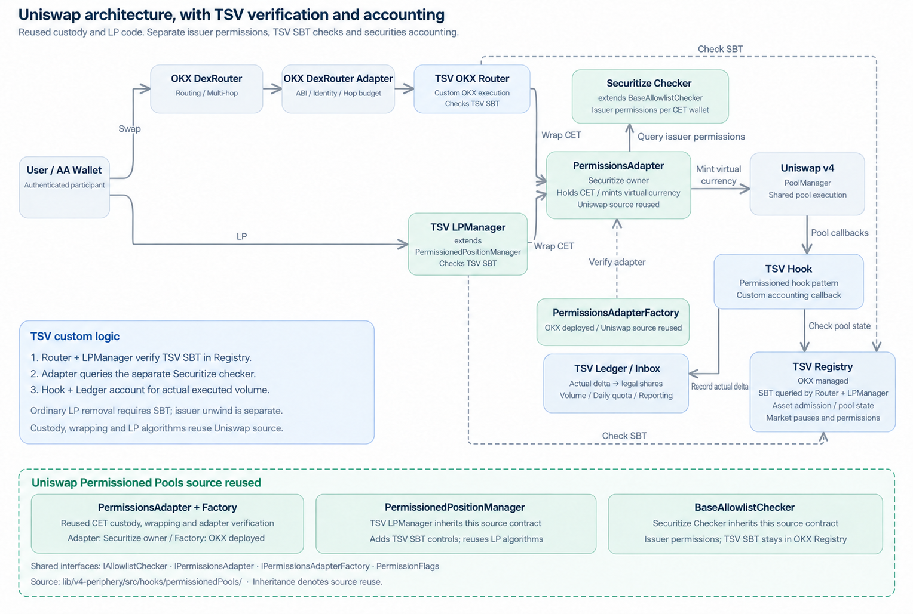
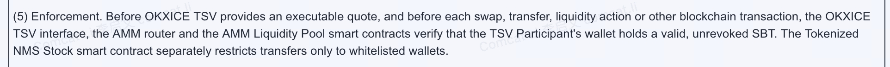
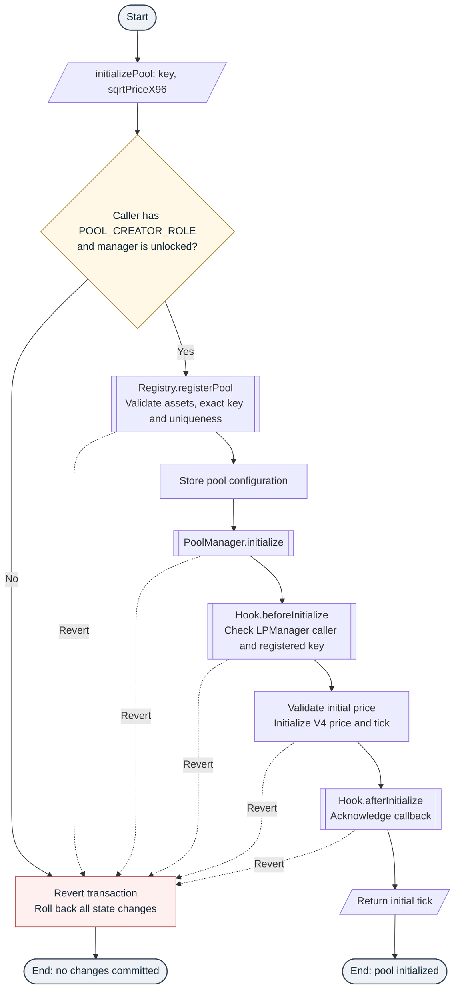
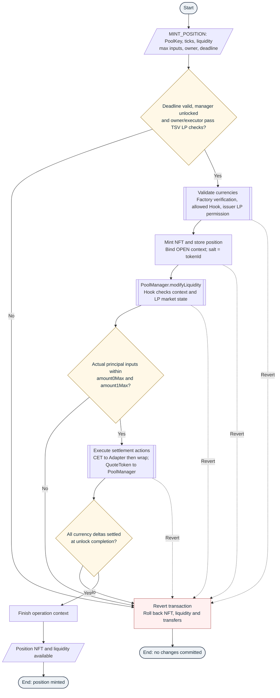
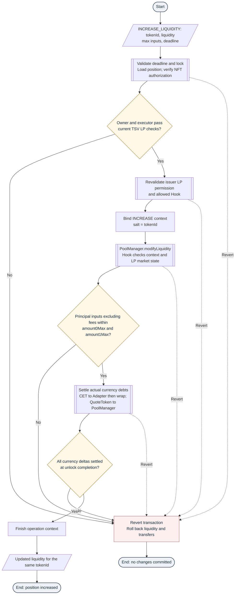
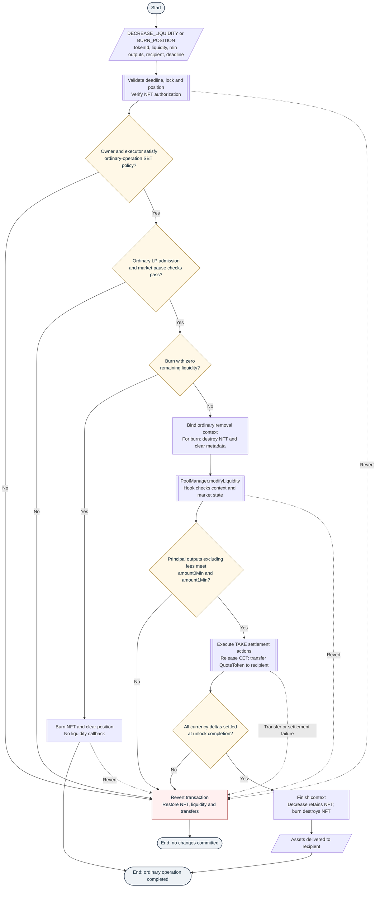
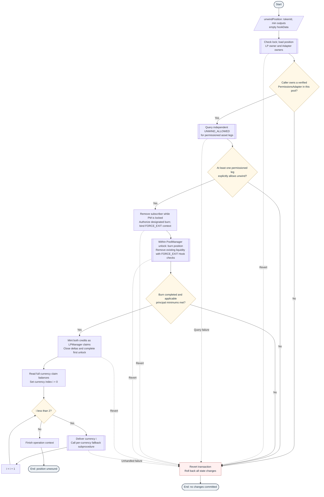
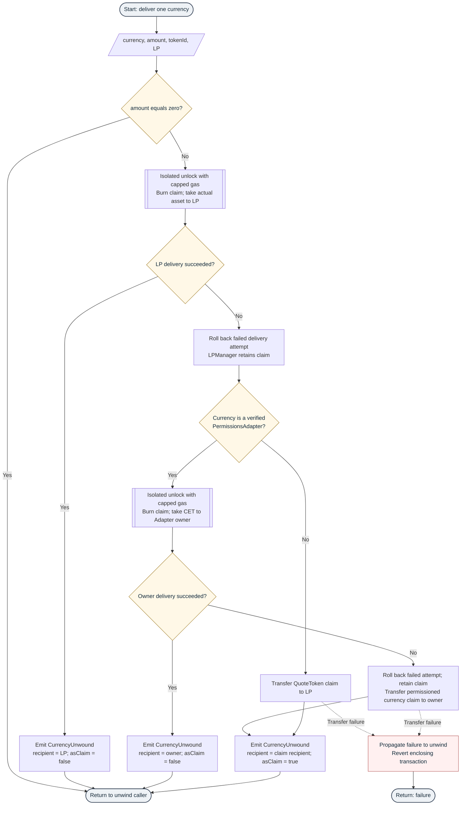
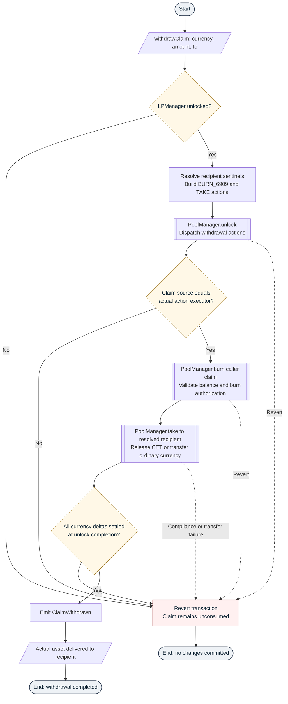

# TSV 合约设计：Permissioned Pools 与 LP 流程

> **历史设计材料（2026-10-09）。不作为当前 ABI 或实现说明。** 本文保留早期 Permissioned Pools、Inbox、报告和治理边界的方案与流程；后续源码已多次变化。当前合约架构和接口请查 [`SYSTEMS_OVERVIEW.md`](./SYSTEMS_OVERVIEW.md)、[`CODING_SPEC_V1.md`](./CODING_SPEC_V1.md) 和 [`DEPLOYMENT_CHECKLIST_V1.md`](./DEPLOYMENT_CHECKLIST_V1.md)。当前行为以 `src/v1/` 为准。

## 1. 总体设计



TSV 基本遵循 Uniswap v4 Permissioned Pools：由 PermissionsAdapter 托管底层受限证券代币，向 PoolManager 铸造虚拟币；复用 PermissionedPositionManager 的仓位、流动性计算及结算流程。TSV 增加参与者 SBT 验证、市场准入及暂停控制，并通过 Hook、Ledger 和 Inbox 完成证券成交量、法律股数与额度管理。OKX DexRouter 通过专用 Adapter 接入 TSV Router。

上图已按当前设计更新：**发行方 checker 与 TSV Registry 分开部署、分开查询**。PermissionsAdapter 查询 Securitize 提供的、继承 `BaseAllowlistChecker` 的具体 checker，获取发行方权限；Router 与 LPManager 独立查询 OKX Registry 的 SBT 权限，Hook 查询 Registry 的池状态。OKX Registry 管理 SBT、证券及市场配置，不继承发行方 checker，也不代替发行方查询。Factory 由 OKX 部署；其 verify 是部署来源及底层余额验证，不是每笔业务的资格验证。图中沿用原图的灰色执行链、绿色源码复用组件及蓝色 TSV 验证/记账组件。

### 1.1 资产与组件名称

| 名称 | 含义 | 持有与用途 |
| --- | --- | --- |
| CET | 底层受限证券代币 | 存入 PermissionsAdapter；每次 CET 转移由证券代币自己的合规逻辑执行检查 |
| PermissionsAdapter | 托管 CET 的适配器合约，其发行的虚拟代币作为池中证券侧 currency | PoolManager 持有适配器发行的虚拟代币；代币流出时自动 burn 并释放 CET |
| QuoteToken | 普通报价币 | 直接由 PoolManager 持有并结算 |

池使用 PermissionsAdapter/QuoteToken；证券侧 currency 地址为 PermissionsAdapter 合约地址。PermissionsAdapter 地址、Hook、fee 或 tickSpacing 变化会改变 PoolKey/poolId，对应不同流动性池。`initializePool` 只初始化价格和池状态，不注入资金、不铸造 LP NFT。

### 1.2 权限分层

1. Securitize checker：查询钱包针对 CET 的发行方权限，返回 `SWAP_ALLOWED`、`LIQUIDITY_ALLOWED`，以及新增的独立强退权限位 `UNWIND_ALLOWED`。
2. TSV Registry：检查钱包是否持有已登记的 SBT，以及其 TSV 操作权限。
3. TSV Hook：校验 LP 操作来源、精确 PoolKey、操作上下文及市场状态。
4. 底层 CET：在真实转账时独立执行白名单及其他发行方合规限制。

通过 checker 不保证下一次 CET 转账成功；转账金额、资产暂停或转账双方状态仍可能导致 CET 拒绝转移。失败按相应入口的回滚或 unwind 兜底规则处理。

## 2. 遵循 Uniswap 的部分与具体修改

TSV 遵循 Uniswap v4 Permissioned Pools 架构。**Uniswap v4 PoolManager、PermissionsAdapter、PermissionsAdapterFactory、BaseAllowlistChecker 完全复用原版，源码和行为均不修改。** PoolManager 参照代码位于 `lib/v4-core/src/PoolManager.sol`，Permissioned Pools 参照代码位于 `lib/v4-periphery/src/hooks/permissionedPools/`。TSV 的定制集中在 Router、LPManager、Registry、Hook、Ledger 和 Inbox；Securitize 继承原版 BaseAllowlistChecker 实现发行方 checker。

| 组件 | 原有职责 / 复用内容 | 是否修改及具体扩展 |
| --- | --- | --- |
| Uniswap v4 PoolManager | 池初始化、swap、增减流动性、池与仓位记账、虚拟代币及 QuoteToken 托管、unlock/settle/take 结算、Hook 回调 | **完全不修改**；使用 PermissionsAdapter/QuoteToken 的 PoolKey，接入 TSV Hook |
| PermissionsAdapter | CET 托管、虚拟代币铸造、allowedWrappers/allowedHooks、issuer checker、PoolManager 流出时 unwrap | **完全不修改**；通过原有 owner 接口配置 checker、wrapper、Hook 和 swap 开关 |
| PermissionsAdapterFactory | permissionless create/verify；记录 PermissionsAdapter→CET；verify 要求工厂创建且 PermissionsAdapter 有非零 CET 余额 | **完全不修改**；由 OKX 部署并绑定同一 PoolManager；TSV 准入检查在 Registry 中另行实现 |
| BaseAllowlistChecker | IAllowlistChecker 接口及 ERC-165 支持 | **完全不修改**；Securitize 在派生 checker 中实现发行方资格；TSV SBT 在 Registry 中独立检查 |
| PermissionedPositionManager | NFT、tick/salt、增减流动性、滑点、结算、NFT 不可转让、owner 强退与交付兜底 | 为 TSVLPManagerV1 提供继承基础；增加必要的扩展点 |
| TSVLPManagerV1 | 继承 PermissionedPositionManager，复用流动性算法及强退交付逻辑 | 增加 TSV SBT 门禁，覆盖普通移除/销毁；初始化前原子注册池；付款接 TokenApproveProxy；补充 Hook 上下文及独立 UNWIND_ALLOWED 强退标志查询；授权强退可不检查 LP 的 SBT |
| TSVRegistryV1 | 使用 V4 PoolKey 和 PermissionFlags | TSV 自定义组件，管理 SBT 权限、证券与资产准入、池注册及市场暂停 |
| TSVHookV1 | 使用 V4 callback 和实际 BalanceDelta | TSV 自定义组件，校验池状态与 LP 上下文，拒绝 donate，将实际证券腿成交量换算为法律股数并调用 Ledger |
| TSVVolumeLedgerV1 | 接收 Hook 提供的实际成交 delta 与法律股数 | TSV 自定义组件，记录证券成交量并执行共享证券额度检查；LP 加减不直接计为 swap 成交量 |
| TSVDataInboxV1 | 无对应的 Permissioned Pools 组件 | TSV 自定义组件，校验并处理市场、额度及证券数据报告 |
| TSVSwapRouterV1 | 继承 PermissionedV4Router，复用权限及 wrap/unwrap 模式 | 增加 TSV SBT 检查、真实参与者识别、聚合器授权和精确结算 |
| OKX DexRouter Adapter | 复用 OKX DexRouter 接入能力 | 适配 TSV 请求和参与者身份，衔接实际收付资产与 TSV Router |

当前 `_decrease` 和带参数的 `_burn` 没有可直接覆盖的 `virtual` 扩展点，当前工作区已将 SBT 持有检查放在 TSV 的 action dispatcher，并将父类 dispatcher 改为 virtual 以允许扩展；不能只增加前端检查。该位置也覆盖无 Hook 回调的零仓位 burn。

## 3. Securitize 与 OKX 的管理边界

“管理”表示配置/治理责任；部署方与合约调用权限另行列明。BaseAllowlistChecker 本身是抽象类，实际部署的是 Securitize 的具体 checker。管理和部署均使用上游已有接口，不修改上述三个原版组件。

| 组件 | 管理方 | 部署/配置责任与要求 |
| --- | --- | --- |
| 底层 CET / 证券白名单体系 | Securitize / 发行方 | 管理 CET 的转账合规；使 PermissionsAdapter 能接收和释放 CET；配置可接收 unwind 实物的 Adapter owner |
| [PermissionsAdapter](../src/v1/vendor/permissionedPools/PermissionsAdapter.sol) | **Securitize 持有 owner 权限** | owner 管理 checker、allowedWrappers、allowedHooks、swappingEnabled；通过 OKX Factory 创建 PermissionsAdapter；initialOwner 指向发行方治理地址 |
| [BaseAllowlistChecker](../src/v1/vendor/permissionedPools/BaseAllowListChecker.sol) 的具体实现 | **Securitize** | 开发、部署并配置发行方查询；支持 IAllowlistChecker/ERC-165；不以 TSV SBT 替代证券合规 |
| [PermissionsAdapterFactory](../src/v1/vendor/permissionedPools/PermissionsAdapterFactory.sol) | OKX 负责部署与选用 | POOL_MANAGER 必须与 TSV 一致；create 和 verify 无 owner 限制，任何地址均可调用；Securitize 完成资产白名单及验证入金配合 |
| TSVRegistryV1 | OKX | 管理证券、PermissionsAdapter/CET/QuoteToken、SBT 权限、发行方 owner 准入、市场和组件绑定 |
| TSVLPManagerV1 | OKX | 管理池创建角色及升级；处理 LP 入口、SBT、issuer 权限、结算及 unwind；强退授权来自 PermissionsAdapter.owner 而非普通 OKX 管理角色 |
| TSVHookV1 | OKX | 管理实际 Router/LPManager 绑定；执行池和 LP 上下文校验、市场控制 |
| TokenApproveProxy / TokenApprove | OKX 相关授权基础设施管理员 | 授权实际 LPManager 代理调用 claimTokens；用户授权 TokenApprove 扣款 |
| TSVVolumeLedgerV1 / TSVDataInboxV1 | OKX | 成交记账、额度及报告处理；不托管 LP 的 CET |
| PoolManager | 选用的 Uniswap v4 基础设施 | 持有 PermissionsAdapter/QuoteToken、维护池和 ERC-6909；发行方不通过 Factory 获得 PoolManager 的整体管理权 |

本文按已确认需求，**unwind 使用 PermissionsAdapter.owner 作为实物及受限资产 claim 的兜底接收方**。

### 3.1 对 Securitize checker 的查询要求

现有接口为 `checkAllowlist(address account, address tokenAddress) -> PermissionFlag`。Adapter 调用时第二参数传 CET，不能传 PermissionsAdapter 或 PoolManager。一个 checker 服务多个资产时必须按 CET 区分权限。

| 查询场景 | 实际调用/输入 | 应表达的含义 | 状态 |
| --- | --- | --- | --- |
| PermissionsAdapter 创建及 TSV 准入 | checker 的 supportsInterface；Registry 检查 checker 有代码及接口可读 | 实现正确接口，允许 Adapter 查询 CET 的钱包权限 | 当前已实现结构检查，不证明每个钱包已获批 |
| 新增/增加 LP 的 validate | `PermissionsAdapter.isAllowed(owner, LIQUIDITY_ALLOWED)` → `checkAllowlist(owner, CET)` | 仓位持有人针对 CET 具备发行方 LP 权限；返回权限集合中的 LP 位 | 当前已实现 |
| 股票侧 LP 支付 | `PermissionsAdapter.isAllowed(msgSender(), LIQUIDITY_ALLOWED)` | 实际操作用户具备 LP 权限；不能只验证目标 NFT owner | 当前已实现；CET 转账还需实际 payer 满足底层合规 |
| swap validate | `PermissionsAdapter.isAllowed(participant, SWAP_ALLOWED)` | 真实参与者针对 CET 具备交易权限 | 本文仅定义边界，Swap 流程后续补充 |
| unwind 资格查询 | `PermissionsAdapter.isAllowed(lp, UNWIND_ALLOWED)` | 独立强退标志：发行方明确允许管理员强退该 LP | 已确认设计；权限常量及 LPManager 查询待接入 |

查询必须读取当前链上状态；资格读取失败不能被当作“LP 已失效”。普通业务遇到读取异常应回滚；强退资格未知也不能据此强退。

### 3.2 独立强退标志：UNWIND_ALLOWED

强退资格使用独立的 `UNWIND_ALLOWED` 标志，与 `SWAP_ALLOWED`、`LIQUIDITY_ALLOWED` 分开表达。Securitize 的具体 checker 根据发行方规则决定是否返回该位：包含该位表示允许管理员强退，不包含表示未授权强退。失去 swap、LP 权限或 SBT 不自动等于允许强退。

目标查询为：

```solidity
permissionsAdapter.isAllowed(lp, UNWIND_ALLOWED);
```

这里的 `UNWIND_ALLOWED` 是计划使用的独立、非零 PermissionFlag；可在 TSV 与 Securitize 共用的扩展权限定义中声明，拟用 `0x0004`（现有 swap 和 LP 位分别为 `0x0001`、`0x0002`）。当前源码仅有该常量的注释，尚未启用。此示例表示目标调用，不表示目前已存在可用常量或已完成接入。

PermissionsAdapter 继续使用原版接口，Securitize 的派生 checker 在 `checkAllowlist(lp, CET)` 返回的权限集合中提供该标志。**PermissionsAdapter、PermissionsAdapterFactory、BaseAllowlistChecker 均不修改。** 不再使用 `NONE` 判断失效，也不以“缺少普通操作权限”替代独立强退授权。

LPManager 对受限资产侧查询该标志；至少一个受限资产侧允许强退，并且调用者满足 Adapter owner 授权，才能继续。checker 查询失败应回滚，不能当作已获强退授权。被退出 LP 无需持有 SBT，资金交付及 Adapter owner 兜底顺序保持不变。

## 4. LP 的 SBT 执行原则

依据用户提供的 Enforcement 摘录：接口、AMM Router 和 AMM Liquidity Pool 合约在可执行报价及流动性等交易前验证参与者钱包具有有效、未撤销的 SBT；证券代币另行限制只向白名单钱包转账。



该摘录作为本设计的需求来源，不在本文中推断其出处或法律效力。

**普通 LP**：新增、增加、减少、销毁及领取手续费均必须验证参与者的有效 SBT。移除不能沿用 Uniswap “撤销 holder 资格后仍可自行退出”的例外。**发行方强退**：可以不检查被退出 LP 的 SBT，因为该 LP 很可能已失去 SBT；以独立 owner 授权及发行方 UNWIND_ALLOWED 标志执行。

新增/增加继续要求 Registry 的 `LIQUIDITY_ALLOWED`。普通移除的已确认最低要求是“有效、未撤销的 SBT”；是否同时要求 SBT 配置仍授予 LP 操作位，不能自动从“必须持有 SBT”推导。实现时须明确这一细节。`hasCredential` 忽略 SBT 暂停，不能单独代表所有“有效”条件。

NFT owner 与执行者可能不同：上游支持授权 operator。必须校验实际参与者，并防止 operator 替失去 SBT 的 owner 绕过移除门禁。建议普通操作的 owner 和执行者均通过相应身份检查，具体 operator 策略待确认；当前移除实现只检查 owner。若产品后续限定 owner-only，可相应简化。底层资产接收方仍需满足 CET 的转账合规。

### 4.1 流程图符号与范围

以下采用标准程序流程图符号：圆角终止符表示开始/结束，平行四边形表示输入/输出，矩形表示处理，菱形表示判断，双边矩形表示子过程。实线箭头表示控制流，带标签的虚线箭头表示异常传播至事务回滚；判断均标明分支结果。发行方配置与资产准入是前置条件，不混入每次 LP 交易的执行步骤。

初始化图对应本文记载的实现；普通 LP 与 unwind 图表示目标设计，包括待接入的 Hook 上下文和 UNWIND_ALLOWED，实现缺口见第 11 节。资金交付与 withdrawClaim 图保留本文记载的现有行为。原子事务遇到未处理异常时整体回滚；unwind 中隔离的实物交付失败仅回滚该次尝试，并进入下一兜底分支。

## 5. 初始化池：initializePool

入口：`TSVLPManagerV1.initializePool(key, sqrtPriceX96)`；调用者须有 `POOL_CREATOR_ROLE`。此处是管理建池动作，不等同于普通参与者提供流动性；当前入口检查角色，不检查 SBT。

### 5.1 Securitize 前置要求

1. 明确 CET、发行方 owner 和具体 checker；owner 满足 Registry 的合约地址及批准 owner 要求。
2. 经 OKX 部署的 Factory 创建 PermissionsAdapter，固定 CET、PoolManager、initialOwner 和 checker；checker 有代码并支持 IAllowlistChecker。
3. CET 的合规配置允许 PermissionsAdapter 托管 CET；可进行验证入金。入金者持有 CET 并授权 PermissionsAdapter，调用 `depositForVerification(amount)`，或通过合规的 CET 转账使 PermissionsAdapter 持有 CET。
4. 调用 Factory `verifyPermissionsAdapter(PermissionsAdapter)`：PermissionsAdapter 由该 Factory 创建且 CET.balanceOf(PermissionsAdapter)>0。调用本身 permissionless，不要求只能由 OKX 或 Securitize 发起。
5. owner 授权 TSV Router 与实际 LPManager 代理为 allowedWrappers，授权 TSV Hook 为 allowedHook。允许 swap 时设置 swappingEnabled；它不是 LP 初始化/加减的独立开关。
6. 确认 owner 可接收 unwind 兜底实物 CET。Securitize 应持续保留有效 owner，并在两步转移 owner 时同步保持发行方控制与 TSV 准入一致；使用原版所有权接口，不新增禁止 renounceOwnership 的合约修改。

### 5.2 OKX 前置要求

完成 Registry/Hook/LPManager/Factory/PoolManager 绑定，发行方 owner 审批、法律股数 Adapter、证券和 PermissionsAdapter 准入、QuoteToken 登记及建池角色授权。

PermissionsAdapter **首次准入**时检查验证保证金 CET 余额非零、PermissionsAdapter.totalSupply=0、PoolManager 的 PermissionsAdapter 余额=0、PermissionsAdapter 协议费=0；这些是资产初次准入条件，不是每次 initializePool 重新要求全局库存清零。

PoolKey 为恰好一个已准入证券 PermissionsAdapter 加一个已登记 QuoteToken，currency 地址升序、非 native、固定 TSV Hook、有效静态 fee 和 tickSpacing；池不得重复注册，初始价格须在 V4 可接受范围内。

### 5.3 流程图



当前初始化已按 `registerPool → PoolManager.initialize` 原子执行；Hook 在 beforeInitialize 验证，afterInitialize 仅确认回调。建池成功后，首次注资另走新增流动性入口。

## 6. 新增流动性：mint position

入口为 `modifyLiquidities(unlockData, deadline)` 中的 `MINT_POSITION`，配合结算动作。它不是独立公开的 `addLiquidity` ABI。

### 6.1 前置要求

- 池已初始化；证券仍上市，池及全局/证券/市场 LP 暂停均不阻断本次操作。
- owner 与实际参与者持有有效 SBT；新增要求 TSV `LIQUIDITY_ALLOWED`，每个受限资产侧还须通过发行方 `LIQUIDITY_ALLOWED`。
- PermissionsAdapter 为 Factory verified，允许池 Hook；PermissionsAdapter 将实际 LPManager 代理列为 wrapper。
- 用户持有 CET/QuoteToken，授权 `TOKEN_APPROVE_PROXY.tokenApprove()` 返回的 TokenApprove，代理允许 LPManager 调用 claimTokens；不是要求用户授权 LPManager/Permit2。
- tick 区间、liquidity、amount0Max/amount1Max、deadline 合法，hookData 为空。
- LPManager 提供与本次参数一致的 Hook 上下文：poolId、tickLower/tickUpper、salt、liquidityDelta、OPEN 模式。

### 6.2 流程图



PermissionsAdapter.wrapToPoolManager 只允许授权 wrapper，并要求可用 CET 库存覆盖铸造数量。所有失败回滚本次 NFT、流动性及资金转移。LP 本身不按 swap 成交量写 Ledger。

## 7. 增加流动性：increase position

入口为 `modifyLiquidities` 中的 `INCREASE_LIQUIDITY`。继承 ABI 还含 from-deltas 变体；它也必须经过同一身份门禁和操作上下文，不能成为绕过入口。当前源码将 from-deltas 变体标为 deprecated，标准业务使用显式 liquidity 参数。

### 7.1 前置要求

除第 6 节资产、身份、市场和扣款要求外，tokenId 必须存在，执行者为 owner 或已授权 operator；每次增加重新检查当前 owner 的发行方 LP 权限、Registry LP 权限和 PermissionsAdapter.allowedHooks，不能沿用 mint 时的历史结论。Hook 模式为 INCREASE，salt 为 tokenId。

### 7.2 流程图



## 8. 普通移除、销毁与领取手续费

入口为 `modifyLiquidities` 中的 `DECREASE_LIQUIDITY` 或 `BURN_POSITION`；`DECREASE_LIQUIDITY` 的 liquidity=0 可用于领取手续费，同样属于普通参与者行为。

### 8.1 前置要求

- tokenId 存在；执行者具有 NFT 操作授权，owner 与实际参与者通过有效 SBT 检查。失去 SBT 后不得自行减少、销毁或领取手续费。
- 当前目标沿用 TSV Hook 的普通 LP 市场门禁：证券下架或 LP 暂停会阻断普通移除；独立强退路径可以绕过普通 LP 市场门禁。
- 指定移除数量不得超过仓位，amount0Min/amount1Min 与 deadline 合法；hookData 为空。
- 实际接收方能合法接收 CET；报价币接收及 native 情况按所支持资产范围处理。本设计的准入池使用 PermissionsAdapter/QuoteToken、非 native。
- LPManager 设置相应普通移除上下文，匹配精确 key、ticks、salt 和 delta。

普通移除不额外要求 PermissionsAdapter 的 swappingEnabled。当前上游不重查 issuer `LIQUIDITY_ALLOWED`，本文保留该发行方权限行为，仅增加已确认的 TSV SBT 门禁；CET 释放仍受底层合规限制。若 issuer LP 权限失效但 SBT 仍有效，是否进一步禁止普通退出需发行方另行决定。

### 8.2 流程图



普通移除不自动执行 unwind 的 owner/claim 兜底；CET 转账失败会回滚。SBT 门禁必须位于所有普通入口可达的位置，包括 `modifyLiquiditiesWithoutUnlock`、零流动性手续费领取、零仓位 burn 和相应批量 action；不能只依赖非零 liquidity 的 Hook 回调。

## 9. 强制移除：unwindPosition

入口：`unwindPosition(tokenId, amount0Min, amount1Min, hookData)`。按已确认要求保留现有资金交付逻辑，SBT 失效不会阻止发行方执行强退。

### 9.1 前置要求

1. tokenId 存在、合约未处于操作锁；调用者为池任一已验证 PermissionsAdapter 的当前 owner。普通报价币的 `_getOwner` 返回零，不赋予强退权限。
2. 针对至少一个受限资产腿，查询发行方 checker 的独立 `UNWIND_ALLOWED` 标志；该位必须明确允许强退，不以普通权限缺失或读取失败作为授权。
3. 不要求被退出 LP 仍有 SBT，不要求其通过普通 LP permission；管理员授权与 UNWIND_ALLOWED 标志查询均不能省略。
4. 设置 FORCE_EXIT 上下文，Hook 允许实际负 liquidityDelta 绕过普通 LP 市场门禁，仍校验调用来源、精确 key、ticks/salt/delta；hookData 为空。
5. PermissionsAdapter.owner 配置为能接收 CET 的发行方地址；即使转账失败，也按保留的 claim 兜底继续处理。
6. amount0Min/amount1Min 约束 burn 的本金输出；0 表示关闭对应下限。非零下限未满足时整笔 unwind 回滚。

### 9.2 仓位退出流程图



第一阶段将资金结算为 LPManager 自持 claim，不在此阶段向 LP 转移 CET，避免 LP 收款逻辑使 burn 失败。当前实现读取的是 LPManager 在相应 currency 上的**完整 claim 余额**，包含本次 burn 和此前可能遗留的余额；本文保留此行为，不改写为只交付本次 delta。

### 9.3 每个 currency 的资金交付流程图



每次实物交付使用独立 unlock，并限于 DELIVERY_GAS_LIMIT。失败只回滚该次交付尝试，claim 保留用于下一步；两腿分别处理，可以一腿给 LP 实物、另一腿给 owner 实物或 claim。claim 转移本身不执行 CET 转账合规，不能描述成 CET 已交付。

## 10. LP 相关后续提取：withdrawClaim

保留 `withdrawClaim(currency, amount, to)`：持有 claim 的调用者指定接收方，LPManager 通过 PoolManager burn 调用者的 claim，再 take 相应资产。PoolManager 的 claim burn 授权必须具备；典型调用需要 claim holder 将 LPManager 设为 operator。受限 PermissionsAdapter 的 take 自动释放 CET，实际收款地址须通过 CET 转账合规。



**边界待讨论**：是否把普通用户 withdrawClaim 也纳入“其他链上交易前必须验证 SBT”，以及如何保留 Securitize owner 的管理员提取路径。当前继承入口无 SBT 门禁；保留 unwind 交付顺序并不自动决定这一入口的身份规则。claim 的 PoolManager transfer/transferFrom 也不会经过 TSV LP Hook。

## 11. 当前实现差距与待讨论项

| 项目 | 当前实现 | 文档中的目标/后续动作 |
| --- | --- | --- |
| 原子建池 | LPManager 先 registerPool，再 initialize | 已具备；后续完整组件联调另行验收 |
| 新增/增加权限 | Registry 与 PermissionsAdapter 的 LIQUIDITY_ALLOWED 均有查询 | 保留；补齐所有变体的身份和上下文覆盖 |
| 普通移除 SBT | 当前工作区 dispatcher 对 decrease/burn 查询 owner.hasCredential；授权 unwind 的指定 tokenId burn 例外 | 已补持有检查，覆盖手续费领取及零仓位 burn；hasCredential 忽略 SBT 暂停，完整有效性与执行者策略仍需明确 |
| LP Hook 上下文 | Hook 调用 activeLPContext；当前 LPManager 未实现该接口 | 补齐 OPEN/INCREASE/普通移除/FORCE_EXIT 的可信上下文和生命周期；现有 LP 不能据此宣称与真实 Hook 已完整联通 |
| 三个上游组件 | 本地 vendor 曾包含 Adapter 兼容及行为改动 | 目标设计完全采用原版 PermissionsAdapter、PermissionsAdapterFactory、BaseAllowlistChecker；本文不执行源码还原 |
| unwind 资格 | `_getLpStatus` 当前仍查询 NONE；独立强退位尚未接入 | 改为查询 UNWIND_ALLOWED，发行方 checker 明确返回该位；三个原版组件保持不变 |
| unwind 资金交付 | LP 实物→owner 实物→受限资产 claim 给 owner；普通资产 claim 给 LP | 保持现有交付逻辑 |
| 普通移除 SBT 操作位 | 用户确认必须持有有效 SBT；是否仍需 LP 操作位未单独定义 | 实现前明确身份有效与操作权限的区别 |
| operator | 上游 owner/approval 模型 | 校验实际执行者与 owner，防止替失效 owner 绕过身份门禁；owner-only 策略未定 |
| withdrawClaim 身份 | 当前无 SBT 检查 | 与普通业务/管理员例外边界一起讨论 |

本文只新增设计文档及用户提供的图片资产，不修改上述合约。撰写期间检测到工作区另有 dispatcher SBT 门禁更新，以上实现状态已据此同步；未运行或声称通过该代码的回归测试。后续实现验收应覆盖：SBT 撤销后的普通移除失败但授权强退可执行、operator 绕过拒绝、零仓位及手续费入口检查、Hook 上下文精确匹配、初始化失败原子回滚、两腿实物/claim 兜底、UNWIND_ALLOWED 设置/撤销及 checker 异常不作为强退授权。

## 12. 后续章节

- **Swap**：可执行报价前的 SBT 检查；直接调用与 OKX Adapter 调用；exact-in/exact-out；参与者、payer、recipient；成交量与额度记账。逐入口图后续补充。
- **管理**：证券及 PermissionsAdapter/QuoteToken 准入、owner/checker/wrapper/Hook 配置变更、SBT 配置、市场暂停恢复、报告和升级。逐入口图后续补充。

## 13. 代码依据

- [TSVLPManagerV1](../src/v1/periphery/TSVLPManagerV1.sol)：initializePool、unwindPosition、LP 权限与 TokenApproveProxy 支付。
- [PermissionedPositionManager](../src/v1/vendor/permissionedPools/PermissionedPositionManager.sol)：NFT 不可转让、mint/increase validate、claim、unwind 交付。
- [PositionManager](../src/v1/vendor/permissionedPools/PositionManager.sol)：action 入口、mint/increase/decrease/burn、滑点与结算。
- [PermissionsAdapter](../src/v1/vendor/permissionedPools/PermissionsAdapter.sol)、[Factory](../src/v1/vendor/permissionedPools/PermissionsAdapterFactory.sol)、[checker 基类](../src/v1/vendor/permissionedPools/BaseAllowListChecker.sol)：issuer 权限、托管及工厂验证。
- [TSVRegistryV1](../src/v1/core/TSVRegistryV1.sol)、[PermissionedValidationLib](../src/v1/libraries/PermissionedValidationLib.sol)：SBT、市场、池注册与资产准入。
- [TSVHookV1](../src/v1/core/TSVHookV1.sol)：初始化、LP 上下文、普通与强退市场门禁及成交记账。
- [PermissionFlags](../src/v1/vendor/permissionedPools/libraries/PermissionFlags.sol)：现有 swap/LP 权限位；UNWIND_ALLOWED 当前仅有注释定义，目标设计使用独立强退位。
