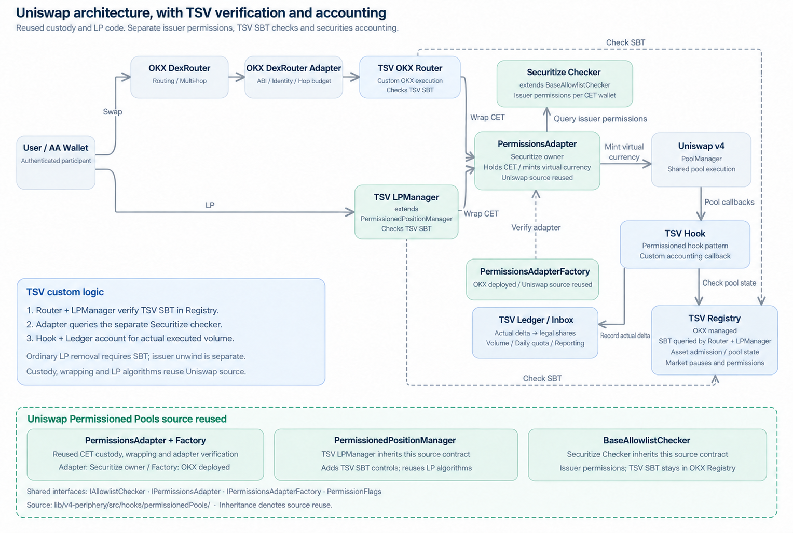
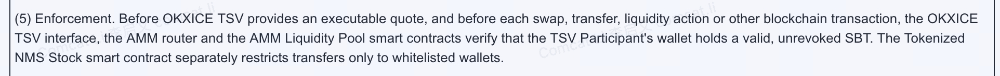
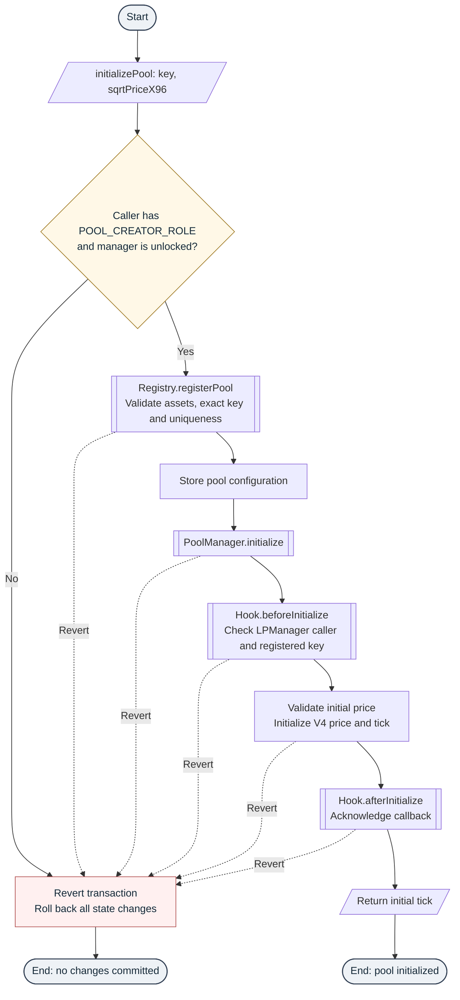
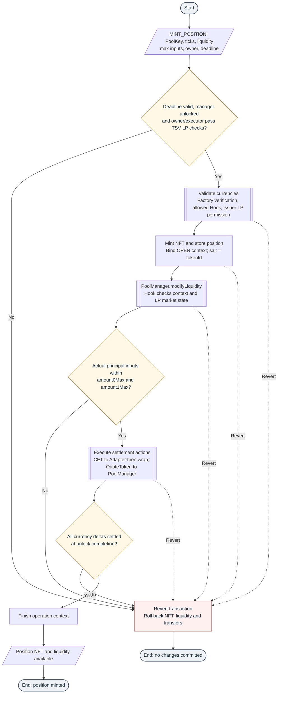
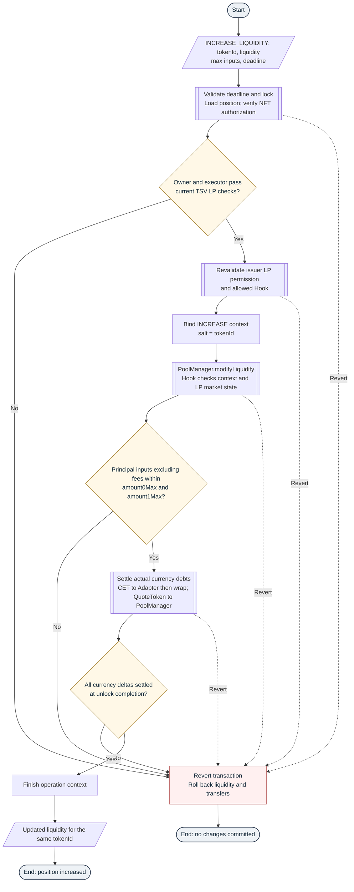
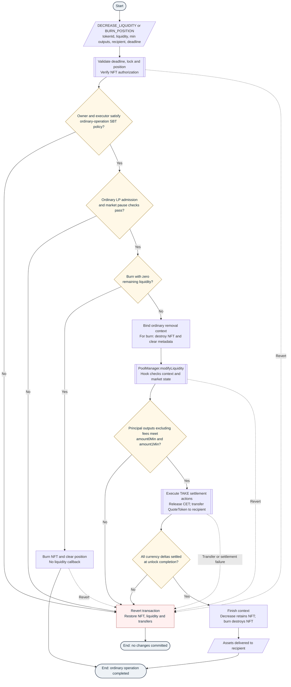
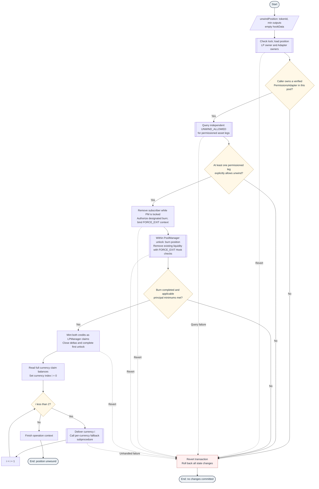
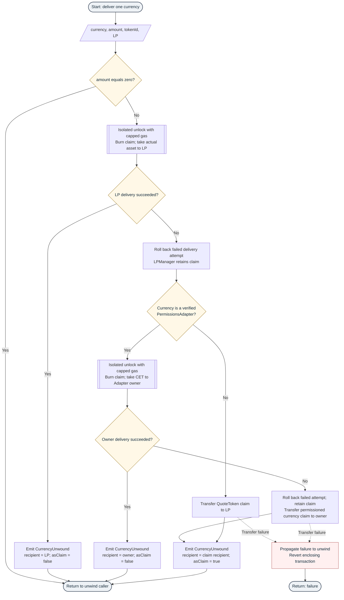
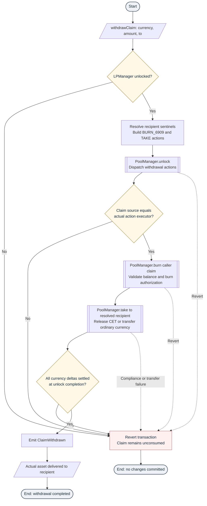

# TSV Contract Design: Permissioned Pools and LP Operations

Date: 2026-10-09. This document covers the overall architecture, Uniswap source reuse and modifications, Securitize management responsibilities, and LP business logic. Detailed entry-point flows for swaps and administration will be added later.

The implementation references are the current `src/v1` workspace, including uncommitted LP initialization and TokenApproveProxy changes. “Target design” refers to confirmed requirements; “current implementation” refers to behavior already present in the source; “pending discussion” refers to interface semantics that have not been finalized. This document does not establish production deployment or completion of integration acceptance testing for the full LP flow.

## 1. Overall Architecture



TSV follows the Uniswap v4 Permissioned Pools architecture. PermissionsAdapter holds the underlying restricted security token and mints virtual currency to PoolManager. TSV reuses PermissionedPositionManager for positions, liquidity calculations, and settlement. TSV adds participant SBT verification, market admission, and pause controls. Hook, Ledger, and Inbox manage securities trading volume, legal share quantities, and quotas. OKX DexRouter connects to TSV Router through a dedicated adapter.

The diagram reflects the current design: **the issuer checker and TSV Registry are deployed separately and queried independently**. PermissionsAdapter queries a concrete checker supplied by Securitize, derived from `BaseAllowlistChecker`, for issuer permissions. Router and LPManager independently query OKX Registry for SBT permissions; Hook queries Registry for pool state. OKX Registry manages SBT, securities, and market configuration. It does not inherit the issuer checker or perform issuer permission queries on its behalf. OKX deploys Factory. Factory verification checks deployment provenance and underlying asset balance, rather than participant eligibility for each operation. The diagram retains the original gray execution paths, green components that reuse upstream source, and blue TSV verification and accounting components.

### 1.1 Asset and Component Names

| Name | Meaning | Custody and use |
| --- | --- | --- |
| CET | Underlying restricted security token | Deposited into PermissionsAdapter; every CET transfer is checked by the security token's own compliance logic |
| PermissionsAdapter | Adapter contract that holds CET and issues the virtual token used as the pool's security-side currency | PoolManager holds the adapter-issued virtual token; an outgoing transfer automatically burns it and releases CET |
| QuoteToken | Ordinary quote token | Held and settled directly by PoolManager |

Pools use PermissionsAdapter/QuoteToken, with the PermissionsAdapter contract address as the security-side currency address. Changing PermissionsAdapter, Hook, fee, or tickSpacing changes PoolKey/poolId and therefore identifies a different liquidity pool. `initializePool` initializes only the price and pool state; it does not fund the pool or mint an LP NFT.

### 1.2 Permission Layers

1. Securitize checker: returns issuer permission flags for a wallet and CET, including `SWAP_ALLOWED`, `LIQUIDITY_ALLOWED`, and the newly added independent `UNWIND_ALLOWED` flag for issuer-authorized unwind.
2. TSV Registry: checks whether the wallet holds a registered SBT and determines its TSV operation permissions.
3. TSV Hook: validates the source of an LP operation, the exact PoolKey, the operation context, and market state.
4. Underlying CET: independently enforces allowlisting and other issuer compliance restrictions during actual transfers.

Passing a checker query does not guarantee that a subsequent CET transfer will succeed. The transfer amount, an asset pause, or the status of either transfer party may still cause CET to reject the transfer. Failures follow the relevant entry point's rollback or unwind fallback rules.

## 2. Uniswap Reuse and Component Modifications

TSV follows Uniswap v4 Permissioned Pools. **Uniswap v4 PoolManager, PermissionsAdapter, PermissionsAdapterFactory, and BaseAllowlistChecker are reused in their original form, with no changes to their source or behavior.** The PoolManager reference is `lib/v4-core/src/PoolManager.sol`; the Permissioned Pools references are in `lib/v4-periphery/src/hooks/permissionedPools/`. TSV customization is concentrated in Router, LPManager, Registry, Hook, Ledger, and Inbox. Securitize implements its issuer checker by inheriting the original BaseAllowlistChecker.

| Component | Original responsibilities / reused functionality | Modifications and extensions |
| --- | --- | --- |
| Uniswap v4 PoolManager | Pool initialization, swaps, liquidity changes, pool and position accounting, custody of virtual tokens and QuoteToken, unlock/settle/take settlement, and Hook callbacks | **No modifications**; uses a PermissionsAdapter/QuoteToken PoolKey and integrates with TSV Hook |
| PermissionsAdapter | CET custody, virtual token minting, allowedWrappers/allowedHooks, issuer checker queries, and unwrapping on outgoing transfers from PoolManager | **No modifications**; checker, wrapper, Hook, and swap enablement are configured through the existing owner interfaces |
| PermissionsAdapterFactory | Permissionless creation and verification; PermissionsAdapter→CET mapping; verification requires Factory provenance and a nonzero CET balance in PermissionsAdapter | **No modifications**; deployed by OKX and bound to the same PoolManager; TSV admission checks are implemented separately in Registry |
| BaseAllowlistChecker | IAllowlistChecker interface and ERC-165 support | **No modifications**; Securitize implements issuer eligibility in a derived checker; TSV SBT is checked independently in Registry |
| PermissionedPositionManager | NFTs, ticks/salt, liquidity changes, slippage, settlement, nontransferable NFTs, owner-authorized unwind, and delivery fallbacks | Provides the inheritance base for TSVLPManagerV1; receives the necessary extension points |
| TSVLPManagerV1 | Inherits PermissionedPositionManager and reuses liquidity algorithms and unwind delivery logic | Adds TSV SBT checks, including ordinary removal/burn; registers pools atomically before initialization; pays through TokenApproveProxy; adds Hook context and independent UNWIND_ALLOWED queries; authorized unwind may bypass the LP's SBT check |
| TSVRegistryV1 | Uses V4 PoolKey and PermissionFlags | Custom TSV component managing SBT permissions, security and asset admission, pool registration, and market pauses |
| TSVHookV1 | Uses V4 callbacks and actual BalanceDelta | Custom TSV component validating pool state and LP context, rejecting donations, converting actual security-side executed volume to legal shares, and calling Ledger |
| TSVVolumeLedgerV1 | Receives actual executed deltas and legal share quantities from Hook | Custom TSV component recording securities volume and enforcing quotas shared by a security; liquidity changes are not directly counted as swap volume |
| TSVDataInboxV1 | No equivalent Permissioned Pools component | Custom TSV component validating and processing market, quota, and security data reports |
| TSVSwapRouterV1 | Inherits PermissionedV4Router and reuses its permission and wrap/unwrap patterns | Adds TSV SBT checks, identification of the actual participant, aggregator authorization, and exact settlement |
| OKX DexRouter Adapter | Reuses OKX DexRouter integration capabilities | Adapts TSV requests and participant identity, connecting the actual payment and receipt assets to TSV Router |

The current `_decrease` and parameterized `_burn` functions do not provide directly overridable `virtual` extension points. The current workspace places SBT holding checks in TSV's action dispatcher and makes the parent dispatcher virtual to support extension. A frontend-only check is insufficient. The dispatcher also covers burning a position with zero liquidity, where no Hook callback occurs.

## 3. Securitize and OKX Management Responsibilities

“Management” refers to configuration and governance responsibilities. Deployment responsibility and contract call permissions are specified separately. BaseAllowlistChecker is abstract; the deployed contract is Securitize's concrete checker. Management and deployment use existing upstream interfaces without modifying PermissionsAdapter, PermissionsAdapterFactory, or BaseAllowlistChecker.

| Component | Managed by | Deployment/configuration responsibilities and requirements |
| --- | --- | --- |
| Underlying CET / security allowlist system | Securitize / issuer | Manage CET transfer compliance; allow PermissionsAdapter to receive and release CET; configure an Adapter owner capable of receiving CET through unwind fallback |
| [PermissionsAdapter](../src/v1/vendor/permissionedPools/PermissionsAdapter.sol) | **Securitize holds owner authority** | Owner manages checker, allowedWrappers, allowedHooks, and swappingEnabled; PermissionsAdapter is created through OKX Factory; initialOwner is the issuer governance address |
| Concrete implementation of [BaseAllowlistChecker](../src/v1/vendor/permissionedPools/BaseAllowListChecker.sol) | **Securitize** | Develop, deploy, and configure issuer queries; support IAllowlistChecker/ERC-165; TSV SBT does not substitute for security token compliance |
| [PermissionsAdapterFactory](../src/v1/vendor/permissionedPools/PermissionsAdapterFactory.sol) | OKX deploys and selects the Factory | POOL_MANAGER must match TSV; create and verify are not owner-restricted and can be called by any address; Securitize supports asset allowlisting and verification deposits |
| TSVRegistryV1 | OKX | Manage securities, PermissionsAdapter/CET/QuoteToken, SBT permissions, issuer owner admission, markets, and component bindings |
| TSVLPManagerV1 | OKX | Manage pool creation roles and upgrades; handle LP entry points, SBT, issuer permissions, settlement, and unwind; unwind authority comes from PermissionsAdapter.owner, not an ordinary OKX administrator role |
| TSVHookV1 | OKX | Manage bindings to the actual Router/LPManager; validate pools and LP context and enforce market controls |
| TokenApproveProxy / TokenApprove | Administrators of the relevant OKX approval infrastructure | Authorize the actual LPManager proxy to call claimTokens; users approve TokenApprove to debit their tokens |
| TSVVolumeLedgerV1 / TSVDataInboxV1 | OKX | Executed-volume accounting, quotas, and report processing; no custody of the LP's CET |
| PoolManager | Selected Uniswap v4 infrastructure | Holds PermissionsAdapter virtual tokens and QuoteToken; maintains pools and ERC-6909 balances; Factory does not grant the issuer management authority over the entire PoolManager |

Under the confirmed requirements, **unwind uses PermissionsAdapter.owner as the fallback recipient for actual assets and permissioned-asset claims**.

### 3.1 Query Requirements for the Securitize Checker

The existing interface is `checkAllowlist(address account, address tokenAddress) -> PermissionFlag`. Adapter passes CET as the second argument, not PermissionsAdapter or PoolManager. A checker serving multiple assets must distinguish permissions by CET address.

| Query scenario | Actual call/input | Required meaning | Status |
| --- | --- | --- | --- |
| PermissionsAdapter creation and TSV admission | Checker's supportsInterface; Registry checks that checker code exists and the interface is readable | Implement the correct interface and allow Adapter to query wallet permissions for CET | Structural checks implemented; they do not establish approval of every wallet |
| LP mint/increase validation | `PermissionsAdapter.isAllowed(owner, LIQUIDITY_ALLOWED)` → `checkAllowlist(owner, CET)` | Position holder has issuer LP permission for CET; the returned permission set includes the LP bit | Implemented |
| Security-side LP payment | `PermissionsAdapter.isAllowed(msgSender(), LIQUIDITY_ALLOWED)` | Actual operation user has LP permission; checking only the destination NFT owner is insufficient | Implemented; actual payer must also satisfy underlying CET transfer compliance |
| Swap validation | `PermissionsAdapter.isAllowed(participant, SWAP_ALLOWED)` | Actual participant has trading permission for CET | Scope defined here; detailed swap flows to follow |
| Unwind eligibility | `PermissionsAdapter.isAllowed(lp, UNWIND_ALLOWED)` | Independent unwind flag: issuer explicitly permits an administrator to unwind this LP | Confirmed design; permission constant and LPManager query integration remain to be implemented |

Queries must read current on-chain state. An eligibility read failure must not be treated as evidence that an LP is invalid. Ordinary operations revert on query errors; unknown unwind eligibility cannot authorize an unwind.

### 3.2 Independent Unwind Flag: UNWIND_ALLOWED

Unwind eligibility uses an independent `UNWIND_ALLOWED` flag, separate from `SWAP_ALLOWED` and `LIQUIDITY_ALLOWED`. Securitize's concrete checker decides whether to return the bit under issuer rules. A set bit permits an administrator to unwind; an unset bit means unwind has not been authorized. Losing swap permission, LP permission, or an SBT does not automatically authorize unwind.

The target query is:

```solidity
permissionsAdapter.isAllowed(lp, UNWIND_ALLOWED);
```

`UNWIND_ALLOWED` is a planned independent, nonzero PermissionFlag. It can be declared in an extended permission definition shared by TSV and Securitize, with a proposed value of `0x0004` (existing swap and LP bits are `0x0001` and `0x0002`). The current source contains only a commented definition of this constant; it is not enabled. This example describes the target call, not an existing usable constant or completed integration.

PermissionsAdapter retains its original interface. Securitize's derived checker supplies this flag in the permission set returned by `checkAllowlist(lp, CET)`. **PermissionsAdapter, PermissionsAdapterFactory, and BaseAllowlistChecker remain unchanged.** `NONE` is no longer used to determine invalidity, and the absence of ordinary operation permissions does not substitute for independent unwind authorization.

LPManager queries this flag for permissioned asset legs. At least one permissioned leg must allow unwind, and the caller must satisfy Adapter owner authorization. Checker query failures revert and must not be interpreted as unwind authorization. The exited LP does not need to hold an SBT; asset delivery and the Adapter owner fallback order remain unchanged.

## 4. SBT Enforcement for LP Operations

The user-provided Enforcement excerpt requires the interface, AMM Router, and AMM Liquidity Pool contracts to verify that the participant's wallet holds a valid, unrevoked SBT before executable quotes and transactions such as liquidity actions. The security token independently restricts transfers to allowlisted wallets.



This excerpt is a requirements input for the design. This document does not infer its provenance or legal effect.

**Ordinary LP operations:** minting, increasing, decreasing, burning, and collecting fees must all verify the participant's valid SBT. Removal must not retain Uniswap's exception allowing holders to exit independently after losing eligibility. **Issuer-authorized unwind:** the exited LP's SBT need not be checked because it may already have been revoked. Unwind requires independent owner authorization and the issuer's UNWIND_ALLOWED flag.

Mint/increase operations continue to require Registry `LIQUIDITY_ALLOWED`. The confirmed minimum requirement for ordinary removal is a valid, unrevoked SBT. Whether the SBT configuration must also continue to grant the LP operation bit cannot be inferred solely from the requirement to hold an SBT; implementation must clarify this detail. `hasCredential` ignores SBT pauses and therefore does not by itself represent every condition of validity.

NFT owner and executor can differ because upstream supports approved operators. The actual participant must be checked, and an operator must not bypass the removal restriction for an owner who has lost their SBT. The recommendation is to check both owner and executor for ordinary operations; the operator policy remains to be confirmed. The current removal implementation checks only the owner. If the product later adopts owner-only operations, this can be simplified. The underlying asset recipient must still satisfy CET transfer compliance.

### 4.1 Flowchart Notation and Scope

The diagrams use standard program flowchart notation: rounded terminals for start/end, parallelograms for inputs/outputs, rectangles for processing, diamonds for decisions, and double-sided rectangles for subprocedures. Solid arrows show control flow; labeled dashed arrows show exceptions propagating to transaction rollback. Decisions have explicit outcomes. Issuer setup and asset admission are prerequisites, rather than steps repeated within every LP transaction.

Initialization reflects the documented implementation. Ordinary LP and unwind charts describe the target design, including Hook context and UNWIND_ALLOWED integration; outstanding implementation work is listed in Section 11. Delivery and withdrawClaim charts retain the documented existing behavior. Unhandled failures revert the entire atomic transaction. During unwind delivery, a failed isolated delivery attempt rolls back only that attempt and proceeds to the next fallback.

## 5. Pool Initialization: initializePool

Entry point: `TSVLPManagerV1.initializePool(key, sqrtPriceX96)`. The caller must have `POOL_CREATOR_ROLE`. This is an administrative pool creation action, rather than liquidity provision by an ordinary participant. The current entry point checks the role, not an SBT.

### 5.1 Securitize Prerequisites

1. Specify CET, the issuer owner, and the concrete checker. The owner must satisfy Registry's contract-address and approved-owner requirements.
2. Create PermissionsAdapter through the Factory deployed by OKX, fixing CET, PoolManager, initialOwner, and checker. Checker must have code and support IAllowlistChecker.
3. CET compliance must allow PermissionsAdapter to hold CET and accept verification deposits. A depositor holds CET and approves PermissionsAdapter, then calls `depositForVerification(amount)`, or transfers CET to PermissionsAdapter through a compliant CET transfer.
4. Call Factory `verifyPermissionsAdapter(PermissionsAdapter)`. PermissionsAdapter must originate from that Factory and CET.balanceOf(PermissionsAdapter)>0. Verification is permissionless and is not restricted to OKX or Securitize.
5. Owner authorizes TSV Router and the actual LPManager proxy as allowedWrappers, and TSV Hook as an allowedHook. Enable swappingEnabled when swaps are permitted; it is not a separate switch for LP initialization or liquidity changes.
6. Confirm that owner can receive CET through unwind fallback. Securitize should retain a valid owner and keep issuer control and TSV admission aligned during two-step ownership transfers. Use the original ownership interfaces; do not add a contract modification that disables renounceOwnership.

### 5.2 OKX Prerequisites

Complete Registry/Hook/LPManager/Factory/PoolManager bindings, issuer owner approval, the legal share adapter, security and PermissionsAdapter admission, QuoteToken registration, and pool creation role authorization.

On **initial admission**, PermissionsAdapter must have a nonzero CET verification deposit, PermissionsAdapter.totalSupply=0, PoolManager's PermissionsAdapter balance=0, and PermissionsAdapter protocol fees=0. These are first-admission conditions, not a requirement to reset global inventory on every initializePool call.

PoolKey must contain exactly one admitted security PermissionsAdapter and one registered QuoteToken, with ascending currency addresses, no native currency, the fixed TSV Hook, and valid static fee and tickSpacing. Duplicate registration is prohibited, and the initial price must be within V4's accepted range.

### 5.3 Flowchart



Current initialization is atomic: `registerPool → PoolManager.initialize`. Hook validates in beforeInitialize; afterInitialize only acknowledges the callback. After pool creation, the first funding operation uses the separate liquidity mint entry point.

## 6. Adding Liquidity: Mint a Position

Entry point: `MINT_POSITION` within `modifyLiquidities(unlockData, deadline)`, together with settlement actions. There is no separate public `addLiquidity` ABI.

### 6.1 Prerequisites

- Pool is initialized; the security is listed; pool, global, security, and market LP pauses do not block the operation.
- Owner and actual participant hold valid SBTs. Minting requires TSV `LIQUIDITY_ALLOWED` and issuer `LIQUIDITY_ALLOWED` on every permissioned asset leg.
- PermissionsAdapter is Factory-verified, allows the pool's Hook, and lists the actual LPManager proxy as a wrapper.
- User holds CET/QuoteToken and approves the TokenApprove returned by `TOKEN_APPROVE_PROXY.tokenApprove()`. The proxy authorizes LPManager to call claimTokens. Users are not required to approve LPManager/Permit2 for these payments.
- Tick range, liquidity, amount0Max/amount1Max, and deadline are valid; hookData is empty.
- LPManager supplies Hook context matching the operation: poolId, tickLower/tickUpper, salt, liquidityDelta, and OPEN mode.

### 6.2 Flowchart



PermissionsAdapter.wrapToPoolManager accepts only authorized wrappers and requires available CET inventory to cover the minted amount. Any failure rolls back the transaction's NFT, liquidity, and fund transfers. LP operations themselves are not recorded in Ledger as swap volume.

## 7. Increasing Liquidity: Increase a Position

Entry point: `INCREASE_LIQUIDITY` within `modifyLiquidities`. The inherited ABI also includes from-deltas variants; these must pass the same identity checks and operation context validation to prevent bypasses. Current source marks from-deltas variants as deprecated. Standard operations use an explicit liquidity parameter.

### 7.1 Prerequisites

In addition to Section 6's asset, identity, market, and payment requirements, tokenId must exist and the executor must be the owner or an approved operator. Each increase rechecks the current owner's issuer LP permission, Registry LP permission, and PermissionsAdapter.allowedHooks; the result from the original mint cannot be reused. Hook mode is INCREASE, and salt is tokenId.

### 7.2 Flowchart



## 8. Ordinary Removal, Burning, and Fee Collection

Entry points: `DECREASE_LIQUIDITY` or `BURN_POSITION` within `modifyLiquidities`. `DECREASE_LIQUIDITY` with liquidity=0 can collect fees and is also an ordinary participant operation.

### 8.1 Prerequisites

- tokenId exists; executor has NFT operation authorization; owner and actual participant pass valid SBT checks. A user who loses their SBT cannot independently decrease, burn, or collect fees.
- The target design retains TSV Hook's ordinary LP market checks. Delisting or an LP pause blocks ordinary removal; the separate authorized unwind path can bypass ordinary LP market checks.
- Requested removal does not exceed the position's liquidity; amount0Min/amount1Min and deadline are valid; hookData is empty.
- Actual recipient can legally receive CET. Quote token receipt and native currency behavior follow the supported asset scope. Admitted pools in this design use PermissionsAdapter/QuoteToken, with no native currency.
- LPManager sets the corresponding ordinary removal context, matching the exact key, ticks, salt, and delta.

Ordinary removal does not additionally require PermissionsAdapter.swappingEnabled. Upstream does not recheck issuer `LIQUIDITY_ALLOWED` for removal. This document retains that issuer permission behavior and adds the confirmed TSV SBT requirement. CET release remains subject to underlying compliance. If issuer LP permission has been revoked but SBT remains valid, any further restriction on ordinary exit requires a separate issuer decision.

### 8.2 Flowchart



Ordinary removal does not automatically use unwind's owner/claim fallback. A failed CET transfer reverts the transaction. SBT checks must cover all ordinary entry points, including `modifyLiquiditiesWithoutUnlock`, zero-liquidity fee collection, burning a zero-liquidity position, and the corresponding batched actions. They cannot rely solely on Hook callbacks for nonzero liquidity changes.

## 9. Forced Removal: unwindPosition

Entry point: `unwindPosition(tokenId, amount0Min, amount1Min, hookData)`. The confirmed requirements retain existing asset delivery logic. An invalid SBT does not prevent issuer-authorized unwind.

### 9.1 Prerequisites

1. tokenId exists and the contract is not locked for an operation. Caller is the current owner of either verified PermissionsAdapter in the pool. `_getOwner` returns zero for an ordinary quote token, which grants no unwind authority.
2. Query the issuer checker's independent `UNWIND_ALLOWED` flag for at least one permissioned asset leg. The flag must explicitly authorize unwind; missing ordinary permissions or a failed read does not constitute authorization.
3. Exited LP need not retain an SBT or pass ordinary LP permission checks. Administrator authorization and the UNWIND_ALLOWED query are both mandatory.
4. Set FORCE_EXIT context. Hook allows an actual negative liquidityDelta to bypass ordinary LP market checks, while still validating source, exact key, ticks/salt/delta. hookData is empty.
5. PermissionsAdapter.owner is an issuer address capable of receiving CET. If asset delivery fails, proceed through the retained claim fallback.
6. amount0Min/amount1Min constrain the principal returned by burn. Zero disables the corresponding lower bound. Failure to meet a nonzero minimum reverts the entire unwind.

### 9.2 Position Exit Flowchart



The first stage settles funds as claims held by LPManager. It does not transfer CET to the LP at this stage, preventing LP receipt logic from blocking the burn. The current implementation reads LPManager's **entire claim balance** for each currency, including the current burn proceeds and any previously remaining balances. This behavior is retained; delivery is not restricted to the current operation's delta.

### 9.3 Asset Delivery Flowchart for Each Currency



Each actual asset delivery uses a separate unlock capped at DELIVERY_GAS_LIMIT. A failure rolls back only that delivery attempt, leaving the claim available for the next step. The two legs are handled independently: one can deliver actual assets to the LP while the other delivers actual assets or a claim to owner. Transferring a claim does not execute CET transfer compliance and must not be described as a completed CET delivery.

## 10. Subsequent LP-Related Withdrawal: withdrawClaim

Retain `withdrawClaim(currency, amount, to)`. A claim holder selects the recipient; LPManager calls PoolManager to burn the caller's claim, then take the corresponding asset. PoolManager claim burn authorization is required; a typical call requires the claim holder to authorize LPManager as an operator. Taking a permissioned PermissionsAdapter currency automatically releases CET. The actual recipient must satisfy CET transfer compliance.



**Scope pending discussion:** whether ordinary-user withdrawClaim calls also fall under the SBT requirement before other blockchain transactions, and how to preserve administrative withdrawals for the Securitize owner. The current inherited entry point has no SBT check. Retaining unwind's delivery order does not automatically determine the identity rules for this entry point. PoolManager claim transfer/transferFrom also bypasses TSV LP Hook.

## 11. Implementation Gaps and Open Items

| Item | Current implementation | Target / next action |
| --- | --- | --- |
| Atomic pool creation | LPManager calls registerPool before initialize | Implemented; full component integration acceptance testing remains separate |
| Mint/increase permissions | Queries LIQUIDITY_ALLOWED in both Registry and PermissionsAdapter | Retain; complete identity and context coverage for all variants |
| Ordinary removal SBT | Current workspace dispatcher queries owner.hasCredential for decrease/burn; the designated tokenId burn in authorized unwind is exempt | Holding check added, covering fee collection and zero-liquidity burns; hasCredential ignores SBT pauses, so full validity and executor policy remain to be clarified |
| LP Hook context | Hook calls activeLPContext; current LPManager does not implement the interface | Implement trusted context and lifecycle for OPEN/INCREASE/ordinary removal/FORCE_EXIT; full integration with the actual Hook cannot yet be claimed |
| Three upstream components | Local vendor previously included Adapter compatibility and behavioral changes | Target uses original PermissionsAdapter, PermissionsAdapterFactory, and BaseAllowlistChecker without changes; this document does not restore source files |
| Unwind eligibility | `_getLpStatus` still queries NONE; independent unwind bit not integrated | Query UNWIND_ALLOWED, explicitly returned by the issuer checker; retain the three original components unchanged |
| Unwind delivery | Actual assets to LP→actual assets to owner→permissioned-asset claim to owner; ordinary-asset claim to LP | Retain existing delivery logic |
| SBT operation bit for ordinary removal | Valid SBT is confirmed as required; continued LP operation permission has not been separately defined | Clarify identity validity versus operation permissions before implementation |
| Operator | Upstream owner/approval model | Check executor and owner to prevent an operator bypass for an ineligible owner; owner-only policy not finalized |
| withdrawClaim identity | No current SBT check | Discuss together with ordinary operation rules and administrator exceptions |

This work adds only the design document and user-provided image assets; it does not change the contracts above. A separate dispatcher SBT update was detected in the workspace during drafting, and the implementation notes were updated accordingly. Its regression tests were not run or claimed to pass as part of this documentation work. Future acceptance tests should cover: ordinary removal rejection after SBT revocation while authorized unwind remains available; operator bypass rejection; zero-liquidity and fee collection checks; exact Hook context matching; atomic rollback on initialization failure; actual asset/claim fallbacks for both legs; UNWIND_ALLOWED grant/revocation; and checker errors not granting unwind authorization.

## 12. Sections to Follow

- **Swap:** SBT verification before executable quotes; direct calls and OKX Adapter calls; exact-in/exact-out; participant, payer, and recipient; executed volume and quota accounting. Entry-point diagrams to follow.
- **Administration:** security and PermissionsAdapter/QuoteToken admission; owner/checker/wrapper/Hook configuration updates; SBT configuration; market pause/resume; reports and upgrades. Entry-point diagrams to follow.

## 13. Code References

- [TSVLPManagerV1](../src/v1/periphery/TSVLPManagerV1.sol): initializePool, unwindPosition, LP permissions, and TokenApproveProxy payments.
- [PermissionedPositionManager](../src/v1/vendor/permissionedPools/PermissionedPositionManager.sol): nontransferable NFTs, mint/increase validation, claims, and unwind delivery.
- [PositionManager](../src/v1/vendor/permissionedPools/PositionManager.sol): action entry points, mint/increase/decrease/burn, slippage, and settlement.
- [PermissionsAdapter](../src/v1/vendor/permissionedPools/PermissionsAdapter.sol), [Factory](../src/v1/vendor/permissionedPools/PermissionsAdapterFactory.sol), and [checker base](../src/v1/vendor/permissionedPools/BaseAllowListChecker.sol): issuer permissions, custody, and Factory verification.
- [TSVRegistryV1](../src/v1/core/TSVRegistryV1.sol) and [PermissionedValidationLib](../src/v1/libraries/PermissionedValidationLib.sol): SBT, markets, pool registration, and asset admission.
- [TSVHookV1](../src/v1/core/TSVHookV1.sol): initialization, LP context, ordinary/unwind market checks, and executed-volume accounting.
- [PermissionFlags](../src/v1/vendor/permissionedPools/libraries/PermissionFlags.sol): existing swap/LP bits; UNWIND_ALLOWED currently has only a commented definition, while the target design uses an independent unwind bit.
