# DEX - TSV 合约审计报告

来源：https://okg-block.sg.larksuite.com/docx/NYPSdzQruohPBOx90CUlFrTegbd

文档修改时间：2026-10-27T09:27:51Z

[doc:https://okg-block.sg.larksuite.com/wiki/UP90w08tvieXm1kUwS5laxE9gif]

[doc:https://okg-block.larksuite.com/docx/ZZ8VddKOsoZJdAxuhbuupdZTsvf] 

[doc:https://okg-block.larksuite.com/docx/CCI3dq4j2oFJroxAOHxuLwiysYf]

❌ 部分内容无需填写

🔵 蓝色字体对应部分内容由产研填写 

基础信息 Basic information：

## 基础信息 Basic information：

| 项目名 project name | TSV |
|---|---|
| 项目里程碑 | 高优项目必填 High-Priority Project Required 可开始审计时间（预期开发完成&权限已开启）：10月13日 计划上线时间：11月第一周 |
| 申请人 applicant | @ou_911c5d1850a0548e95126d48437403ce |
| GitHub link 权限需要开启给@ou_4c4c1d4e17650d7dacd774ff0c8ee58a | 如需要权限，请参考该表中的负责审计是分享权限 If permissions are needed, please refer to the table where the responsible auditor is sharing permissions. [doc:https://okg-block.larksuite.com/wiki/Vt44wN9bgiZYKpkc6EfuTdEnsVc?from=from_copylink]  https://gitlab.okg.com/web3-dex/tsv |
| Commint ID | 必填 Required 6402443e9fc372e8aa52c9ba82cd3e84cb846493 Scope：src/v1内的代码，其中src/v1/vendor是v4源码的修改 (明确版本，清理掉不需要的文件，或说明审计哪几个文件 Specify the version, clean up unnecessary files, or indicate which files are being audited) |
| Branch | main |
| Languege | 中文 |
| 项目文档        Project Documents | [doc:https://okg-block.sg.larksuite.com/docx/CBqDdSZJio10SlxlRonll38kgPd] 产品业务逻辑说明，合约文件功能及要点解释 Explanation of product business logic, contract file functionalities, and key points explanation |
| 代码部署       Code deployment | 如果合约已经部署，提供合约地址（测试网/主网）If the contract has been deployed, provide the contract address (testnet/mainnet). 必填 Required 如果已经部署的合约可升级，需要提供链上部署合约的Commit ID。审计需要重点关注升级之后是否会出现storage冲突的场景 If the deployed contract is upgradeable, the Commit ID of the on-chain deployed contract needs to be provided. The audit should focus on whether storage conflicts may occur after the upgrade. 如果合约未部署，需提供部署脚本或部署说明 If the contract has not been deployed, please provide deployment scripts or deployment instructions. |
| 预估工期       Estimated working day | 11 天 |

审计范围 Audit Scope

## 审计范围 Audit Scope

| 目录 contents | 文件 Files | SHA-256 checksum |
|---|---|---|
| src/v1 | * 排除vendor（V4源码） |  |

审计结果 Audit Results

## 审计结果 Audit Results

### No.1: 中风险【订阅回调可使强制退出的余额差计算下溢】（别术林，吴晓涛）

| 位置 | 文件 | 风险状态 | 风险类型 | 风险级别 |
|---|---|---|---|---|
| Line -- | src/v1/libraries/TSVLPManagerLib.sol | ❌  | Denial of Service | 中风险 |

风险描述及修改建议

风险描述

unwindPositionByTsv 与 unwindPosition 在调用 subscriber.notifyUnsubscribe 之前读取 LP／发行方钱包余额，完成仓位销毁及资产交付后，再以 after − before 构造退出事件。LP 可控制订阅回调，在回调中转走自己原先持有的普通报价资产，使最终余额低于快照值。事件参数中的 uint256 减法会触发 Panic(0x11)，导致整个强退交易回滚。

例如：LP 原有 1,000 Q，本仓位退出获得 10 Q；订阅回调转走原有 1,000 Q 后正常返回，最终余额为 10 Q，事件计算 10 − 1,000 时回滚。回滚同时恢复仓位、订阅和余额，因此同一行为可重复阻止该仓位强退，并可能阻塞要求仓位计数归零的池子／证券下架。

修改建议

计算余额差额前，应先比较退出前后余额，仅在 after >= before 时执行减法，避免因余额减少触发算术下溢，导致整个强制退出交易回滚。

相关代码

```solidity
/// @dev Original TSV exit body; state mappings and immutable dependencies are explicit parameters.
function unwindPositionByTsv(
    UnwindParams memory p,
    mapping(uint256 => PositionInfo) storage positionInfo,
    mapping(uint256 => ISubscriber) storage subscriber,
    mapping(uint256 => address) storage approvals
) external {
    ...
    uint256 lpBalance0Before = poolKey.currency0.balanceOf(lp);
    uint256 lpBalance1Before = poolKey.currency1.balanceOf(lp);
    ...
    emit TsvPositionUnwound(
        tokenId,
        lp,
        issuer,
        Currency.unwrap(poolKey.currency0),
        Currency.unwrap(poolKey.currency1),
        //@audit-issue Medium 潜在的 DoS 攻击，lp 在 notifier 中将账户本来持有的代币转移走，导致 after 的资产反而小于 before 的资产
        //@audit-issue Low 对于 W 资产，lp 的账户余额永远都是0，应该获取 W 对应的 U 的账户余额
        poolKey.currency0.balanceOf(lp) - lpBalance0Before,
        0,
        poolKey.currency1.balanceOf(lp) - lpBalance1Before,
        0
    );
}

function unwindPosition(
    UnwindParams memory p,
    mapping(uint256 => PositionInfo) storage positionInfo,
    mapping(uint256 => ISubscriber) storage subscriber,
    mapping(uint256 => address) storage approvals
) external {
    ...
    RecipientBalances memory beforeBalances = _recipientBalances(poolKey, lp, issuer);
    ...
    RecipientBalances memory afterBalances = _recipientBalances(poolKey, lp, issuer);
    emit IssuerPositionUnwound(
        tokenId,
        lp,
        issuer,
        Currency.unwrap(poolKey.currency0),
        Currency.unwrap(poolKey.currency1),
        //@audit-issue Medium 潜在的 DoS 攻击，lp 在 notifier 中将账户本来持有的代币转移走，导致 after 的资产反而小于 before 的资产
        //@audit-issue Low 对于 W 资产，lp 的账户余额永远都是0，应该获取 W 对应的 U 的账户余额
        issuerReceived0 ? 0 : afterBalances.lp0 - beforeBalances.lp0,
        issuerReceived0 ? afterBalances.issuer0 - beforeBalances.issuer0 : 0,
        issuerReceived1 ? 0 : afterBalances.lp1 - beforeBalances.lp1,
        issuerReceived1 ? afterBalances.issuer1 - beforeBalances.issuer1 : 0
    );
}
```

问题反馈

| 项目方（产研）反馈 |  |
|---|---|
| 审计反馈 |  |

---

### No.2: 中风险【SBT 身份列表无长度上限，权限校验可能耗尽 gas】（吴晓涛）

| 位置 | 文件 | 风险状态 | 风险类型 | 风险级别 |
|---|---|---|---|---|
| Lines 269–291、315–331、729–737 | src/v1/core/TSVRegistryV1.sol | ❌  | Out Of Gas | 中风险 |

风险描述及修改建议

风险描述

setSbtConfig 在首次注册 tokenId 时将其永久追加到 identityTokenIds；当前没有长度上限及移除机制，权限设为 NONE 后该 ID 仍保留在数组中。_credentialState 每次遍历整个列表，并对每个 ID 外部调用 participantSbt.verify；permissionsOf、isSbtAllowed 和 hasCredential 均依赖该遍历。

随着管理员登记的身份类型增长，交易和流动性操作中的权限校验成本线性增长；同一业务流程对多个参与者重复校验时，成本会进一步累积。列表过大可能使链上调用超过可用 gas，并使完整列表查询受到 RPC gas／响应限制。注册仅允许 DEFAULT_ADMIN_ROLE，故该项属于依赖管理员配置规模的潜在可用性风险，不能据此认定任意用户可以低成本填满列表。

修改建议

对可登记的身份类型设置明确且经过最坏情况测算的数量上限，避免历史禁用 ID 无限参与交易路径遍历；需要移除时维护可控的活跃身份集合。长期可考虑由调用者提供身份凭证并逐项验证。

相关代码

```solidity
// TSVRegistryV1.sol，节选
if (!sbtIdentityConfig[tokenId].registered) identityTokenIds.push(tokenId);
sbtIdentityConfig[tokenId] = SbtIdentityConfig(true, permissions);

function _credentialState(address owner) private view returns (bool held, PermissionFlag permissions) {
    for (uint256 i; i < identityTokenIds.length; ++i) {
        uint256 tokenId = identityTokenIds[i];
        if (ISmartWalletSbtV1(participantSbt).verify(owner, tokenId)) {
            held = true;
            permissions = permissions | sbtIdentityConfig[tokenId].permissions;
        }
    }
}
```

问题反馈

| 项目方（产研）反馈 |  |
|---|---|
| 审计反馈 |  |

---

### No.3: 低风险【强退事件读取 W 余额，漏报实际收到的 U 资产】（别术林，吴晓涛）

| 位置 | 文件 | 风险状态 | 风险类型 | 风险级别 |
|---|---|---|---|---|
| Line -- | src/v1/libraries/TSVLPManagerLib.sol | ❌  | Business Logic / Event Accounting | 低风险 |

风险描述及修改建议

风险描述

对于 W 资产，LP 在 unwind 前后的 W 余额始终为 0，因此通过 W 余额差计算的到账数量也始终为 0，无法反映实际收到的 U 资产。

修改建议

应计算 W 对应的 U 资产在 unwind 前后的余额变化，以统计实际到账数量。

相关代码

```solidity
/// @dev Original TSV exit body; state mappings and immutable dependencies are explicit parameters.
function unwindPositionByTsv(
    UnwindParams memory p,
    mapping(uint256 => PositionInfo) storage positionInfo,
    mapping(uint256 => ISubscriber) storage subscriber,
    mapping(uint256 => address) storage approvals
) external {
    ...
    uint256 lpBalance0Before = poolKey.currency0.balanceOf(lp);
    uint256 lpBalance1Before = poolKey.currency1.balanceOf(lp);
    ...
    emit TsvPositionUnwound(
        tokenId,
        lp,
        issuer,
        Currency.unwrap(poolKey.currency0),
        Currency.unwrap(poolKey.currency1),
        //@audit-issue Medium 潜在的 DoS 攻击，lp 在 notifier 中将账户本来持有的代币转移走，导致 after 的资产反而小于 before 的资产
        //@audit-issue Low 对于 W 资产，lp 的账户余额永远都是0，应该获取 W 对应的 U 的账户余额
        poolKey.currency0.balanceOf(lp) - lpBalance0Before,
        0,
        poolKey.currency1.balanceOf(lp) - lpBalance1Before,
        0
    );
}

function unwindPosition(
    UnwindParams memory p,
    mapping(uint256 => PositionInfo) storage positionInfo,
    mapping(uint256 => ISubscriber) storage subscriber,
    mapping(uint256 => address) storage approvals
) external {
    ...
    RecipientBalances memory beforeBalances = _recipientBalances(poolKey, lp, issuer);
    ...
    RecipientBalances memory afterBalances = _recipientBalances(poolKey, lp, issuer);
    emit IssuerPositionUnwound(
        tokenId,
        lp,
        issuer,
        Currency.unwrap(poolKey.currency0),
        Currency.unwrap(poolKey.currency1),
        //@audit-issue Medium 潜在的 DoS 攻击，lp 在 notifier 中将账户本来持有的代币转移走，导致 after 的资产反而小于 before 的资产
        //@audit-issue Low 对于 W 资产，lp 的账户余额永远都是0，应该获取 W 对应的 U 的账户余额
        issuerReceived0 ? 0 : afterBalances.lp0 - beforeBalances.lp0,
        issuerReceived0 ? afterBalances.issuer0 - beforeBalances.issuer0 : 0,
        issuerReceived1 ? 0 : afterBalances.lp1 - beforeBalances.lp1,
        issuerReceived1 ? afterBalances.issuer1 - beforeBalances.issuer1 : 0
    );
}
```

问题反馈

| 项目方（产研）反馈 | 待项目方反馈 |
|---|---|
| 审计反馈 | 待项目方确认／修复后复核 |

---

### No.4: 优化建议【不同合约的升级暂停检查不一致】（别术林）

| 位置 | 文件 | 风险状态 | 风险类型 | 风险级别 |
|---|---|---|---|---|
| Line -- | src/v1/core/TSVHookV1.sol<br>src/v1/periphery/TSVSwapRouterV1.sol<br>src/v1/periphery/TSVLPManagerV1.sol<br>src/v1/core/TSVRegistryV1.sol<br>src/v1/governance/TSVGoverned.sol<br>src/v1/core/TSVVolumeLedgerV1.sol | ❌  | Business Logic | 优化建议 |

风险描述及修改建议

风险描述

TSVHookV1、TSVSwapRouterV1 和 TSVLPManagerV1 仅允许在 Registry 未暂停时升级，而 TSVRegistryV1 和 TSVVolumeLedgerV1 不检查暂停状态，升级条件不一致。要求未暂停才能升级，也使“暂停 → 升级修复 → 恢复”的常规应急流程无法直接执行。

修改建议

建议统一取消升级流程中的 pause 状态检查，允许授权管理员在暂停或未暂停状态下执行升级。

相关代码

```solidity
// TSVHookV1.sol
function _authorizeUpgrade(address) internal view override {
    if (registry.isPaused()) revert InvalidOperation();
    if (!registry.hasRole(UPGRADE_ADMIN_ROLE, msg.sender)) revert UnauthorizedUpgrade();
}

// TSVSwapRouterV1.sol；TSVLPManagerV1.sol 的升级入口亦使用同一暂停门禁
function upgradeToAndCall(address newImplementation, bytes memory data)
    public
    payable
    override
    whenRegistryNotPaused
{
    UUPSUpgradeable.upgradeToAndCall(newImplementation, data);
}
```

问题反馈

| 项目方（产研）反馈 |  |
|---|---|
| 审计反馈 |  |

---

### No.5: 低风险【中心化风险】（所有审计人员）

| 位置 | 文件 | 风险状态 | 风险类型 | 风险级别 |
|---|---|---|---|---|
| Line -- | src/v1/governance/TSVGoverned.sol<br>src/v1/core/TSVRegistryV1.sol<br>src/v1/core/TSVVolumeLedgerV1.sol<br>src/v1/periphery/TSVSwapRouterV1.sol<br>src/v1/periphery/TSVLPManagerV1.sol | ❌  | 中心化风险 | 低风险 |

风险描述及修改建议

风险描述

协议依赖多个特权角色及外部合规依赖正确运作；关键账户失陷、误配置或不可用，可能影响资产准入、交易额度、暂停恢复、合约升级与强退。低风险评级描述既有信任模型，不代表关键权限失陷的潜在损失较低。

DEFAULT_ADMIN_ROLE：在 Registry 管理角色、绑定核心组件及配置 SBT 身份权限；Router 同时依赖该角色管理可提交交易的 Adapter。UPGRADE_ADMIN_ROLE：授权升级 Registry、Hook、Router、LPManager 及 Ledger 等业务代理。

SYMBOL_ADMIN_ROLE：管理证券、底层资产、报价币、档位及池生命周期等配置。POOL_CREATOR_ROLE：授权初始化池子。HALT_REPORTER_ROLE：管理证券级业务暂停。EMERGENCY_PAUSER_ROLE／EMERGENCY_RESUMER_ROLE：启用／解除全局紧急暂停。

VOLUME_ORACLE_ROLE：设置每日额度及覆盖已用额度，直接影响后续交易可用性

FORCE_EXIT_ADMIN_ROLE：调用 TSV 强退入口；强退仍受代码中的资产退出资格及结算条件约束。发行方、权限适配器及 SBT 的外部治理同样是合规与持续可用性的信任依赖。

修改建议

关键特权采用多签机制并遵循最小权限原则；分离日常配置、升级、暂停和恢复职责，持续监控角色与关键配置变更。对非紧急升级及高影响参数变更采用适当时间锁；为紧急操作保留经过演练的受控流程。核对部署后的实际权限持有人、升级实现及外部合规依赖，及时撤销闲置授权。

问题反馈

| 项目方（产研）反馈 |  |
|---|---|
| 审计反馈 |  |

---

### No.6: 优化建议【其他优化建议】（所有审计人员）

| 位置 | 文件 | 风险状态 | 风险级别 |
|---|---|---|---|
| 见下表 | 多个文件 | ❌  | 优化建议 |

风险描述及修改建议

风险描述

      当前程序实现还有其他待优化项，整理如下：

其他优化项列表

| No | 代码位置 | 描述 | 建议 | 反馈 |
|---|---|---|---|---|
| 1 | src/v1/periphery/TSVLPManagerV1.sol:65 | 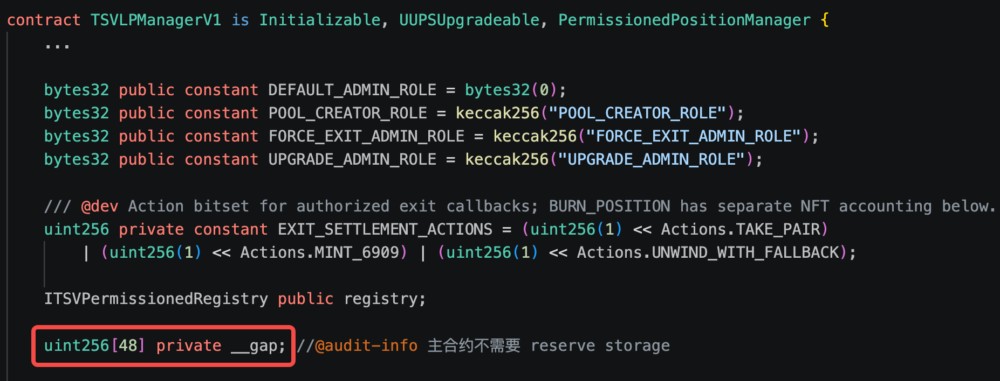 | 主合约不需要 reserve gap，只有抽象合约才需要 |  |
| 2 | src/v1/periphery/TSVLPManagerV1.sol:87–106 | 构造函数传入并写入 registry，但普通存储赋值只作用于实现合约；代理仍需在 initialize 中再次传入 Registry，易混淆配置来源。 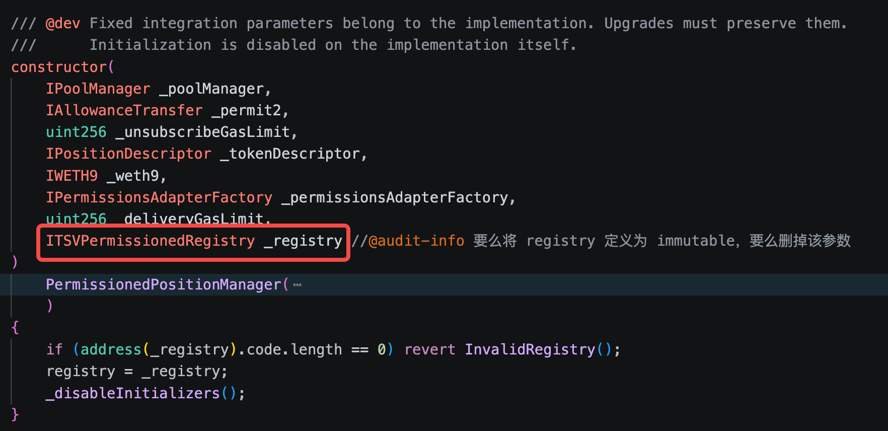 | 将 registry 定义为 immutable 或者将 constructor 中的 _registry 参数移除 |  |
| 3 | src/v1/periphery/TSVLPManagerV1.sol:338、352–353 | bytes32(uint256(1)) 表示授权强退进行中的状态，调用处与判断处重复使用魔法值，不利于理解临时授权状态。 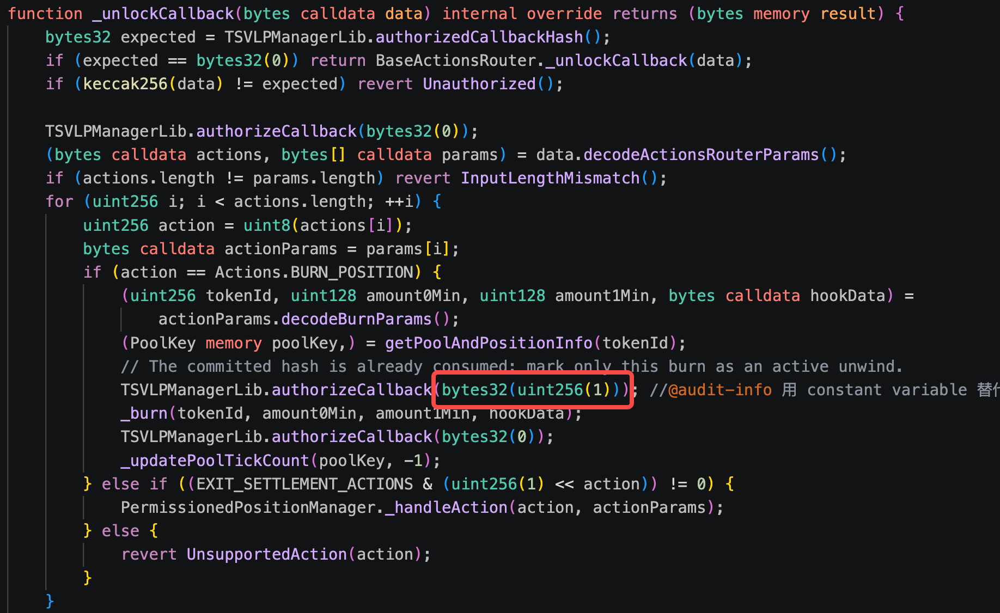 | 定义 UNWIND_ACTIVE_FLAG 等具名常量，并在 authorizeCallback 与 isUnwindActive 等位置统一引用；保持与回调哈希、未授权零值的语义一致。 |  |
| 4 | src/v1/libraries/PermissionedValidationLib.sol:112–126 | _candidateUnderlying 先读取 permissionsAdapterOf，再读取 verifiedPermissionsAdapterOf 比较，两次读取存在简化空间。 | 直接读取 verifiedPermissionsAdapterOf，然后进行非零检查 |  |
| 5 | src/v1/libraries/TSVLPManagerLib.sol:369–372<br>关联：src/v1/periphery/TSVLPManagerV1.sol:356–379 | 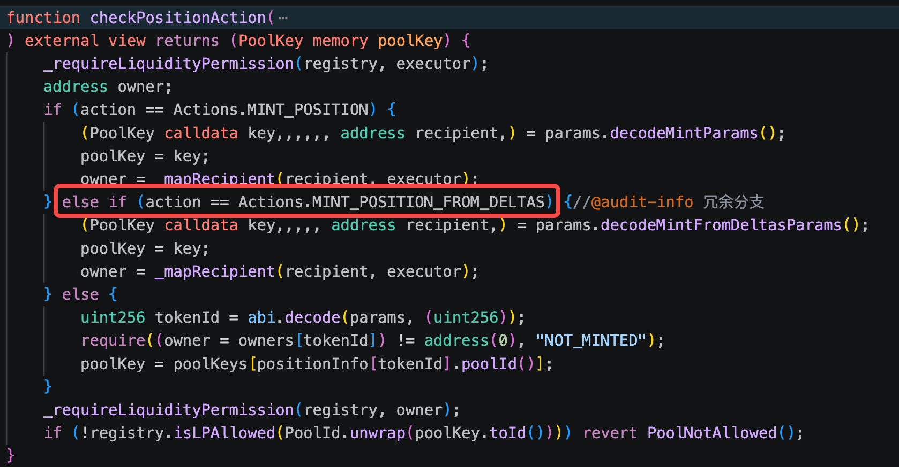 | 删除未支持的分支 |  |
| 6 | src/v1/libraries/TSVLPManagerLib.sol:389–410 | checkSettlementAction 显式拒绝 MINT_6909 和 UNWIND_WITH_FALLBACK，而末尾允许列表也会拒绝这两个 action，对最终拒绝结果而言重复。 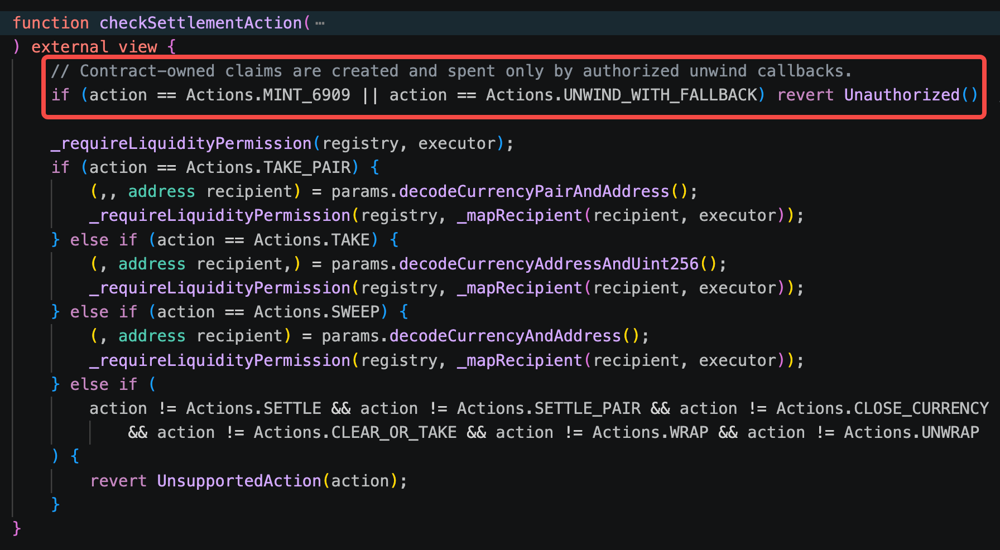 | 减少不必要的检查 |  |
| 7 | src/v1/core/TSVRegistryV1.sol:532–542、799–805 | registerPool 已对两侧调用 _assetAllowed；股票侧准入已要求对应证券 listed，后续再次检查 security.listed 存在重复。 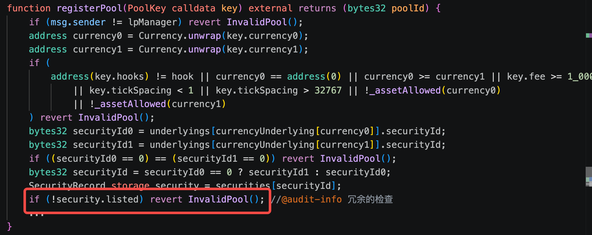 | 删除冗余的检查 |  |
| 8 | src/v1/core/TSVHookV1.sol:230–233、319–330<br>关联：src/v1/core/TSVVolumeLedgerV1.sol:69–86 | afterSwap 按股票侧实际 delta 的绝对值折算法定份额：W→Q 时输入股票数量包含 swap 手续费，Q→W 时输出股票数量不包含输入侧手续费。双向统计口径存在差异，并会传递到 usedWad 日额度。 | 明确额度是按实际股票流出／流入量、成交本金还是含费名义量统计；若要求双向一致，应显式处理手续费并覆盖双向、exact-input／exact-output 场景；若接受当前实际流量口径，应在业务文档和接口说明中披露。 |  |
| 9 | src/v1/core/TSVHookV1.sol | 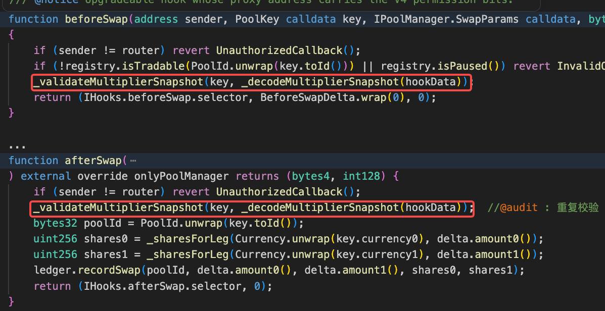 | _validateMultiplierSnapshot()在beforeSwap()和beforeSwap()各执行一次属于重复调用，是否有必要 |  |
| 10 | src/v1/core/TSVRegistryV1.sol | 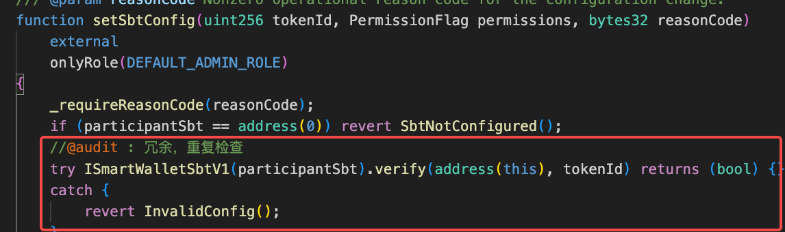 | bindComponents()已经做过校验，这里只需要确保participantSbt != address(0)即可 |  |
| 11 | src/v1/core/TSVRegistryV1.sol | 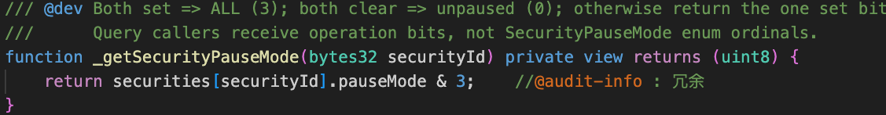 | 赋值操作已经确保了securities[securityId].pauseMode的值不会超过3。这里操作冗余 |  |
| 12 | src/v1/core/TSVRegistryV1.sol | 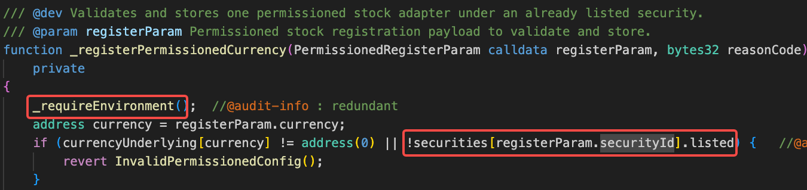 | registerPermissionedCurrency()函数已经做了相同check，这两处检查都属于冗余操作 |  |
| 13 | src/v1/libraries/TSVDirectSettlementLib.sol | 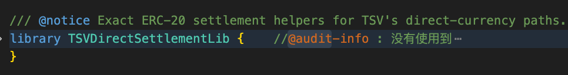 | TSVDirectSettlementLib.sol这个合约没有用到，是否需要保留？ |  |
| 14 | src/v1/periphery/TSVSwapRouterV1.sol | 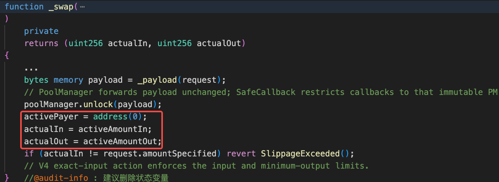 | swap操作结束建议删除activeParticipant/activeRecipient/activeInputCurrency/activePayer这些状态变量 |  |
| 15 | src/v1/periphery/TSVLPManagerV1.sol | 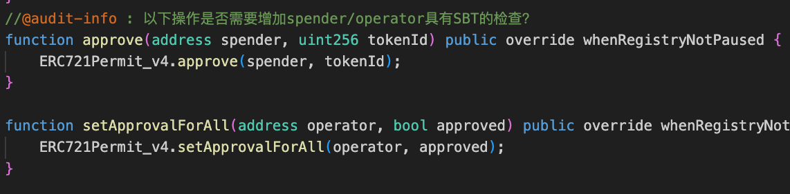 | approve操作建议增加spender/operator是否具有SBT的检查 |  |

问题反馈

| 项目方（产研）反馈 |  |
|---|---|
| 审计反馈 |  |

---

### 问题1: 累计本金超出单次资产增量上限，可能导致强退失败

同一仓位可通过多次合法增仓累积本金，而两个强退入口unwindPositionByTsv()和unwindPosition()均一次性移除全部流动性。在极端价格及足够大的原始供应量下，单次移除产生的资产增量可能超过 int128.max，导致交易回滚，阻碍强退及后续摘牌。目前只限制decimals ≤ 18 ，不限制原始供应量，无法排除此情形；需要确认实际准入资产无法满足触发条件。

| 項目方（產研）反饋 |  |
|---|---|
| 审计反馈 |  |

---

审计结果

## 审计结果

| 审计结果 | 待定 |
|---|---|
| 审计师 | 别术林，吴晓涛 |
| 最终版本 |  |