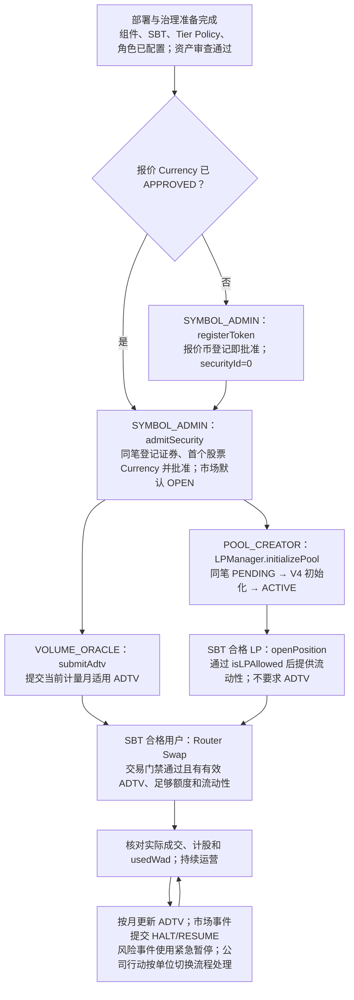

# 如何开启一只股票市场（TSV V1）

合约部署与治理准备完成后，报价 Currency 已获批时，新证券只需三次运营调用：**一次资产准入、一次 ADTV 提交、一次建池**。准入后市场默认开放，无需首次开市报告；LP 提供流动性后，满足额度与交易门禁即可成交。

合约 ABI、准入证据和角色权限以[系统总览](../SYSTEMS_OVERVIEW.md)、[代币准入标准](../TOKEN_ADMISSION_STANDARD_V1.md)及[部署清单](../DEPLOYMENT_CHECKLIST_V1.md)为准。本版用于全新部署，不兼容旧准入和市场状态 ABI。

## 全流程图

ADTV 与建池可以按任意顺序完成，也可先建池、提供 LP，再提交 ADTV。Pool 的 PENDING 只存在于建池交易内部，运营无需单独确认或推进。

## 执行要点

1. **完成治理与链下审查。**Governor 配置 SBT、Tier Policy 并授予相应运营角色。准入前确认资产转账、法律计股、发行方限制和公司行动证据；材料未齐时不登记链上待审状态。Tier 未配置或名额已满时准入失败。
2. **一次准入新证券。**`SYMBOL_ADMIN_ROLE` 调用 `admitSecurity(securityId, symbolHash, tierId, config, evidenceHash)`。`config.securityId` 必须匹配，`status=APPROVED`、`reviewHash` 非零；股票配置还须有绑定同一 Currency、版本为 1 的 LegalShareAdapter、代码哈希及非零 `legalSharePolicyHash`。证券、符号或 Currency 重复及任一校验失败时，整笔回滚，不占用 Tier 名额。成功后市场为 OPEN、暂停模式为 NONE、市场报告序号为零。
3. **复用报价资产。**普通 Currency 用 `registerToken` 登记即批准，`securityId=0`、Adapter 相关字段为零、`reviewHash` 非零。已有 listed 证券新增 Currency 也使用此入口，不重复占用 Tier 名额。普通 Currency 不需要证券、市场报告或 ADTV。一个池最多只能有一侧股票。
4. **建池并核验。**`POOL_CREATOR_ROLE` 调用 `initializePool(key, sqrtPriceX96, priceBasisHash)`。核对 PoolKey、PoolId、Hook、初始价格及 ACTIVE 状态，保存回执和定价依据。失败时 Registry 登记、V4 初始化及池计数全部回滚。
5. **提交适用 ADTV。**`VOLUME_ORACLE_ROLE` 调用 `submitAdtv`，要求 `adtvWad > 0`。`sourceMonth` 是当前 TSV 计量日所在自然月的上一个自然月，例如 2026 年 10 月对应 `202609`；该证券/来源月首次 `version=1`，更正递增，报告类别内的序号持续递增。Quota 是可选覆盖，不提交时按 ADTV 和 Tier 计算硬上限。
6. **提供 LP 与做首笔成交。**普通 LP 要求 SBT 合格且 `Registry.isLPAllowed(poolId)` 为真；不要求 ADTV。Swap 要求交易门禁通过，Ledger 另行校验适用 ADTV、有效额度与实际法律股数。`isTradable` 为真仅表示 Registry 交易门禁通过，不证明额度或流动性已就绪。核对 `SwapExecuted`、`SwapAccounted`、实际收付及 `usedWad`。
7. **持续运营。**市场事件通过 `HALT/RESUME` 指定 TRADE、LP 或 ALL；首份报告可直接 HALT。暂停叠加，恢复仅清除指定市场模式，紧急暂停独立清除。重新上市保留原市场暂停及报告序号，不自动开放。Currency/Pool 禁用继续阻断普通操作，授权强退另走专用路径。拆股/合股按[公司行动运营步骤](../TOKEN_ADMISSION_STANDARD_V1.md#41-法律股数单位切换的运营步骤)暂停并准备新单位报告后恢复。

Token 拒转、资格失效、额度缺失或池操作失败时，核对余额、仓位及账本均回到交易前状态，再处理对应阻断原因。
