# 如何开启一只股票市场（TSV V1）

本文按首次开通一只新证券市场的顺序，串起治理配置、资产准入、报告提交、建池、加流动性和首笔交易。适用前提是 TSV 合约已部署；合约 ABI、准入标准和角色权限仍以[系统总览](../SYSTEMS_OVERVIEW.md)、[代币准入标准](../TOKEN_ADMISSION_STANDARD_V1.md)和[部署清单](../DEPLOYMENT_CHECKLIST_V1.md)为准。

## 全流程图

```mermaid
flowchart TD
    A["部署与治理准备完成<br/>组件已绑定；SBT 已配置；所需角色已授予；Token/发行方审查材料备齐"] --> B{"所需 Tier Policy 是否已配置？"}
    B -- 否 --> B1["Governor：setTierPolicy<br/>配置 tierBps 与 maxListed"]
    B -- 是 --> C
    B1 --> C["SYMBOL_ADMIN：listSecurity<br/>登记唯一 securityId、symbolHash 和 tierId"]

    C --> D{"股票及发行方审查材料齐全且准入通过？"}
    D -- 否 --> D1["暂停准入；补齐法律、结算、计股或限制审查材料"]
    D1 --> D
    D -- 是 --> E["SYMBOL_ADMIN：registerToken（股票 Currency）<br/>securityId 指向新证券；status=UNREVIEWED；TokenConfig 带非零 reviewHash 与 LegalShareAdapter"]
    E --> F["SYMBOL_ADMIN：setTokenStatus(APPROVED)<br/>复核通过后单独批准 Token"]

    F --> G{"报价 Currency 已登记且 APPROVED？"}
    G -- 否 --> G1["SYMBOL_ADMIN：registerToken（普通 Currency）<br/>securityId=0；Adapter 字段为零；TokenConfig 带非零 reviewHash"]
    G -- 是 --> H
    G1 --> H["报告角色提交两份报告"]

    H --> I["HALT_REPORTER：submitMarketStatus<br/>首次提交 INITIAL_OPEN 或 INITIAL_HALTED"]
    H --> J["VOLUME_ORACLE：submitAdtv<br/>提交当前计量月适用的 ADTV；adtvWad > 0"]
    I --> K{"市场状态与 ADTV 报告均已接受？"}
    J --> K
    K -- 否 --> K1["修正报告字段、权限、序号或数据来源后重提"]
    K1 --> H
    K -- 是 --> L["POOL_CREATOR：LPManager.initializePool<br/>提交 PoolKey、sqrtPriceX96、priceBasisHash"]

    L --> M["同一交易内：Registry 登记 PENDING → PoolManager 初始化 → Registry 标为 ACTIVE"]
    M --> N["核验 PoolId、PoolKey、Hook、初始价格和 ACTIVE 状态；留存交易回执"]
    N --> O{"Registry.isTradable(poolId) 为 true？"}
    O -- 否 --> O1["解除阻断：Token 需 APPROVED、市场需 OPEN、相关紧急暂停需清除"]
    O1 --> O
    O -- 是 --> P["SBT 合格的 LP 调用 TSVLPManagerV1.openPosition<br/>设定 tick 区间、流动性与两侧结算边界"]

    P --> Q["SBT 合格的用户经 TSVSwapRouterV1 发起单池 Swap<br/>exact-in 或 exact-out；Hook/Ledger 按实际成交计股并检查额度"]
    Q --> R["验收并持续运营<br/>核对 Swap 事件与 usedWad；按月提交 ADTV，维护市场状态和暂停"]
    R --> S{"市场停牌、风险事件或法律股数单位变化？"}
    S -- 否 --> R
    S -- 是 --> T["按事件提交 HALT/恢复或紧急暂停；公司行动按准入标准暂停、切换新单位和报告后再恢复"]
    T --> R
```

## 执行要点

1. **先确认前置配置。**Governor 配置 SBT 和 Tier Policy，并授予 `SYMBOL_ADMIN_ROLE`、`HALT_REPORTER_ROLE`、`VOLUME_ORACLE_ROLE`、`POOL_CREATOR_ROLE`、`EMERGENCY_PAUSER_ROLE`、`EMERGENCY_RESUMER_ROLE` 等所需角色。Tier Policy 是 Governor 配置；Tier 尚未配置或名额已满时，`listSecurity` 会失败。
2. **登记证券与股票 Token。**`SYMBOL_ADMIN_ROLE` 先调用 `listSecurity`。完成外部审查后准备 `TokenConfig`，其中包括非零 `reviewHash`；再调用 `registerToken` 登记股票 Currency，初始状态保持 `UNREVIEWED`。随后单独调用 `setTokenStatus(..., APPROVED, ...)` 批准。`reviewHash` 只能随 `registerToken` 写入，`setTokenStatus` 不会修改它。股票 Token 还需要绑定该 Currency、版本为 `1` 的 LegalShareAdapter。
3. **准备报价 Currency。**若报价 Token 尚未登记，完成资产审查后按普通 Token 流程登记并批准：`securityId=0`，LegalShareAdapter 相关字段全为零；用于批准的非零 `reviewHash` 随 `registerToken` 写入。普通 Token 不需要 Tier、`listSecurity`、市场状态或 ADTV 报告。一个 TSV 池最多只能有一侧是股票。
4. **提交市场状态和 ADTV。**这是两份独立报告：`HALT_REPORTER_ROLE` 提交 `INITIAL_OPEN`（准备开市）或 `INITIAL_HALTED`；`VOLUME_ORACLE_ROLE` 提交适用月份 ADTV。`sourceMonth` 是当前 TSV 计量日所在自然月的上一个自然月，例如 2026 年 10 月计量日对应 `202609`；该证券/来源月首次提交时 `version=1`，后续更正递增。两份报告都须在首笔 Swap 前被接受。日额度 quota 是可选覆盖，不提交时按 ADTV 和 Tier 计算硬上限。
5. **建池并核验。**`initializePool` 会在同一笔交易中完成 Registry 的 PENDING 登记、V4 初始化和 ACTIVE 标记。随后核对 `PoolKey`、`PoolId`、Hook、`sqrtPriceX96` 和 Registry 状态，并保存交易回执及定价依据。
6. **开市后再加流动性。**普通 LP 入口要求 SBT 合格且 `Registry.isTradable(poolId)` 为真。因此市场须为 OPEN、Token 须 APPROVED、相关紧急暂停须解除，LP 才能调用 `openPosition`。若初始市场状态设为 `INITIAL_HALTED`，须先提交有效 `RESUME`；市场仍关闭时不能通过普通入口开初始仓位。
7. **做首笔交易并核对账本。**用户本人经 TSV Router 发起单池 exact-in 或 exact-out Swap。核对 `SwapExecuted`、`SwapAccounted`、实际输入/输出及 Ledger 的 `usedWad`；额度缺 ADTV 或超过有效上限时交易会回滚。
8. **转入持续运营。**按适用月份提交 ADTV，按市场事件提交 HALT/RESUME，必要时使用紧急暂停。拆股/合股若改变法律股数单位，按[公司行动运营步骤](../TOKEN_ADMISSION_STANDARD_V1.md#41-法律股数单位切换的运营步骤)暂停并完成新单位报告后再恢复。

遇到 Token 转账受限、SBT 暂停、池不可交易或额度报告缺失时，不要把失败当作部分开通；先按对应准入/运营规则处理，并确认失败交易未改变资产、仓位和成交账本状态。
