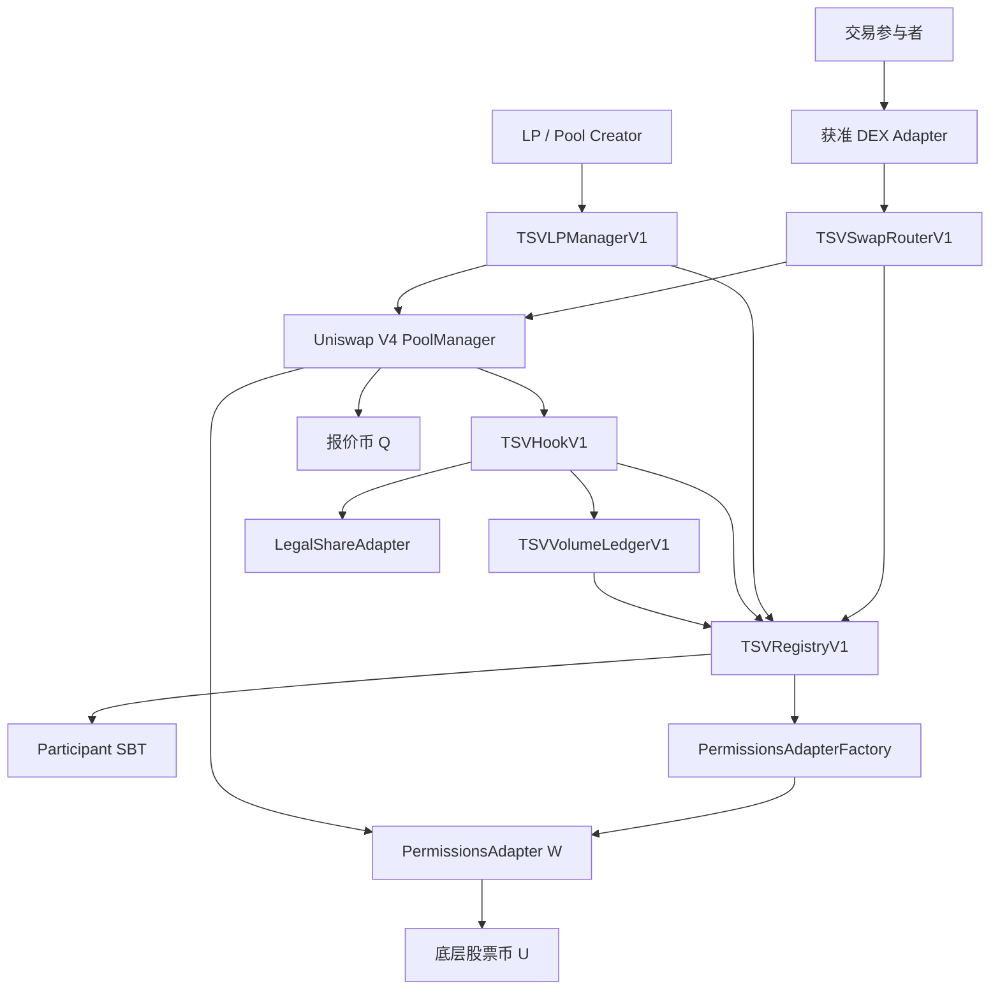

# TSV V1 合约架构：当前代码基准

> 分析日期：2026-10-12 · 分支：`main` · 提交：`6743896068174c0bd8472f893b661ab23366e409`
>
> 本文以该提交的 Solidity 实现为最高解释依据。源码注释、既有文档、历史审计和测试与实现冲突时，以函数体及其实际调用链为准。代码基准及文件 SHA-256 见 [baseline.json](baseline.json)。文中的地址名称表示组件关系，不代表已核实的链上部署地址。

## 1. 架构总览

TSV 在 Uniswap V4 PoolManager 上提供证券身份约束的集中流动性交易场所。Registry 保存证券、底层资产、包装资产、报价资产、池、身份权限和暂停状态；Router 只接受获准合约提交的单池 exact-input 交易；LPManager 管理不可转让的 ERC-721 头寸；Hook 在 V4 回调中校验场所入口、暂停和 multiplier，并将实际成交量提交给 Ledger；Ledger 按证券和固定 EST 日期约束每日法定份额成交量。

池内资产组合是 `W/Q`。`W` 是由 PermissionsAdapter 实现的权限包装股票币，`U` 是其底层股票币，`Q` 是原始报价 ERC-20。用户在池外交付/接收 `U/Q`；`W` 由 PoolManager 持有。W 与 U 的 raw 数量为 1:1；法定份额由独立 LegalShareAdapter 换算，不改变池内价格或结算数量。

TSV 当前合约架构




图中箭头表示主要调用或组件关系。真实股票资金由 W 托管，报价币由 PoolManager 托管；Registry、Hook、Ledger 不承担交易资产托管。

### 组件职责与继承


| 组件                                                 | 实现/继承                                                      | 主要职责                                                | 关键源码                                                                                                                                              |
| -------------------------------------------------- | ---------------------------------------------------------- | --------------------------------------------------- | ------------------------------------------------------------------------------------------------------------------------------------------------- |
| `TSVRegistryV1`                                    | `TSVGoverned → AccessControlUpgradeable + UUPSUpgradeable` | 全场所配置、角色、身份、资产注册、池生命周期和暂停                           | [Registry](../src/v1/core/TSVRegistryV1.sol#L38)                                                                                                  |
| `TSVHookV1`                                        | `Initializable + UUPSUpgradeable + IHooks`                 | V4 回调鉴权、multiplier 校验、成交量上报                         | [Hook](../src/v1/core/TSVHookV1.sol#L18)                                                                                                          |
| `TSVVolumeLedgerV1`                                | `Initializable + UUPSUpgradeable`                          | `Quota` / `usedWad` 日额度                             | [Ledger](../src/v1/core/TSVVolumeLedgerV1.sol#L8)                                                                                                 |
| `TSVSwapRouterV1`                                  | 本地 `PermissionedV4Router + ReentrancyLock`，及 UUPS          | 获准 Adapter 单池 exact-input，U/Q 预付款和结算                | [Router](../src/v1/periphery/TSVSwapRouterV1.sol#L21)                                                                                             |
| `TSVLPManagerV1`                                   | 本地 `PermissionedPositionManager → PositionManager`，及 UUPS  | V4 action 批处理、头寸 NFT、支付、退出                          | [LPManager](../src/v1/periphery/TSVLPManagerV1.sol#L42)                                                                                           |
| `PermissionedValidationLib`                        | 外部链接的无状态 library                                           | Factory 来源、资产身份、精度、份额转换器准入                          | [准入库](../src/v1/libraries/PermissionedValidationLib.sol#L30)                                                                                      |
| `TSVLPManagerLib`                                  | 外部链接 library                                               | LP 权限、付款、退出、回调授权、NFT 计数同步                           | [LP 库](../src/v1/libraries/TSVLPManagerLib.sol#L24)                                                                                               |
| `TSVPermissionedSettlementLib`                     | 内部 library                                                 | `SafeERC20` 转账及 U→W 支付                              | [结算库](../src/v1/libraries/TSVPermissionedSettlementLib.sol#L8)                                                                                    |
| `ERC8056DirectLegalShareAdapter`                   | 不可升级、无状态、固定 U                                              | 读取 U 的 `uiMultiplier()`，将 raw 数量换算为 legal-share WAD | [转换器](../src/v1/adapters/ERC8056DirectLegalShareAdapter.sol#L13)                                                                                  |
| `PermissionsAdapterFactory` / `PermissionsAdapter` | 本地 permissionedPools 实现；W 为 `ERC20 + Ownable2Step`         | 创建/验证 W，托管 U，包装/解包，发行方权限                            | [Factory](../src/v1/vendor/permissionedPools/PermissionsAdapterFactory.sol#L9)、[W](../src/v1/vendor/permissionedPools/PermissionsAdapter.sol#L15) |
| `TSVERC1967Proxy` / `TSVHookProxyFactoryV1`        | ERC-1967 / CREATE2                                         | 初始化代理、实现地址查询、Hook 权限地址部署                            | [Proxy](../src/v1/deployment/TSVERC1967Proxy.sol#L8)、[Hook Factory](../src/v1/deployment/TSVHookProxyFactoryV1.sol#L8)                            |


Router 实际继承的是 `vendor/v4-router/hooks/permissionedPools/PermissionedV4Router.sol`。源码树中另外存在 `vendor/permissionedPools/PermissionedV4Router.sol`，不能把两者当成同一个 Router 的继承路径。`TSVDirectSettlementLib` 仍存在于源码，但当前 `src/` 调用链没有导入或调用它；其逐笔余额差校验不是当前 Router 的结算行为。

## 2. 数据模型与计量单位


| 对象           | 主键/字段                                                              | 所属组件      | 语义                                                          |
| ------------ | ------------------------------------------------------------------ | --------- | ----------------------------------------------------------- |
| SBT 身份       | `tokenId → {registered, permissions}`；追加式 ID 列表                    | Registry  | 参与者持有的所有已注册身份权限按位合并                                         |
| Tier         | `uint8 tierId → {maxListed, listedCount}`                          | Registry  | 限制该层级已上市证券数，非成交量或 LP 数量额度                                   |
| Security     | `bytes32 securityId`、tier、listed、poolIds、listedPoolCount、pauseMode | Registry  | 多个 W / 多个池归属同一证券                                            |
| Underlying   | `U → {securityId, legalShareAdapter, rawDecimals, registered}`     | Registry  | 同 U 的 W 共用证券及转换器；registered 控制未来建池                          |
| Currency     | `W → U`                                                            | Registry  | 首次绑定后无改绑入口；W 不作为 Q 使用                                       |
| Quote        | `Q → {rawDecimals, registered}`                                    | Registry  | 原始 ERC-20，registered 控制未来建池                                 |
| Pool         | 完整 `PoolKey` 的 hash                                                | Registry  | 固定 W/Q、证券、注册时 tier 快照、lifecycle、tickCount、poolSecurityIndex |
| Daily quota  | `Quota[securityId][ESTDay]`                                        | Ledger    | 每证券每固定 EST 日的 legal-share WAD 上限                            |
| Daily usage  | `usedWad[securityId][ESTDay]`                                      | Ledger    | 所有关联池、双向成交累计的法定份额绝对量                                        |
| LP position  | `tokenId → owner / positionInfo / approvals / subscriber`          | LPManager | ERC-721 所有权对应 V4 头寸，tokenId 用作头寸 salt                       |
| Swap context | participant、recipient、inputCurrency、actualIn/Out                   | Router    | 交易执行上下文；`msgSender()` 在 transient lock 非零时返回真实参与者           |


定义见 [TSVTypes](../src/v1/types/TSVTypes.sol)、[Registry 状态](../src/v1/core/TSVRegistryV1.sol#L63)、[Ledger 状态](../src/v1/core/TSVVolumeLedgerV1.sol#L17)。

池价、流动性、token raw 数量和 legal-share WAD 是不同单位。`rawDecimals ≤ 18` 且 W/U decimals 相等在准入时校验。提供的 ERC-8056 转换器使用 `floor(rawAmount × uiMultiplier / 10^decimals)`；非零 raw 数量换算为零会回退。`uiMultiplier` 不是 Registry 自行计算的股价。[精度准入](../src/v1/libraries/PermissionedValidationLib.sol#L157)、[份额换算](../src/v1/adapters/ERC8056DirectLegalShareAdapter.sol#L38)

## 3. 角色、身份和外部权限


### Registry 角色

所有 TSV 业务组件通过 Registry 的 `hasRole` 查询权限。初始化只把 `DEFAULT_ADMIN_ROLE` 和 `UPGRADE_ADMIN_ROLE` 授予初始 admin；其余角色需通过 AccessControl 单独授权。当前实现没有独立 GovernanceAnchor、内置多签或业务操作 timelock。[TSVGoverned](../src/v1/governance/TSVGoverned.sol#L15)


| 角色/调用者                            | 当前实际权限                                                       | 对应源码                           |
| --------------------------------- | ------------------------------------------------------------ | ------------------------------ |
| `DEFAULT_ADMIN_ROLE`              | 角色管理、一次性 bindComponents、SBT 配置、tier policy、Router Adapter 授权 | Registry:230/270/334；Router:91 |
| `SYMBOL_ADMIN_ROLE`               | W/U/Q 准入、证券重上/下市、tier 调整、转换器替换、禁用未来建池、池生命周期                  | Registry:355–612               |
| `POOL_CREATOR_ROLE`               | 经 LPManager 原子注册并初始化池                                        | LPManager:126                  |
| `HALT_REPORTER_ROLE`              | 直接更新已上市证券的最终 pauseMode                                       | Registry:643                   |
| `VOLUME_ORACLE_ROLE`              | 写入任意非零 securityId 的每日 quota 数组                               | Ledger:41                      |
| `EMERGENCY_PAUSER_ROLE`           | 启用全局紧急暂停                                                     | Registry:656                   |
| `EMERGENCY_RESUMER_ROLE`          | 解除全局紧急暂停                                                     | Registry:656                   |
| `FORCE_EXIT_ADMIN_ROLE`           | 满足发行方 UNWIND_ALLOWED 条件时执行 `unwindPositionByOkx`             | LPManager:140；LP 库:80          |
| `UPGRADE_ADMIN_ROLE`              | 授权五个 TSV 业务代理的 UUPS 升级，附加约束因组件而异                             | 各组件 `_authorizeUpgrade`        |
| 固定 `lpManager` 地址                 | Registry.registerPool / updatePoolTickCount，函数体内部鉴权          | Registry:514/621               |
| 固定 PoolManager / Router / Hook 地址 | Hook 回调、交易 sender、Ledger.recordSwap 调用链鉴权                    | Hook:86/208/227；Ledger:60      |


`REVOKE_EXIT_EXECUTOR_ROLE`、`WITHDRAW_CLAIM_ROLE` 在治理基类声明，但当前路径没有消费这些角色；不能据此推出存在对应业务入口。`withdrawClaim` 在当前 LPManager 中总是回退。

### 两层参与者权限

第一层为 TSV 身份：Registry 遍历已配置 tokenId，通过固定 SBT 的 `verify(account, tokenId)` 合并权限。`permissionsOf` 在 SBT 自身 paused 时返回 NONE；`hasIdentity` / `hasCredential` 只表示身份持有，不受 permission flags 或 SBT paused 影响。调用 SBT 失败会传播错误。[Registry:295–326 / 689–697](../src/v1/core/TSVRegistryV1.sol#L295)

第二层为发行方权限：W 调用自己的 `allowListChecker` 检查 `SWAP_ALLOWED`、`LIQUIDITY_ALLOWED` 或 `UNWIND_ALLOWED`。发行方 owner 可修改 checker、allowedWrappers、allowedHooks 和 swappingEnabled；这些权限不受 Registry 角色管理。[W:62–108](../src/v1/vendor/permissionedPools/PermissionsAdapter.sol#L62)

Router 把获准 Adapter 提供的 `participant` 当作身份主体；Core Router 本身不验证 participant 的签名。上游 Adapter 必须认证身份来源。当前 dex-adapters 子模块提供的 TSVAdapter 使用已签名 caller 集合、nonce、expiry 和 calldata trailer 识别参与者；这些是外部 Adapter 的实现，不是 Core Router 的通用保证。[Core Router:198–216](../src/v1/periphery/TSVSwapRouterV1.sol#L198)、[外部 TSVAdapter:73–118](../lib/dex-adapters/src/adapters/uniswap-v4/TSVAdapter.sol#L73)

## 4. 准入、建池与生命周期

1. admin 一次性执行 `bindComponents(hook, lpManager, factory, sbt)`，Factory 提供 PoolManager 地址。
2. admin 配置 tier capacity 和 SBT identity permissions。
3. 发行方通过 Factory 创建 W，向 W 存入 U，再执行 Factory.verifyPermissionsAdapter；验证条件是 W 在该 Factory 创建且 W 的 U 余额非零，非链下审计批准。
4. SYMBOL_ADMIN 调用 `registerPermissionedCurrency({W, securityId, legalShareAdapter}, tierId, reasonCode)`。初次注册同时创建证券并占用 tier slot；追加 W 必须匹配已上市证券及 tier，U 的已有 securityId、decimals、converter 必须一致。
5. SYMBOL_ADMIN 注册 Q；POOL_CREATOR 通过 LPManager.initializePool 注册完整 PoolKey 后调用 PoolManager.initialize。任一步失败，注册和初始化整体回退。

准入会检查 Factory 两张 provenance 映射、W 的 U/PoolManager、checker ERC-165、W/U 精度以及资产与场所组件/其他资产角色的隔离。LegalShareAdapter 只检查代码、接口和 bound U；注册时不证明任意 converter 的经济换算正确性。[准入库:62–179](../src/v1/libraries/PermissionedValidationLib.sol#L62)

PoolKey 必须满足：非零且按地址排序的两个 currency、固定 TSV Hook、fee < 1,000,000、tickSpacing 在 1–32767、资产允许未来建池、恰好一边关联非零证券、证券已上市、池尚未注册。新池默认 LIST，tickCount 为零，永久追加到证券 poolIds。[Registry:513–534](../src/v1/core/TSVRegistryV1.sol#L513)

### 生命周期与操作矩阵


| PoolLifecycle | 交易      | 普通 LP 操作 | 条件                                       |
| ------------- | ------- | -------- | ---------------------------------------- |
| `LIST`        | 可进入后续检查 | 可进入后续检查  | 仍检查证券 pause、全局 pause、身份及发行方权限            |
| `PAUSE`       | 禁止      | 可进入后续检查  | listedPoolCount 仍包含该池                    |
| `DELIST`      | 禁止      | 禁止       | 只有 tickCount==0 才能切入该状态；授权 unwind 另走专用路径 |


生命周期不是 liquidity 非零状态。`tickCount` 实际由 NFT mint/burn 更新，是头寸 NFT 数，不是不同价格 tick 的数量；减仓到零而保留 NFT 不会减计数。池从 DELIST 恢复到 LIST/PAUSE 要求证券仍 listed。相同生命周期更新返回 false。[Registry:806–840](../src/v1/core/TSVRegistryV1.sol#L806)、[LPManager:362–387](../src/v1/periphery/TSVLPManagerV1.sol#L362)

下市证券要求 listedPoolCount==0；先清理 NFT 并逐池 DELIST，才能 delistSecurity。该数只按池是否 DELIST 变更，不随 tickCount 增减。证券 tier 调整只更新当前证券 tier 和两个 tier counter；已注册池保留注册时 tierId 快照。[Registry:368–390 / 528–533 / 815–820](../src/v1/core/TSVRegistryV1.sol#L368)

`disableQuoteTokenPoolRegister` / `disableUnderlyingPoolRegister` 只阻止未来建池，保留已有 metadata 和 W/U 绑定。现有池的 `isTradable` / `isLPAllowed` 不再读取这些 registered 标志；控制现有池需使用生命周期或暂停。`delistSecurity` 的源码注释所称阻断所有池，是通过先决条件保证所有池已 DELIST，非运行时再次读取 security.listed。[Registry:446–468 / 759–793](../src/v1/core/TSVRegistryV1.sol#L446)

## 5. 交易调用链与资金流


### 对外入口


| 入口                                                                 | payer        | participant | recipient  | token 授权对象                      |
| ------------------------------------------------------------------ | ------------ | ----------- | ---------- | ------------------------------- |
| `swapExactInputFromAdapterDirect(request, participant, recipient)` | participant  | participant | Adapter 指定 | 输入 U/Q 授权给 Core Router          |
| `swapExactInputFromContract(request, participant)`                 | 获准调用 Adapter | participant | 调用 Adapter | Adapter 的输入 U/Q 授权给 Core Router |


两个入口均要求 `isAdapterAllowed[msg.sender]`，并受全局 pause 与 transient reentrancy lock 限制。当前没有用户直接提交入口；Core Router 只构造三个固定 action：`SWAP_EXACT_IN_SINGLE → SETTLE_ALL → TAKE_ALL`。底层 V4Router 具备的 exact-output/multihop 逻辑没有因此自动成为 Core Router 的公开交易能力。[Router:106–124 / 234–253](../src/v1/periphery/TSVSwapRouterV1.sol#L106)

```text
获准 Adapter → Router._swap
  ├─ 校验 adapter、recipient、deadline、非零 amount/limit、池与参与者 SBT
  ├─ 预付款：输入 U → W；或输入 Q → Router
  └─ PoolManager.unlock
       ├─ SWAP_EXACT_IN_SINGLE → PoolManager.swap
       │    ├─ Hook.beforeSwap：固定 Router、tradable、pause、multiplier
       │    └─ Hook.afterSwap：再次 multiplier 校验 → actual stock delta → Ledger
       ├─ SETTLE_ALL：Q 从 Router → PoolManager；U 已在 W → mint W 给 PoolManager
       └─ TAKE_ALL：Q → recipient；W 转出时自动 burn 并释放 U → recipient
返回 actualIn / actualOut，并要求 actualIn == amountSpecified
```

`amountSpecified` 为输入 raw exact amount，必须在 1..int128.max；`limitAmount` 为非零输出 raw 下限；`deadline` 是 Unix 秒。价格极限取 V4 全区间边界，request 不提供独立 sqrtPriceLimit。部分输入成交会导致实际输入不等于请求，从而整笔回退。[Router:222–253](../src/v1/periphery/TSVSwapRouterV1.sol#L222)、[V4Router:83–98 / 204–217](../src/v1/vendor/v4-router/V4Router.sol#L83)

Hook 收到的 hookData 必须是一个 32-byte `expectedMultiplier`。Hook.beforeSwap 和 afterSwap 都读取当前 U 的转换器并验证非零且相等。Hook 不收取附加 hook delta 或覆盖 pool fee；交易 delta 和价格形成由 PoolManager 实现。[Hook:200–233 / 282–315](../src/v1/core/TSVHookV1.sol#L200)

W 仅允许获准 wrapper 从已存入的 U surplus 中 mint 等量 W 给 PoolManager。PoolManager 向 recipient 转 W 时，W 先执行转移，再 burn recipient 的 W 并交付等量 U；成功后断言 `W.balanceOf(PoolManager)==W.totalSupply()`。[W:48–58 / 115–140](../src/v1/vendor/permissionedPools/PermissionsAdapter.sol#L48)

当前结算库只使用 SafeERC20，不逐笔验证 payer debit/recipient credit 的余额差。准入检查 metadata 和资产身份，没有动态测试任意 U/Q 的手续费、rebase 或转账行为。W 包装上限检查当前 U 余额减 supply；这与全面支持非标准 ERC-20 是不同保证。[结算库](../src/v1/libraries/TSVPermissionedSettlementLib.sol#L8)、[W:48–52](../src/v1/vendor/permissionedPools/PermissionsAdapter.sol#L48)

### 外部 TSVAdapter 的接入边界

基准子模块中的 `TSVAdapter.sellBase/sellQuote` 从自身 U/Q 余额确定输入，按 PoolKey currency0/currency1 决定方向，调用 `swapExactInputFromContract`，清除 Router allowance，再按输出余额差交付 `to`。它给 Core Router 传 `limitAmount=1` 和当前区块时间；真实聚合交易 minReturn/deadline 依赖上层 DEX Router。签名覆盖 key、multiplier、expiry 和可信 caller 集合，参与者来自已认证 caller 写入的 trailer。[TSVAdapter:34–42 / 73–140](../lib/dex-adapters/src/adapters/uniswap-v4/TSVAdapter.sol#L34)

## 6. 日成交额度与证券暂停

Ledger 的当前全部业务接口是 `setQuota`、`currentESTDay`、`recordSwap` 及两个公开 mapping getter。

```text
ESTDay = floor((block.timestamp - 5 hours) / 1 days)
legalSharesWad = converter.toLegalShares(U, abs(actual stock delta))
usedWad[securityId][ESTDay] += legalSharesWad
成功条件：usedWad[securityId][ESTDay] <= Quota[securityId][ESTDay]
```

采用全年固定 UTC-5，边界为 05:00 UTC，不跟随美国夏令时。ESTDay 是 epoch day 整数，非 YYYYMMDD；quota 单位为 legal-share WAD，非 ADTV 比例、月份或 raw amount。多个同证券池共享额度，买卖方向都消耗绝对成交份额。未配置日期额度默认为零，任何正成交量都会回退。[Ledger:17–26 / 50–72](../src/v1/core/TSVVolumeLedgerV1.sol#L17)

`setQuota` 由 VOLUME_ORACLE_ROLE 直接调用，可修改过去/当前/未来日期，不清零已用量；只要求 securityId 非零，不检查证券注册或 listed。数组允许为空，reasonCode 仅写事件，未强制非零，也不验证新 quota≥used。降低 quota 到 used 以下不会使 setter 回退，但后续正量交易无法通过额度检查。[Ledger:40–47](../src/v1/core/TSVVolumeLedgerV1.sol#L40)

`recordSwap` 只允许 Registry 当前 Hook；要求两边 delta 非零、符号相反、恰好一边 legalShares 为正，并从已注册 PoolRecord 读取非零 securityId。额度检查发生在 afterSwap 内，失败回滚整个交易及 used 增量。[Ledger:56–72](../src/v1/core/TSVVolumeLedgerV1.sol#L56)

证券暂停由 HALT_REPORTER_ROLE 调用 `applySecurityStatus(securityId, mode)` 直接写最终状态，只要求证券已上市且 mode 改变。`NONE=0`、`TRADE=1`、`LP=2`、`ALL=3`；TRADE/LP 是位掩码。当前没有 report envelope、reportId、sequence、observedAt 或恢复序列状态机。[Registry:643–650](../src/v1/core/TSVRegistryV1.sol#L643)

## 7. LP 头寸、支付与退出


### 普通头寸操作

LPManager 使用 V4 action 编码，通过 `modifyLiquidities(unlockData, deadline)` 或 `modifyLiquiditiesWithoutUnlock(actions, params)` 执行 mint/increase/decrease/burn；`multicall` 能组合公共方法，调用者上下文通过 delegatecall 保留。没有单独的 TSV `addLiquidity/removeLiquidity` 业务 ABI。[LPManager:197–213 / 285–292 / 349–379](../src/v1/periphery/TSVLPManagerV1.sol#L197)

六种 position action 都先检查 executor 和 NFT owner/新 recipient 的 TSV LIQUIDITY_ALLOWED，以及 Registry.isLPAllowed。已存在头寸的修改另受父类 ERC-721 owner/approval 检查。Mint/increase 额外校验 W 的 allowedHooks 及发行方对 owner 的 LIQUIDITY_ALLOWED；decrease/burn 不重复该准入校验，但仍有 TSV 普通 LP gate。[LP 库:262–287](../src/v1/libraries/TSVLPManagerLib.sol#L262)、[PermissionedPositionManager:161–206](../src/v1/vendor/permissionedPools/PermissionedPositionManager.sol#L161)

LP 输入资产仍为 U/Q。用户付款调用 `TokenApproveProxy.claimTokens`；stock 输入先到 W 后 wrap，quote 输入到 PoolManager；LPManager 自身付款使用自身余额。构造时会校验 approve proxy 及其 tokenApprove 地址存在代码。Permit2 forwarding 接口仍继承并公开，不代表 `_pay` 使用 Permit2 transferFrom。LP payable action 还可调用 WRAP/UNWRAP 处理 WETH；注册的 PoolKey 仍要求非零 ERC-20 currency，不是 native ETH 池。[LPManager:104–108 / 248–265 / 395–398](../src/v1/periphery/TSVLPManagerV1.sol#L104)、[LP 库:230–259](../src/v1/libraries/TSVLPManagerLib.sol#L230)

NFT 不可转让：`transferFrom` 和两个 `safeTransferFrom` 都回退。Approval、permit、subscribe 仍有用途，可授权对头寸执行操作；这些不是可转移所有权入口。LP NFT 保留 Uniswap V4 EIP-712 signing name，代理初始化 NFT name/symbol 和 nextTokenId=1。[PermissionedPositionManager:143–155](../src/v1/vendor/permissionedPools/PermissionedPositionManager.sol#L143)、[LPManager:115–121](../src/v1/periphery/TSVLPManagerV1.sol#L115)

费用通过 position 修改得到的 `feesAccrued` 一并计入 delta；increase/decrease 使用零 liquidity 也可取得费用，付款边界取决于后续 settlement actions。本金滑点校验使用 `liquidityDelta - feesAccrued`；没有单独 TSV `collectFees` 入口。[PositionManager:292–354](../src/v1/vendor/permissionedPools/PositionManager.sol#L292)

### 授权退出


| 入口                    | 权限/额外条件                                                      | 交付路径                                                                  |
| --------------------- | ------------------------------------------------------------ | --------------------------------------------------------------------- |
| `unwindPositionByOkx` | Registry FORCE_EXIT_ADMIN_ROLE；至少一边 W 对 LP 返回 UNWIND_ALLOWED | BURN_POSITION → TAKE_PAIR，两个资产直接交付 LP；任一失败整笔回退                        |
| `unwindPosition`      | 池中 W 的发行方 owner；同样要求至少一边 UNWIND_ALLOWED                      | burn 后内部形成 PoolManager ERC-6909 claims，再逐币尝试实物到 LP、到 W owner；均失败则整笔回退 |


退出先处理 subscriber，并临时授权 burn；用 transient callback hash 把精确 actions/params 与已授权入口绑定，回调先消耗 hash，只有 burn 期间设置标记 1，供 Hook.isUnwindActive 检查。NFT burn 成功后 Registry.tickCount 减 1。[LPManager:140–194 / 315–345](../src/v1/periphery/TSVLPManagerV1.sol#L140)、[LP 库:80–225](../src/v1/libraries/TSVLPManagerLib.sol#L80)

授权 unwind 绕过普通 LP 的 lifecycle/security pause gate，但 Hook 仍检查固定 LPManager、已知精确池和全局暂停；LPManager 公共入口也检查全局暂停。不能从父类“始终可退出”的注释推导当前 TSV 在全局暂停时可退出。[Hook:163–175 / 265–273](../src/v1/core/TSVHookV1.sol#L163)

当前 `withdrawClaim` 被禁用，普通 action 不允许 `MINT_6909`、`UNWIND_WITH_FALLBACK`，`BURN_6909` 也不在允许 action 集合。父类最后交付 ERC-6909 claim 的 fallback 被 TSVLPManagerLib 覆盖为回退；内部短暂使用 claims 不等于面向用户的 claim 提款产品。[LPManager:215–217](../src/v1/periphery/TSVLPManagerV1.sol#L215)、[LP 库:178–195 / 290–314](../src/v1/libraries/TSVLPManagerLib.sol#L178)

## 8. 暂停覆盖矩阵


| 路径                                                  | 全局 emergency pause  | security TRADE | security LP | pool PAUSE / DELIST         |
| --------------------------------------------------- | ------------------- | -------------- | ----------- | --------------------------- |
| Router 两个 swap 入口                                   | 阻止                  | 阻止             | 不阻止         | 两者均阻止                       |
| 普通 LP position action                               | 阻止                  | 不阻止            | 阻止          | PAUSE 允许；DELIST 阻止          |
| 授权 unwind                                           | 阻止                  | 不阻止            | 不阻止         | 专用 burn 绕过普通 lifecycle gate |
| LP approval/permit/nonce/subscription/multicall     | 阻止                  | 不直接检查          | 不直接检查       | 不直接检查；实际 action 另受 gate     |
| LP initializePool                                   | 阻止                  | 不直接检查          | 不直接检查       | 只能注册新池，默认 LIST              |
| Router.setAdapterAllowed                            | 阻止                  | 不检查            | 不检查         | 不检查                         |
| Registry 配置、角色、applySecurityStatus、emergency setter | 不以全局 pause 作入口 gate | 依函数条件          | 依函数条件       | 依函数条件                       |
| Ledger.setQuota                                     | 不检查                 | 不检查            | 不检查         | 不检查                         |
| W owner 配置 / Factory 创建和验证                          | 不检查 Registry pause  | 不检查            | 不检查         | 不检查                         |


`isPaused()` 只等于 Registry.emergencyPauseEnable，不包含 SBT 自身 paused；后者通过参与者权限检查影响交易和普通 LP。全局 pause 没有统一覆盖所有管理操作，精确行为见每个函数体。

## 9. 代理、部署与升级

五个 TSV 业务实现支持 UUPS：Registry、Hook、Ledger、Router、LPManager。Registry 通过 TSVGoverned 锁实现初始化，其余业务实现也在 constructor 中 `_disableInitializers()`。TSVERC1967Proxy 要求非空 init calldata，并提供稳定的 `tsvImplementation()` 查看 ERC-1967 implementation slot。[Proxy](../src/v1/deployment/TSVERC1967Proxy.sol#L12)

Hook 代理地址低 14 bit 必须全置位 `0x3FFF`；Factory 用 implementation+initData+salt 计算 CREATE2 地址，预测和部署均验证 permission bits。当前 Hook 启用所有 callback bits、返回零 delta，donate 前后回调明确禁止。[Hook Factory:14–42](../src/v1/deployment/TSVHookProxyFactoryV1.sol#L14)、[Hook:23–25 / 239–257](../src/v1/core/TSVHookV1.sol#L23)

部署顺序由初始化依赖推导：部署外部基础设施与链接库 → Registry proxy → Ledger/Router/LPManager 实现及初始化代理 → CREATE2 Hook proxy → Registry.bindComponents → 分配业务角色和配置资产/身份 → 建池及 LP 操作。Hook.initialize 要求 Registry、Ledger、Router、LPManager 都已具有代码；Registry 依赖一次性后绑定解决环形引用。该顺序是代码依赖推导，不是当前脚本已执行成功的证明。


| 组件        | Upgrade role                | 全局 pause 下 | 实现额外一致性校验                                             |
| --------- | --------------------------- | ---------- | ----------------------------------------------------- |
| Registry  | 自身 UPGRADE_ADMIN_ROLE       | 允许         | 基类 UUPS 标准检查                                          |
| Hook      | Registry UPGRADE_ADMIN_ROLE | 阻止         | 标准 UUPS；当前 `_authorizeUpgrade` 不比较新实现组件地址             |
| Ledger    | Registry UPGRADE_ADMIN_ROLE | 允许         | 标准 UUPS                                               |
| Router    | Registry UPGRADE_ADMIN_ROLE | 允许         | locker 必须空；新实现 PoolManager、Factory immutables 必须与当前一致 |
| LPManager | Registry UPGRADE_ADMIN_ROLE | 阻止         | 标准 UUPS；未链上强制比对新实现所有 immutable 参数                     |


对应 [治理基类:40](../src/v1/governance/TSVGoverned.sol#L40)、[Hook:58](../src/v1/core/TSVHookV1.sol#L58)、[Ledger:75](../src/v1/core/TSVVolumeLedgerV1.sol#L75)、[Router:257](../src/v1/periphery/TSVSwapRouterV1.sol#L257)、[LPManager:299–310](../src/v1/periphery/TSVLPManagerV1.sol#L299)。

Registry/LPManager 的外部链接库通过 delegatecall 在业务代理的上下文执行。替换 implementation 时，存储布局、链接库地址和 immutable 集成参数需要一起作为升级输入审查；源码中的声明、错误名称或注释不能替代实际升级校验。

## 10. 事件与索引边界


| 事件族                                                                     | 发出组件      | 下游应读取的含义                                                |
| ----------------------------------------------------------------------- | --------- | ------------------------------------------------------- |
| ComponentsBound / SbtConfigChanged / TierPolicyChanged                  | Registry  | 场所固定组件及身份/tier 配置                                       |
| SecurityListed / Delisted / TierChanged                                 | Registry  | 证券上市和 tier counter 变化                                   |
| UnderlyingBound / PermissionedCurrencyRegistered / QuoteTokenRegistered | Registry  | U 的 canonical 首绑、W/U 关系、Q 注册                            |
| QuoteTokenDisabled / UnderlyingPoolRegisterDisabled                     | Registry  | 未来建池开关，不能解释为已有池立即停用                                     |
| PoolRegistered / PoolLifecycleChanged                                   | Registry  | 永久池身份及显式生命周期                                            |
| SecurityStatusChanged / EmergencyPauseChanged                           | Registry  | 最终证券 pause / 全局 pause                                   |
| QuotaSet / VolumeUsed                                                   | Ledger    | EST epoch day 的 WAD 日额度/每次成交消耗，VolumeUsed.amount 不是累计总量 |
| AdapterAuthorizationUpdated                                             | Router    | 允许提交 Core Router 交易的合约名单                                |
| ERC721 mint/burn、Subscription/Unsubscription、CurrencyUnwound            | LPManager | NFT 头寸和退出实物交付；当前退出不成功交付用户 claim                         |


reasonCode 的约束不统一：Registry 多数配置操作要求非零，Ledger.setQuota 仅将它写事件；applySecurityStatus 目前没有 reasonCode 参数。tickCount 更新没有独立 Registry 事件，应结合 NFT mint/burn 与 Registry getter 核对状态。

## 11. 与历史资料的差异


| 历史文档/注释中的描述                                   | 当前实现                                                      |
| --------------------------------------------- | --------------------------------------------------------- |
| DataInbox 作为 report 入口、六个业务代理                 | 当前源码没有 DataInbox；五个 TSV 业务 UUPS 实现                        |
| 独立 GovernanceAnchor / 固定外部治理座位                | Registry AccessControl，初始 admin 直接授予 default/upgrade role |
| ADTV×quota factor、月度/拆股报表、sequence/observedAt | Ledger 每证券每天直接 quota；halt reporter 直接设置 mode              |
| Registry direct currency 股票池                  | 只注册恰好一边股票 W 的 W/Q 池；池外股票结算 U                              |
| tier 改动同步影响每个 PoolRecord.tierId               | PoolRecord 保存注册时快照                                        |
| 禁用资产立即禁止旧池操作                                  | registered 开关只影响未来建池                                      |
| LP 独立入口且不能原子组合                                | V4 action 批处理及 multicall                                  |
| 不合规退出最终给用户 ERC-6909 claim                     | 当前 TSV 覆盖为实物交付尝试失败则回退；withdrawClaim 禁用                    |
| 所有管理/升级统一受全局暂停限制                              | 各组件、各函数约束不同，见第 8–9 节                                      |


文档差异来自当前代码与既有 README、SYSTEMS_OVERVIEW、CONTRACT_ARCHITECTURE、CODING_SPEC 以及继承实现注释的比较；历史资料不能用来补出当前不存在的 ABI 或保障。

## 12. 分析边界与配套文件

当前 `src/` 有 55 个 Solidity 文件、6,450 物理行、4,270 nSLOC（包含 interfaces 和本地 vendor）。自有主代码含类型定义 14 文件、2,064 nSLOC；外部基础库按依赖审阅，不作为已完成完整安全审计的结论。Foundry 配置为 Solidity 0.8.26、Cancun、via_ir、optimizer 200。

x-ray 检测到 53 个测试/辅助 Solidity 文件、272 个 test* 函数和 15 个 testFuzz* 函数。`forge coverage` 及 `--ir-minimum` 重试均在编译阶段失败：测试仍引用已删除的 DataInbox、TSVReports、TradeDayLib、ReportValidationLib。当前没有获得测试通过或覆盖率证明；本次只输出源码架构及 x-ray 配套资料。

- [X-Ray 报告](x-ray.md)：协议画像、信任边界、依赖、测试与 Git 历史。
- [入口清单](entry-points.md)：权限、调用者、状态变更与资产方向。
- [不变量](invariants.md)：逐调用 guards、跨调用属性和跨合约约束。
- [代码基准](baseline.json)：完整 commit、子模块提交、源码/依赖文件哈希。
- [分析校验](verification.json)：输出时 HEAD 和源文件哈希是否仍匹配基准。

